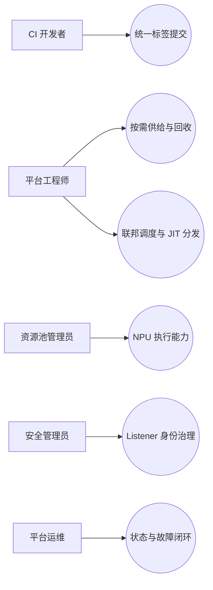
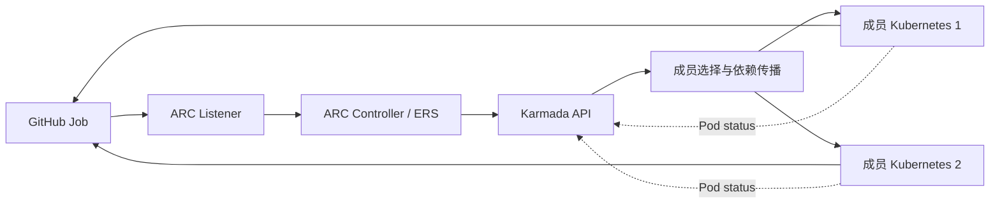
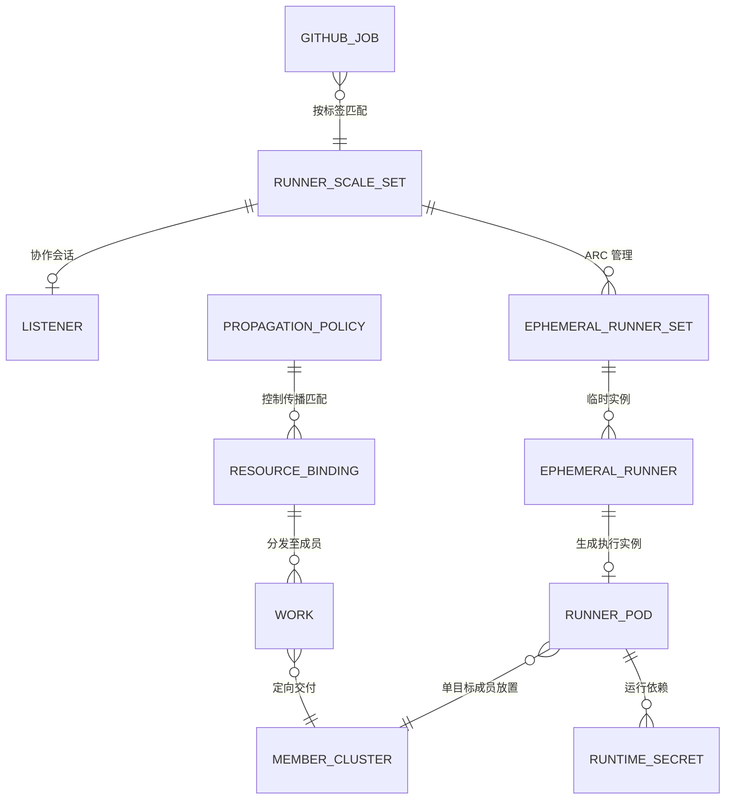

# 昇腾CI 联邦集群功能设计文档

> 文档标识：ASCEND-CI-FEDERATED-CLUSTER-FUNCTIONAL-DESIGN
> 状态：统一设计正文（基于现有资料整理；新增决定与待选参数显式标记）
> 目录依据：用户提供的功能域设计模板：第 1 章保留已有内容；第 2 章概述；第 3 章总体方案；第 4 章领域规格；第 5 章功能实现
> **设计证明依据：** 官方 ARC/GitHub Actions、Karmada、Kubernetes 技术文档及清晰的项目设计决策。**文档完成不要求 PoC、Kind、真实 Runner 或硬件实验**。

**阅读原则**：**U** = 上游文档明确支持的机制；**D** = 昇腾CI针对组件组合定义的集成设计决策；**P** = 实施/厂商选型待定的参数。当前仓库 Manifest 是参考实现，不等于上游产品承诺；“设计完成”也不等于“已部署运行”。

# 1 功能域背景与目的

## 1.1 目标与职责

将原先项目独占的多个执行集群纳入 Karmada，统一管理 GitHub Actions Runner 的创建、分发与回收。

| 职责 | 实现主体 | 边界 |
|---|---|---|
| 任务匹配与 Runner 生命周期 | ARC Listener、Controller、Scale Set | GitHub Actions 提供队列；ARC 调整 Runner 数量 |
| 资源对象传播与成员选择 | Karmada Policy、Scheduler、Binding / Execution Controller | 选择成员集群；不承担每个 Pod 的节点级调度 |
| 资源实际执行 | 成员 Kubernetes、kube-scheduler、kubelet | 创建 Runner Pod；可在 NPU 节点执行有设备请求的工作负载 |
| 状态与凭证适配 | ResourceInterpreterCustomization、Listener Token / RBAC、propagateDeps | 保留 ARC 所需的 Pod 状态和 JIT Secret |
| 设计契约与治理 | 本子系统接口适配、策略、身份与状态约束 | 由本项目负责架构决策；不代替上游内部实现 |

## 1.2 系统边界

**边界内：** ARC Controller、Listener、Runner Scale Set；Karmada 控制面；纳管的 Kubernetes 成员集群、Runner Pod 和目标 NPU 节点资源。

**边界外：** GitHub Actions 服务、业务项目、镜像仓库及现有企业级监控系统。

系统边界表示统一联邦执行的运行范围，组件可依据部署条件运行在不同 Kubernetes / 宿主环境。图示选择了“Controller 在独立管理环境、Listener 定向成员、Runner 由联邦分发”的**参考部署拓扑**，并非上游唯一合法部署形态。跨控制面访问需要独立的凭据与网络设计。

## 1.3 子系统目标

**现状：** 集群按项目固定分配。不同集群不能共享空闲资源。部分集群资源空闲，部分集群任务排队。热点项目等待时间较长。

**目标：** ARC 统一管理 Runner 需求。Karmada 将 Runner 分发至满足条件的成员集群。系统支持项目间共享合格成员的执行容量，以减少资源错配和可避免的排队等待。

**设计边界：** 该图为问题/目标示意，利用率及排队收益没有定量证明；本设计不承诺指定改善百分比。联邦策略负责成员选择，成员实际容量、资源兼容性和 NPU 驱动属于部署输入。

## 1.4 整体架构

本子系统包含 ARC、Karmada、成员 Kubernetes 集群及 Runner 执行环境。图中灰色外框表示子系统边界。边界外的系统通过以下接口交互。

| 外部子系统 | 方向 | 交互内容 |
|---|---|---|
| GitHub Actions | 输入 | 工作流任务、`runs-on` 标签、Runner 需求 |
| GitHub Actions | 输出 | Runner 注册、Job 执行状态和结果 |
| 配置与部署系统 | 输入 | Scale Set、PropagationPolicy、RBAC、组件版本 |
| 镜像仓库 | 输入 | Runner 镜像、Action 镜像 |
| 监控与审计系统 | 输出 | 运行日志、Kubernetes 事件、验证记录 |

**设计范围：** 图中以一个集中 ARC、一个 Karmada 控制面和两个成员作为可扩展的逻辑示例，不限定 Kind 或具体地区。NPU 设备插件是目标环境依赖，按选型纳入成员集群；不依赖 `karmada-search`。

## 1.5 关键约束

- Runner 工作流使用 `runs-on: karmada-runner`。标签对应一个已注册 Scale Set。
- Scale Set 版本标签与选定的官方 ARC Controller 版本保持一致；仓库当前 0.15.0 为配置示例。
- Listener 运行在成员集群，通过独立 Token、CA 和 DNS 配置访问 Karmada API。
- Runner Pod 的 JIT Secret 必须传播至同一执行成员；传播过程允许短暂异步等待。
- Karmada Pod 状态解释器保留 `containerStatuses[].name` 和 `conditions`。
- `Divided / Weighted` 针对单个资源对象执行。多个独立 Pod 不保证逐轮均匀分布。
- 成员 Kubernetes 负责节点调度。NPU 任务需额外核实节点标签、设备插件、资源请求和工作负载运行环境。

# 2 功能域概述

## 2.1 定位、使用者和边界

本功能域向 GitHub Actions 工作流提供统一的计算资源入口，将原先固定按项目使用的集群汇聚成受控联邦候选集。用户仅选择 Runner 服务标签，平台将 Job 需求转换为短生命周期 Runner，通过 Karmada 选择成员并在成员 Kubernetes 内执行。它不是替代 GitHub Job Queue、重写 ARC 生命周期控制器或重建 Karmada 调度器。

**业务参与者**：CI 开发者（提交 Job）、CI 平台工程师（定义 Scale Set 与策略）、资源池管理员（纳管成员与 NPU）、安全管理员（权限/凭证）、运维人员（升级/故障/审计）。外部系统包括 GitHub Actions、OCI 镜像仓库、已有身份/密钥系统、GitOps/部署面和观测系统。

## 2.2 功能清单与用例

| 功能 | 关键问题 | 对应 Story | 负责设计内容 |
|---|---|---|---|
| F-01 统一 Runner 服务入口 | 项目与执行集群解耦 | US-01 | runs-on / Scale Set 关联与无匹配行为 |
| F-02 Runner 弹性供给与回收 | 统一供给、避免各集群管理孤岛 | US-02、US-07 | ARC 生命周期与 Karmada 对象清理的协作 |
| F-03 联邦调度与依赖分发 | 在合格成员执行并携带 JIT | US-03、US-04 | Policy、placement、propagateDeps |
| F-04 Listener 跨控制面访问 | 在成员运行的 Listener 安全访问统一 API | US-05 | Endpoint/TLS/Token/RBAC |
| F-05 Runner 状态反馈 | 避免错误的未就绪判断 | US-06 | Pod.status / 状态解释与聚合 |
| F-06 NPU 执行资源适配 | 在兼容设备节点执行 | US-08 | Device Plugin/扩展资源/节点筛选 |

## 2.3 需求分析与追踪（IR → UC → SR → 功能）

> IR/UC/SR 为根据现有 US-01～US-08 **整理出的建议需求编号**，不是已批准的外部需求编号。后续有正式需求系统 ID 时应映射或替换，不能把这些编号视为原始来源。

| IR | 客户需求意图 | 用例 UC | 导出的 SR | 功能 |
|---|---|---|---|---|
| IR-01 | 统一 CI Runner 服务入口 | UC-01 标签提交、UC-02 无匹配 Runner | SR-01-01、SR-01-02 | F-01 |
| IR-02 | 集中供给并回收 Runner | UC-03 按需创建、UC-04 作业完成回收 | SR-02-01、SR-02-02 | F-02 |
| IR-03 | 跨成员使用异构计算资源 | UC-05 候选成员调度、UC-06 JIT 依赖晚到、UC-07 NPU 放置 | SR-03-01、SR-03-02、SR-06-01 | F-03 / F-06 |
| IR-04 | 跨控制面身份和状态正确性 | UC-08 Listener 鉴权、UC-09 Pod 状态回传 | SR-04-01、SR-05-01 | F-04 / F-05 |

**用例视图（概要）：**

## 2.4 系统功能需求 SR

| SR | 开发应实现的可观察行为 | 实现单元 | 用例 | 来源类型 |
|---|---|---|---|---|
| SR-01-01 | 统一 Runner 标签到 Scale Set 映射，业务工作流无需指定成员 | F-01 | UC-01 | U:ARC-1,ARC-2 |
| SR-01-02 | 无匹配 Scale Set 或认证异常时保持可观察错误或排队状态，不静默错误路由 | F-01 | UC-02 | D |
| SR-02-01 | 按任务需求通过 ARC 官方 CR 管理临时 Runner 实例和 Job 注册 | F-02 | UC-03 | U:ARC-1 |
| SR-02-02 | 执行结束后依据上游 Owner/Finalizer 回收临时 Runner、JIT 及联邦副本 | F-02 | UC-04 | D:ARC+Karmada |
| SR-03-01 | 将 Runner Pod 分发至符合 ClusterAffinity/资源约束的一个成员，不保证独立 Pod 逐轮均衡 | F-03 | UC-05 | U:KAR-1 |
| SR-03-02 | 将 Runner 引用的 JIT Secret 与 Pod 下发同一成员，并容忍异步晚到 | F-03 | UC-06 | U:KAR-2；D:依赖链 |
| SR-04-01 | Listener 使用控制面 endpoint、CA、受限身份操作 ERS；区分认证/授权/网络异常 | F-04 | UC-08 | U:K8S-1,K8S-2；D |
| SR-05-01 | 对单目标 Runner Pod 聚合完整 status，保留 containerStatuses 名称和 Ready Conditions | F-05 | UC-09 | U:KAR-3；D |
| SR-06-01 | NPU Runner 通过 Kubernetes Device Plugin 的扩展资源与节点约束分配到兼容成员 | F-06 | UC-07 | U:K8S-3；P:型号/资源名 |

**功能变更判断**：U 类优先复用官方机制；D 类是本项目的配置、身份、资源、状态适配；P 类需在实施配置/设备选型时落实。接口和异常规格集中在第 4 章定义；第 5 章对每个功能只描述该功能必须编写/声明的对象、调用与运行路径。

## 2.5 非目标、约束及使用体验

- 不提供自研 Job Queue；GitHub 仍负责 Job 匹配与结果。
- 不把 Weighted/Divided 自动解释成跨多个独立 Pod 的统计公平或逐轮均衡保证。
- 当前不自行开发 ARC、Karmada 和 Kubernetes 内部控制器；本系统聚焦对象配置与必要适配。
- 业务方通过 GitHub 原生 `runs-on` 选择服务，不要求在业务工作流中写成员集群 IP/名称。
- NPU 执行依赖选定厂商 Device Plugin/Runtime/资源名；功能设计可以完整，设备型号属于 P 类输入。

# 3 功能域总体方案

## 3.1 总体原则、设计模式与边界

1. **职责分离**：GitHub 负责队列，ARC 负责 Runner 期望量与短生命周期，Karmada 负责成员选择和对象传播，成员 Kubernetes 负责节点调度与设备资源分配。
2. **控制面与执行面分离**：Runner 管理请求汇入统一 API；Listener 和 Runner 可以部署于执行域，但其权限、连接地址和证书与目标 API 一致。
3. **最小权限与最小传播**：GitHub 主凭证以管理域为中心，JIT 凭证按具体引用传播至执行成员；Runner 默认不获取 Kubernetes 管控 API Token。
4. **最终一致与无重放假设**：跨组件 Pod/Secret/Binding 传播与清理都是异步流程；没有上游证明不得承诺原子传播、无损迁移或 Job exactly-once 重试。
5. **上游优先**：默认复用 ARC、Karmada、Kubernetes 的正式 API/控制器；本功能域仅增加集成策略、必要权限、状态解释及配置，不重复设计上游模块。

## 3.2 备选方案与最终选型

| 选型 | 结构 | 优点 | 主要代价与适用边界 |
|---|---|---|---|
| A：每成员独立 ARC | 每个集群有独立 Scale Set/Controller | 实施与故障域较独立 | 统一入口、跨资源池共享需要额外协调层；与“集中 Runner 生命周期”目标不完全一致 |
| B：ARC + Liqo | ARC 结合跨集群资源/网络抽象 | 某些网络和工作负载场景可复用 Liqo 能力 | 跨集群网络、资源抽象和运维依赖需独立设计；当前仓库不是该方案实现 |
| **C：ARC + Karmada（选择）** | ARC 管理期望量，Karmada 分发 Runner Pod | 复用 Karmada Policy、成员集群与执行面调度边界 | ARC 的控制面访问、状态回传、JIT 依赖、资源回收需要本项目显式约束 |

**方案选择依据（D）**：功能域主要是 Kubernetes 对象级跨集群分发，且不要求 Pod 间跨集群直连网络，因此以现有 Karmada 联邦能力承担成员选择和依赖传播。上述评价属于**本功能域的架构取舍**，不代表上游对 ARC+Karmada 组合做了兼容性认证。

## 3.3 端到端实现思路

需求方向为 GitHub → Listener → ARC → Karmada → 成员 Runner。反馈方向为 Runner → GitHub 和成员 Pod.status → Karmada → ARC。状态/依赖传播是两个上游控制器体系之间的**集成契约**，参见第 4 章。

## 3.4 功能域系统元素及逻辑架构

### 3.4.1 逻辑组件架构

本子系统要解决的核心问题是：**项目与执行集群绑定，导致集群间资源难以互用、负载不均衡及任务排队**。架构采用 **ARC 集中管理 Runner + Karmada 联邦分发 + 成员 Kubernetes 原生执行** 的协作模式；以下重点说明各构件对整体问题的贡献，而非展开上游组件的内部实现。

| 架构构件 | 主要解决的问题 / 架构职责 | 与其他构件的协作关系 |
|---|---|---|
| ARC Listener | **统一任务入口**：让开发者使用同一个 Runner 标签提交任务，不必为不同成员集群选择专用标签。 | 对接 GitHub Actions 的任务需求，与 ARC Controller 协同完成按需 Runner 供给。 |
| ARC Controller | **集中管理执行实例的生命周期**：使 Runner 的创建、扩缩与回收不再由每个执行集群各自管理。 | 承接 Listener 的需求变化，将 Runner 交给 Karmada 跨集群分发，并根据执行状态管理生命周期。 |
| Karmada（复用的联邦子系统） | **打通相互隔离的执行资源池**：将多个成员集群纳入同一分发范围，使一个项目的任务可以使用其他合格成员的执行资源。 | 接收 ARC 产生的 Runner 对象，将其分发至成员 Kubernetes，并把执行状态返回给 ARC；不取代成员的节点级调度。 |
| 成员 Kubernetes 与 Runner Pod | **提供实际、相互隔离的任务执行能力**：让集中管理的 Runner 在选中的成员集群使用当地计算资源执行 GitHub Job。 | 接收 Karmada 下发的 Runner 工作负载，使用成员原生调度与网络执行任务，并向控制面反馈状态。 |
| ARC–Karmada 集成适配（本系统设计） | **消除两套上游系统之间的语义与环境差异**：保障跨控制面访问、临时注册凭证可用、Runner 就绪状态可被正确识别。 | 在 ARC、Karmada 与成员 Kubernetes 之间补齐通信鉴权、依赖传播和状态聚合约束，使上述管理、分发、执行链路闭环。 |

**范围与边界：** GitHub Actions 是外部任务来源；ARC、Karmada 与 Kubernetes 是复用组件。`karmada-search` 不在本方案逻辑图中；NPU 设备插件属于成员环境依赖，不应误画为自研核心模块。跨成员执行是设计能力，不据此承诺均匀分配或固定排队收益。

部署关系见 3.6；资源、状态与接口契约见 3.5、4.4～4.6 和第 5 章。

### 3.4.2 与周边系统元素的关系

| 周边元素 | 职责关系 | 进入/输出的实体 | 约束 |
|---|---|---|---|
| GitHub Actions | 外部任务入口与运行结果接收方 | Job 需求、Runner 注册、运行状态 | 入口标签、GitHub 身份与 JIT |
| 镜像仓库 | 提供 Controller/Runner/Action 镜像 | OCI Image | 可信源、平台架构、版本/digest |
| 密钥系统 | 供给和轮换 GitHub 主凭证、控制面身份 | Credential/CA/Token | 不在仓库明文保存、最小授权 |
| 部署与配置管理 | 安装官方组件及本项目 CRD/Policy | Chart/Manifest/配置参数 | 声明式、回滚与版本兼容 |
| 观测/审计系统 | 关联一次 Job 与执行实例 | Job/ER/Pod/Binding/Work 标识、事件与日志 | 不收集 Secret Data |

## 3.5 领域数据模型和归属

图为**领域概念关系**，不等于原生 Kubernetes OwnerReference；动态资源真实归属由所选 ARC/Karmada 版本定义。以下表格是实现和销毁规格：

| 领域对象 | 权威生产者 | 主要关联/消费者 | 寿命分类 | 处置与销毁要求 |
|---|---|---|---|---|
| GitHub Job | GitHub Actions | 任务来源；不是 Kubernetes API 对象 | 单次/外部保留 | 任务队列、运行状态 |
| AutoscalingRunnerSet | 平台声明；ARC 管理 | Runner 服务及 GitHub 认证入口 | 长期 | ScaleSetName、GitHubConfigSecret、RunnerTemplate |
| AutoscalingListener / Listener Pod | ARC 生成 | 侦听任务需求并调整 ERS | 随 Scale Set | Token、CA、管理控制面 API |
| EphemeralRunnerSet / EphemeralRunner | ARC 生成 | 需求副本/单 Runner 实例生命周期 | 临时 | OwnerReference、状态、Finalizer |
| Runner Pod | ARC 生成 / Karmada 传播 | 成员的实际 Job 执行对象 | 临时 | SA、镜像、JIT Secret 引用、status |
| JIT Secret | ARC 动态生成 | 一次性 Runner 注册凭证 | 临时敏感 | 仅传目标执行成员；作业后回收 |
| 主 GitHub Secret | 平台密钥系统提供 | ARC 管理链路授权 | 受控敏感 | 目标设计不向无消费者成员扩散 |
| PropagationPolicy | 平台声明 / Karmada 消费 | 成员选择、匹配范围、依赖传播 | 长期配置 | ResourceSelectors、Placement、propagateDeps |
| ResourceBinding / Work | Karmada 生成 | 联邦调度与成员期望资源载体 | 随 Pod/策略 | 控制面到执行面的对象关系 |
| Pod.status | 成员 Kubernetes 产生 | 供 ARC 判断 Runner 状态 | 随 Pod | containerStatuses、conditions、Phase |
| MemberCluster / NPU 资源 | Karmada + 成员 K8s / Device Plugin | 集群资格、节点扩展资源 | 长期运行时 | Ready、labels、allocatable、扩展资源 |

**数据分级与销毁（D）**：GitHub PAT/App 凭证、Listener Token、JIT Secret 属敏感数据，禁止在日志、Git、工单附件输出值；运行时对象删除由 ARC/Karmada 所有权规则驱动，审计只保留非敏感 ID/状态。Job 日志、镜像与第三方系统持久数据的保留/销毁服从各自系统策略，**不因 Pod 删除自动消失**。证书/Token 轮换同时考虑控制面存储、成员副本和日志暴露面。销毁保留期/合规等级若需精确数值，由企业数据分类制度提供（P），不虚构默认周期。

## 3.6 部署拓扑与周边服务

| 部署域 | 构件 | 运行接口 | 设计约束 |
|---|---|---|---|
| ARC 管理域 | 官方 ARC Controller | GitHub API、统一 Karmada API | 可以是管理 Kubernetes/容器部署；不要求在每个成员单独部署 |
| Karmada 控制面 | API、Policy/Scheduler、状态解释扩展 | 多成员 Kubernetes API | API、证书、网络、成员资格、可用性由部署管理提供 |
| Listener 成员域 | Listener Pod、独立控制面身份 | GitHub Actions、Karmada HTTPS API | 示例固定在 member1；目标成员是可配置的 Placement |
| Runner 执行域 | Runner Pod、JIT Secret、Runner SA、可选 NPU 资源 | GitHub Actions、成员 kubelet/Runtime | 只允许在满足资源、镜像和安全约束的成员运行 |
| 平台外 | 镜像仓库、身份/密钥服务、运维/观测 | 拉取、认证、日志/指标 | 不要求跨成员 Pod 网络直连 |

**配置输入清单（P）**：`runnerScaleSetName` / `runs-on`、GitHub URL、Runner 镜像/digest、控制面 API DNS/IP/port/SAN、CA、Token audience/TTL、目标成员集合、调度权重、Namespace、NPU 资源名、节点标签、业务 SLO。当前 Manifest 的 `karmada-runner`、`member1/member2`、`172.22.0.4:32443` 是示例值，后两者不应硬编码到通用部署工具。

### 3.6.1 安装与声明依赖次序

1. 提供 Karmada API、可达的成员 K8s API 和所需 ARC 版本 CRD；目标成员达到可参与传播的状态。
2. 准备命名空间、控制面身份/证书、Runner SA 与 GitHub 管理凭证。
3. 安装状态解释器、角色/绑定和传播策略，再声明 AutoscalingRunnerSet；保证 Listener 访问的是正确控制面。
4. 安装官方 ARC Controller 并由其调谐动态对象。组件顺序、重试和升级回滚在部署计划中实现，不在功能设计中复刻具体 Shell 命令。

## 3.7 上游官方资料及推导边界

| ID | 上游组件资料 | 本设计引用的能力 |
|---|---|---|
| ARC-1 | [GitHub：Actions Runner Controller](https://docs.github.com/en/actions/concepts/runners/actions-runner-controller) | Runner Scale Set、Listener、EphemeralRunner、JIT、生命周期 |
| ARC-2 | [GitHub：部署 Runner Scale Sets](https://docs.github.com/en/actions/how-tos/manage-runners/use-actions-runner-controller/deploy-runner-scale-sets) | Scale Set 部署配置、GitHub 凭证、Runner 模板 |
| KAR-1 | [Karmada：PropagationPolicy](https://karmada.io/docs/next/userguide/scheduling/propagation-policy/) | 资源选择器、成员放置、分副本/加权策略 |
| KAR-2 | [Karmada：Propagate dependencies](https://karmada.io/docs/userguide/scheduling/propagate-dependencies/) | 对象引用的 Secret/ConfigMap 依赖传播 |
| KAR-3 | [Karmada：Customizing Resource Interpreter](https://karmada.io/docs/userguide/globalview/customizing-resource-interpreter/) | ResourceInterpreterCustomization、AggregateStatus |
| K8S-1 | [Kubernetes：Service Accounts](https://kubernetes.io/docs/concepts/security/service-accounts/) | TokenRequest、SA 身份与 Token 生命周期 |
| K8S-2 | [Kubernetes：RBAC Good Practices](https://kubernetes.io/docs/concepts/security/rbac-good-practices/) | 角色权限及最小权限原则 |
| K8S-3 | [Kubernetes：Device Plugins](https://kubernetes.io/docs/concepts/extend-kubernetes/compute-storage-net/device-plugins/) | Device Plugin 扩展资源与节点分配 |

**使用边界**：官方文档分别证明 ARC 与 Karmada 等组件的原生能力；**并不证明两者组合的端到端兼容性**。所有跨组件行为应在第 4～5 章以 D 类设计契约表达；性能百分比、Token 自动轮换、多副本 status 和无损故障切换不得当作已有保证。

