# 昇腾CI 联邦集群功能设计文档

> 文档标识：ASCEND-CI-FEDERATED-CLUSTER-FUNCTIONAL-DESIGN
> 状态：统一设计正文（基于现有资料整理；新增决定与待选参数显式标记）
> 目录依据：用户提供的功能域设计模板：第 1 章保留已有内容；第 2 章概述；第 3 章总体方案；第 4 章领域规格；第 5 章功能实现
> **设计证明依据：** 官方 ARC/GitHub Actions、Karmada、Kubernetes 技术文档及清晰的项目设计决策。**文档完成不要求 PoC、Kind、真实 Runner 或硬件实验**。

**阅读原则**：**U** = 上游文档明确支持的机制；**D** = 昇腾CI针对组件组合定义的集成设计决策；**P** = 实施/厂商选型待定的参数。当前仓库 Manifest 是参考实现，不等于上游产品承诺；“设计完成”也不等于“已部署运行”。

# 1 功能域背景与目的

## 1.1 目标与职责

将项目独占集群纳入 Karmada，统一管理 Runner 供给、分发和回收。

| 职责 | 实现主体 | 边界 |
|---|---|---|
| 任务匹配与 Runner 生命周期 | ARC Listener、Controller、Scale Set | GitHub Actions 提供队列；ARC 调整 Runner 数量 |
| 资源对象传播与成员选择 | Karmada Policy、Scheduler、Binding / Execution Controller | 选择成员集群；不承担每个 Pod 的节点级调度 |
| 资源实际执行 | 成员 Kubernetes、kube-scheduler、kubelet | 创建 Runner Pod；可在 NPU 节点执行有设备请求的工作负载 |
| 状态与凭证适配 | ResourceInterpreterCustomization、Listener Token / RBAC、propagateDeps | 保留 ARC 所需的 Pod 状态和 JIT Secret |
| 设计契约与治理 | 本子系统接口适配、策略、身份与状态约束 | 由本项目负责架构决策；不代替上游内部实现 |

## 1.2 边界

**边界内：** ARC Controller、Listener、Runner Scale Set；Karmada 控制面；纳管的 Kubernetes 成员集群、Runner Pod 和目标 NPU 节点资源。

**边界外：** GitHub Actions 服务、业务项目、镜像仓库及现有企业级监控系统。

图示为参考拓扑：Controller 独立部署，Listener 定向成员，Runner 联邦分发。组件位置可调整；跨控制面访问仍需独立凭证和网络配置。

## 1.3 目标

**现状：** 集群按项目独占，空闲容量无法共享，任务排队。

**目标：** ARC 统一供给 Runner，Karmada 选择成员；共享合格容量，减少资源错配和等待。

**边界：** 图为目标示意，不承诺利用率或排队收益；容量、兼容性和 NPU 驱动由部署提供。

## 1.4 整体架构

包含 ARC、Karmada、成员 Kubernetes 和 Runner。灰框为边界；外部接口如下。

| 外部子系统 | 方向 | 交互内容 |
|---|---|---|
| GitHub Actions | 输入 | 工作流任务、`runs-on` 标签、Runner 需求 |
| GitHub Actions | 输出 | Runner 注册、Job 执行状态和结果 |
| 配置与部署系统 | 输入 | Scale Set、PropagationPolicy、RBAC、组件版本 |
| 镜像仓库 | 输入 | Runner 镜像、Action 镜像 |
| 监控与审计系统 | 输出 | 运行日志、Kubernetes 事件、验证记录 |

**范围：** 一套 ARC、一套 Karmada、两个成员仅为示例；不限定地域或 Kind。NPU 插件按设备选型提供，不依赖 `karmada-search`。

## 1.5 关键约束

- Runner 工作流使用 `runs-on: karmada-runner`。标签对应一个已注册 Scale Set。
- Scale Set 版本标签与选定的官方 ARC Controller 版本保持一致；仓库当前 0.15.0 为配置示例。
- Listener 运行在成员集群，通过独立 Token、CA 和 DNS 配置访问 Karmada API。
- Runner Pod 的 JIT Secret 必须传播至同一执行成员；传播过程允许短暂异步等待。
- Karmada Pod 状态解释器保留 `containerStatuses[].name` 和 `conditions`。
- `Divided / Weighted` 针对单个资源对象执行。多个独立 Pod 不保证逐轮均匀分布。
- 成员 Kubernetes 负责节点调度。NPU 任务需额外核实节点标签、设备插件、资源请求和工作负载运行环境。

# 2 功能域概述

## 2.1 定位、使用者和边界

开发者仅选 Runner 服务；ARC 按需供给 Runner，Karmada 选择执行成员。复用 GitHub 队列、ARC 生命周期和 Karmada 调度，不重新实现。

**参与者**：开发者、平台工程师、资源池管理员、安全管理员、运维人员。**外部依赖**：GitHub Actions、镜像仓库、密钥服务、部署与观测平台。

## 2.2 核心特性

目标：**统一 Runner 服务，跨成员共享资源；执行成员由平台选定。**

**FT-01 统一入口与资源共享。** 开发者只选 Runner 服务，不指定成员。作业可使用授权成员的空闲容量。

**FT-02 可控成员放置。** 平台配置候选成员，Karmada 选择执行成员，成员 Kubernetes 选择节点。工作流标签不变。

**FT-03 跨控制面执行。** 保障 Listener 访问、临时凭证下发和状态反馈；未就绪 Runner 不得接收作业。

**FT-04 临时资源回收。** 按作业需求创建 Runner，作业结束后回收临时资源。

**执行链路：统一入口 → 成员选择 → 跨集群执行与状态反馈 → 资源回收。**

NPU 专项适配为后续扩展，不单列核心特性。

## 2.3 需求与用例追踪

依据第 1.3 节的问题和第 3.2 节的选型提取需求。IR、UC、SR 为设计编号，尚非业务方批准的外部需求编号。

| 需求意图 | 核心场景 | SR | 特性与功能 |
|---|---|---|---|
| IR-01 跨成员资源共享 | UC-01 统一提交；UC-03 按需供给 | SR-01-01、SR-02-01 | FT-01；F-01、F-02 |
| IR-02 可控成员放置 | UC-05 成员选择；UC-10 无合格成员 | SR-03-01 | FT-02；F-03 |
| IR-03 跨控制面执行 | UC-06 凭证未就绪；UC-08 访问控制；UC-09 状态反馈 | SR-03-02、SR-04-01、SR-05-01 | FT-03；F-03～F-05 |
| IR-04 临时资源回收 | UC-04 作业结束；UC-12 状态或清理异常 | SR-02-02 | FT-04；F-02、F-03、F-05 |

**用例概览：**

> 图示角色与用例关系，不代表执行顺序。NPU 属后续扩展；Pod、Secret 与状态处理见第 5 章。

## 2.4 需求 SR

只规定联邦调度的**场景、行为、验收条件**。实现字段与控制器交互见第 4、5 章。中文表述借鉴 [ASD-STE100](https://www.asd-ste100.org/about_STE.html) 的术语一致和避免歧义原则，不声称符合该英语标准。

### 2.4.1 功能需求

| SR | 场景 | 必须满足的行为 | 判定方法 | 来源与现状 |
|---|---|---|---|---|
| **SR-01-01** | 开发者通过统一 Runner 服务提交作业。 | 作业可在授权成员执行，无需指定集群。 | 工作流不含成员信息；作业在允许的成员运行。 | FT-01；统一标签已配置 |
| **SR-02-01** | 有待执行作业，且未达容量上限。 | 按需创建临时 Runner，在选定成员执行。 | Runner 数量随需求变化；执行成员符合策略。 | FT-01/FT-04；复用 ARC |
| **SR-03-01** | Runner 服务可使用多个成员。 | 按平台策略选择成员，不得使用被禁止的成员；无需修改工作流。 | 变更候选集后，新 Runner 只在允许的成员运行。 | FT-02；已配置成员范围，未实现复杂容量调度 |
| **SR-03-02** | 执行成员已选定，注册信息尚未就绪。 | 注册信息可用后才能将 Runner 判为可执行。 | 凭证缺失时保持未就绪或报告启动错误。 | FT-03；依赖上游传播 |
| **SR-04-01** | 成员中的 Listener 访问统一控制面。 | 凭有效身份处理所属任务；连接或授权失败不得报成功。 | 可正常更新所属 Runner 服务；错误类别可区分。 | FT-03；已配置 Token/CA/RBAC，轮换未实现 |
| **SR-05-01** | 成员 Runner 启动、就绪或异常。 | 将真实状态反馈到管理面；未就绪不得判为就绪。 | 管理面与成员状态一致，保留关键状态字段。 | FT-03；单成员状态解释 |
| **SR-02-02** | 作业结束。 | 回收临时执行资源；失败时保留残留对象及错误。 | 资源进入回收流程；可定位异常残留。 | FT-04；复用 ARC/Karmada |

原 SR-01-02 属 GitHub 原生匹配异常；原 SR-06-01 属 NPU 扩展设计，均不列为当前核心 SR。

### 2.4.2 非功能需求

| SR | 属性 | 要求 | 判定方法 | 实现边界 |
|---|---|---|---|---|
| **SR-NF-01** | 跨控制面访问安全 | 拒绝未授权访问；不得关闭 TLS 校验。 | 验证授权、未授权身份及证书校验。 | 受限 RBAC/CA 已配置；Controller 权限待收敛 |
| **SR-NF-02** | 跨成员凭证隔离 | 长期 GitHub 管理凭证只提供给实际消费者；临时凭证只供执行成员使用。 | 核对凭证消费者和传播范围。 | **目标未满足**：当前向两个成员分发管理凭证 |
| **SR-NF-03** | 成员故障边界 | 不可用成员的未就绪 Runner 不得作为可执行资源；不承诺运行中 Job 无损迁移。 | 检查成员失联后的 Runner 状态。 | 尚无自动故障迁移依据 |
| **SR-NF-04** | 跨集群问题定位 | 可关联 Job、Runner、执行成员及传播、注册、状态异常。 | 根据 Job 标识查找成员与故障阶段。 | 已有检查脚本，暂无统一查询入口 |
| **SR-NF-05** | 容量与排队性能 | 不得突破 Runner 容量上限；记录排队、Runner 准备耗时。 | 核对并发数和时间指标。 | 已设 min=0/max=5；时延目标待定 |
| **SR-NF-06** | 资源使用与成本 | 无待执行作业且允许零空闲时，应能回收 Runner；成员无需各部署 ARC Controller。 | 检查缩至零和成员部署方式。 | 能力依赖配置和上游；节约目标待定 |
| **SR-NF-08** | 放置策略可维护性 | 可调整候选成员，不要求开发者修改 Runner 服务名称。 | 修改并恢复策略，核对后续执行成员。 | 策略可配置，未开发管理 UI |

### 2.4.3 待定指标

| 参数 | 指标 | 待确认内容 | 状态 |
|---|---|---|---|
| P-SR-01 | Runner 准备耗时 | 起止事件、窗口、分位数、阈值 | 未确定 |
| P-SR-02 | Job 排队时间 | GitHub 等待是否计入、样本、分位数、阈值 | 未确定 |
| P-SR-03 | 成员故障后的新作业执行 | 备用成员条件、故障检测、恢复目标；不含运行中 Job 迁移 | 未确定 |
| P-SR-04 | 资源利用率与成本 | 负载、共享前基线、计量方法、目标值 | 未确定 |

未批准的指标不得作为验收目标；不承诺未经验证的收益。

### 2.4.4 特性与设计追踪

| 特性 | 功能 SR | 非功能 SR | 设计单元 |
|---|---|---|---|
| FT-01 统一入口与共享 | SR-01-01、SR-02-01 | SR-NF-05、SR-NF-06 | F-01～F-03 |
| FT-02 可控成员放置 | SR-03-01 | SR-NF-03、SR-NF-08 | F-03 |
| FT-03 跨控制面执行 | SR-03-02、SR-04-01、SR-05-01 | SR-NF-01、SR-NF-02、SR-NF-04 | F-03～F-05 |
| FT-04 临时资源回收 | SR-02-02 | SR-NF-04、SR-NF-06 | F-02、F-03、F-05 |

**范围**：Manifest 证明现有配置；上游定义组件行为；未实现的目标要求仍须实施，不能标为已交付。

## 2.5 非目标

- 不重建 GitHub Job 匹配、排队和结果存储；UC-02 仍保留异常说明。
- ARC/Karmada 内部实现见第 4、5 章，不另列核心 SR。
- NPU 设备适配保留为 F-06/US-08 扩展，当前未实现。
- 不承诺运行中 Job 无损迁移或独立 Runner 逐轮均衡分配。
- 企业级可用性、通用升级、成本预算和监控产品选型不另列核心 SR。
- 只修订设计，不变更 Manifest；文档完成不要求 PoC。

# 3 功能域总体方案

## 3.1 设计原则

1. **职责分离**：GitHub 负责队列，ARC 负责 Runner 期望量与短生命周期，Karmada 负责成员选择和对象传播，成员 Kubernetes 负责节点调度与设备资源分配。
2. **控制面与执行面分离**：Runner 管理请求汇入统一 API；Listener 和 Runner 可以部署于执行域，但其权限、连接地址和证书与目标 API 一致。
3. **最小权限与最小传播**：GitHub 主凭证以管理域为中心，JIT 凭证按具体引用传播至执行成员；Runner 默认不获取 Kubernetes 管控 API Token。
4. **最终一致与无重放假设**：跨组件 Pod/Secret/Binding 传播与清理都是异步流程；没有上游证明不得承诺原子传播、无损迁移或 Job exactly-once 重试。
5. **上游优先**：默认复用 ARC、Karmada、Kubernetes 的正式 API/控制器；本功能域仅增加集成策略、必要权限、状态解释及配置，不重复设计上游模块。

## 3.2 备选方案与最终选型

| 选型 | 方案结构 | 主要优点 | 主要限制 |
|---|---|---|---|
| A：各成员独立 ARC | 各集群部署 Controller 和 Scale Set；同名 Scale Set 分属不同 Runner Group。 | 独立管理和故障隔离。 | **跨 Scale Set 的 Job 分配由 GitHub 决定，平台无法定制调度策略**；同名 Scale Set 之间存在不可配置的 `assignment race`，无法按成员容量、NPU、地域或优先级决定分配。 |
| B：ARC + Liqo | ARC 结合 Liqo 跨集群资源和网络能力。 | 复用资源与网络抽象。 | 需额外设计跨集群网络和资源映射；非当前实现。 |
| **C：ARC + Karmada（选定）** | 统一 Scale Set 接收需求；ARC 供给 Runner，Karmada 分发 Pod。 | **平台控制候选成员和放置约束。** | 需适配身份、JIT Secret、Pod 状态及回收；不保证多个独立 Pod 按固定比例分配。 |

### 3.2.1 调度职责

作业分配与 Runner Pod 放置是两级决策：

1. **GitHub：** 按 `runs-on`、Runner Group 和注册信息分配 Job。方案 A 的跨 Scale Set 选择不可定制。
2. **ARC：** Listener 接收任务需求，调整 `EphemeralRunnerSet` 期望数量；`minRunners` / `maxRunners` 控制容量，**不决定跨 Scale Set 的任务分配**。
3. **Karmada：** 按 `PropagationPolicy` 选择 Runner Pod 的执行成员；成员 Kubernetes 选择节点。平台控制 **Pod 放置**，不控制 GitHub 的 Job 分配。

**结论（D）：选 C。** Karmada 策略由平台控制成员放置；方案 A 的跨 Scale Set Job 分配由 GitHub 决定，平台不可定制。

**上游依据**：

- [GitHub 官方：部署 Runner Scale Sets — High availability and automatic failover](https://docs.github.com/en/actions/how-tos/manage-runners/use-actions-runner-controller/deploy-runner-scale-sets#high-availability-and-automatic-failover)：说明多个独立集群可以在不同 Runner Group 使用同名 Scale Set；多个 Scale Set 同时在线时，分配可能由竞争决定，且不能配置作业分配算法。
- [GitHub 官方：ARC 工作原理](https://docs.github.com/en/actions/concepts/runners/actions-runner-controller)：说明 GitHub Actions 服务进行作业匹配，ARC Listener 接收 `Job Available` 消息后按需求调整 Runner 数量。
- [ARC 源码：`cmd/ghalistener/scaler/scaler.go`](https://github.com/actions/actions-runner-controller/blob/master/cmd/ghalistener/scaler/scaler.go)：`Scale` 处理收到的作业消息与 `TotalAssignedJobs`，后续更新当前 `EphemeralRunnerSet` 的目标 Runner 数量。这里没有跨独立 Scale Set 的成员选择算法。
- [Karmada 官方：PropagationPolicy](https://karmada.io/docs/next/userguide/scheduling/propagation-policy/)：说明通过传播策略选择成员集群。本方案根据这些机制制定跨集群 Runner Pod 放置规则，**不把 ARC 与 Karmada 的组合描述成上游已认证的整体方案**。

## 3.3 端到端实现思路

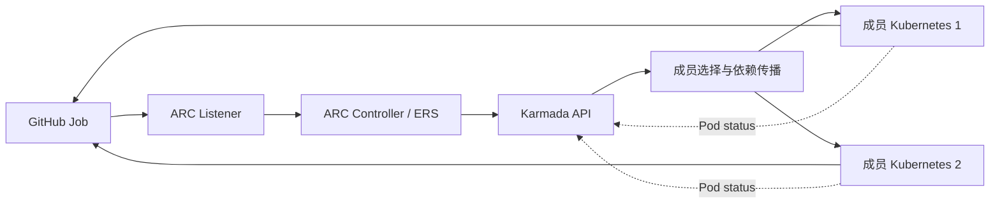

请求：GitHub → Listener → ARC → Karmada → 成员 Runner；反馈：Runner → GitHub，Pod.status → Karmada → ARC。状态与依赖契约见第 4 章。

## 3.4 组件与逻辑架构

### 3.4.1 逻辑架构

**问题：** 项目与集群绑定，空闲容量难共享、任务排队。**方案：** ARC 统一供给，Karmada 分发，成员 Kubernetes 执行。

| 架构构件 | 主要解决的问题 / 架构职责 | 与其他构件的协作关系 |
|---|---|---|
| ARC Listener | **统一任务入口**：让开发者使用同一个 Runner 标签提交任务，不必为不同成员集群选择专用标签。 | 对接 GitHub Actions 的任务需求，与 ARC Controller 协同完成按需 Runner 供给。 |
| ARC Controller | **集中管理执行实例的生命周期**：使 Runner 的创建、扩缩与回收不再由每个执行集群各自管理。 | 承接 Listener 的需求变化，将 Runner 交给 Karmada 跨集群分发，并根据执行状态管理生命周期。 |
| Karmada（复用的联邦子系统） | **打通相互隔离的执行资源池**：将多个成员集群纳入同一分发范围，使一个项目的任务可以使用其他合格成员的执行资源。 | 接收 ARC 产生的 Runner 对象，将其分发至成员 Kubernetes，并把执行状态返回给 ARC；不取代成员的节点级调度。 |
| 成员 Kubernetes 与 Runner Pod | **提供实际、相互隔离的任务执行能力**：让集中管理的 Runner 在选中的成员集群使用当地计算资源执行 GitHub Job。 | 接收 Karmada 下发的 Runner 工作负载，使用成员原生调度与网络执行任务，并向控制面反馈状态。 |
| ARC–Karmada 集成适配（本系统设计） | **消除两套上游系统之间的语义与环境差异**：保障跨控制面访问、临时注册凭证可用、Runner 就绪状态可被正确识别。 | 在 ARC、Karmada 与成员 Kubernetes 之间补齐通信鉴权、依赖传播和状态聚合约束，使上述管理、分发、执行链路闭环。 |

**边界：** GitHub 提供任务；ARC/Karmada/Kubernetes 为复用组件。`karmada-search` 不在范围内，NPU 插件属成员依赖。不承诺均匀分配或固定收益。

部署关系见 3.6；资源、状态与接口契约见 3.5、4.4～4.6 和第 5 章。

### 3.4.2 周边依赖

| 周边元素 | 职责关系 | 进入/输出的实体 | 约束 |
|---|---|---|---|
| GitHub Actions | 外部任务入口与运行结果接收方 | Job 需求、Runner 注册、运行状态 | 入口标签、GitHub 身份与 JIT |
| 镜像仓库 | 提供 Controller/Runner/Action 镜像 | OCI Image | 可信源、平台架构、版本/digest |
| 密钥系统 | 供给和轮换 GitHub 主凭证、控制面身份 | Credential/CA/Token | 不在仓库明文保存、最小授权 |
| 部署与配置管理 | 安装官方组件及本项目 CRD/Policy | Chart/Manifest/配置参数 | 声明式、回滚与版本兼容 |
| 观测/审计系统 | 关联一次 Job 与执行实例 | Job/ER/Pod/Binding/Work 标识、事件与日志 | 不收集 Secret Data |

## 3.5 领域数据模型和归属

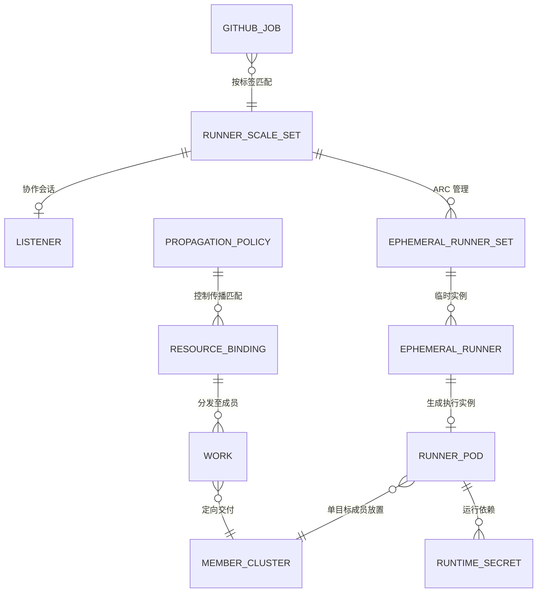

图为**领域概念关系**，不等于原生 Kubernetes OwnerReference；动态资源真实归属由所选 ARC/Karmada 版本定义。以下表格是实现和销毁规格：

| 领域对象 | 权威生产者 | 主要关联/消费者 | 寿命分类 | 处置与销毁要求 |
|---|---|---|---|---|
| GitHub Job | GitHub Actions | 任务来源；不是 Kubernetes API 对象 | 单次/外部保留 | 任务队列、运行状态 |
| AutoscalingRunnerSet | 平台声明；ARC 管理 | Runner 服务及 GitHub 认证入口 | 长期 | ScaleSetName、GitHubConfigSecret、RunnerTemplate |
| AutoscalingListener / Listener Pod | ARC 生成 | 侦听任务需求并调整 ERS | 随 Scale Set | Token、CA、管理控制面 API |
| EphemeralRunnerSet / EphemeralRunner | ARC 生成 | 需求副本/单 Runner 实例生命周期 | 临时 | OwnerReference、状态、Finalizer |
| Runner Pod | ARC 生成 / Karmada 传播 | 成员的实际 Job 执行对象 | 临时 | SA、镜像、JIT Secret 引用、status |
| JIT Secret | ARC 动态生成 | 一次性 Runner 注册凭证 | 临时敏感 | 仅传目标执行成员；作业后回收 |
| 主 GitHub Secret | 平台密钥系统提供 | ARC 管理链路授权 | 受控敏感 | 目标设计不向无消费者成员扩散 |
| PropagationPolicy | 平台声明 / Karmada 消费 | 成员选择、匹配范围、依赖传播 | 长期配置 | ResourceSelectors、Placement、propagateDeps |
| ResourceBinding / Work | Karmada 生成 | 联邦调度与成员期望资源载体 | 随 Pod/策略 | 控制面到执行面的对象关系 |
| Pod.status | 成员 Kubernetes 产生 | 供 ARC 判断 Runner 状态 | 随 Pod | containerStatuses、conditions、Phase |
| MemberCluster / NPU 资源 | Karmada + 成员 K8s / Device Plugin | 集群资格、节点扩展资源 | 长期运行时 | Ready、labels、allocatable、扩展资源 |

**数据分级与销毁（D）**：GitHub PAT/App 凭证、Listener Token、JIT Secret 属敏感数据，禁止在日志、Git、工单附件输出值；运行时对象删除由 ARC/Karmada 所有权规则驱动，审计只保留非敏感 ID/状态。Job 日志、镜像与第三方系统持久数据的保留/销毁服从各自系统策略，**不因 Pod 删除自动消失**。证书/Token 轮换同时考虑控制面存储、成员副本和日志暴露面。销毁保留期/合规等级若需精确数值，由企业数据分类制度提供（P），不虚构默认周期。

## 3.6 部署拓扑与周边服务

| 部署域 | 构件 | 运行接口 | 设计约束 |
|---|---|---|---|
| ARC 管理域 | 官方 ARC Controller | GitHub API、统一 Karmada API | 可以是管理 Kubernetes/容器部署；不要求在每个成员单独部署 |
| Karmada 控制面 | API、Policy/Scheduler、状态解释扩展 | 多成员 Kubernetes API | API、证书、网络、成员资格、可用性由部署管理提供 |
| Listener 成员域 | Listener Pod、独立控制面身份 | GitHub Actions、Karmada HTTPS API | 示例固定在 member1；目标成员是可配置的 Placement |
| Runner 执行域 | Runner Pod、JIT Secret、Runner SA、可选 NPU 资源 | GitHub Actions、成员 kubelet/Runtime | 只允许在满足资源、镜像和安全约束的成员运行 |
| 平台外 | 镜像仓库、身份/密钥服务、运维/观测 | 拉取、认证、日志/指标 | 不要求跨成员 Pod 网络直连 |

**配置输入清单（P）**：`runnerScaleSetName` / `runs-on`、GitHub URL、Runner 镜像/digest、控制面 API DNS/IP/port/SAN、CA、Token audience/TTL、目标成员集合、调度权重、Namespace、NPU 资源名、节点标签、业务 SLO。当前 Manifest 的 `karmada-runner`、`member1/member2`、`172.22.0.4:32443` 是示例值，后两者不应硬编码到通用部署工具。

### 3.6.1 安装与声明依赖次序

1. 提供 Karmada API、可达的成员 K8s API 和所需 ARC 版本 CRD；目标成员达到可参与传播的状态。
2. 准备命名空间、控制面身份/证书、Runner SA 与 GitHub 管理凭证。
3. 安装状态解释器、角色/绑定和传播策略，再声明 AutoscalingRunnerSet；保证 Listener 访问的是正确控制面。
4. 安装官方 ARC Controller 并由其调谐动态对象。组件顺序、重试和升级回滚在部署计划中实现，不在功能设计中复刻具体 Shell 命令。

## 3.7 官方依据与边界

| ID | 上游组件资料 | 本设计引用的能力 |
|---|---|---|
| ARC-1 | [GitHub：Actions Runner Controller](https://docs.github.com/en/actions/concepts/runners/actions-runner-controller) | Runner Scale Set、Listener、EphemeralRunner、JIT、生命周期 |
| ARC-2 | [GitHub：部署 Runner Scale Sets](https://docs.github.com/en/actions/how-tos/manage-runners/use-actions-runner-controller/deploy-runner-scale-sets) | Scale Set 部署配置、GitHub 凭证、Runner 模板 |
| KAR-1 | [Karmada：PropagationPolicy](https://karmada.io/docs/next/userguide/scheduling/propagation-policy/) | 资源选择器、成员放置、分副本/加权策略 |
| KAR-2 | [Karmada：Propagate dependencies](https://karmada.io/docs/userguide/scheduling/propagate-dependencies/) | 对象引用的 Secret/ConfigMap 依赖传播 |
| KAR-3 | [Karmada：Customizing Resource Interpreter](https://karmada.io/docs/userguide/globalview/customizing-resource-interpreter/) | ResourceInterpreterCustomization、AggregateStatus |
| K8S-1 | [Kubernetes：Service Accounts](https://kubernetes.io/docs/concepts/security/service-accounts/) | TokenRequest、SA 身份与 Token 生命周期 |
| K8S-2 | [Kubernetes：RBAC Good Practices](https://kubernetes.io/docs/concepts/security/rbac-good-practices/) | 角色权限及最小权限原则 |
| K8S-3 | [Kubernetes：Device Plugins](https://kubernetes.io/docs/concepts/extend-kubernetes/compute-storage-net/device-plugins/) | Device Plugin 扩展资源与节点分配 |

**使用边界**：官方文档分别证明 ARC 与 Karmada 等组件的原生能力；**并不证明两者组合的端到端兼容性**。所有跨组件行为应在第 4～5 章以 D 类设计契约表达；性能百分比、Token 自动轮换、多副本 status 和无损故障切换不得当作已有保证。

# 4 功能域规格变更与设计

> 本章定义跨功能规则；实现见第 5 章。**U** 上游能力；**D** 本方案约束；**P** 部署参数。区分 Manifest 现状与目标，差异需处理。

## 4.1 功能域规格变更

| 规格编号 | 当前配置 | 目标设计要求 | 负责方 |
|---|---|---|---|
| SP-01 Runner 服务命名 | 示例的 Scale Set 名称为 `karmada-runner`，`minRunners` 为 0，`maxRunners` 为 5。 | 平台必须保持 GitHub 工作流标签与 Runner 服务名称一致。Runner 数量的上下限由业务容量参数确定。 | 平台配置维护者 |
| SP-02 候选成员策略 | 现有策略包含 member1、member2，并使用 `Divided` 与 `Weighted`。 | 平台必须规定每个 Runner Pod 的合格成员范围。一个临时 Runner Pod 只在一个成员执行；该策略不保证多个 Pod 每轮平均分配。 | 联邦策略维护者 |
| SP-03 Runner Pod 选择范围 | 现有策略匹配 `arc-runners` 命名空间的全部 Pod。 | 平台必须只选择 ARC 管理的 Runner Pod。开发人员须按目标 ARC 版本的对象标签定义选择条件，并检查其他 Pod 不会被选中。 | 联邦策略维护者 |
| SP-04 GitHub 主凭证传播 | 现有策略将 `arc-github-secret` 同步到两个成员集群。 | 平台必须按实际凭证使用者确定传播范围。临时 Runner 不应因为需要跨集群运行而自动获得 GitHub 管理凭证。 | 身份管理者 |
| SP-05 Listener API 身份 | 示例通过单独的 Token 和 CA 证书访问固定 API 地址，Token 由脚本签发。 | 平台必须提供可配置的 API 地址、可信 CA、最小权限和凭证更新规则。必须区分网络、证书、身份认证和权限错误。 | 身份管理与部署维护者 |
| SP-06 Runner Pod 状态 | 当前 Lua 解释器选取第一个非空 `status`。 | 状态解释必须保留 ARC 所需的 Pod 字段。该规则只适用于一个 Runner Pod 在一个成员运行且状态来源没有冲突的情况。 | 状态适配维护者 |
| SP-07 临时资源生命周期 | ARC 和 Karmada 分别处理临时对象的删除。 | 平台必须能够关联同一任务的 Runner、Pod、JIT Secret 和联邦对象。删除失败时必须保留原因，不能任意清空未知 Finalizer。 | 控制器维护者和运维人员 |
| SP-08 NPU 资源规格 | 当前示例没有固定 NPU 资源名称及设备插件。 | 部署方必须从目标设备插件取得扩展资源名称与分配规则。平台据此配置成员筛选和 Runner Pod 资源请求。 | 设备与资源池维护者 |
| SP-09 安全与可观测性 | 现有资料通过 GitHub Run、Pod、Work 和日志进行局部诊断。 | 平台必须保存任务和联邦资源之间可追踪的标识，记录错误类型，禁止将凭证值写入日志。 | 平台运维与安全管理员 |

**待实施差异**：SP-03、SP-04、SP-05；目标不代表已实施。设计不以 PoC 为前提。

## 4.2 SP-01 Runner 服务与任务入口规格设计

### 4.2.1 实现思路

工作流通过 `runs-on` 匹配 `AutoscalingRunnerSet.spec.runnerScaleSetName`。ARC 管理 Runner 生命周期（U）；平台维护服务、模板和候选成员的映射（D）。工作流无需成员名称；硬件或权限不兼容时，应分设服务。

### 4.2.2 实现设计

| 规范字段 | 类型/位置 | 约束 |
|---|---|---|
| 服务标识 | GitHub workflow `runs-on`、`AutoscalingRunnerSet.spec.runnerScaleSetName` | 同一个 Runner 服务在工作流 `runs-on` 与 `spec.runnerScaleSetName` 中必须使用相同名称。`karmada-runner` 是参考名称。 |
| GitHub 目标 | `spec.githubConfigUrl` | 平台管理员必须为 `spec.githubConfigUrl` 设置已授权的仓库或组织地址。Runner 不得注册到未授权的仓库或组织。 |
| 主凭证 | `spec.githubConfigSecret` | `spec.githubConfigSecret` 引用的凭证必须由可信管理域提供，并遵守 SP-04 的分发限制。 |
| 弹性区间 | `spec.minRunners/maxRunners` | `spec.minRunners` 与 `spec.maxRunners` 必须满足 `0 ≤ minRunners ≤ maxRunners`。具体数值由部署配置确定。 |
| Runner 镜像与 Pod 模板 | `spec.template` | `spec.template` 必须声明 Runner 镜像、资源请求、ServiceAccount 及必要的容器安全配置。 |
| 版本约束 | ARC CRD/Controller/Listener/RunnerSet label | 部署方必须核对 ARC Controller、CRD 和 Runner 资源的版本兼容性。现有 0.15.0 只是配置示例。 |

标签无匹配时，不得替换服务；排队由 GitHub 处理。权限不足或容量已满时，保留错误及容量状态，不得绕过隔离。

## 4.3 SP-02/SP-03 联邦调度与依赖传播规格设计

### 4.3.1 实现思路

Karmada `PropagationPolicy` 选择资源与执行成员（U）；每个 Runner Pod 只在一个成员运行（D），成员 Kubernetes 选节点。`propagateDeps` 传播 JIT Secret 等引用依赖。Pod 与 Secret 异步到达；必需的 Secret 未就绪时，容器不能启动。

### 4.3.2 实现设计

| 配置项 | 规定的行为 | 前置条件与异常处理 |
|---|---|---|
| `PropagationPolicy.metadata.namespace` | 策略必须位于待传播 Runner Pod 所属的命名空间。平台必须检查该范围不会包括其他租户的 Pod。 | 当前使用 `arc-runners`。 |
| `resourceSelectors` | 策略必须只选择目标 Runner 服务管理的 Pod，所用标签必须符合选定 ARC 版本的对象定义。 | 除检查目标 Pod 被选中，还必须检查其他 Pod 不被选中；当前全命名空间匹配属于待修改配置。 |
| `placement.clusterAffinity` | 平台必须指定可以接收 Runner Pod 的成员集群，并根据设备类型、节点架构及隔离条件确定候选集。 | 当前示例为 member1 和 member2，不能把它们当成通用常量。 |
| `replicaScheduling` | 使用 `Divided` 或 `Weighted` 时，必须遵循所选 Karmada 版本的接口语义。 | 多个独立的单 Pod 任务不保证逐轮平均分配。 |
| `propagateDeps` | Karmada 必须将 Runner Pod 引用的 JIT Secret 等依赖资源传播到该 Pod 所在的成员。 | 依赖到达顺序不保证是原子事务；Secret 缺失时保留 Pod 挂载或启动异常状态。 |
| 主凭证 | 平台不得仅因为传播 Runner Pod 就把 GitHub 管理凭证分发到所有成员。 | 只有明确存在成员侧消费者并已授权时，才允许额外分发相应凭证。 |
| 执行态 | 成员 Kubernetes 负责维护 Pod 的 `Pending`、`FailedMount`、`ErrImagePull` 等状态或事件。 | 平台必须显示或保存异常原因，不得因此重复提交同一个 GitHub 作业。 |

无合格成员时，Pod 保持未就绪或不可调度，并保留原因。成员失联后，区分待运行 Pod 与执行中 Job；重新分发不等于无损迁移或安全重试。资源冲突按 Karmada 规则处理，不覆盖非本方案资源。

## 4.4 SP-04/SP-05 身份、凭证与跨控制面访问规格设计

### 4.4.1 实现思路

Controller、Listener、Runner 分别授权。Controller 管理 Runner 并持 GitHub 管理凭证；Listener 以最小权限访问 Karmada API；Runner 使用 JIT 注册配置，不持长期管理凭证。身份基于 ServiceAccount、TokenRequest、RBAC（U）；令牌签发、到期、轮换与审计由平台负责（D）。

### 4.4.2 实现设计

| 访问主体和目标 | 认证方式 | 规定的权限与安全限制 |
|---|---|---|
| Controller → Karmada API | Controller 必须通过可信 CA 验证 Karmada API，并使用专门的 Kubernetes API 凭证。 | 平台必须按 ARC 管理资源所需的 API 操作授予权限，不得把管理员级 kubeconfig 作为生产目标权限。 |
| Listener → Karmada API | Listener 必须使用单独的 ServiceAccount 凭证和可验证的 HTTPS 地址。 | 权限应限制为指定 Runner 服务需要的 `EphemeralRunnerSet` 与 `EphemeralRunner` 操作；当前 [RBAC Manifest](../manifests/03-rbac.yaml) 是配置示例。 |
| Runner Pod → GitHub Actions | Runner 使用 ARC 创建的 JIT 注册配置与 GitHub 通信。 | 不得使用管理端的长期 GitHub 凭证；Runner 模板使用 `automountServiceAccountToken: false` 避免自动挂载 Kubernetes API 令牌。 |
| Karmada → 成员 API | Karmada 使用联邦成员注册时配置的访问身份。 | 成员 API 凭证应限制在传播资源和读取必要状态的操作范围内，由平台身份管理者维护。 |

**部署方必须提供的认证参数（P）**：API 地址与端口、服务器证书名称、可信 CA、令牌的使用范围和有效期、凭证颁发者以及更新方法。平台必须规定 Listener 如何加载更新后的令牌或证书。仅修改 Kubernetes Secret 不能证明 Listener 一定会自动使用新凭证。

**异常**：DNS/TCP 失败记网络错误；证书链或名称不匹配记 TLS 错误；HTTP 401 记认证失败，403 记权限不足。保留类别；不得关闭 TLS 校验或授予 `cluster-admin`；日志不得含凭证原文。

## 4.5 SP-06/SP-07 状态与生命周期规格设计

### 4.5.1 实现思路

成员 Kubernetes 生成 Pod 状态，Karmada 回传控制面（U），ARC 据此管理生命周期。`ResourceInterpreterCustomization` 保留单目标状态（D），不改变 ARC 判断；对象回收沿用 OwnerReference/Finalizer。

### 4.5.2 实现设计

**下列阶段是设计描述，不是 Kubernetes 或 ARC 的 API 枚举。**

| 逻辑阶段 | 进入条件 | 规定的行为 |
|---|---|---|
| 任务需求已接收（Requested） | Listener 接收到 Runner 服务的任务数量需求。 | ARC 按 Runner Scale Set 管理期望 Runner 数量。Karmada 不负责 GitHub 任务排队。 |
| 执行成员已选定（Scheduled） | Karmada 为 Runner Pod 选择一个成员集群。 | Karmada 分发资源；没有合格成员时不得把 Pod 视为已调度。 |
| Pod 尚未就绪（Pending） | 成员 Kubernetes 尚未完成调度、镜像获取或必需 Secret 挂载。 | 平台保留 Pod 事件和未就绪原因，不因此重复提交 GitHub Job。 |
| Pod 已就绪（Ready） | 成员 Pod 状态满足 ARC 需要的容器状态及 Ready 条件。 | Karmada 必须保留并同步这些字段。Pod Ready 不等于 GitHub Job 成功。 |
| 作业执行中（Executing） | Runner 已注册并开始执行 GitHub 分配的 Job。 | GitHub Actions 管理 Job 的执行结果；Pod 状态用于 Runner 运行诊断。 |
| 作业结束（Completed / Failed） | ARC 和 GitHub 按各自接口识别任务结束状态。 | ARC 开始相应的临时资源回收流程，平台保留失败原因。 |
| 资源删除中（Deleting） | ARC 或 Karmada 开始删除关联的临时对象。 | 各控制器处理其拥有的资源；删除失败时保留对象标识、Finalizer 和错误原因。 |

**状态解释**：保留 `status.phase`、`status.conditions`、`status.containerStatuses[].name` 及 ARC 所需的容器状态。无成员状态时不得生成 Ready。当前 Lua 取第一个非空 `status`，仅适用于单目标、无冲突；支持迁移或多副本前须定义冲突处理。

**删除**：关联 Runner、Pod、JIT Secret、Binding/Work。各控制器独立删除；Finalizer 阻塞时先查所有者和未完成操作，不得直接清空。

## 4.6 SP-08 NPU 资源规格设计

### 4.6.1 实现思路

Device Plugin 发布扩展资源（U）。按设备需求设置候选成员和 Pod 请求（D）；Karmada 选成员、Kubernetes 选节点，不重实现设备分配。架构、OS、驱动、固件、插件及运行时由设备选型确定（P）。

### 4.6.2 实现设计

| 配置项 | 参数来源 | 规定的行为与限制 |
|---|---|---|
| NPU 扩展资源名 | 目标设备插件发布的 Kubernetes 资源定义。 | Runner Pod 必须使用插件实际发布的扩展资源名称。不得假定所有设备都使用 `npu`。 |
| 设备份额与数量 | 设备插件定义的资源单位与可共享规则。 | 平台必须按插件支持的分配单位设置请求数量。没有厂商资料时不得承诺共享或超额分配。 |
| 成员/节点标签 | 资源池配置、成员标签及节点标签。 | Karmada 应选合格成员，成员调度器再按资源请求和节点约束选节点。两层约束必须一致。 |
| 镜像/驱动/Runtime | 设备驱动、固件和容器运行时的兼容资料。 | 部署方必须核对 Runner 镜像与目标设备的兼容性；不能因为安装了设备插件就推定全部软件栈可用。 |
| Runner Scale Set | 服务目录及 GitHub 工作流标签。 | 硬件能力不能互换时，平台必须配置不同 Runner 服务，不能默默把 NPU Job 交给普通 CPU Runner。 |

设备不足时，Pod 保持不可调度并保留原因；插件未就绪时不得删掉 NPU 请求或降级至 CPU 节点。成员 Kubernetes、设备插件和运维人员分别排障；型号、资源名、性能指标为部署参数（P）。

## 4.7 SP-09 跨功能质量与可服务性规格

| 质量属性 | 规定的行为 | 需要确认的部署参数 |
|---|---|---|
| 安全 | Controller、Listener 和 Runner 必须使用彼此独立且满足最小权限原则的身份。平台只下发执行所需的 Secret，并校验 TLS 证书。 | Token 有效期、凭证系统和租户隔离规则。 |
| 可靠性 | 系统必须区分控制器可以重试的资源操作与需要管理员修复的证书、权限、网络错误。不得仅凭 Runner Pod 异常就重新提交同一 GitHub Job。 | 故障恢复目标、告警规则与人工处理责任。 |
| 可用性 | 平台必须明确 GitHub、Karmada 控制面、成员集群和网络连接之间的故障边界。一个成员可用不代表整个 GitHub Runner 服务可用。 | 目标部署拓扑、冗余级别和服务可用性目标。 |
| 性能与并发 | 平台应分别记录 Job 排队、Runner 数量调整、Pod 就绪和 Runner 注册的时间。不能用一次分配结果推定长期负载均衡。 | 服务容量、排队时间与每阶段延迟要求。 |
| 可服务性 | 平台必须能够使用 GitHub Run、Runner Scale Set、临时 Runner、Pod UID、Binding/Work 和成员集群定位同一次任务的处理状态。 | 日志保留期限、审计要求及观测平台。 |
| 升级与兼容 | 部署方必须记录 ARC CRD、Controller、Listener、Runner 镜像及 Karmada API 的版本，并按目标版本的接口检查兼容性。 | 组件版本、镜像摘要和升级回滚窗口。 |

F-01～F-06 遵守 SP-01～SP-09。FMEA 写明原因、影响、检测、恢复和责任。未确认的性能、设备、安全参数标待定，不编造数值。

# 5 功能实现设计

> 各功能保留时序、接口和 FMEA/DFX；共享规格见第 4 章。Kubernetes 原生资源遵循对应 OpenAPI；ARC/Karmada 自定义资源遵循 CRD Schema。未新增 REST API，不编造 Swagger Endpoint。
>
> US-01～US-08 时序图及异常场景均为设计，不是实测调用记录；上游行为以目标版本文档为准。
>
> FMEA 仅作定性分析；风险评分标准未批准，不填数值。

## 5.1 F-01 统一 Runner 服务入口

### 5.1.1 功能概述

**关联的正式系统需求**：SR-01-01；**用例**：UC-01 通过统一标签提交工作流、UC-02 无匹配或无可用 Runner（异常处理，不单列 SR）；**功能域规格**：SP-01。

F-01 提供统一 Runner 服务名称。开发者通过 `runs-on` 选择服务，无需指定成员；平台配置服务、GitHub 目标与 Runner 模板。

**职责**：维护服务名称与 GitHub 目标映射；成员选择见 F-03，节点调度归 Kubernetes。

### 5.1.3 实现思路

`AutoscalingRunnerSet.spec.runnerScaleSetName` 必须与工作流 `runs-on` 一致。GitHub/ARC 负责匹配、创建和注册；不开发独立队列。硬件或权限不兼容时，分设 Runner 服务。

### 5.1.4 设计思路

GitHub 按 `runs-on` 匹配；Listener 接收需求，Controller 管理 Runner，F-03 选择成员。无匹配服务时，不得替换工作流标签或转交其他服务。

#### 5.1.4.1 UC-01 通过统一标签提交工作流——运行时序（US-01）

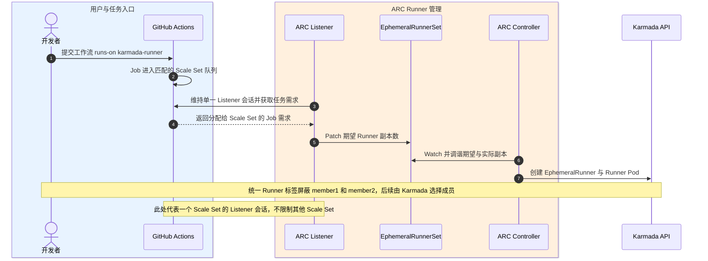

### 5.1.5 用户接口设计

通过 `jobs.<job>.runs-on` 选择服务，名称必须与 `spec.runnerScaleSetName` 一致。无独立 UI；复用 GitHub 和配置管理工具。

### 5.1.6 实现接口设计

#### 5.1.6.1 接口设计

| 交互双方 | 原生接口或资源 | 输入、操作与输出 | 权限与前置条件 | 异常处理与限制 | 依据及规格 |
|---|---|---|---|---|---|
| 工作流使用者与 GitHub Actions | GitHub Actions Workflow：`jobs.<job>.runs-on` | 开发者必须填写已发布的 Runner 服务名称。GitHub 根据该名称匹配 Runner。 | 开发者必须具有目标仓库工作流的提交权限。 | 名称未匹配时，GitHub 按其队列机制处理；平台不得改写标签。 | ARC-1；SP-01 |
| 平台配置与 ARC Controller | `AutoscalingRunnerSet`：`actions.github.com/v1alpha1` | 管理员必须配置服务名称、GitHub 目标、凭证引用、Runner 数量范围和 Pod 模板。 | Controller 必须具备所需的 Kubernetes API 与 GitHub 目标权限。 | API 拒绝创建或更新时，必须保留资源名称和错误原因；不能自行扩大权限。 | ARC-2；SP-01 |

**开发交付边界**：开发人员应维护 Runner Scale Set 模板与服务名称配置。不新增用于代替 GitHub Job Queue 的接口。

### 5.1.9 DFX分析

**功能安全与性能约束**：Runner 的最大数量受 `maxRunners` 限制。平台必须防止 Runner 在未授权的 GitHub 仓库或组织中注册。具体并发容量和排队时间由业务方定义。

**可靠性故障分析（FMEA）**

| 编号 | 失效原因 | 业务或系统影响 | 检测方法 | 处理与恢复要求 | 负责方 |
|---|---|---|---|---|---|
| F01-01 | 工作流标签和 Runner 服务名称不一致。 | GitHub Job 不能匹配目标 Runner。 | 对照 `runs-on` 和 `runnerScaleSetName`，检查 GitHub Job 的排队信息。 | 平台管理员应修正不一致的服务配置，并检查修改影响。 | 平台维护者 |
| F01-02 | GitHub 管理凭证失效。 | Runner 无法正常向目标 GitHub 仓库注册。 | 检查 Controller 或 Listener 的认证错误和凭证引用。 | 身份管理者更新凭证；不得通过更改业务标签来规避认证失败。 | 身份管理员、ARC 运维 |

**运行诊断与敏感信息处理**：运维人员应先比较 `runs-on`、Runner Scale Set 名称和 GitHub 配置，再分析身份认证错误。审计不得记录 GitHub 管理凭证。

## 5.2 F-02 Runner 弹性供给及临时资源回收

### 5.2.1 功能概述

**关联需求**：SR-02-01、SR-02-02；**用例**：UC-03 Job 需求驱动 Runner 创建、UC-04 Job 结束回收 Runner 与凭证；**功能域规格**：SP-01、SP-06、SP-07。

F-02 按需供给临时 Runner。ARC 创建 Runner、Pod 和注册配置；作业结束后，ARC/Karmada 分别回收。通过对象 ID 关联同一任务。

**职责**：集成 Runner 需求与回收；注册协议及控制器沿用 ARC。

### 5.2.3 实现思路

复用 ARC `AutoscalingRunnerSet`、`EphemeralRunnerSet`、`EphemeralRunner` 生命周期。Karmada 传播并回收成员对象；不得新增争夺 Runner 所有权的控制器。临时资源按 UID/OwnerReference 关联，不依赖生成名称。

### 5.2.4 设计思路

Listener 更新 `EphemeralRunnerSet`，Controller 创建 Runner；成员启动 Pod 并注册 GitHub。作业结束后 ARC 回收 Runner，Karmada 异步删除传播对象。不要求同时删除，也不得因 Pod 失败重复派发 Job。

#### 5.2.4.1 UC-03 Job 需求驱动 Runner 创建——运行时序（US-02）

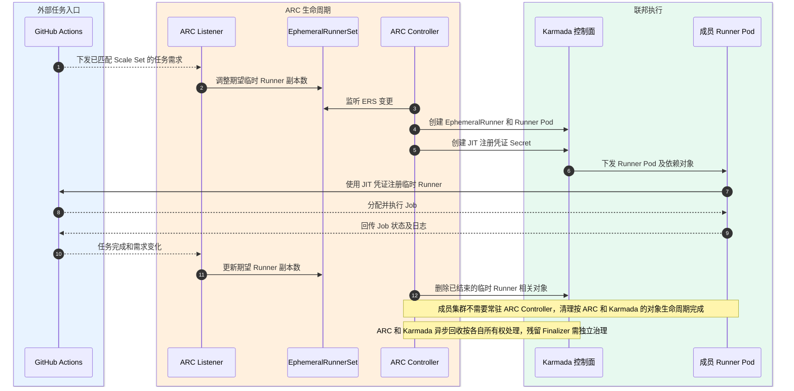

#### 5.2.4.2 UC-04 Job 结束回收 Runner 与凭证——运行时序（US-07）

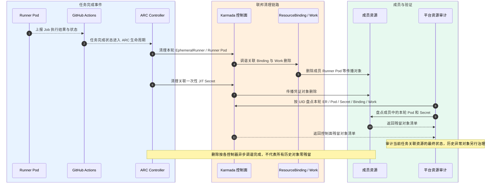

### 5.2.5 用户接口设计

开发者通过 GitHub 查看作业状态；运维通过 Run、Runner、Pod、Work 标识排障。无需手动创建 Pod/Secret；无新增 UI。

### 5.2.6 实现接口设计

#### 5.2.6.1 接口设计

| 交互双方 | 原生接口或资源 | 输入、操作与输出 | 权限与前置条件 | 异常处理与限制 | 依据及规格 |
|---|---|---|---|---|---|
| ARC Listener 与 EphemeralRunnerSet | Kubernetes API：`EphemeralRunnerSet` 更新操作 | Listener 根据 GitHub 返回的任务需求更新指定 Runner 服务的期望数量。 | Listener 身份必须具有指定 Runner 服务所需的更新权限。 | API 返回资源版本冲突或拒绝访问时，必须保留失败原因，不得更新其他 Runner 服务。 | ARC-1；SP-01 |
| ARC Controller 与 Karmada API | `EphemeralRunner`、`Pod` 和 JIT Secret | ARC 创建临时 Runner 对象、Runner Pod 和注册所需的临时 Secret。 | Controller 必须有权管理所在命名空间的对应资源。 | 对象创建失败时记录资源类型和 API 错误，不得报告不存在的 Runner 已注册。 | ARC-1；SP-07 |
| ARC/Karmada 与成员 Kubernetes | Runner Pod、JIT Secret、`ResourceBinding`、`Work` | ARC 按官方生命周期删除临时 Runner，Karmada 调谐被传播对象的删除。 | 每个控制器只能依据其资源所有权处理相关对象。 | 删除未完成时保留对象 UID、Finalizer 和错误，不得清除未知 Finalizer。 | ARC-1、KAR-1；SP-07 |

**开发交付边界**：开发人员维护 Runner Scale Set 配置、资源关联和必要权限；动态 Runner 的创建与回收由 ARC 的官方控制器完成。

### 5.2.9 DFX分析

**功能安全与性能约束**：平台不能超过 Runner 服务规定的容量上限。作业失败后，未经确认的重复执行可能产生副作用，因此不得仅因 Runner Pod 消失而重新提交作业。JIT Secret 的数据不得写入日志。

**可靠性故障分析（FMEA）**

| 编号 | 失效原因 | 业务或系统影响 | 检测方法 | 处理与恢复要求 | 负责方 |
|---|---|---|---|---|---|
| F02-01 | ARC 对任务需求的响应延迟。 | GitHub Job 需要等待 Runner。 | 比较 Runner 的期望数量与实际数量，并检查 ARC Controller 事件。 | ARC 运维人员应检查控制器状态和资源容量；平台按业务阈值发出告警。 | ARC 运维 |
| F02-02 | Runner 注册失败或 Job 执行中断。 | Job 不能完成，错误重试可能导致重复执行。 | 检查 GitHub Run、临时 Runner 状态和 Pod 事件。 | 应按 GitHub 与 ARC 的官方机制处理；没有明确去重依据时不得再次派发。 | GitHub、ARC 运维 |
| F02-03 | 临时资源的 Finalizer 阻止删除。 | 临时 Pod 或 Secret 仍占用资源。 | 按对象 UID 检查 ER、Pod、Binding、Work 和 Secret 的删除状态。 | 由对象所属控制器完成清理；需要人工操作时先确认资源所有者。 | ARC、Karmada 运维 |

**运行诊断与敏感信息处理**：使用 GitHub Run、临时 Runner、Runner Pod UID、JIT Secret 和 Binding/Work 追踪同一次任务。Finalizer 阻止删除时，必须先确认设置它的控制器。

## 5.3 F-03 Runner 联邦成员调度与依赖传播

### 5.3.1 功能概述

**关联需求**：SR-03-01、SR-03-02；**用例**：UC-05 在合格成员放置 Runner、UC-06 JIT Secret 晚到后的依赖恢复、UC-10 成员不可用或无可调度资源；**功能域规格**：SP-02、SP-03、SP-04。

F-03 将 Runner Pod 与临时注册凭证分发至合格成员，并接收传播和运行状态。

**职责**：Runner Pod 匹配、候选成员和依赖传播；节点调度归 Kubernetes。

### 5.3.3 实现思路

`PropagationPolicy` 定义 Runner Pod 选择器和候选成员；`propagateDeps` 下发 JIT Secret。标签须匹配目标 ARC 版本。Karmada 选成员、Kubernetes 选节点；不另建 GitHub 调度器。`Divided/Weighted` 不保证独立 Pod 逐轮均分。

### 5.3.4 设计思路

Controller 创建 Pod；Karmada 选成员、分发 Pod 和依赖；成员挂载 Secret 并启动。JIT Secret 晚到时 Pod 等待，不得判为可执行。成员故障保留原因，不重复提交 Job。

#### 5.3.4.1 UC-05 在合格成员放置 Runner——运行时序（US-03）

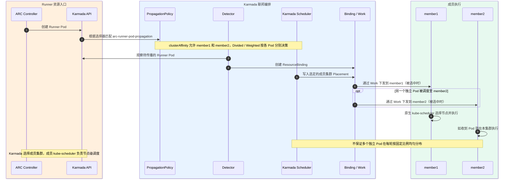

#### 5.3.4.2 UC-06 JIT Secret 晚到后的依赖恢复——运行时序（US-04）

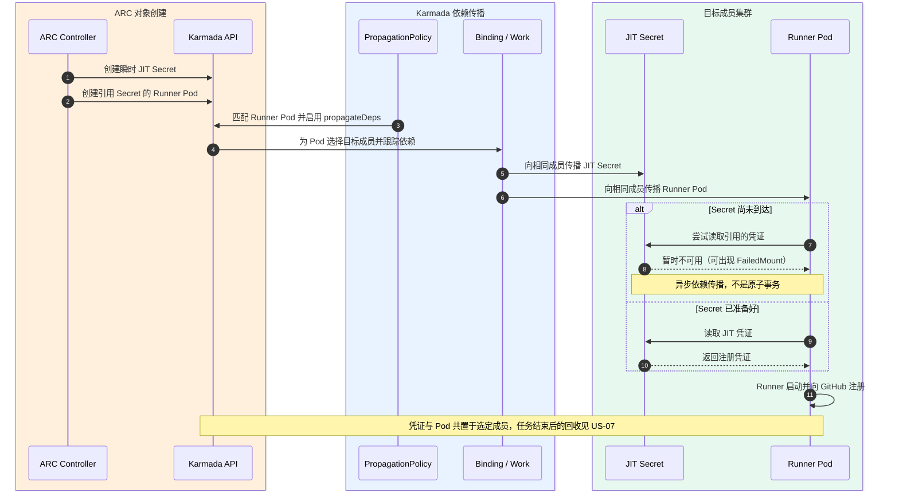

#### 5.3.4.3 UC-10 成员不可用——异常运行时序

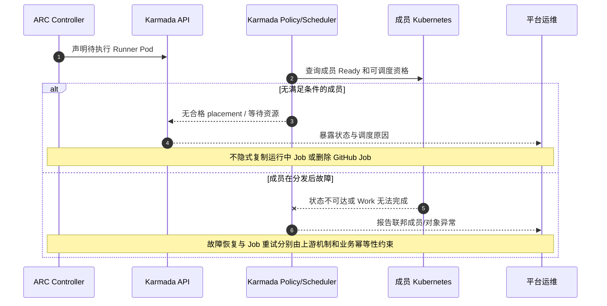

**异常约束**：不得将成员失联等价于 GitHub Job 已失败或可安全重复执行；设计仅保证可诊断的异常状态和责任边界。

### 5.3.5 用户接口设计

开发者无需选择成员；管理员通过 Cluster、Binding/Work、Pod 事件定位执行成员与未就绪原因。无新增 UI。

### 5.3.6 实现接口设计

#### 5.3.6.1 接口设计

| 交互双方 | 原生接口或资源 | 输入、操作与输出 | 权限与前置条件 | 异常处理与限制 | 依据及规格 |
|---|---|---|---|---|---|
| ARC Controller 与 Karmada API | Kubernetes `Pod`、`Secret`、`ServiceAccount` | ARC 创建带有服务标签、运行身份和 JIT Secret 引用的 Runner Pod。 | Controller 必须具有指定命名空间的所需对象管理权限。 | 对象不存在或 JIT Secret 尚未可用时，必须保留实际状态，不得重新提交 Job。 | ARC-1；SP-03 |
| 平台配置与 Karmada | `PropagationPolicy`：`policy.karmada.io/v1alpha1` | 平台必须设置资源匹配条件、成员候选范围和依赖传播规则。 | 策略维护者只能操作授权范围内的命名空间及成员。 | 策略不匹配或没有合格成员时，保留调度原因，不得默默选择其他租户成员。 | KAR-1、KAR-2；SP-02、SP-03 |
| Karmada 与成员 Kubernetes | `ResourceBinding`、`Work` 及成员对象 | Karmada 将选定 Runner Pod 和它引用的运行依赖分发到指定成员。 | Karmada 必须持有已注册成员的 API 访问身份。 | 成员不可达或资源发生冲突时，按上游调谐语义处理，不强制覆盖其他管理者的对象。 | KAR-1、KAR-2；SP-02 |

**开发交付边界**：开发人员维护 `PropagationPolicy` 及关联权限，并检查目标 Runner Pod 被选中、非目标 Pod 不被选中。不得将 GitHub Job 重新派发作为 Karmada 对象传播失败的默认恢复动作。

### 5.3.9 DFX分析

**功能安全与性能约束**：传播策略不能无意包含其他租户的 Pod。JIT Secret 必须只分发到有实际执行需求的成员。监控应分别记录成员选择、Secret 可用和 Runner 注册等阶段，不得宣称未经定义的平均分配比例。

**可靠性故障分析（FMEA）**

| 编号 | 失效原因 | 业务或系统影响 | 检测方法 | 处理与恢复要求 | 负责方 |
|---|---|---|---|---|---|
| F03-01 | 传播策略错误地选择了非 Runner Pod。 | 其他工作负载可能被复制到不应访问的成员。 | 比对策略标签与目标 Runner Pod、非目标 Pod 的标签。 | 策略维护者必须收窄选择条件，并确认其他租户 Pod 不匹配。 | 联邦策略维护者 |
| F03-02 | JIT Secret 晚于 Runner Pod 到达成员。 | Runner Pod 无法挂载所需 Secret，启动推迟。 | 检查成员 Pod 的 `FailedMount` 事件和 JIT Secret 引用。 | Karmada 继续调谐依赖传播；成员 Kubernetes 继续挂载重试。平台不得因此重复派发 Job。 | Karmada、成员运维 |
| F03-03 | 候选成员不可达或资源不足。 | Runner Pod 无法进入可执行状态。 | 检查成员 Cluster Ready、Binding/Work 和 Pod 调度事件。 | 运维人员应恢复成员或调整已授权的候选集；不得重复提交正在执行的 Job。 | 联邦与资源池运维 |

**运行诊断与敏感信息处理**：诊断时先查看成员集群的 Ready 状态与 Karmada Binding/Work，再检查成员 Pod 事件和 Secret 引用。日志不得保存 Secret 数据。

## 5.4 F-04 Listener 跨控制面认证与访问

### 5.4.1 功能概述

**关联需求**：SR-04-01；**用例**：UC-08 Listener 访问统一 Karmada API、UC-11 Token 失效或证书不匹配；**功能域规格**：SP-04、SP-05。

F-04 为成员 Listener 提供 Karmada API 地址、可信证书和最小授权身份，仅允许操作所属 Runner 服务。

**职责**：Listener 访问身份、地址和权限；不修改 API Server 认证。

### 5.4.3 实现思路

用 ServiceAccount、TokenRequest 和 RBAC 建立 Listener 身份。校验 Karmada API 证书链与名称。地址、CA、Token 由部署提供；示例固定 IP 和签发脚本不等于自动轮换。

### 5.4.4 设计思路

凭证方签发 Token/CA；Listener 验证服务器证书，API Server 校验身份与权限。校验通过才能更新指定 `EphemeralRunnerSet`；网络、TLS、401、403 分别记录。

#### 5.4.4.1 UC-08 Listener 访问统一 Karmada API——运行时序（US-05）

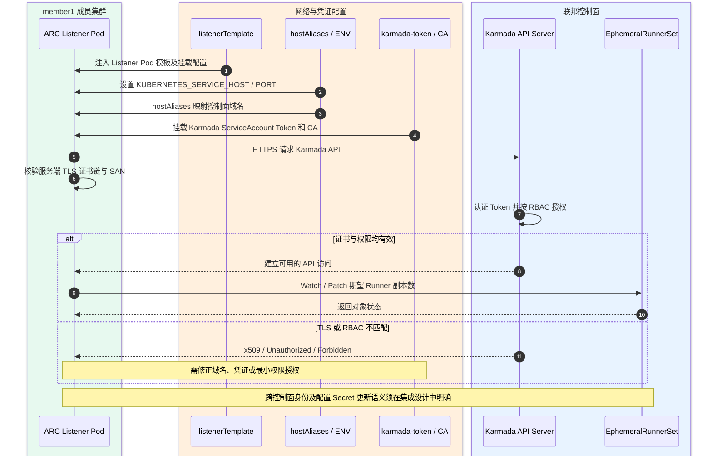

### 5.4.5 用户接口设计

身份和轮换由安全管理员维护；运维查看 Listener 状态、错误类型及证书/Token 版本。复用现有工具，无独立 UI。

### 5.4.6 实现接口设计

#### 5.4.6.1 接口设计

| 交互双方 | 原生接口或资源 | 输入、操作与输出 | 权限与前置条件 | 异常处理与限制 | 依据及规格 |
|---|---|---|---|---|---|
| ARC Listener 与 Karmada API | HTTPS Kubernetes API、`EphemeralRunnerSet` | Listener 必须使用指定 API 地址、可信 CA 和访问令牌更新所负责的 Runner 对象。 | Token 必须来自受控身份；RBAC 只授予所需对象和操作。 | 网络、证书、HTTP 401、HTTP 403 和超时必须分别记录，不允许绕过认证。 | K8S-1、K8S-2；SP-05 |
| 部署与密钥管理系统和 Listener Pod | Listener 模板、Secret 或受控凭证投射卷 | 部署方必须提供 CA、Token、有效期及 API 连接信息，并明确更新后的加载方式。 | 凭证应以只读方式提供给需要的容器，禁止出现在日志中。 | Token 到期或未加载时，必须报告身份状态；不得假定修改 Secret 后立即生效。 | SP-04、SP-05 |
| 安全管理员与 Kubernetes RBAC | `Role`、`RoleBinding` | 对指定 `EphemeralRunnerSet` 授予所需 `patch` 权限，对必要的 `EphemeralRunner` 资源授予对应读写和状态权限。 | 必须确认 ServiceAccount 命名空间、绑定对象以及操作范围。 | RBAC 配置与契约不一致时，应修正 Role/Binding；不得赋予 `cluster-admin`。 | K8S-2；SP-05 |

**开发交付边界**：开发人员维护 ServiceAccount、Role/RoleBinding、Listener 模板和证书/令牌加载配置。Token 的到期处理和重新加载方式必须在部署方案中确定。

### 5.4.9 DFX分析

**功能安全与性能约束**：Listener 必须验证 HTTPS 服务器证书。凭证只授予必要操作权限，日志不得包含 Token 或私钥。高可用与不中断轮换属于部署参数，不能宣称已自动具备。

**可靠性故障分析（FMEA）**

| 编号 | 失效原因 | 业务或系统影响 | 检测方法 | 处理与恢复要求 | 负责方 |
|---|---|---|---|---|---|
| F04-01 | API 地址不可达或 TLS 证书校验失败。 | Listener 不能访问 Karmada API。 | 分别检查 DNS/TCP 连通性、CA 与证书 SAN。 | 部署维护者应修正服务地址或证书配置，不能关闭 TLS 校验。 | 部署与证书管理员 |
| F04-02 | Token 已到期或 Listener 未加载新 Token。 | Listener 的 Runner 数量更新操作失败。 | 检查 HTTP 401、Token 有效期和凭证加载记录。 | 身份管理员更新 Token；部署维护者按规定重载 Listener。 | 身份与部署维护者 |
| F04-03 | Role 或 RoleBinding 的授权范围错误。 | Listener 无法操作所需资源，或存在越权风险。 | 检查 HTTP 403 与 Role/Binding 中的资源名称及操作。 | 安全管理员按最小权限规则修正配置，保留变更审计。 | 安全管理员 |

**运行诊断与敏感信息处理**：平台必须分开记录网络连接错误、证书校验错误、HTTP 401 与 HTTP 403。出现权限失败时，不能通过关闭 TLS 或授予 `cluster-admin` 来绕过。

## 5.5 F-05 Runner Pod 状态反馈与一致性

### 5.5.1 功能概述

**关联需求**：SR-05-01；**用例**：UC-09 Runner Ready 状态反馈、UC-12 状态缺失、冲突或滞后；**功能域规格**：SP-06、SP-07。

F-05 将成员 Pod 状态回传 Karmada，供 ARC 读取容器名、运行状态与 Ready；仅支持单执行成员。

**职责**：状态解释及来源约束；Job 结果归 GitHub。

### 5.5.3 实现思路

用 Karmada `ResourceInterpreterCustomization` 保留 Pod 状态，不改 ARC/Karmada 控制器。多来源状态须另定冲突规则，不能直接取第一个非空值。

### 5.5.4 设计思路

成员 kubelet 更新 Pod，Karmada 汇总状态，ARC 读取 Ready 和容器信息。无成员状态时不得伪造 Ready 或判定 Job 成功。

#### 5.5.4.1 UC-09 Runner Ready 状态反馈——运行时序（US-06）

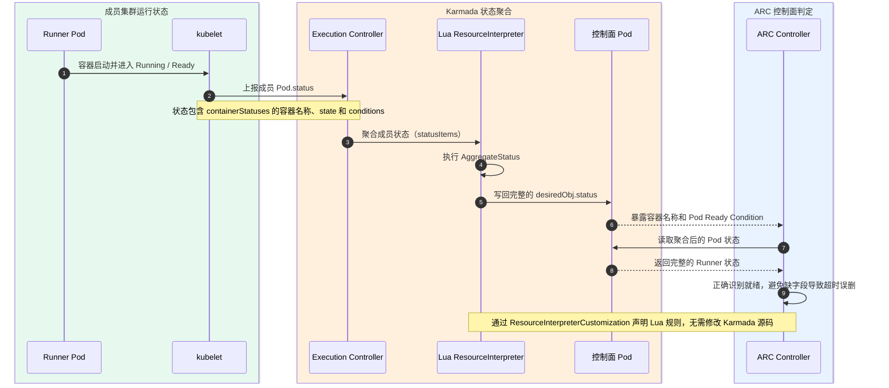

### 5.5.5 用户接口设计

开发者在 GitHub 查看 Job；运维按 Pod UID、成员、容器名、Ready 排障。无新增 UI。

### 5.5.6 实现接口设计

#### 5.5.6.1 接口设计

| 交互双方 | 原生接口或资源 | 输入、操作与输出 | 权限与前置条件 | 异常处理与限制 | 依据及规格 |
|---|---|---|---|---|---|
| 成员 kubelet 与 Karmada | Kubernetes `Pod.status` | 成员 Kubernetes 提供 `phase`、`conditions`、`containerStatuses` 和容器运行信息。 | Karmada 必须能读取目标成员 Pod 的状态。 | 状态未返回时应保留未确认状态，不得生成不存在的容器状态。 | KAR-3；SP-06 |
| Karmada 状态解释器与控制面 Pod | `ResourceInterpreterCustomization` 的 `AggregateStatus` | Lua 规则必须将单目标成员的必要 Pod 状态字段写入控制面对象。 | 目标对象为 `apiVersion: v1`、`kind: Pod`；来源必须与选定执行成员一致。 | 没有状态时不能伪造 Ready；出现多个状态来源时必须有明确的选择规则。 | KAR-3；SP-06 |
| ARC Controller 与 Pod 状态 | Kubernetes Pod 读取或监听操作 | ARC 读取 Runner 容器名称、容器状态与 Pod Ready 条件。 | Controller 必须具有读取对应 Pod 的权限。 | 字段缺失时不能假定 Runner 已就绪；必须提供状态与事件诊断。 | ARC-1；SP-06 |

**开发交付边界**：开发人员维护 `ResourceInterpreterCustomization` 中的 Lua 解释规则，并保证目标版本的 ARC 所需字段完整保留。

### 5.5.9 DFX分析

**功能安全与性能约束**：必须保留 ARC 需要的 Pod 状态字段，同时避免在状态聚合或日志中记录凭证数据。状态同步延迟和告警时限由业务 SLO 确定，不得把测试采样参数当作生产指标。

**可靠性故障分析（FMEA）**

| 编号 | 失效原因 | 业务或系统影响 | 检测方法 | 处理与恢复要求 | 负责方 |
|---|---|---|---|---|---|
| F05-01 | 状态解释器遗漏容器名称或 Ready 条件。 | ARC 可能把 Runner 判定为未就绪。 | 逐项比较成员和控制面 Pod 的状态字段。 | 状态适配维护者必须保留 ARC 所需字段并检查映射规则。 | 状态适配维护者 |
| F05-02 | 同一个 Pod 出现多个互相冲突的状态来源。 | 控制面可能显示错误成员的状态。 | 核对 Binding 的目标成员与各来源 Pod 的标识。 | 设计必须先定义状态来源规则；不得静默采用第一个非空状态。 | 状态适配与 Karmada 管理者 |
| F05-03 | 成员状态同步延迟。 | Runner 就绪信息不能及时反映到控制面。 | 比较 Pod 条件时间和控制面状态更新时间。 | 平台应根据批准的时效性目标设计告警，不能填写未经定义的 SLA。 | Karmada、ARC 运维 |

**运行诊断与敏感信息处理**：排障时比较目标成员与控制面 Pod 的 UID、容器状态和 Ready 条件。状态来源发生冲突时必须先确认目标成员，不能静默取第一个来源。

## 5.6 F-06 异构 NPU Runner 执行资源适配

### 5.6.1 功能概述

**扩展设计，当前无正式核心 SR**：原候选需求 SR-06-01 暂不纳入第 2.4 节；**用例**：UC-07 请求 NPU Runner 并在兼容节点执行、UC-13 NPU 资源不足或设备插件不可用；**功能域规格**：SP-02、SP-08。仓库当前没有 NPU 资源请求或插件部署配置，本节仅提供未来选型后的实施参考。

F-06（扩展）提供 NPU Runner 服务；按设备资源请求，将 Pod 放置到兼容成员。

**职责**：NPU 请求、成员约束、兼容配置；实际设备分配归 Kubernetes/插件。

### 5.6.3 实现思路

Device Plugin 提供资源名和单位；Runner 模板声明请求，Karmada 选成员、kube-scheduler 选节点。设备型号、驱动和运行时由设备规格确定；NPU 不可默认互换。

### 5.6.4 设计思路

选择 NPU Runner 后，ARC 创建带设备请求的 Pod；Karmada 选成员，Kubernetes 选节点，插件分配设备。设备不足则保持不可调度并报告原因，不得降级为 CPU Runner。

#### 5.6.4.1 UC-07 请求 NPU Runner 并在兼容节点执行——运行时序（US-08）

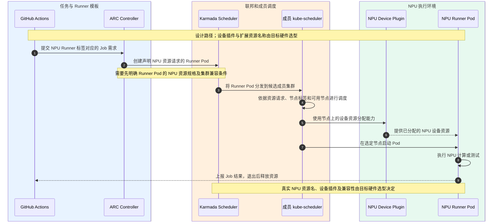

#### 5.6.4.2 UC-13 NPU 资源不足——异常运行时序

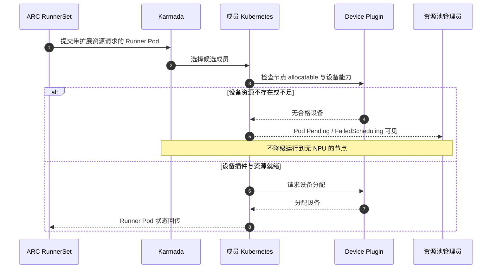

### 5.6.5 用户接口设计

通过独立 `runs-on` 名称选择 NPU 服务；需说明设备与软件栈约束。无新增 UI。

### 5.6.6 实现接口设计

#### 5.6.6.1 接口设计

| 交互双方 | 原生接口或资源 | 输入、操作与输出 | 权限与前置条件 | 异常处理与限制 | 依据及规格 |
|---|---|---|---|---|---|
| 工作流使用者与 NPU Runner 服务 | GitHub Actions `runs-on` | 开发者必须选择明确标注 NPU 能力的 Runner 服务名称。 | 目标仓库必须获得相应服务的使用授权。 | 没有匹配的服务时，按 GitHub 队列机制显示状态；不得改选普通 CPU Runner。 | ARC-1；SP-08 |
| Runner Pod 与成员 Kubernetes | `Pod.spec.containers[].resources` | Pod 必须声明实际设备插件提供的扩展资源名称和数量，并配置必要的节点约束。 | 成员必须安装与所选设备相符的插件、驱动和运行时。 | 资源不足时保持 Pending 并记录调度原因，不得删除 NPU 请求。 | K8S-3；SP-08 |
| Karmada 传播策略与成员候选集 | `PropagationPolicy.spec.placement` | 传播策略必须把 NPU Runner Pod 分发到满足设备与隔离条件的成员。 | 平台必须提供正确的成员标签及资源条件。 | 无合格成员时保留不可调度原因，不得分发到不兼容集群。 | KAR-1；SP-02、SP-08 |

**开发交付边界**：开发人员在 Runner Pod 模板及传播策略中配置扩展资源请求和目标成员条件；具体值必须来源于选定的设备插件和设备兼容清单。

### 5.6.9 DFX分析

**功能安全与性能约束**：目标 NPU 的驱动、资源隔离、并发容量和租户权限应由设备管理员提供。没有真实负载指标时，不能写入性能改善百分比或设备共享保证。

**可靠性故障分析（FMEA）**

| 编号 | 失效原因 | 业务或系统影响 | 检测方法 | 处理与恢复要求 | 负责方 |
|---|---|---|---|---|---|
| F06-01 | Runner 请求的资源名称与插件发布的名称不同。 | Runner Pod 无法匹配需要的 NPU 资源。 | 比较 Pod 资源请求与 Node `status.allocatable`。 | 资源池维护者应按插件正式资源名修正服务模板。 | 设备与平台维护者 |
| F06-02 | 设备驱动、固件或容器运行时不兼容。 | Runner 容器启动失败，或者 NPU 作业执行失败。 | 检查节点事件、容器退出原因及设备运行环境版本。 | 设备维护者按厂商兼容资料调整镜像、驱动及运行时版本。 | 设备与运维维护者 |
| F06-03 | NPU 设备资源耗尽或候选成员不可达。 | Pod 不能调度，GitHub Job 需要等待可用 Runner。 | 检查 Karmada 目标成员、Node allocatable 与 `FailedScheduling` 事件。 | 平台必须报告资源不足并维持 NPU 约束，不能改用普通 CPU 节点。 | 调度与资源池维护者 |

**运行诊断与敏感信息处理**：平台应保留 Node allocatable、Runner Pod 的资源请求、成员调度结果和 FailedScheduling 事件。设备异常时，不得通过删除 NPU 请求使错误任务运行在 CPU 节点。

## 5.7 功能追踪与开发接口清单

| SR | 功能 | 关联规格 | 运行视图 | 开发实现入口 |
|---|---|---|---|---|
| FT-01：SR-01-01 | F-01 | SP-01 | 5.1.4.1（UC-02 为异常场景） | `04-autoscalingrunnerset.yaml`、GitHub Workflow |
| FT-01/FT-04：SR-02-01、SR-02-02 | F-02 | SP-01、SP-07 | 5.2.4.1 / 5.2.4.2 | 官方 ARC、RunnerSet、对象生命周期契约 |
| FT-02/FT-03：SR-03-01、SR-03-02 | F-03 | SP-02、SP-03、SP-04 | 5.3.4.1 / 5.3.4.2 / 5.3.4.3 | `02-propagation-policies.yaml`、关联资源 |
| FT-03：SR-04-01 | F-04 | SP-04、SP-05 | 5.4.4.1 | `03-rbac.yaml`、`04-autoscalingrunnerset.yaml` Listener Template |
| FT-03：SR-05-01 | F-05 | SP-06 | 5.5.4.1 | `01-karmada-interpreter.yaml` |
| **扩展候选：原 SR-06-01，当前非正式 SR** | F-06 | SP-02、SP-08 | 5.6.4.1 / 5.6.4.2 | 尚需设备选型；仓库未配置 NPU 扩展资源 |

### 5.7.1 非功能需求与详细设计追踪

| 非功能需求 | 功能域规格 | 主要实现设计章节 |
|---|---|---|
| SR-NF-01 身份与权限 | SP-01、SP-05 | 5.1.9、5.4.6、5.4.9 |
| SR-NF-02 凭证保护 | SP-04、SP-09 | 5.2.9、5.3.9、5.4.9 |
| SR-NF-03 成员故障隔离 | SP-02、SP-07 | 5.2.9、5.3.4.3、5.3.9 |
| SR-NF-04 可服务性 | SP-09 | 5.1～5.6 各功能的 DFX |
| SR-NF-05 性能与容量 | SP-01、SP-09 | 5.1.9、5.2.9；量化参数 P-SR-01、P-SR-02 |
| SR-NF-06 成本与资源利用 | SP-01、SP-07 | 5.2.3、5.2.9；量化参数 P-SR-04 |
| SR-NF-08 策略可维护性 | SP-01、SP-02 | 4.2、4.3、5.3.6 |

本表只将与 FT-01～FT-04 相关的正式 SR 关联至详细设计。第 4、5 章仍可保存 ARC/Karmada 的必要技术契约和 NPU 扩展参考，但不把所有实现机制或通用 DFX 项目升级为正式系统需求。量化参数未获得业务批准时，对应指标保持待定。

**统一资料来源及版本边界**：本文件 3.7 给出 ARC/GitHub Actions、Karmada、Kubernetes 官方文档索引；本仓库现有 Manifest 用于定位配置差异；任何仅有内部运行记录支持、而无上游接口规范支持的声明都应标明为集成设计假设。缺少 PoC 不构成功能设计缺口，但 **SR/接口/异常/DFX 未定义**属于设计缺口。

**实施前需选择的参数（P）**：GitHub 组织/仓库与权限、目标版本和镜像 digest、联邦控制面 API/DNS/CA、凭证发行及轮换、成员与资源标签、NPU 型号与扩展资源名、隔离与容量策略、性能/可用性 SLO。若有正式输入来源，则填写批准值；如果尚无，不得硬编码临时 Kind IP 或杜撰业务 SLA。
