# 昇腾CI 联邦集群功能设计文档

> 文档标识：ASCEND-CI-FEDERATED-CLUSTER-FUNCTIONAL-DESIGN
> 状态：统一设计正文（基于现有资料整理；新增决定与待选参数显式标记）
> 目录依据：用户提供的功能域设计模板：第 1 章保留已有内容；第 2 章概述；第 3 章总体方案；第 4 章领域规格；第 5 章功能实现
> **设计证明依据：** 官方 ARC/GitHub Actions、Karmada、Kubernetes 技术文档及清晰的项目设计决策。**文档完成不要求 PoC、Kind、真实 Runner 或硬件实验**。

**阅读原则**：**U** = 上游文档明确支持的机制；**D** = 昇腾CI针对组件组合定义的集成设计决策；**P** = 实施/厂商选型待定的参数。当前仓库 Manifest 是参考实现，不等于上游产品承诺；“设计完成”也不等于“已部署运行”。

# 1 功能域背景与目的

## 1.1 目标与职责

将原先项目独占的多个执行集群纳入 Karmada，统一管理 GitHub Actions Runner 的创建、分发与回收。

| 职责 | 实现主体 | 边界 |
|---|---|---|
| 任务匹配与 Runner 生命周期 | ARC Listener、Controller、Scale Set | GitHub Actions 提供队列；ARC 调整 Runner 数量 |
| 资源对象传播与成员选择 | Karmada Policy、Scheduler、Binding / Execution Controller | 选择成员集群；不承担每个 Pod 的节点级调度 |
| 资源实际执行 | 成员 Kubernetes、kube-scheduler、kubelet | 创建 Runner Pod；可在 NPU 节点执行有设备请求的工作负载 |
| 状态与凭证适配 | ResourceInterpreterCustomization、Listener Token / RBAC、propagateDeps | 保留 ARC 所需的 Pod 状态和 JIT Secret |
| 设计契约与治理 | 本子系统接口适配、策略、身份与状态约束 | 由本项目负责架构决策；不代替上游内部实现 |

## 1.2 系统边界

**边界内：** ARC Controller、Listener、Runner Scale Set；Karmada 控制面；纳管的 Kubernetes 成员集群、Runner Pod 和目标 NPU 节点资源。

**边界外：** GitHub Actions 服务、业务项目、镜像仓库及现有企业级监控系统。

系统边界表示统一联邦执行的运行范围，组件可依据部署条件运行在不同 Kubernetes / 宿主环境。图示选择了“Controller 在独立管理环境、Listener 定向成员、Runner 由联邦分发”的**参考部署拓扑**，并非上游唯一合法部署形态。跨控制面访问需要独立的凭据与网络设计。

## 1.3 子系统目标

**现状：** 集群按项目固定分配。不同集群不能共享空闲资源。部分集群资源空闲，部分集群任务排队。热点项目等待时间较长。

**目标：** ARC 统一管理 Runner 需求。Karmada 将 Runner 分发至满足条件的成员集群。系统支持项目间共享合格成员的执行容量，以减少资源错配和可避免的排队等待。

**设计边界：** 该图为问题/目标示意，利用率及排队收益没有定量证明；本设计不承诺指定改善百分比。联邦策略负责成员选择，成员实际容量、资源兼容性和 NPU 驱动属于部署输入。

## 1.4 整体架构

本子系统包含 ARC、Karmada、成员 Kubernetes 集群及 Runner 执行环境。图中灰色外框表示子系统边界。边界外的系统通过以下接口交互。

| 外部子系统 | 方向 | 交互内容 |
|---|---|---|
| GitHub Actions | 输入 | 工作流任务、`runs-on` 标签、Runner 需求 |
| GitHub Actions | 输出 | Runner 注册、Job 执行状态和结果 |
| 配置与部署系统 | 输入 | Scale Set、PropagationPolicy、RBAC、组件版本 |
| 镜像仓库 | 输入 | Runner 镜像、Action 镜像 |
| 监控与审计系统 | 输出 | 运行日志、Kubernetes 事件、验证记录 |

**设计范围：** 图中以一个集中 ARC、一个 Karmada 控制面和两个成员作为可扩展的逻辑示例，不限定 Kind 或具体地区。NPU 设备插件是目标环境依赖，按选型纳入成员集群；不依赖 `karmada-search`。

## 1.5 关键约束

- Runner 工作流使用 `runs-on: karmada-runner`。标签对应一个已注册 Scale Set。
- Scale Set 版本标签与选定的官方 ARC Controller 版本保持一致；仓库当前 0.15.0 为配置示例。
- Listener 运行在成员集群，通过独立 Token、CA 和 DNS 配置访问 Karmada API。
- Runner Pod 的 JIT Secret 必须传播至同一执行成员；传播过程允许短暂异步等待。
- Karmada Pod 状态解释器保留 `containerStatuses[].name` 和 `conditions`。
- `Divided / Weighted` 针对单个资源对象执行。多个独立 Pod 不保证逐轮均匀分布。
- 成员 Kubernetes 负责节点调度。NPU 任务需额外核实节点标签、设备插件、资源请求和工作负载运行环境。

# 2 功能域概述

## 2.1 定位、使用者和边界

本功能域向 GitHub Actions 工作流提供统一的计算资源入口，将原先固定按项目使用的集群汇聚成受控联邦候选集。用户仅选择 Runner 服务标签，平台将 Job 需求转换为短生命周期 Runner，通过 Karmada 选择成员并在成员 Kubernetes 内执行。它不是替代 GitHub Job Queue、重写 ARC 生命周期控制器或重建 Karmada 调度器。

**业务参与者**：CI 开发者（提交 Job）、CI 平台工程师（定义 Scale Set 与策略）、资源池管理员（纳管成员与 NPU）、安全管理员（权限/凭证）、运维人员（升级/故障/审计）。外部系统包括 GitHub Actions、OCI 镜像仓库、已有身份/密钥系统、GitOps/部署面和观测系统。

## 2.2 功能清单与用例

| 功能 | 关键问题 | 对应 Story | 负责设计内容 |
|---|---|---|---|
| F-01 统一 Runner 服务入口 | 项目与执行集群解耦 | US-01 | runs-on / Scale Set 关联与无匹配行为 |
| F-02 Runner 弹性供给与回收 | 统一供给、避免各集群管理孤岛 | US-02、US-07 | ARC 生命周期与 Karmada 对象清理的协作 |
| F-03 联邦调度与依赖分发 | 在合格成员执行并携带 JIT | US-03、US-04 | Policy、placement、propagateDeps |
| F-04 Listener 跨控制面访问 | 在成员运行的 Listener 安全访问统一 API | US-05 | Endpoint/TLS/Token/RBAC |
| F-05 Runner 状态反馈 | 避免错误的未就绪判断 | US-06 | Pod.status / 状态解释与聚合 |
| F-06 NPU 执行资源适配 | 在兼容设备节点执行 | US-08 | Device Plugin/扩展资源/节点筛选 |

## 2.3 需求分析与追踪（IR → UC → SR → 功能）

> IR/UC/SR 为根据现有 US-01～US-08 **整理出的建议需求编号**，不是已批准的外部需求编号。后续有正式需求系统 ID 时应映射或替换，不能把这些编号视为原始来源。

| IR | 客户需求意图 | 用例 UC | 导出的 SR | 功能 |
|---|---|---|---|---|
| IR-01 | 统一 CI Runner 服务入口 | UC-01 标签提交、UC-02 无匹配 Runner | SR-01-01、SR-01-02 | F-01 |
| IR-02 | 集中供给并回收 Runner | UC-03 按需创建、UC-04 作业完成回收 | SR-02-01、SR-02-02 | F-02 |
| IR-03 | 跨成员使用异构计算资源 | UC-05 候选成员调度、UC-06 JIT 依赖晚到、UC-07 NPU 放置 | SR-03-01、SR-03-02、SR-06-01 | F-03 / F-06 |
| IR-04 | 跨控制面身份和状态正确性 | UC-08 Listener 鉴权、UC-09 Pod 状态回传 | SR-04-01、SR-05-01 | F-04 / F-05 |

**用例视图（概要）：**

> 图中连线仅表示参与者与主要业务用例的关联，不代表任务执行时序。Runner 弹性供给、JIT Secret 传播、Pod 状态聚合等属于支撑业务用例的内部实现功能，详见第 5 章。

## 2.4 系统功能需求 SR

本节规定昇腾CI联邦集群功能域必须提供的功能。每条需求说明**在什么条件下，由哪个组件完成什么操作，以及出现异常时如何处理**。具体资源字段、访问权限和交互时序分别见第 4 章和第 5 章。本节不规定未经确认的响应时间、资源数量或性能指标。

需求使用明确的动作词，例如“设置”“创建”“传播”“读取”“拒绝”，不使用“打通”“赋能”“闭环”“容忍”等含义不确定的词。一个名称只表示一种对象；同一对象在全文中使用同一个名称。写法参考 [ASD-STE100 受控技术英语](https://www.asd-ste100.org/about_STE.html)的术语一致、简明句式和减少歧义原则。ASD-STE100 是英语写作标准，本节是对这些原则的**中文技术需求写作应用**，不是 ASD-STE100 符合性声明。

**术语约定**：Runner 指执行 GitHub Actions 作业的执行器；Runner 服务指通过 Runner Scale Set 向 GitHub 提供的一组可自动增减的 Runner；成员集群指由 Karmada 管理并实际运行 Runner Pod 的 Kubernetes 集群；JIT Secret 指保存 Runner 临时注册配置的 Kubernetes Secret。首次引用 Kubernetes 资源时，保留其官方英文资源名，以便开发人员查找对应的 API 文档。

| 需求编号 | 功能需求（规定的行为） | 适用条件及异常处理 | 负责功能与用例 | 设计依据 |
|---|---|---|---|---|
| **SR-01-01** | 平台必须为每个对外提供的 Runner 服务设置一个固定名称，并将该名称配置为 `AutoscalingRunnerSet.spec.runnerScaleSetName`。CI 开发者通过 GitHub Actions 工作流中的 `runs-on` 指定该名称。开发者不需要在工作流中填写成员集群名称或地址。 | 同一 Runner 服务的工作流标签与 Scale Set 名称必须一致。Runner 服务的目标 GitHub 仓库或组织由平台配置，不能由成员集群自行更改。 | F-01，UC-01 | ARC-1、ARC-2；SP-01 |
| **SR-01-02** | 当工作流指定的 `runs-on` 名称没有对应的 Runner 服务时，平台不得修改工作流中的名称，也不得将该作业交给名称不同的 Runner 服务。 | GitHub Actions 负责该作业的排队及运行状态。平台管理员应通过 GitHub Actions 的作业信息和 Runner 服务配置排查名称不匹配问题。认证失败由 SR-04-01 规定，不属于标签不匹配。 | F-01，UC-02 | ARC-1；本系统的服务隔离约束 |
| **SR-02-01** | 当 ARC Listener 收到 GitHub Actions 的 Runner 数量需求时，ARC 必须按照 Runner Scale Set 的配置调整临时 Runner 的数量。ARC 使用其管理的 `EphemeralRunnerSet`、`EphemeralRunner` 和 Runner Pod 创建执行器，并使用临时注册配置向 GitHub 注册 Runner。 | Runner 数量不得超过所配置的 `maxRunners`。如果没有可用的执行资源，作业由 GitHub Actions 保持相应的排队状态；本功能域不得绕过 Runner 服务的容量限制。 | F-02，UC-03 | ARC-1；SP-01 |
| **SR-02-02** | 当作业结束并进入 ARC 规定的 Runner 删除流程时，ARC 必须按照其资源所有权规则删除临时 Runner 对象。Karmada 必须按照其资源传播和删除机制处理对应的 Runner Pod、临时注册凭证及成员集群中的资源副本。 | 删除由不同控制器分别处理，不要求所有对象在同一时刻消失。如果资源因 `finalizer` 而不能删除，平台必须保留对象状态和错误信息，不得直接删除未知控制器设置的 `finalizer`。 | F-02，UC-04 | ARC-1、KAR-1；SP-07 |
| **SR-03-01** | 对于 ARC 创建的每个临时 Runner Pod，Karmada 必须根据传播策略中规定的候选成员和资源约束选择执行集群。本方案规定，一个 Runner Pod 只在一个成员集群执行。成员集群的 Kubernetes 调度器负责在该集群内选择运行节点。 | 当没有满足条件的成员集群时，系统必须保留 Runner Pod 的未就绪或不可调度状态，并提供调度失败原因。传播策略不保证多个独立 Runner Pod 在每轮任务中平均分配到各成员集群。 | F-03，UC-05 | KAR-1；SP-02、SP-03 |
| **SR-03-02** | 当 Karmada 将 Runner Pod 分发到指定成员集群时，必须将该 Pod 引用的 JIT Secret 分发到同一成员集群。Runner Pod 只有在所需的 Secret 可以被 Kubernetes 正常使用后，才能进入依赖该凭证的启动流程。 | Runner Pod 和 JIT Secret 可以先后到达。Secret 尚未到达时，平台不得把该 Runner 判定为可以执行作业；Karmada 和成员 Kubernetes 按各自的资源同步及 Pod 启动机制继续处理。 | F-03，UC-06 | KAR-2；SP-03、SP-04 |
| **SR-04-01** | ARC Listener 访问 Karmada API 时，必须使用目标 API 的地址、可信任的 CA 证书和授予该 Listener 所需权限的访问凭证。Listener 必须校验服务器的 TLS 证书。访问权限必须限定为更新指定 Runner 服务所需的 Kubernetes API 资源和操作。 | 当连接失败、证书校验失败、身份认证失败或权限检查失败时，系统必须分别记录错误类型。不得通过关闭 TLS 校验、改用成员集群的默认身份或授予管理员权限来绕过这些错误。凭证更新和重新加载的责任由平台身份管理设计规定。 | F-04，UC-08 | K8S-1、K8S-2；SP-04、SP-05 |
| **SR-05-01** | 当成员集群更新 Runner Pod 的运行状态时，Karmada 必须将该 Pod 的状态传回联邦控制面。本系统的状态解释规则必须保留 ARC 判断 Runner 状态所需的字段，包括容器名称、容器运行状态和 Pod 的 Ready 条件。 | 本方案只定义 Runner Pod 在一个成员集群执行时的状态处理规则。当状态尚未返回时，不得自行生成 Ready 状态。如果同一 Pod 出现多个成员的状态信息，不能在没有明确规则的情况下选择其中一个作为最终状态。 | F-05，UC-09 | KAR-3；SP-06 |
| **SR-06-01** | 对于要求使用 NPU 的 Runner 服务，平台必须在 Runner Pod 中声明对应设备插件提供的 Kubernetes 扩展资源名称和资源数量。Karmada 必须将该 Pod 分发到符合所选 NPU 资源要求的成员集群；成员 Kubernetes 负责在具有相应设备资源的节点上调度 Pod。 | 扩展资源名称、数量单位、设备驱动、容器运行环境和兼容性条件由目标 NPU 产品规格确定。没有符合要求的设备时，Pod 必须保持不可调度状态；平台不得删除 NPU 资源请求，也不得改用不具备所需设备的节点执行作业。 | F-06，UC-07 | K8S-3、KAR-1；SP-08 |

**需求边界**：上述条目规定的是系统应当具备的功能和限制，不表示这些要求已经由当前仓库的全部配置实现。特别是 Runner Pod 选择范围、GitHub 主凭证传播和 Listener 身份管理，当前配置与目标设计之间的差异已在第 4.1 节列出。

**需求来源与实现关系**：ARC、Karmada 和 Kubernetes 的既有功能优先复用官方接口。跨组件的资源关系、身份约束和异常处理属于本系统的设计要求。每个需求在第 5 章对应一个负责功能及相关用例；实际部署所需的 NPU 资源名称、证书参数及容量指标，由部署和产品选型提供。

## 2.5 非目标、约束及使用体验

- 不提供自研 Job Queue；GitHub 仍负责 Job 匹配与结果。
- 不把 Weighted/Divided 自动解释成跨多个独立 Pod 的统计公平或逐轮均衡保证。
- 当前不自行开发 ARC、Karmada 和 Kubernetes 内部控制器；本系统聚焦对象配置与必要适配。
- 业务方通过 GitHub 原生 `runs-on` 选择服务，不要求在业务工作流中写成员集群 IP/名称。
- NPU 执行依赖选定厂商 Device Plugin/Runtime/资源名；功能设计可以完整，设备型号属于 P 类输入。

# 3 功能域总体方案

## 3.1 总体原则、设计模式与边界

1. **职责分离**：GitHub 负责队列，ARC 负责 Runner 期望量与短生命周期，Karmada 负责成员选择和对象传播，成员 Kubernetes 负责节点调度与设备资源分配。
2. **控制面与执行面分离**：Runner 管理请求汇入统一 API；Listener 和 Runner 可以部署于执行域，但其权限、连接地址和证书与目标 API 一致。
3. **最小权限与最小传播**：GitHub 主凭证以管理域为中心，JIT 凭证按具体引用传播至执行成员；Runner 默认不获取 Kubernetes 管控 API Token。
4. **最终一致与无重放假设**：跨组件 Pod/Secret/Binding 传播与清理都是异步流程；没有上游证明不得承诺原子传播、无损迁移或 Job exactly-once 重试。
5. **上游优先**：默认复用 ARC、Karmada、Kubernetes 的正式 API/控制器；本功能域仅增加集成策略、必要权限、状态解释及配置，不重复设计上游模块。

## 3.2 备选方案与最终选型

| 选型 | 结构 | 优点 | 主要代价与适用边界 |
|---|---|---|---|
| A：每成员独立 ARC | 每个集群有独立 Scale Set/Controller | 实施与故障域较独立 | 统一入口、跨资源池共享需要额外协调层；与“集中 Runner 生命周期”目标不完全一致 |
| B：ARC + Liqo | ARC 结合跨集群资源/网络抽象 | 某些网络和工作负载场景可复用 Liqo 能力 | 跨集群网络、资源抽象和运维依赖需独立设计；当前仓库不是该方案实现 |
| **C：ARC + Karmada（选择）** | ARC 管理期望量，Karmada 分发 Runner Pod | 复用 Karmada Policy、成员集群与执行面调度边界 | ARC 的控制面访问、状态回传、JIT 依赖、资源回收需要本项目显式约束 |

**方案选择依据（D）**：功能域主要是 Kubernetes 对象级跨集群分发，且不要求 Pod 间跨集群直连网络，因此以现有 Karmada 联邦能力承担成员选择和依赖传播。上述评价属于**本功能域的架构取舍**，不代表上游对 ARC+Karmada 组合做了兼容性认证。

## 3.3 端到端实现思路

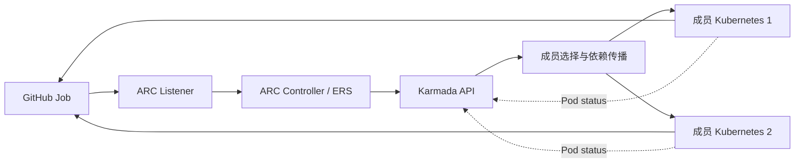

需求方向为 GitHub → Listener → ARC → Karmada → 成员 Runner。反馈方向为 Runner → GitHub 和成员 Pod.status → Karmada → ARC。状态/依赖传播是两个上游控制器体系之间的**集成契约**，参见第 4 章。

## 3.4 功能域系统元素及逻辑架构

### 3.4.1 逻辑组件架构

本子系统要解决的核心问题是：**项目与执行集群绑定，导致集群间资源难以互用、负载不均衡及任务排队**。架构采用 **ARC 集中管理 Runner + Karmada 联邦分发 + 成员 Kubernetes 原生执行** 的协作模式；以下重点说明各构件对整体问题的贡献，而非展开上游组件的内部实现。

| 架构构件 | 主要解决的问题 / 架构职责 | 与其他构件的协作关系 |
|---|---|---|
| ARC Listener | **统一任务入口**：让开发者使用同一个 Runner 标签提交任务，不必为不同成员集群选择专用标签。 | 对接 GitHub Actions 的任务需求，与 ARC Controller 协同完成按需 Runner 供给。 |
| ARC Controller | **集中管理执行实例的生命周期**：使 Runner 的创建、扩缩与回收不再由每个执行集群各自管理。 | 承接 Listener 的需求变化，将 Runner 交给 Karmada 跨集群分发，并根据执行状态管理生命周期。 |
| Karmada（复用的联邦子系统） | **打通相互隔离的执行资源池**：将多个成员集群纳入同一分发范围，使一个项目的任务可以使用其他合格成员的执行资源。 | 接收 ARC 产生的 Runner 对象，将其分发至成员 Kubernetes，并把执行状态返回给 ARC；不取代成员的节点级调度。 |
| 成员 Kubernetes 与 Runner Pod | **提供实际、相互隔离的任务执行能力**：让集中管理的 Runner 在选中的成员集群使用当地计算资源执行 GitHub Job。 | 接收 Karmada 下发的 Runner 工作负载，使用成员原生调度与网络执行任务，并向控制面反馈状态。 |
| ARC–Karmada 集成适配（本系统设计） | **消除两套上游系统之间的语义与环境差异**：保障跨控制面访问、临时注册凭证可用、Runner 就绪状态可被正确识别。 | 在 ARC、Karmada 与成员 Kubernetes 之间补齐通信鉴权、依赖传播和状态聚合约束，使上述管理、分发、执行链路闭环。 |

**范围与边界：** GitHub Actions 是外部任务来源；ARC、Karmada 与 Kubernetes 是复用组件。`karmada-search` 不在本方案逻辑图中；NPU 设备插件属于成员环境依赖，不应误画为自研核心模块。跨成员执行是设计能力，不据此承诺均匀分配或固定排队收益。

部署关系见 3.6；资源、状态与接口契约见 3.5、4.4～4.6 和第 5 章。

### 3.4.2 与周边系统元素的关系

| 周边元素 | 职责关系 | 进入/输出的实体 | 约束 |
|---|---|---|---|
| GitHub Actions | 外部任务入口与运行结果接收方 | Job 需求、Runner 注册、运行状态 | 入口标签、GitHub 身份与 JIT |
| 镜像仓库 | 提供 Controller/Runner/Action 镜像 | OCI Image | 可信源、平台架构、版本/digest |
| 密钥系统 | 供给和轮换 GitHub 主凭证、控制面身份 | Credential/CA/Token | 不在仓库明文保存、最小授权 |
| 部署与配置管理 | 安装官方组件及本项目 CRD/Policy | Chart/Manifest/配置参数 | 声明式、回滚与版本兼容 |
| 观测/审计系统 | 关联一次 Job 与执行实例 | Job/ER/Pod/Binding/Work 标识、事件与日志 | 不收集 Secret Data |

## 3.5 领域数据模型和归属

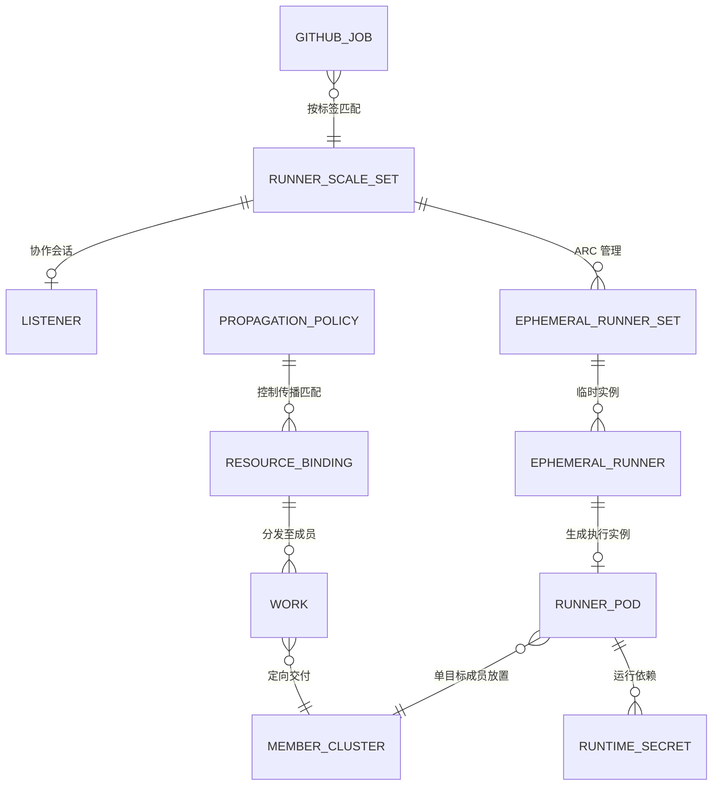

图为**领域概念关系**，不等于原生 Kubernetes OwnerReference；动态资源真实归属由所选 ARC/Karmada 版本定义。以下表格是实现和销毁规格：

| 领域对象 | 权威生产者 | 主要关联/消费者 | 寿命分类 | 处置与销毁要求 |
|---|---|---|---|---|
| GitHub Job | GitHub Actions | 任务来源；不是 Kubernetes API 对象 | 单次/外部保留 | 任务队列、运行状态 |
| AutoscalingRunnerSet | 平台声明；ARC 管理 | Runner 服务及 GitHub 认证入口 | 长期 | ScaleSetName、GitHubConfigSecret、RunnerTemplate |
| AutoscalingListener / Listener Pod | ARC 生成 | 侦听任务需求并调整 ERS | 随 Scale Set | Token、CA、管理控制面 API |
| EphemeralRunnerSet / EphemeralRunner | ARC 生成 | 需求副本/单 Runner 实例生命周期 | 临时 | OwnerReference、状态、Finalizer |
| Runner Pod | ARC 生成 / Karmada 传播 | 成员的实际 Job 执行对象 | 临时 | SA、镜像、JIT Secret 引用、status |
| JIT Secret | ARC 动态生成 | 一次性 Runner 注册凭证 | 临时敏感 | 仅传目标执行成员；作业后回收 |
| 主 GitHub Secret | 平台密钥系统提供 | ARC 管理链路授权 | 受控敏感 | 目标设计不向无消费者成员扩散 |
| PropagationPolicy | 平台声明 / Karmada 消费 | 成员选择、匹配范围、依赖传播 | 长期配置 | ResourceSelectors、Placement、propagateDeps |
| ResourceBinding / Work | Karmada 生成 | 联邦调度与成员期望资源载体 | 随 Pod/策略 | 控制面到执行面的对象关系 |
| Pod.status | 成员 Kubernetes 产生 | 供 ARC 判断 Runner 状态 | 随 Pod | containerStatuses、conditions、Phase |
| MemberCluster / NPU 资源 | Karmada + 成员 K8s / Device Plugin | 集群资格、节点扩展资源 | 长期运行时 | Ready、labels、allocatable、扩展资源 |

**数据分级与销毁（D）**：GitHub PAT/App 凭证、Listener Token、JIT Secret 属敏感数据，禁止在日志、Git、工单附件输出值；运行时对象删除由 ARC/Karmada 所有权规则驱动，审计只保留非敏感 ID/状态。Job 日志、镜像与第三方系统持久数据的保留/销毁服从各自系统策略，**不因 Pod 删除自动消失**。证书/Token 轮换同时考虑控制面存储、成员副本和日志暴露面。销毁保留期/合规等级若需精确数值，由企业数据分类制度提供（P），不虚构默认周期。

## 3.6 部署拓扑与周边服务

| 部署域 | 构件 | 运行接口 | 设计约束 |
|---|---|---|---|
| ARC 管理域 | 官方 ARC Controller | GitHub API、统一 Karmada API | 可以是管理 Kubernetes/容器部署；不要求在每个成员单独部署 |
| Karmada 控制面 | API、Policy/Scheduler、状态解释扩展 | 多成员 Kubernetes API | API、证书、网络、成员资格、可用性由部署管理提供 |
| Listener 成员域 | Listener Pod、独立控制面身份 | GitHub Actions、Karmada HTTPS API | 示例固定在 member1；目标成员是可配置的 Placement |
| Runner 执行域 | Runner Pod、JIT Secret、Runner SA、可选 NPU 资源 | GitHub Actions、成员 kubelet/Runtime | 只允许在满足资源、镜像和安全约束的成员运行 |
| 平台外 | 镜像仓库、身份/密钥服务、运维/观测 | 拉取、认证、日志/指标 | 不要求跨成员 Pod 网络直连 |

**配置输入清单（P）**：`runnerScaleSetName` / `runs-on`、GitHub URL、Runner 镜像/digest、控制面 API DNS/IP/port/SAN、CA、Token audience/TTL、目标成员集合、调度权重、Namespace、NPU 资源名、节点标签、业务 SLO。当前 Manifest 的 `karmada-runner`、`member1/member2`、`172.22.0.4:32443` 是示例值，后两者不应硬编码到通用部署工具。

### 3.6.1 安装与声明依赖次序

1. 提供 Karmada API、可达的成员 K8s API 和所需 ARC 版本 CRD；目标成员达到可参与传播的状态。
2. 准备命名空间、控制面身份/证书、Runner SA 与 GitHub 管理凭证。
3. 安装状态解释器、角色/绑定和传播策略，再声明 AutoscalingRunnerSet；保证 Listener 访问的是正确控制面。
4. 安装官方 ARC Controller 并由其调谐动态对象。组件顺序、重试和升级回滚在部署计划中实现，不在功能设计中复刻具体 Shell 命令。

## 3.7 上游官方资料及推导边界

| ID | 上游组件资料 | 本设计引用的能力 |
|---|---|---|
| ARC-1 | [GitHub：Actions Runner Controller](https://docs.github.com/en/actions/concepts/runners/actions-runner-controller) | Runner Scale Set、Listener、EphemeralRunner、JIT、生命周期 |
| ARC-2 | [GitHub：部署 Runner Scale Sets](https://docs.github.com/en/actions/how-tos/manage-runners/use-actions-runner-controller/deploy-runner-scale-sets) | Scale Set 部署配置、GitHub 凭证、Runner 模板 |
| KAR-1 | [Karmada：PropagationPolicy](https://karmada.io/docs/next/userguide/scheduling/propagation-policy/) | 资源选择器、成员放置、分副本/加权策略 |
| KAR-2 | [Karmada：Propagate dependencies](https://karmada.io/docs/userguide/scheduling/propagate-dependencies/) | 对象引用的 Secret/ConfigMap 依赖传播 |
| KAR-3 | [Karmada：Customizing Resource Interpreter](https://karmada.io/docs/userguide/globalview/customizing-resource-interpreter/) | ResourceInterpreterCustomization、AggregateStatus |
| K8S-1 | [Kubernetes：Service Accounts](https://kubernetes.io/docs/concepts/security/service-accounts/) | TokenRequest、SA 身份与 Token 生命周期 |
| K8S-2 | [Kubernetes：RBAC Good Practices](https://kubernetes.io/docs/concepts/security/rbac-good-practices/) | 角色权限及最小权限原则 |
| K8S-3 | [Kubernetes：Device Plugins](https://kubernetes.io/docs/concepts/extend-kubernetes/compute-storage-net/device-plugins/) | Device Plugin 扩展资源与节点分配 |

**使用边界**：官方文档分别证明 ARC 与 Karmada 等组件的原生能力；**并不证明两者组合的端到端兼容性**。所有跨组件行为应在第 4～5 章以 D 类设计契约表达；性能百分比、Token 自动轮换、多副本 status 和无损故障切换不得当作已有保证。

# 4 功能域规格变更与设计

> 本章规定多个功能共同使用的资源、配置及安全规则。第 5 章说明每个功能如何使用这些规则，不重复描述 ARC、Karmada 和 Kubernetes 的内部实现。**U** 表示上游文档支持的能力；**D** 表示本功能域确定的集成规则；**P** 表示部署时需要提供的参数。“当前配置”指本仓库已有的 Manifest，“目标设计”指开发必须满足的要求。两者不一致时，开发人员必须明确记录并处理差异。

## 4.1 功能域规格变更

| 规格编号 | 当前配置 | 目标设计要求 | 负责方 |
|---|---|---|---|
| SP-01 Runner 服务命名 | 示例的 Scale Set 名称为 `karmada-runner`，`minRunners` 为 0，`maxRunners` 为 5。 | 平台必须保持 GitHub 工作流标签与 Runner 服务名称一致。Runner 数量的上下限由业务容量参数确定。 | 平台配置维护者 |
| SP-02 候选成员策略 | 现有策略包含 member1、member2，并使用 `Divided` 与 `Weighted`。 | 平台必须规定每个 Runner Pod 的合格成员范围。一个临时 Runner Pod 只在一个成员执行；该策略不保证多个 Pod 每轮平均分配。 | 联邦策略维护者 |
| SP-03 Runner Pod 选择范围 | 现有策略匹配 `arc-runners` 命名空间的全部 Pod。 | 平台必须只选择 ARC 管理的 Runner Pod。开发人员须按目标 ARC 版本的对象标签定义选择条件，并检查其他 Pod 不会被选中。 | 联邦策略维护者 |
| SP-04 GitHub 主凭证传播 | 现有策略将 `arc-github-secret` 同步到两个成员集群。 | 平台必须按实际凭证使用者确定传播范围。临时 Runner 不应因为需要跨集群运行而自动获得 GitHub 管理凭证。 | 身份管理者 |
| SP-05 Listener API 身份 | 示例通过单独的 Token 和 CA 证书访问固定 API 地址，Token 由脚本签发。 | 平台必须提供可配置的 API 地址、可信 CA、最小权限和凭证更新规则。必须区分网络、证书、身份认证和权限错误。 | 身份管理与部署维护者 |
| SP-06 Runner Pod 状态 | 当前 Lua 解释器选取第一个非空 `status`。 | 状态解释必须保留 ARC 所需的 Pod 字段。该规则只适用于一个 Runner Pod 在一个成员运行且状态来源没有冲突的情况。 | 状态适配维护者 |
| SP-07 临时资源生命周期 | ARC 和 Karmada 分别处理临时对象的删除。 | 平台必须能够关联同一任务的 Runner、Pod、JIT Secret 和联邦对象。删除失败时必须保留原因，不能任意清空未知 Finalizer。 | 控制器维护者和运维人员 |
| SP-08 NPU 资源规格 | 当前示例没有固定 NPU 资源名称及设备插件。 | 部署方必须从目标设备插件取得扩展资源名称与分配规则。平台据此配置成员筛选和 Runner Pod 资源请求。 | 设备与资源池维护者 |
| SP-09 安全与可观测性 | 现有资料通过 GitHub Run、Pod、Work 和日志进行局部诊断。 | 平台必须保存任务和联邦资源之间可追踪的标识，记录错误类型，禁止将凭证值写入日志。 | 平台运维与安全管理员 |

**当前配置与目标的差异**：SP-03、SP-04、SP-05 需要改变现有集成配置。文档明确的是开发目标，不表示这些变化已经实施。设计完成不需要 PoC，但实施人员必须逐项处理目标规格与现有 Manifest 的差异。

## 4.2 SP-01 Runner 服务与任务入口规格设计

### 4.2.1 实现思路

GitHub Actions 通过工作流的 `runs-on` 字段匹配 Runner 服务。平台在 `AutoscalingRunnerSet.spec.runnerScaleSetName` 中配置该服务的名称。ARC 负责创建和删除 Runner（U）。本功能域负责维护工作流标签、Runner 服务、Runner 模板和候选成员之间的对应关系（D）。成员集群名称不应出现在一般业务工作流中。若两个资源池的硬件或权限不能互换，平台应分别定义 Runner 服务。

### 4.2.2 实现设计

| 规范字段 | 类型/位置 | 约束 |
|---|---|---|
| 服务标识 | GitHub workflow `runs-on`、`AutoscalingRunnerSet.spec.runnerScaleSetName` | 同一个 Runner 服务在工作流 `runs-on` 与 `spec.runnerScaleSetName` 中必须使用相同名称。`karmada-runner` 是参考名称。 |
| GitHub 目标 | `spec.githubConfigUrl` | 平台管理员必须为 `spec.githubConfigUrl` 设置已授权的仓库或组织地址。Runner 不得注册到未授权的仓库或组织。 |
| 主凭证 | `spec.githubConfigSecret` | `spec.githubConfigSecret` 引用的凭证必须由可信管理域提供，并遵守 SP-04 的分发限制。 |
| 弹性区间 | `spec.minRunners/maxRunners` | `spec.minRunners` 与 `spec.maxRunners` 必须满足 `0 ≤ minRunners ≤ maxRunners`。具体数值由部署配置确定。 |
| Runner 镜像与 Pod 模板 | `spec.template` | `spec.template` 必须声明 Runner 镜像、资源请求、ServiceAccount 及必要的容器安全配置。 |
| 版本约束 | ARC CRD/Controller/Listener/RunnerSet label | 部署方必须核对 ARC Controller、CRD 和 Runner 资源的版本兼容性。现有 0.15.0 只是配置示例。 |

如果工作流标签没有对应的 Runner 服务，平台不得更改该标签或把作业发送给其他服务。GitHub Actions 根据自己的规则显示排队状态。当注册权限不足或 Runner 已达到容量上限时，平台必须保留对应的错误信息或容量状态，不得通过更换服务标签绕过隔离要求。

## 4.3 SP-02/SP-03 联邦调度与依赖传播规格设计

### 4.3.1 实现思路

Karmada 的 `PropagationPolicy` 规定哪些对象需要传播，以及允许向哪些成员集群传播（U）。本功能域使用该策略传播 Runner Pod，不另行实现 GitHub 作业调度器（D）。每个临时 Runner Pod 只在一个成员集群运行。成员 Kubernetes 负责选择运行节点。Karmada 使用 `propagateDeps` 处理 Pod 引用的 JIT Secret 等依赖对象。Pod 与 Secret 可以先后到达；成员 Kubernetes 不能在必需的 Secret 尚未可用时完成相应的容器启动。

### 4.3.2 实现设计

| 配置项 | 规定的行为 | 前置条件与异常处理 |
|---|---|---|
| `PropagationPolicy.metadata.namespace` | 策略必须位于待传播 Runner Pod 所属的命名空间。平台必须检查该范围不会包括其他租户的 Pod。 | 当前使用 `arc-runners`。 |
| `resourceSelectors` | 策略必须只选择目标 Runner 服务管理的 Pod，所用标签必须符合选定 ARC 版本的对象定义。 | 除检查目标 Pod 被选中，还必须检查其他 Pod 不被选中；当前全命名空间匹配属于待修改配置。 |
| `placement.clusterAffinity` | 平台必须指定可以接收 Runner Pod 的成员集群，并根据设备类型、节点架构及隔离条件确定候选集。 | 当前示例为 member1 和 member2，不能把它们当成通用常量。 |
| `replicaScheduling` | 使用 `Divided` 或 `Weighted` 时，必须遵循所选 Karmada 版本的接口语义。 | 多个独立的单 Pod 任务不保证逐轮平均分配。 |
| `propagateDeps` | Karmada 必须将 Runner Pod 引用的 JIT Secret 等依赖资源传播到该 Pod 所在的成员。 | 依赖到达顺序不保证是原子事务；Secret 缺失时保留 Pod 挂载或启动异常状态。 |
| 主凭证 | 平台不得仅因为传播 Runner Pod 就把 GitHub 管理凭证分发到所有成员。 | 只有明确存在成员侧消费者并已授权时，才允许额外分发相应凭证。 |
| 执行态 | 成员 Kubernetes 负责维护 Pod 的 `Pending`、`FailedMount`、`ErrImagePull` 等状态或事件。 | 平台必须显示或保存异常原因，不得因此重复提交同一个 GitHub 作业。 |

如果没有符合要求的成员集群，Runner Pod 必须保持未就绪或不可调度状态，并保留调度失败原因。成员失去连接时，平台必须区别尚未运行的 Runner Pod 和正在执行的 GitHub Job。Karmada 的资源重新分发不等于 GitHub Job 可以无损迁移或安全重复执行。传播策略发生资源冲突时，平台必须遵守 Karmada 的冲突处理机制，不得覆盖不属于本系统管理的资源。

## 4.4 SP-04/SP-05 身份、凭证与跨控制面访问规格设计

### 4.4.1 实现思路

ARC Controller、ARC Listener 和临时 Runner 必须使用各自需要的访问身份。Controller 负责管理 Runner 对象并使用 GitHub 管理凭证。Listener 使用独立身份访问 Karmada API，只获得处理其 Runner 服务所需的权限。临时 Runner 使用 ARC 创建的 JIT 配置注册到 GitHub，不应获取长期 GitHub 管理凭证。本功能域采用 Kubernetes ServiceAccount、TokenRequest 和 RBAC 的身份与授权机制（U）。令牌的签发、有效期、更新与审计由平台身份管理者负责（D）。

### 4.4.2 实现设计

| 访问主体和目标 | 认证方式 | 规定的权限与安全限制 |
|---|---|---|
| Controller → Karmada API | Controller 必须通过可信 CA 验证 Karmada API，并使用专门的 Kubernetes API 凭证。 | 平台必须按 ARC 管理资源所需的 API 操作授予权限，不得把管理员级 kubeconfig 作为生产目标权限。 |
| Listener → Karmada API | Listener 必须使用单独的 ServiceAccount 凭证和可验证的 HTTPS 地址。 | 权限应限制为指定 Runner 服务需要的 `EphemeralRunnerSet` 与 `EphemeralRunner` 操作；当前 [RBAC Manifest](../manifests/03-rbac.yaml) 是配置示例。 |
| Runner Pod → GitHub Actions | Runner 使用 ARC 创建的 JIT 注册配置与 GitHub 通信。 | 不得使用管理端的长期 GitHub 凭证；Runner 模板使用 `automountServiceAccountToken: false` 避免自动挂载 Kubernetes API 令牌。 |
| Karmada → 成员 API | Karmada 使用联邦成员注册时配置的访问身份。 | 成员 API 凭证应限制在传播资源和读取必要状态的操作范围内，由平台身份管理者维护。 |

**部署方必须提供的认证参数（P）**：API 地址与端口、服务器证书名称、可信 CA、令牌的使用范围和有效期、凭证颁发者以及更新方法。平台必须规定 Listener 如何加载更新后的令牌或证书。仅修改 Kubernetes Secret 不能证明 Listener 一定会自动使用新凭证。

**异常处理**：地址无法解析或 TCP 连接失败时，记录网络错误；服务器证书链或证书名称校验失败时，记录 TLS 错误；API 返回 HTTP 401 时，记录身份认证失败；API 返回 HTTP 403 时，记录权限不足。平台必须保留错误类型以供身份或网络管理员定位，不能关闭 TLS 校验，也不能通过临时授予 `cluster-admin` 绕过故障。日志不得包含令牌、私钥或 Secret 数据。

## 4.5 SP-06/SP-07 状态与生命周期规格设计

### 4.5.1 实现思路

成员 Kubernetes 负责生成 Runner Pod 的实际状态。Karmada 将该状态提供给统一控制面（U），ARC 根据其管理的 Runner 对象和 Pod 状态执行原有生命周期处理。本功能域通过 `ResourceInterpreterCustomization` 规定单目标 Runner Pod 的状态保留规则（D），不改变上游 ARC 的状态判断逻辑。动态对象仍由相应控制器根据 OwnerReference 与 Finalizer 管理。

### 4.5.2 实现设计

**下面的阶段名称用于描述设计流程，不是 Kubernetes Pod Phase 或 ARC 的 API 枚举值。**

| 逻辑阶段 | 进入条件 | 规定的行为 |
|---|---|---|
| 任务需求已接收（Requested） | Listener 接收到 Runner 服务的任务数量需求。 | ARC 按 Runner Scale Set 管理期望 Runner 数量。Karmada 不负责 GitHub 任务排队。 |
| 执行成员已选定（Scheduled） | Karmada 为 Runner Pod 选择一个成员集群。 | Karmada 分发资源；没有合格成员时不得把 Pod 视为已调度。 |
| Pod 尚未就绪（Pending） | 成员 Kubernetes 尚未完成调度、镜像获取或必需 Secret 挂载。 | 平台保留 Pod 事件和未就绪原因，不因此重复提交 GitHub Job。 |
| Pod 已就绪（Ready） | 成员 Pod 状态满足 ARC 需要的容器状态及 Ready 条件。 | Karmada 必须保留并同步这些字段。Pod Ready 不等于 GitHub Job 成功。 |
| 作业执行中（Executing） | Runner 已注册并开始执行 GitHub 分配的 Job。 | GitHub Actions 管理 Job 的执行结果；Pod 状态用于 Runner 运行诊断。 |
| 作业结束（Completed / Failed） | ARC 和 GitHub 按各自接口识别任务结束状态。 | ARC 开始相应的临时资源回收流程，平台保留失败原因。 |
| 资源删除中（Deleting） | ARC 或 Karmada 开始删除关联的临时对象。 | 各控制器处理其拥有的资源；删除失败时保留对象标识、Finalizer 和错误原因。 |

**Pod 状态解释要求**：对只在一个成员运行的 Runner Pod，状态解释器必须保留 `status.phase`、`status.conditions`、`status.containerStatuses[].name` 及 ARC 读取的容器运行字段。如果成员没有返回状态，不能自行生成 Ready 条件。当前 Lua 使用“第一个非空 `status`”的规则，只适用于单目标且没有状态冲突的场景。新增跨成员迁移或多副本场景前，必须另行定义状态来源选择及冲突解决规则。

**删除要求**：平台必须能够关联一次任务对应的临时 Runner、Runner Pod、JIT Secret 和 Karmada Binding/Work。各控制器分别完成删除，不要求所有对象同时消失。Finalizer 阻止删除时，运维人员必须先确认该 Finalizer 的所属控制器和未完成的清理操作，不能随意清空它。

## 4.6 SP-08 NPU 资源规格设计

### 4.6.1 实现思路

Kubernetes Device Plugin 负责向成员 Kubernetes 发布扩展设备资源（U）。本功能域必须依据目标 Runner 服务的设备需求，设置成员候选范围和 Runner Pod 的扩展资源请求（D）。Karmada 负责选择成员，成员 Kubernetes 负责选择节点；本功能域不重新实现 NPU 设备分配。具体硬件架构、操作系统、驱动、固件、设备插件及容器运行时必须依据目标 NPU 产品资料确定（P）。

### 4.6.2 实现设计

| 配置项 | 参数来源 | 规定的行为与限制 |
|---|---|---|
| NPU 扩展资源名 | 目标设备插件发布的 Kubernetes 资源定义。 | Runner Pod 必须使用插件实际发布的扩展资源名称。不得假定所有设备都使用 `npu`。 |
| 设备份额与数量 | 设备插件定义的资源单位与可共享规则。 | 平台必须按插件支持的分配单位设置请求数量。没有厂商资料时不得承诺共享或超额分配。 |
| 成员/节点标签 | 资源池配置、成员标签及节点标签。 | Karmada 应选合格成员，成员调度器再按资源请求和节点约束选节点。两层约束必须一致。 |
| 镜像/驱动/Runtime | 设备驱动、固件和容器运行时的兼容资料。 | 部署方必须核对 Runner 镜像与目标设备的兼容性；不能因为安装了设备插件就推定全部软件栈可用。 |
| Runner Scale Set | 服务目录及 GitHub 工作流标签。 | 硬件能力不能互换时，平台必须配置不同 Runner 服务，不能默默把 NPU Job 交给普通 CPU Runner。 |

没有符合条件的设备时，Runner Pod 必须保留不可调度状态及原因。插件未就绪或节点扩展资源消失时，不得删除 NPU 资源请求，也不得改用不具备 NPU 的节点执行任务。资源分配失败由成员 Kubernetes、设备插件和设备运维人员按各自职责定位。设备型号、资源名称和性能指标属于部署选型参数（P）。

## 4.7 SP-09 跨功能质量与可服务性规格

| 质量属性 | 规定的行为 | 需要确认的部署参数 |
|---|---|---|
| 安全 | Controller、Listener 和 Runner 必须使用彼此独立且满足最小权限原则的身份。平台只下发执行所需的 Secret，并校验 TLS 证书。 | Token 有效期、凭证系统和租户隔离规则。 |
| 可靠性 | 系统必须区分控制器可以重试的资源操作与需要管理员修复的证书、权限、网络错误。不得仅凭 Runner Pod 异常就重新提交同一 GitHub Job。 | 故障恢复目标、告警规则与人工处理责任。 |
| 可用性 | 平台必须明确 GitHub、Karmada 控制面、成员集群和网络连接之间的故障边界。一个成员可用不代表整个 GitHub Runner 服务可用。 | 目标部署拓扑、冗余级别和服务可用性目标。 |
| 性能与并发 | 平台应分别记录 Job 排队、Runner 数量调整、Pod 就绪和 Runner 注册的时间。不能用一次分配结果推定长期负载均衡。 | 服务容量、排队时间与每阶段延迟要求。 |
| 可服务性 | 平台必须能够使用 GitHub Run、Runner Scale Set、临时 Runner、Pod UID、Binding/Work 和成员集群定位同一次任务的处理状态。 | 日志保留期限、审计要求及观测平台。 |
| 升级与兼容 | 部署方必须记录 ARC CRD、Controller、Listener、Runner 镜像及 Karmada API 的版本，并按目标版本的接口检查兼容性。 | 组件版本、镜像摘要和升级回滚窗口。 |

第 5 章 F-01～F-06 必须遵守 SP-01～SP-09。每项 FMEA 应明确失效原因、影响、检测方式、恢复方法和责任方。如果业务尚未提供性能目标、设备型号或安全等级，文档必须标记为待确定参数，不得填写无依据的数值。

# 5 功能实现设计

> 本章按**功能单元**组织，每个功能汇总：功能概述、技术取舍、用例运行时序、用户接口、实现接口及 FMEA/DFX。其共同规格只引用第 4 章的 SP 编号，不重复堆叠 YAML 细节。对已有 Kubernetes/ARC/Karmada CRD，以其 OpenAPI schema 和字段契约为准；**没有新增 REST 服务，因此不虚构 Swagger Endpoint**。如实际新增 REST API，必须另补 OpenAPI 3 规范。
>
> US 图源自此前主设计文档的 8 张运行图，在此按 F 功能聚合（F-02: US-02/07，F-03: US-03/04）。部分交互为本系统的集成设计推论，不是官方对组合系统端到端行为的保证。

## 5.1 F-01 统一 Runner 服务入口

### 5.1.1 功能概述

**关联需求**：SR-01-01、SR-01-02；**用例**：UC-01 通过统一标签提交工作流、UC-02 无匹配或无可用 Runner；**功能域规格**：SP-01。

对业务方屏蔽 member1/member2 和资源池拓扑，只暴露可授权的 GitHub Runner Scale Set 服务标签。输入为工作流 runs-on 与配置的 Scale Set，输出为已匹配任务需求或可见的排队/授权状态。

**边界/归属**：只维护本功能域的配置或适配；ARC/Karmada/Kubernetes 上游内部调谐逻辑不由本功能重写。

### 5.1.3 实现思路

选用 ARC 官方 Scale Set + GitHub 原生 runs-on（U）；由平台将服务标签、Runner 模板、目标 GitHub Repo/Org 和容量区间关联（D）。不开发自研 GitHub Job Queue；若资源型号/隔离不同，以多个显式服务区分（P）。

### 5.1.4 设计思路

开发者 → GitHub Job 队列 → Listener 会话 → EphemeralRunnerSet 期望量 → ARC Runner 供给；具体成员由 F-03 决定。任务未匹配 Scale Set 时保持 GitHub 的等待与失败可诊断状态，平台不得自动替换标签。

#### 5.1.4.1 UC-01 通过统一标签提交工作流——运行时序（US-01）

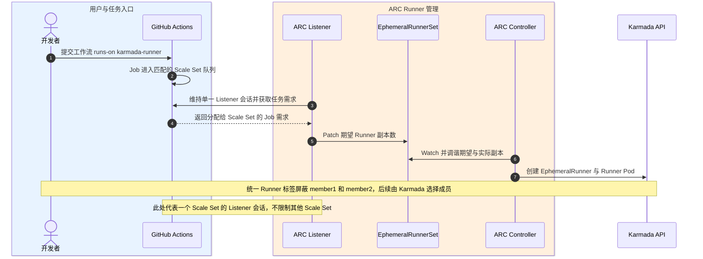

**图的架构含义**：展示该用例跨组件的主要消息路径与对象更新。当前图是设计交互，不是实测调用栈；真实上游控制器内部仍以目标版本官方文档为准。

### 5.1.5 用户接口设计

用户接口是 Workflow YAML 中的 `jobs.<job>.runs-on`，不是自建网页 UI。示例：`runs-on: karmada-runner`；该字符串必须与 `AutoscalingRunnerSet.spec.runnerScaleSetName` 配置一致。若没有新增管理 UI，则“可视化页面设计”为 N/A，运维使用 GitHub/声明式配置。

### 5.1.6 实现接口设计

#### 5.1.6.1 接口设计

| 调用方 → 提供方 | 原生接口/对象 | 关键字段与输入输出 | 身份或前置条件 | 异常/幂等及诊断 | 依据/决策 |
|---|---|---|---|---|---|
| 外部 GitHub workflow → Scale Set | GitHub Actions runs-on | string 标签到服务名映射 | Repo/Org 权限和 Runner Service 名称一致 | 未匹配 → GitHub queued；不偷换成员标签 | U:ARC-1; D:SP-01 |
| 平台配置 → ARC Controller | actions.github.com/v1alpha1 AutoscalingRunnerSet（声明式） | metadata.name/ns, spec.runnerScaleSetName, githubConfigUrl, githubConfigSecret, minRunners, maxRunners, template | Karmada API CRD 权限；GitHub 主凭证保管在可信管理域 | 版本/权限/配额异常可观测；禁用隐式扩权 | U:ARC-2; D |

**开发交付边界**：只新增/修改本仓库负责的 RunnerSet 模板、PropagationPolicy、RBAC、身份适配、Lua/状态解释或资源参数；对官方 API 的精确字段类型、枚举和版本兼容限制，必须以所选版本的 CRD OpenAPI Schema 为准。上表不能替代完整 upstream schema。

### 5.1.9 DFX分析

**功能内 DFX**：并发由 `maxRunners` 和 GitHub/ARC 上游机制控制；服务容量和排队目标为 P 类输入。安全要求避免跨 Repo/Org 意外注册，并确保工作流不直接获得 GitHub 管理凭证。

**可靠性 FMEA（设计阶段定性分析；严重度/发生概率/探测度的数值及 RPN 未经业务基准审批，暂不虚构）**

| FMEA 编号 | 失效模式 | 对业务/系统的影响 | 发现与定位 | 预防/恢复措施 | 责任主体 |
|---|---|---|---|---|---|
| F01-01 | 标签拼写或命名漂移 | Job 长时间等待 | GitHub runs-on/Scale Set 清单比对 | 统一配置源与变更审查 | 平台维护者 |
| F01-02 | GitHub 管理凭证无效 | Scale Set 会话/Runner 注册受阻 | Listener/Controller 认证事件 | 刷新凭证与隔离错误，不重写 Job 标签 | 身份服务/ARC |

**可服务性与安全检查**：关联 GitHub Job Run → RunnerSet → ER/Pod UID → Karmada Binding/Work → 成员集群，采集必要状态与错误分类，不记录主 GitHub Token、JIT Secret Data、Kubeconfig 和私钥。若此功能提供可配置的 SLO，明确指标定义、度量位置、业务提供的阈值及失败处理，而不把一次 PoC 运行值当作产品规格。

## 5.2 F-02 Runner 弹性供给及临时资源回收

### 5.2.1 功能概述

**关联需求**：SR-02-01、SR-02-02；**用例**：UC-03 Job 需求驱动 Runner 创建、UC-04 Job 结束回收 Runner 与凭证；**功能域规格**：SP-01、SP-06、SP-07。

把临时 Runner 供给与回收集中在 ARC，成员只负责运行。输入是 Listener 的任务需求及 ARC CR；输出是单 Job 执行的临时 Runner 与最终释放的对象。

**边界/归属**：只维护本功能域的配置或适配；ARC/Karmada/Kubernetes 上游内部调谐逻辑不由本功能重写。

### 5.2.3 实现思路

采用 ARC 官方 Listener/Controller/EphemeralRunnerSet/EphemeralRunner 生命周期（U），Karmada 仅负责成员 Pod/Secret 分发及副本回收（D）。不自行维护 runnerID 与 Pod 名称的固定格式；采用动态 Owner/UID 关联。

### 5.2.4 设计思路

需求更新 → ERS 期望量 → EphemeralRunner / Pod / JIT Secret → 成员执行 → GitHub Job 状态 → ARC 临时资源回收 → Karmada Binding/Work 与成员对象异步清理。正常 Job 与失败 Job 都进入可诊断终态，但不能在缺乏 GitHub 幂等约束时擅自重派发。

#### 5.2.4.1 UC-03 Job 需求驱动 Runner 创建——运行时序（US-02）

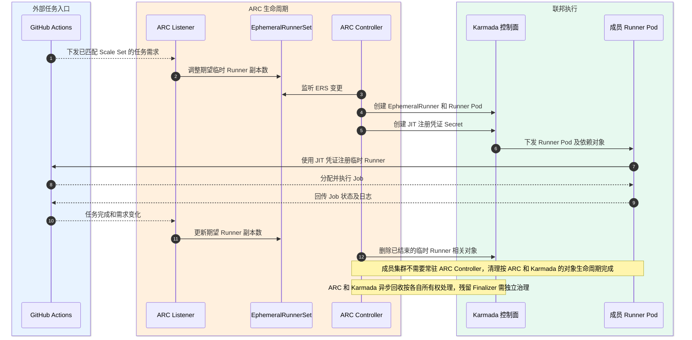

**图的架构含义**：展示该用例跨组件的主要消息路径与对象更新。当前图是设计交互，不是实测调用栈；真实上游控制器内部仍以目标版本官方文档为准。

#### 5.2.4.2 UC-04 Job 结束回收 Runner 与凭证——运行时序（US-07）

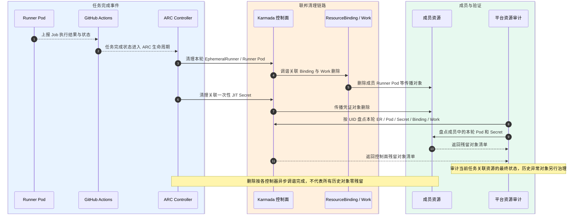

**图的架构含义**：展示该用例跨组件的主要消息路径与对象更新。当前图是设计交互，不是实测调用栈；真实上游控制器内部仍以目标版本官方文档为准。

### 5.2.5 用户接口设计

开发者只在 GitHub Actions 看到任务排队、执行与结果；用户无需创建 Pod、Secret 或调用 Kubernetes API。平台运维可通过对象/日志和 Run 标识关联一次任务。额外用户页面：N/A。

### 5.2.6 实现接口设计

#### 5.2.6.1 接口设计

| 调用方 → 提供方 | 原生接口/对象 | 关键字段与输入输出 | 身份或前置条件 | 异常/幂等及诊断 | 依据/决策 |
|---|---|---|---|---|---|
| Listener → ERS | Kubernetes API PATCH: actions.github.com/v1alpha1 EphemeralRunnerSet | 对指定 Scale Set 的期望副本调整；对象 UID/RV、资源名动态 | 独立 Listener SA，指定 ERS patch | 冲突更新遵循 resourceVersion；拒绝越权或重复写错 ERS | U:ARC-1; D:SP-01 |
| ARC Controller → Karmada API | EphemeralRunner、Runner Pod、临时 JIT Secret | Pod 模板含镜像、SA、JIT Secret 引用；临时 ER 动态生成 | Controller 最小 Karmada API 权限 | 资源未创建/镜像不可用保留事件与诊断 | U:ARC-1; D |
| ARC/Karmada → 成员 K8s | Pod 删除；ResourceBinding/Work 生命周期 | 关联 UID/owner、已选成员及临时 Secret | 分层的 Owner/Finalizer | 异步删除、Finalizer 阻塞独立处理，不强清 | U:ARC-1,KAR-1; D:SP-07 |

**开发交付边界**：只新增/修改本仓库负责的 RunnerSet 模板、PropagationPolicy、RBAC、身份适配、Lua/状态解释或资源参数；对官方 API 的精确字段类型、枚举和版本兼容限制，必须以所选版本的 CRD OpenAPI Schema 为准。上表不能替代完整 upstream schema。

### 5.2.9 DFX分析

**功能内 DFX**：并发上限由 Scale Set 配置控制；设计不承诺无损故障切换。JIT Secret 按短期敏感数据处置，不把 Secret.data 记录在审计或工作流日志中。

**可靠性 FMEA（设计阶段定性分析；严重度/发生概率/探测度的数值及 RPN 未经业务基准审批，暂不虚构）**

| FMEA 编号 | 失效模式 | 对业务/系统的影响 | 发现与定位 | 预防/恢复措施 | 责任主体 |
|---|---|---|---|---|---|
| F02-01 | 需求变化与 Controller 调谐延迟 | Job 排队增加 | ERS 期望与实际、Controller Event | 遵循 ARC 上游 reconcile；容量告警 | ARC/运维 |
| F02-02 | 注册后 Pod 异常或 Job 失败 | 执行失败/重复风险 | GitHub Run/ER/Pod 相关事件 | 遵守 ARC/GitHub 重试语义，禁止盲目重复 dispatch | GitHub/ARC |
| F02-03 | 临时对象 Finalizer 阻塞 | Pod/Secret 残留 | ER/Pod/Binding/Work 关联 UID 与删除状态 | 由对应对象 owner 调谐；异常人工处置 | ARC/Karmada/运维 |

**可服务性与安全检查**：关联 GitHub Job Run → RunnerSet → ER/Pod UID → Karmada Binding/Work → 成员集群，采集必要状态与错误分类，不记录主 GitHub Token、JIT Secret Data、Kubeconfig 和私钥。若此功能提供可配置的 SLO，明确指标定义、度量位置、业务提供的阈值及失败处理，而不把一次 PoC 运行值当作产品规格。

## 5.3 F-03 Runner 联邦成员调度与依赖传播

### 5.3.1 功能概述

**关联需求**：SR-03-01、SR-03-02；**用例**：UC-05 在合格成员放置 Runner、UC-06 JIT Secret 晚到后的依赖恢复、UC-10 成员不可用或无可调度资源；**功能域规格**：SP-02、SP-03、SP-04。

让 ARC 创建的单个 Runner Pod 可在候选成员运行，且 Runner 所需临时凭证随 Pod 同成员可用。输入是 Pod/Policy、成员资格及对象引用；输出为 Binding/Work、成员 Pod/Secret 和调度状态。

**边界/归属**：只维护本功能域的配置或适配；ARC/Karmada/Kubernetes 上游内部调谐逻辑不由本功能重写。

### 5.3.3 实现思路

以 Karmada PropagationPolicy/clusterAffinity/propagateDeps（U）实现对象级跨集群分发；目标 Policy 仅选择 ARC Runner Pod（D）。不新增跨成员网络隧道或自研联邦分配器。`Divided/Weighted` 属每资源调度策略，不代表独立 Pod 的逐轮均匀分布。

### 5.3.4 设计思路

Controller 创建 Runner Pod → Policy 匹配 Runner 受管标签 → Karmada 选择满足资源/隔离条件的成员 → Binding/Work 分发 Pod 与被引用 JIT Secret → 成员调度节点 → Runner Ready 与后续注册。缺少 Secret 容忍短暂 FailedMount；成员不可用时保持不可执行并报告原因，不擅自复制执行中的 Job。

#### 5.3.4.1 UC-05 在合格成员放置 Runner——运行时序（US-03）

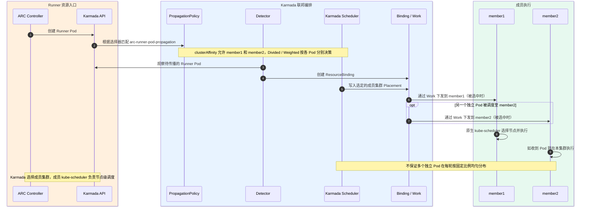

**图的架构含义**：展示该用例跨组件的主要消息路径与对象更新。当前图是设计交互，不是实测调用栈；真实上游控制器内部仍以目标版本官方文档为准。

#### 5.3.4.2 UC-06 JIT Secret 晚到后的依赖恢复——运行时序（US-04）

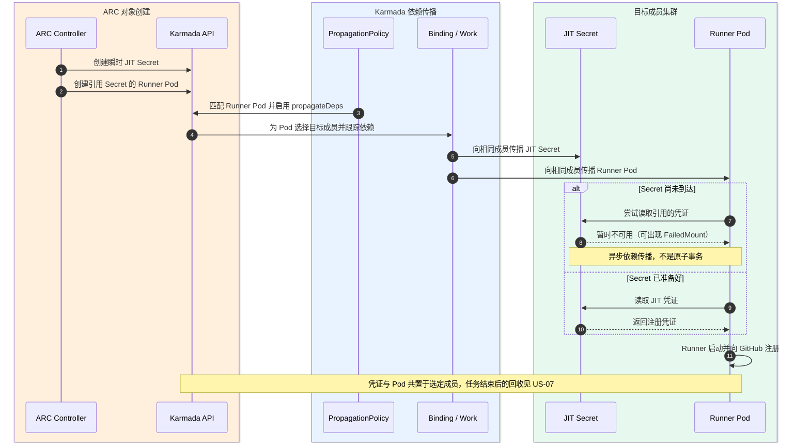

**图的架构含义**：展示该用例跨组件的主要消息路径与对象更新。当前图是设计交互，不是实测调用栈；真实上游控制器内部仍以目标版本官方文档为准。

#### 5.3.4.3 UC-10 成员不可用——异常运行时序

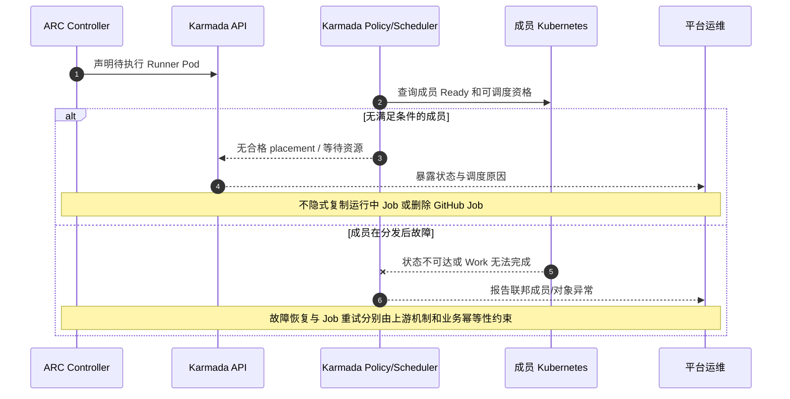

**异常约束**：不得将成员失联等价于 GitHub Job 已失败或可安全重复执行；设计仅保证可诊断的异常状态和责任边界。

### 5.3.5 用户接口设计

业务方继续使用同一 runs-on 标签，无需选择成员。平台用户可以查看任务实际成员、资源不足原因和依赖状态；若没有新建管理界面，采用既有 GitHub/观测与 Kubernetes Event，专用 UI：N/A。

### 5.3.6 实现接口设计

#### 5.3.6.1 接口设计

| 调用方 → 提供方 | 原生接口/对象 | 关键字段与输入输出 | 身份或前置条件 | 异常/幂等及诊断 | 依据/决策 |
|---|---|---|---|---|---|
| ARC → Karmada API | v1/Pod、v1/Secret、v1/ServiceAccount | Runner Pod 标签、Namespace、SA、SecretKeyRef；JIT 动态 Secret | 控制面 CR 访问授权 | 资源丢失、JIT 未到可观测，不重试 GitHub 任务 | U:ARC-1; D |
| 平台 → Karmada Scheduler/Controller | policy.karmada.io/v1alpha1 PropagationPolicy | resourceSelectors、clusterAffinity、propagateDeps、replicaScheduling | policy 管理角色，命名空间隔离 | 无匹配/候选集为空 → 留置与调度事件 | U:KAR-1,KAR-2; D:SP-02,SP-03 |
| Karmada → 成员 | ResourceBinding/Work（上游动态资源） | 成员目标、Pod/引用 Secret/SA、同步状态 | 联邦成员访问身份 | 成员不可达/冲突遵循 Karmada 官方 reconcile | U:KAR-1,KAR-2; D |

**开发交付边界**：只新增/修改本仓库负责的 RunnerSet 模板、PropagationPolicy、RBAC、身份适配、Lua/状态解释或资源参数；对官方 API 的精确字段类型、枚举和版本兼容限制，必须以所选版本的 CRD OpenAPI Schema 为准。上表不能替代完整 upstream schema。

### 5.3.9 DFX分析

**功能内 DFX**：安全隔离禁止广域 Pod 和主 GitHub Secret 传播；性能指标分离“成员选择耗时”“依赖就绪时间”“Runner 注册时间”，不虚构全局公平。

**可靠性 FMEA（设计阶段定性分析；严重度/发生概率/探测度的数值及 RPN 未经业务基准审批，暂不虚构）**

| FMEA 编号 | 失效模式 | 对业务/系统的影响 | 发现与定位 | 预防/恢复措施 | 责任主体 |
|---|---|---|---|---|---|
| F03-01 | Pod 选择器过宽 | 误传播非 Runner Pod / 租户边界被扩大 | Policy selectors 与实际 Pod 标签审查 | 目标选择器限定受管标签、配置审查 | 策略管理员 |
| F03-02 | JIT Secret 晚于 Pod 到达 | Pod FailedMount / 启动推迟 | 成员 Event + Secret 引用检查 | 依赖传播/成员 kubelet 重试，不强制重派发 | Karmada/Kubernetes |
| F03-03 | 目标成员离线或设备容量不足 | Runner Pending / 排队 | Cluster Ready、Work/Binding、Pod Event | 成员筛选、故障诊断，避免重复执行 | Karmada/运维 |

**可服务性与安全检查**：关联 GitHub Job Run → RunnerSet → ER/Pod UID → Karmada Binding/Work → 成员集群，采集必要状态与错误分类，不记录主 GitHub Token、JIT Secret Data、Kubeconfig 和私钥。若此功能提供可配置的 SLO，明确指标定义、度量位置、业务提供的阈值及失败处理，而不把一次 PoC 运行值当作产品规格。

## 5.4 F-04 Listener 跨控制面认证与访问

### 5.4.1 功能概述

**关联需求**：SR-04-01；**用例**：UC-08 Listener 访问统一 Karmada API、UC-11 Token 失效或证书不匹配；**功能域规格**：SP-04、SP-05。

让部署在执行成员的 Listener 正确访问 ARC 控制面对象，且不获得比所需更新更大的 Karmada 权限。输入为 API endpoint、CA/Token、RBAC；输出是经认证的 ERS 操作和鉴权诊断。

**边界/归属**：只维护本功能域的配置或适配；ARC/Karmada/Kubernetes 上游内部调谐逻辑不由本功能重写。

### 5.4.3 实现思路

采用 Kubernetes ServiceAccount/TokenRequest/RBAC（U）构建独立控制面身份；Listener 应按控制面 serverName/SAN 与 CA 校验 API Server（D）。当前 hostAliases/环境变量/Secret 挂载是仓库示例，目标部署要求 endpoint 参数化与凭证轮换策略。

### 5.4.4 设计思路

密钥/部署面提供控制面身份 → 注入 Listener → client 验证服务器证书 → Karmada 验证 Token 与 Role → Listener Watch/Patch ERS。任何 x509、401、403 应保留可区分的诊断，并由证书/Token/授权责任方修复。

#### 5.4.4.1 UC-08 Listener 访问统一 Karmada API——运行时序（US-05）

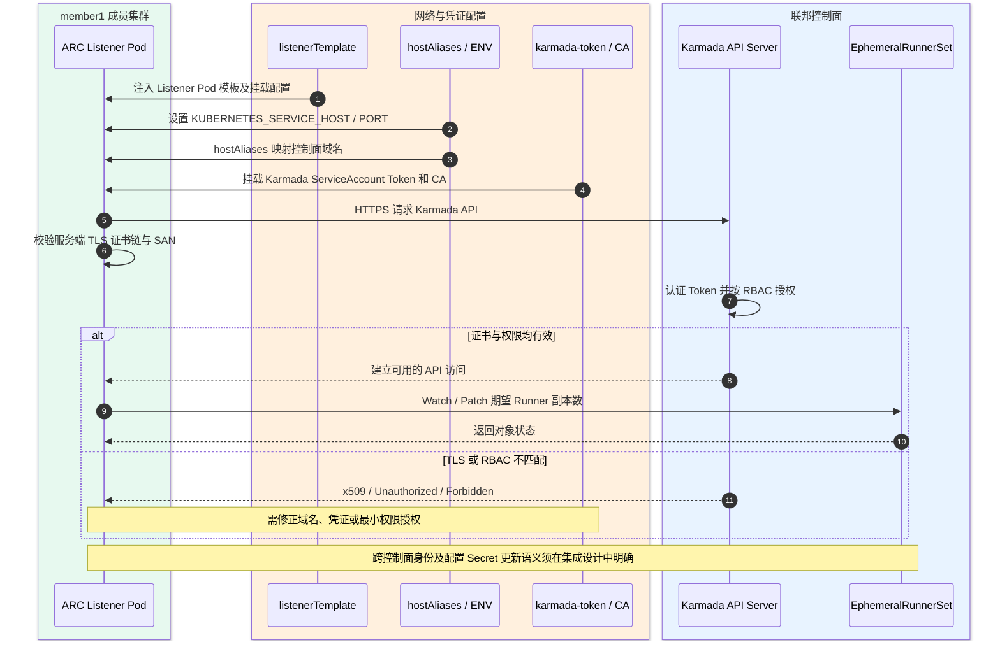

**图的架构含义**：展示该用例跨组件的主要消息路径与对象更新。当前图是设计交互，不是实测调用栈；真实上游控制器内部仍以目标版本官方文档为准。

### 5.4.5 用户接口设计

开发者对鉴权无直接操作。平台运维查看 Listener ready、认证错误类别和身份版本。安全管理员维护角色与凭证轮换；不要求专用 UI，使用已有密钥与监控系统。

### 5.4.6 实现接口设计

#### 5.4.6.1 接口设计

| 调用方 → 提供方 | 原生接口/对象 | 关键字段与输入输出 | 身份或前置条件 | 异常/幂等及诊断 | 依据/决策 |
|---|---|---|---|---|---|
| Listener → Karmada API | HTTPS Kubernetes API（EphemeralRunnerSet） | host/port/SNI、CA、bearer token、resourceNames=Scale Set | TokenRequest + 独立 SA | x509、401、403、超时独立分类 | U:K8S-1,K8S-2; D:SP-05 |
| 部署/密钥面 → Listener Pod | listenerTemplate/Secret 或受控投射卷 | CA、Token/有效期、KUBERNETES_SERVICE_HOST/PORT 或 kubeconfig | Pod 只读最小挂载，禁止明文日志 | 轮换后重新加载行为必须明确，不假定自动生效 | D |
| 安全管理员 → K8s RBAC | Role/RoleBinding | ephemeralrunnersets patch(限名)、ephemeralrunners get/patch、status patch | 跨 namespace subject 确认；禁止 cluster-admin | 角色漂移按差异检查纠正 | U:K8S-2; D |

**开发交付边界**：只新增/修改本仓库负责的 RunnerSet 模板、PropagationPolicy、RBAC、身份适配、Lua/状态解释或资源参数；对官方 API 的精确字段类型、枚举和版本兼容限制，必须以所选版本的 CRD OpenAPI Schema 为准。上表不能替代完整 upstream schema。

### 5.4.9 DFX分析

**功能内 DFX**：安全为核心：可验证 TLS、受控 Token 生命周期、独立 SA、控制面最小 RBAC、凭证不落日志。高可用 Listener 与轮换不中断属于 P 类平台运维目标，设计不能默认宣称已支持。

**可靠性 FMEA（设计阶段定性分析；严重度/发生概率/探测度的数值及 RPN 未经业务基准审批，暂不虚构）**

| FMEA 编号 | 失效模式 | 对业务/系统的影响 | 发现与定位 | 预防/恢复措施 | 责任主体 |
|---|---|---|---|---|---|
| F04-01 | DNS/CA/SAN 不匹配 | Listener 无法建立 Karmada API 会话 | x509 / endpoint 连通性诊断 | 统一证书域名和服务发现，拒绝关闭 TLS 校验 | 部署/PKI |
| F04-02 | Token 失效或未被正确加载 | ERS 无法更新 | 401 / Token 到期/身份版本 | 平台重签与受控重载；不直接扩权 | 安全/运维 |
| F04-03 | RBAC 漂移 | 403/需求无法更新或越权 | Role/Binding 对照契约审计 | 最小权限修复；保持 Role 目标名约束 | 安全/平台 |

**可服务性与安全检查**：关联 GitHub Job Run → RunnerSet → ER/Pod UID → Karmada Binding/Work → 成员集群，采集必要状态与错误分类，不记录主 GitHub Token、JIT Secret Data、Kubeconfig 和私钥。若此功能提供可配置的 SLO，明确指标定义、度量位置、业务提供的阈值及失败处理，而不把一次 PoC 运行值当作产品规格。

## 5.5 F-05 Runner Pod 状态反馈与一致性

### 5.5.1 功能概述

**关联需求**：SR-05-01；**用例**：UC-09 Runner Ready 状态反馈、UC-12 状态缺失、冲突或滞后；**功能域规格**：SP-06、SP-07。

使 ARC 能够读取有容器名称、状态和 Ready Condition 的控制面 Runner Pod 状态，避免因联邦层丢失字段导致误判。输入成员 Pod.status，输出控制面完整聚合状态。

**边界/归属**：只维护本功能域的配置或适配；ARC/Karmada/Kubernetes 上游内部调谐逻辑不由本功能重写。

### 5.5.3 实现思路

使用 Karmada 的 ResourceInterpreterCustomization/AggregateStatus（U）对 Pod 状态做显式解释（D），不修改 Karmada/ARC 官方源码；当前只定义**一个 Runner Pod 对应一个选定执行成员**的语义。

### 5.5.4 设计思路

成员 kubelet 更新 status → Karmada 收集目标 Pod 状态 → 自定义解释器保留完整 status → 控制面 Pod → ARC 读取 Ready/容器状态。无来源或状态滞后时应维持不可确认状态，不能人工制造 Ready。

#### 5.5.4.1 UC-09 Runner Ready 状态反馈——运行时序（US-06）

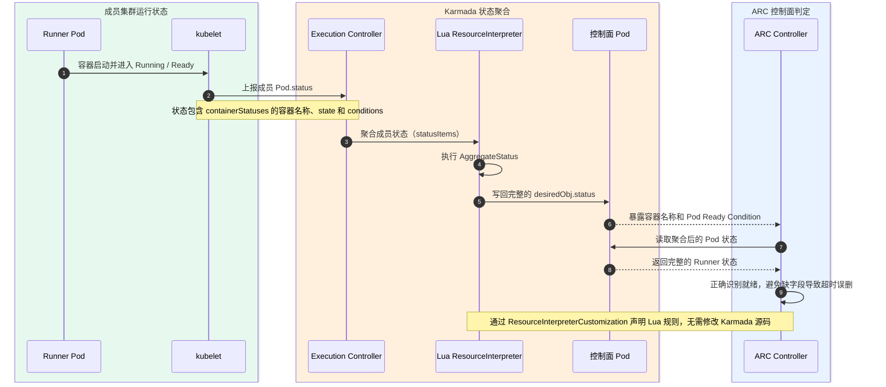

**图的架构含义**：展示该用例跨组件的主要消息路径与对象更新。当前图是设计交互，不是实测调用栈；真实上游控制器内部仍以目标版本官方文档为准。

### 5.5.5 用户接口设计

用户在 GitHub 查看 Job 状态；运维可按 Pod 名称/UID、成员和 Ready 条件排查。用户操作 UI：N/A。

### 5.5.6 实现接口设计

#### 5.5.6.1 接口设计

| 调用方 → 提供方 | 原生接口/对象 | 关键字段与输入输出 | 身份或前置条件 | 异常/幂等及诊断 | 依据/决策 |
|---|---|---|---|---|---|
| 成员 kubelet → Karmada | v1 Pod.status | phase、conditions、containerStatuses[name,state,ready]、启动/结束原因 | 成员资源读取身份 | 状态缺失/滞后须可检测，不凭空生成字段 | U:Kubernetes, KAR-3 |
| Karmada Interpreter → 控制面 Pod | config.karmada.io/v1alpha1 ResourceInterpreterCustomization（AggregateStatus） | target apiVersion=v1 kind=Pod；statusItems → desiredObj.status | 本系统维护 Lua 规则，不改上游源码 | 空/多个 status 来源需按单目标前提处理 | U:KAR-3; D:SP-06 |
| ARC → Pod.status | Kubernetes Pod get/watch | runner 容器名、Ready Conditions、状态/退出信息 | Controller 读取所需对象权限 | 缺字段保持未就绪并给出日志/事件 | U:ARC-1; D |

**开发交付边界**：只新增/修改本仓库负责的 RunnerSet 模板、PropagationPolicy、RBAC、身份适配、Lua/状态解释或资源参数；对官方 API 的精确字段类型、枚举和版本兼容限制，必须以所选版本的 CRD OpenAPI Schema 为准。上表不能替代完整 upstream schema。

### 5.5.9 DFX分析

**功能内 DFX**：状态聚合运行不得泄露 Secret Data；目标只保留必要 Pod.status 内容。性能与时效性需要以业务 SLO 定义上限，不把测试脚本的 180s 采样窗口当作生产恢复时限。

**可靠性 FMEA（设计阶段定性分析；严重度/发生概率/探测度的数值及 RPN 未经业务基准审批，暂不虚构）**

| FMEA 编号 | 失效模式 | 对业务/系统的影响 | 发现与定位 | 预防/恢复措施 | 责任主体 |
|---|---|---|---|---|---|
| F05-01 | status 解释器丢失容器名/Ready | ARC 误判未就绪 | 控制面与目标成员 Pod.status 字段比较 | 无损保留关键字段；单目标语义审查 | 状态适配 |
| F05-02 | 多个状态来源互相冲突 | 错误聚合或跨成员状态串扰 | Binding 目标与 status 来源不一致 | 拒绝无定义的选首个策略；新场景另定义合并规则 | 状态适配/Karmada |
| F05-03 | 状态上报延迟 | 临时 Runner 过早超时或诊断滞后 | Pod UID/RV、条件时间戳与日志 | 保持异步语义并设计告警，不捏造 SLO | Karmada/ARC |

**可服务性与安全检查**：关联 GitHub Job Run → RunnerSet → ER/Pod UID → Karmada Binding/Work → 成员集群，采集必要状态与错误分类，不记录主 GitHub Token、JIT Secret Data、Kubeconfig 和私钥。若此功能提供可配置的 SLO，明确指标定义、度量位置、业务提供的阈值及失败处理，而不把一次 PoC 运行值当作产品规格。

## 5.6 F-06 异构 NPU Runner 执行资源适配

### 5.6.1 功能概述

**关联需求**：SR-06-01；**用例**：UC-07 请求 NPU Runner 并在兼容节点执行、UC-13 NPU 资源不足或设备插件不可用；**功能域规格**：SP-02、SP-08。

通过服务级 Runner 规格和成员 Kubernetes 扩展资源，使需要 NPU 的 CI Job 仅进入与硬件/软件栈兼容的资源池。输入 NPU Runner 标签、资源名/数量/驱动约束，输出可调度的 NPU Runner Pod 或可观察的资源不足状态。

**边界/归属**：只维护本功能域的配置或适配；ARC/Karmada/Kubernetes 上游内部调谐逻辑不由本功能重写。

### 5.6.3 实现思路

成员 K8s Device Plugin 提供扩展资源（U），Karmada 依据成员资源与放置约束分发 Runner Pod（U），服务模板声明对应扩展资源和镜像/驱动约束（D）。不得编造统一 NPU 资源名或声称任何设备/Runtime 都兼容（P）。

### 5.6.4 设计思路

业务选择 NPU Runner 标签 → ARC 创建带扩展资源请求的 Runner Pod → Karmada 过滤合格成员 → 成员 kube-scheduler 选择符合资源的节点 → Device Plugin/kubelet 分配设备 → Runner 执行并上报 Job 结果。资源不足则保持等待/不可调度并暴露原因。

#### 5.6.4.1 UC-07 请求 NPU Runner 并在兼容节点执行——运行时序（US-08）

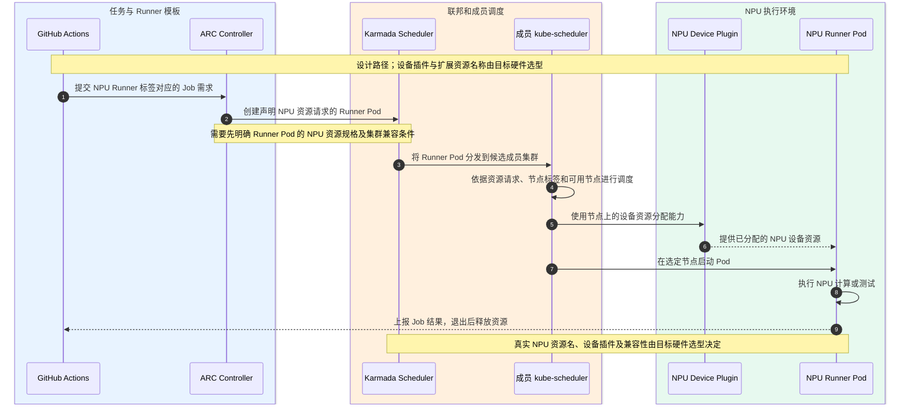

**图的架构含义**：展示该用例跨组件的主要消息路径与对象更新。当前图是设计交互，不是实测调用栈；真实上游控制器内部仍以目标版本官方文档为准。

#### 5.6.4.2 UC-13 NPU 资源不足——异常运行时序

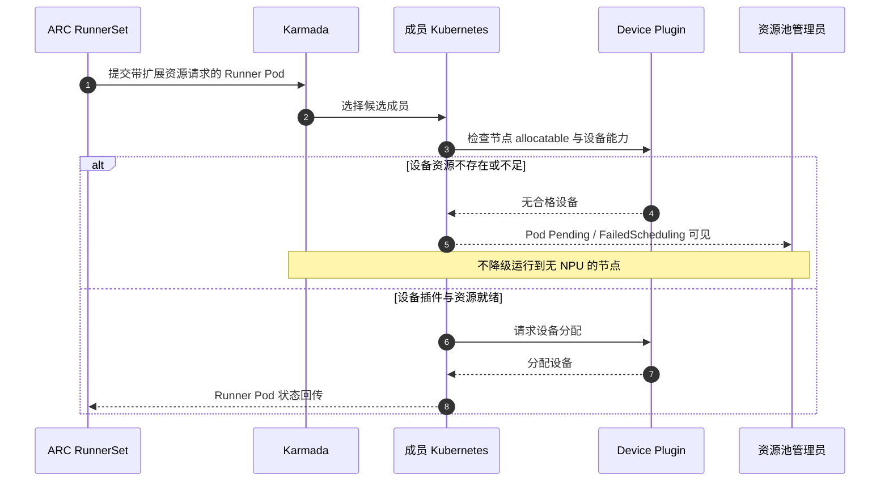

### 5.6.5 用户接口设计

用户通过独立 NPU Runner 服务标签选择设备能力，不需要直接填成员集群名称；需要在服务规格文档中说明设备类型、镜像/驱动约束。没有独立 UI 时使用 GitHub workflow YAML 与平台服务目录。

### 5.6.6 实现接口设计

#### 5.6.6.1 接口设计

| 调用方 → 提供方 | 原生接口/对象 | 关键字段与输入输出 | 身份或前置条件 | 异常/幂等及诊断 | 依据/决策 |
|---|---|---|---|---|---|
| 用户 Workflow → NPU Scale Set | GitHub Actions runs-on | 服务标签表示清晰设备规格，不能与通用 CPU Runner 混用 | Repo/Org 授权 | 无匹配服务 → queued/错误明确 | U:ARC-1; D |
| Runner Pod → 成员 Kubernetes | v1 Pod.spec.containers[].resources | requests/limits[厂商扩展资源名]、nodeSelector/affinity/tolerations | Pod SA 最小权限 | 资源不足 Pending，不静默丢弃 NPU 要求 | U:K8S-3; D:SP-08 |
| Karmada → 成员候选集 | PropagationPolicy placement | 选择兼容 NPU 成员、集群标签与资源容量条件 | 平台策略管理权限 | 成员标签/资源不满足 → 不错误放置 | U:KAR-1; D |

**开发交付边界**：只新增/修改本仓库负责的 RunnerSet 模板、PropagationPolicy、RBAC、身份适配、Lua/状态解释或资源参数；对官方 API 的精确字段类型、枚举和版本兼容限制，必须以所选版本的 CRD OpenAPI Schema 为准。上表不能替代完整 upstream schema。

### 5.6.9 DFX分析

**功能内 DFX**：资源配额、并发、设备隔离与多租户权限必须由目标 NPU 产品和集群容量制度补充（P）；性能不可用一次执行结果推导，应以定义的 workloads/metrics 评价。

**可靠性 FMEA（设计阶段定性分析；严重度/发生概率/探测度的数值及 RPN 未经业务基准审批，暂不虚构）**

| FMEA 编号 | 失效模式 | 对业务/系统的影响 | 发现与定位 | 预防/恢复措施 | 责任主体 |
|---|---|---|---|---|---|
| F06-01 | 厂商资源名与插件实际发布不一致 | Runner 无法调度 | Node allocatable 与 Pod requests 对照 | 设备能力目录与服务模板同源维护 | 设备/平台 |
| F06-02 | 驱动/Runtime/固件版本不兼容 | Pod 启动失败或任务失败 | 节点事件、容器退出原因 | 版本兼容矩阵和分层镜像管理 | 设备/运维 |
| F06-03 | 设备已耗尽或成员不可达 | 排队/持续 Pending | Karmada 目标、K8s FailedScheduling | 容量告警与候选集过滤，不降级成 CPU | 调度/资源管理员 |

**可服务性与安全检查**：关联 GitHub Job Run → RunnerSet → ER/Pod UID → Karmada Binding/Work → 成员集群，采集必要状态与错误分类，不记录主 GitHub Token、JIT Secret Data、Kubeconfig 和私钥。若此功能提供可配置的 SLO，明确指标定义、度量位置、业务提供的阈值及失败处理，而不把一次 PoC 运行值当作产品规格。

## 5.7 功能追踪与开发接口清单

| SR | 功能 | 关联规格 | 运行视图 | 开发实现入口 |
|---|---|---|---|---|
| SR-01-01、SR-01-02 | F-01 | SP-01 | 5.1.4.1 | `04-autoscalingrunnerset.yaml`、GitHub Workflow |
| SR-02-01、SR-02-02 | F-02 | SP-01、SP-07 | 5.2.4.1 / 5.2.4.2 | 官方 ARC、RunnerSet、对象生命周期契约 |
| SR-03-01、SR-03-02 | F-03 | SP-02、SP-03、SP-04 | 5.3.4.1 / 5.3.4.2 / 5.3.4.3 | `02-propagation-policies.yaml`、关联资源 |
| SR-04-01 | F-04 | SP-04、SP-05 | 5.4.4.1 | `03-rbac.yaml`、`04-autoscalingrunnerset.yaml` Listener Template |
| SR-05-01 | F-05 | SP-06 | 5.5.4.1 | `01-karmada-interpreter.yaml` |
| SR-06-01 | F-06 | SP-02、SP-08 | 5.6.4.1 / 5.6.4.2 | Runner Pod 资源模板、成员设备插件和 Placement |

**统一资料来源及版本边界**：本文件 3.7 给出 ARC/GitHub Actions、Karmada、Kubernetes 官方文档索引；本仓库现有 Manifest 用于定位配置差异；任何仅有内部运行记录支持、而无上游接口规范支持的声明都应标明为集成设计假设。缺少 PoC 不构成功能设计缺口，但 **SR/接口/异常/DFX 未定义**属于设计缺口。

**实施前需选择的参数（P）**：GitHub 组织/仓库与权限、目标版本和镜像 digest、联邦控制面 API/DNS/CA、凭证发行及轮换、成员与资源标签、NPU 型号与扩展资源名、隔离与容量策略、性能/可用性 SLO。若有正式输入来源，则填写批准值；如果尚无，不得硬编码临时 Kind IP 或杜撰业务 SLA。
