# 昇腾CI 联邦集群功能设计文档

# 1 功能域背景与目的

## 1.1 目标与职责

**业务场景。** vLLM 社区在 PR 高峰期每天可能提交超过 50 个 PR，单个 PR 的 CI 验证平均需要约 36 张 NPU 卡。当多个 PR 并发运行时，分配给 vLLM 的集群容量不足，任务持续排队。与此同时，分配给 vLLM-Omni 的集群可能还有满足运行条件的空闲 NPU。上述 PR 数量和卡数用于说明业务负载，不代表全平台容量统计或性能承诺。

**现有问题。** 当前 CI 平台按项目配置相互独立的集群。即使 vLLM-Omni 集群存在空闲资源，vLLM 的任务也只能等待本集群释放 NPU。平台缺少统一的跨集群容量管理和 Runner 放置机制，形成“一个项目排队、另一个项目资源闲置”的矛盾。要求开发者自行切换 `runs-on` 标签、选择目标集群或维护多个工作流，会把内部资源管理复杂度转嫁给社区。

**设计目标。** 开发者继续使用统一的 GitHub Actions Runner 标签提交任务，无须感知底层集群。平台在授权范围内利用其他项目集群的合格空闲资源，并在容量不足时进行统一等待与安全回填；资源就绪后由选定成员执行 Runner Pod，执行状态正常返回 ARC 和 GitHub。目标是减少由集群隔离导致的无效等待，提高多集群资源利用效率，同时防止大任务因容量碎片持续饥饿。

**总体方案。** ARC 负责 Runner 需求与生命周期；Karmada 负责资源传播和成员对象管理；目标 Dispatcher 负责跨成员容量准入、FIFO、Reserve Node、安全 Backfill 与租户公平；成员 Kubernetes/Volcano 负责节点与 NPU 资源调度。现有 Manifest 尚未配置 Dispatcher，相关能力属于目标架构。

| 职责 | 责任组件 | 主要输入与输出 |
|---|---|---|
| GitHub Job 匹配、Runner 供给与回收 | GitHub Actions、ARC Listener/Controller/Scale Set | `runs-on`、Job 需求 → 临时 Runner、注册状态、生命周期 |
| 跨成员容量准入、公平排队与成员选择 | Dispatcher、Karmada | 成员资格、容量事实、排队顺序 → 目标成员、放行决定 |
| 对象传播与跨控制面协调 | Karmada Binding/Work 与相关控制器 | Runner Pod、JIT Secret → 成员对象及传播状态 |
| 节点/NPU 资源调度 | 成员 Kubernetes、Volcano、kubelet | Pod 资源请求、节点容量、优先级 → 节点绑定、执行 |
| 身份、状态与诊断 | ARC/Karmada 集成配置及状态解释器 | 受限访问身份、Pod 状态 → Runner 可用性与故障归因 |

**关键约束。** 共享仅发生在授权成员及符合 NPU 规格、网络、拓扑与运行环境的资源之间。单 Pod 要求一个节点完整可放置；多 Pod/Gang 任务要求同一成员内整组可放置，成员总空闲卡数不能代替拓扑可行性判断；正在执行的 GitHub Job 不因成员失联而自动获得无损迁移保证。

## 1.2 边界

**包含：** 统一 Runner 入口、成员选择、容量准入与排队、Runner 供给与回收，以及跨控制面的状态、凭证、资源传播。复用 ARC、Karmada 和成员 Kubernetes；Dispatcher 承担联邦容量与公平决策。NPU 设备规格与节点拓扑属于资源准入约束。

**边界外：** GitHub Actions 队列算法及 Job 结果管理、业务工作负载、镜像仓库、现有监控系统和工作负载执行环境的安全选型。

图示为参考拓扑：Controller 独立部署，Listener 定向成员，Runner 联邦分发。组件位置可调整；跨控制面访问仍需独立凭证和网络配置。

## 1.3 目标

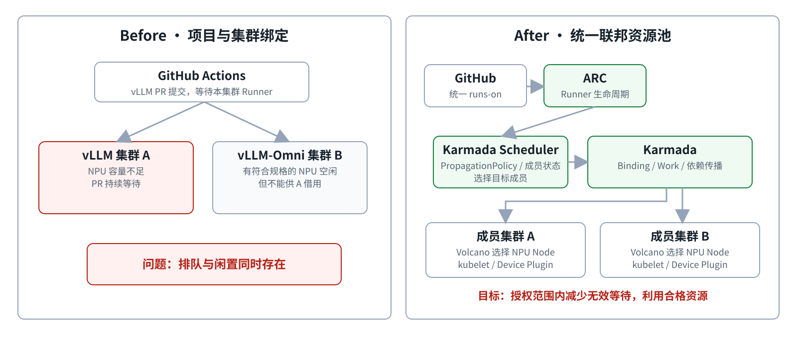

图 1-1 集群隔离与联邦资源共享的业务对比

说明：目标利用授权成员的合格 NPU 空闲资源减少不必要的任务等待。

**现状：** 集群按项目独占，空闲容量无法共享，任务排队。

**目标：** ARC 统一供给 Runner，Dispatcher 在 Karmada 控制面按授权、容量及 FIFO/Reserve Node/Backfill 决定何时放行并选择成员，成员 Kubernetes 完成 NPU 节点调度。资源共享减少因集群割裂造成的等待；租户公平权重与等待目标仍需批准；PR/nightly 的成员调度顺序见 PL-D05。

**资源条件：** 借用集群必须具备授权、可用容量以及兼容的 NPU、运行时和网络环境；吞吐与排队收益取决于实际负载和资源分布。

## 1.4 整体架构

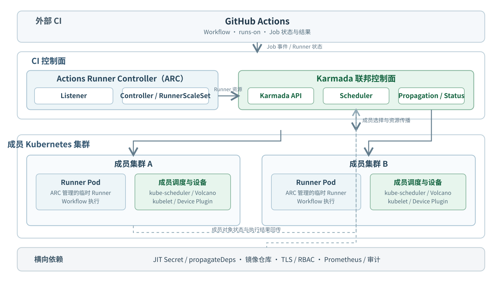

图 1-2 ARC 与 Karmada 联邦集群整体架构

**职责划分：** ARC 管理 GitHub Job 对应的 Runner 需求与生命周期；Karmada 管理成员集群、选择目标成员、传播 Runner 资源及其依赖，并协调成员对象状态；成员 Kubernetes 调度 Runner Pod，Volcano（如部署）负责 Gang 等成员内调度，kubelet/Device Plugin 完成节点执行与设备分配。

**核心链路：** GitHub Actions 将任务需求交给 ARC；ARC 创建和管理 Runner 资源；Karmada Scheduler 根据传播策略选择成员集群，Karmada 将 Runner Pod 及必要依赖传播到目标成员；成员 Kubernetes 执行 Runner，并将对象状态反馈至 Karmada，ARC 据此推进 Runner 生命周期。JIT Secret 等敏感依赖按目标成员范围传播。

**边界：** 本功能域提供 ARC 与 Karmada 的联邦集成，不包含独立 Dispatcher、跨成员 FIFO/Reserve/Backfill 或自定义容量准入。成员选择由 Karmada 原生调度机制及传播策略承担；NPU 设备分配仍由成员 Kubernetes 及设备插件负责。

| 外部子系统 | 方向 | 交互内容 |
|---|---|---|
| GitHub Actions | 双向 | Job 需求、Runner 注册、执行状态和结果 |
| 配置与身份系统 | 输入 | RunnerScaleSet、PropagationPolicy、RBAC、TLS 与依赖传播配置 |
| 镜像仓库 | 输入 | Runner 镜像及 Workflow 所需镜像 |
| 监控与审计系统 | 输出 | ARC/Karmada/成员集群状态、事件与诊断数据 |

## 1.5 关键约束

- Runner 工作流使用 `runs-on: karmada-runner`。标签对应一个已注册 Scale Set。
- Scale Set 版本标签与选定的官方 ARC Controller 版本保持一致；仓库当前 0.15.0 为配置示例。
- Listener 运行在成员集群，通过独立 Token、CA 和 DNS 配置访问 Karmada API。
- Runner Pod 的 JIT Secret 必须传播至同一执行成员；传播过程允许短暂异步等待。
- Karmada Pod 状态解释器保留 `containerStatuses[].name` 和 `conditions`。
- `Divided / Weighted` 针对单个资源对象执行。多个独立 Pod 不保证逐轮均匀分布。
- 成员 Kubernetes 负责节点调度。NPU 任务需额外核实节点标签、设备插件、资源请求和工作负载运行环境。

# 2 功能域概述

## 2.1 定位、使用者和边界

在 vLLM 专属集群不足、vLLM-Omni 集群存在合格空闲卡时，开发者仍提交原有 `runs-on`。GitHub 负责 Job 匹配，ARC 按需创建 Runner；Dispatcher 根据跨成员容量、FIFO 与 Reserve Node 决定放行及目标成员，Karmada 分发对象，成员调度器为 Runner Pod 选择节点。GitHub Job 队列不由 Dispatcher 接管；Dispatcher 管理的是联邦资源放置前的等待与准入。

**参与者**：开发者、平台工程师、资源池管理员、安全管理员、运维人员。**外部依赖**：GitHub Actions、镜像仓库、密钥服务、部署与观测平台。

## 2.2 核心特性

核心能力是让开发者使用统一 Runner 服务，并将合格的空闲资源从按项目隔离的集群中释放出来供授权任务使用。

**FT-01 统一入口与资源共享。** vLLM 开发者保留原有工作流标签；Runner 可在授权的 vLLM-Omni 等成员集群运行，开发者无须选择集群。

**FT-02 可控成员放置与公平等待。** 当 36 卡任务无法在任何合格成员上放置时，Dispatcher 保留队首容量并允许不破坏该预留的回填任务；资源可用后选择授权成员，成员 Kubernetes 负责节点调度。

**FT-03 跨控制面执行。** 被放置到其他成员的 Runner 必须获得对应 JIT 注册信息，且 Listener 能访问 Karmada API、运行状态能反馈给 ARC；未就绪 Runner 不应报告为可执行。

**FT-04 临时资源回收。** PR 检查结束后回收临时 Runner、传播对象与敏感依赖，使释放的 NPU 容量可供后续任务使用。

**执行链路：统一入口 → 成员选择 → 跨集群执行与状态反馈 → 资源回收。**

**FT-05 NPU 工作负载容量准入与成员内调度。** 平台在 Runner 放行前取得可信的 NPU 资源规格，识别单 Pod 或多 Pod 协同任务，筛选能够容纳完整需求的成员；成员 Volcano 负责实际 NPU 节点选择及需要时的 Gang 调度。设备插件提供真实扩展资源，容量不满足时不得将零散卡数拼接成虚假可用容量。

## 2.3 需求与用例追踪

需求从统一 Runner 入口、跨集群容量共享、公平等待、执行状态反馈及资源回收等业务场景分解。以下编号用于需求到组件、接口和故障处理的追踪；业务需求正式编号尚未提供。

| 编号 | 定义与粒度 | 使用范围 |
|---|---|---|
| **IR** | 功能级需求：描述平台必须提供的独立业务能力 | IR-01～IR-05 为能力需求；与 F 功能实现单元可多对多关联，不把上游组件直接当作 IR |
| **FT** | 功能域特性：对外可感知的能力归类 | FT-01～FT-05 组织 IR 和 SR，不替代需求验收 |
| **SR** | 场景级需求：描述某一条件下必须实现的行为与验收依据 | SR-xx-xx 和 SR-NF-xx；一个 IR 可关联多个 SR |
| **UC** | 用例：具有参与者、前置条件、主/异常路径的行为场景 | UC-01～UC-14；一个 SR 可由多个 UC 展示 |
| **F** | 功能实现单元：第 5 章可独立评审的设计职责 | F-01～F-06 均为功能设计单元，F-06 对应 NPU 容量与调度核心需求 |
| **AR** | 迭代实现/合入单元：由已批准 SR 分解得到的最小实现变更 | 尚未分配编号 |
| **SP** | 跨功能域设计规格：多个 F 共同遵守的行为/接口约束 | SP-01～SP-09 在第 4 章定义，供第 5 章引用 |

**追踪关系：** IR → SR → UC/F → SP/接口/DFX；AR 在迭代分解时关联 SR。

| 需求意图 | 核心场景 | SR | 特性与功能 |
|---|---|---|---|
| IR-01 跨成员资源共享 | UC-01 统一提交；UC-03 按需供给 | SR-01-01、SR-02-01 | FT-01；F-01、F-02 |
| IR-02 可控成员放置 | UC-05 成员选择；UC-10 无合格成员 | SR-03-01 | FT-02；F-03 |
| IR-03 跨控制面执行 | UC-06 凭证未就绪；UC-08 访问控制；UC-09 状态反馈 | SR-03-02、SR-04-01、SR-05-01 | FT-03；F-03～F-05 |
| IR-04 临时资源回收 | UC-04 作业结束；UC-12 状态或清理异常 | SR-02-02 | FT-04；F-02、F-03、F-05 |
| IR-05 NPU 资源容量准入 | UC-07 NPU 节点执行；UC-13 NPU 容量不足；UC-14 多节点协同任务 | SR-06-01～03 | FT-05；F-03、F-06 |

**用例概览：**

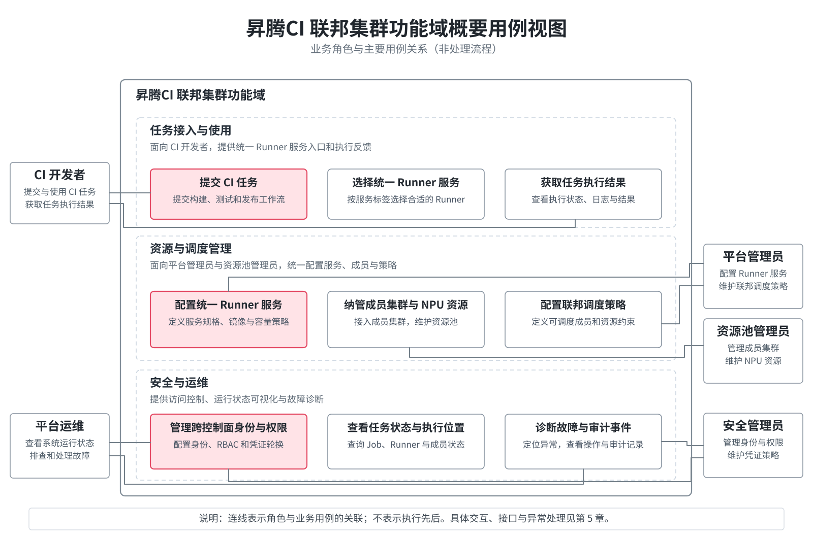

图 2-1 联邦 Runner 执行功能域主要用例

说明：用例涵盖统一入口、跨成员执行与回收；NPU 资源准入和 Gang 由 UC-07/13/14 细化。

> 图示为既有用例概要，NPU 资源准入与多节点协同任务已纳入 FT-05，分别由 UC-07/13/14 细化；Pod、Secret 与状态处理见第 5 章。

## 2.4 需求 SR

以下需求定义具体触发场景、系统预期行为和可观察的判定结果；对应组件及接口见第 4、5 章。

### 2.4.1 功能需求

| SR | 场景 | 必须满足的行为 | 判定方法 | 来源与现状 |
|---|---|---|---|---|
| **SR-01-01** | 开发者通过统一 Runner 服务提交作业。 | 作业可在授权成员执行，无需指定集群。 | 工作流不含成员信息；作业在允许的成员运行。 | FT-01；统一标签已配置 |
| **SR-02-01** | 有待执行作业，且未达容量上限。 | 按需创建临时 Runner，在选定成员执行。 | Runner 数量随需求变化；执行成员符合策略。 | FT-01/FT-04；复用 ARC |
| **SR-03-01** | Runner 服务可使用多个成员。 | 按平台策略选择成员，不得使用被禁止的成员；无需修改工作流。 | 变更候选集后，新 Runner 只在允许的成员运行。 | FT-02；已配置成员范围，未实现复杂容量调度 |
| **SR-03-02** | 执行成员已选定，注册信息尚未就绪。 | 注册信息可用后才能将 Runner 判为可执行。 | 凭证缺失时保持未就绪或报告启动错误。 | FT-03；依赖上游传播 |
| **SR-04-01** | 成员中的 Listener 访问统一控制面。 | 凭有效身份处理所属任务；连接或授权失败不得报成功。 | 可正常更新所属 Runner 服务；错误类别可区分。 | FT-03；已配置 Token/CA/RBAC，轮换未实现 |
| **SR-05-01** | 成员 Runner 启动、就绪或异常。 | 将真实状态反馈到管理面；未就绪不得判为就绪。 | 管理面与成员状态一致，保留关键状态字段。 | FT-03；单成员状态解释 |
| **SR-02-02** | 作业结束。 | 回收临时执行资源；失败时保留残留对象及错误。 | 资源进入回收流程；可定位异常残留。 | FT-04；复用 ARC/Karmada |
| **SR-06-01** | 一个需要 NPU 的 Runner 请求进入联邦排队，真实 NPU Pod 尚未创建。 | 依据已声明且可验证的 Runner Service Resource Profile 进行成员容量准入；缺失或冲突时不把 CPU Runner 请求当作 NPU 需求，也不宣称已完成容量保留。 | 能从服务标识追踪资源规格版本、Binding 授予及目标成员；未知需求不按零卡放行。 | IR-05/FT-05；F-03/F-06；PL-D07 |
| **SR-06-02** | NPU 工作负载为单 Pod 或同成员多个 Pod 的协同任务。 | 单 Pod 必须能由成员内一个 Node 完整容纳；多 Pod 任务必须在同一个授权成员满足各 Pod 的节点约束和最小同时运行数量，成员 Volcano 负责真实节点选择及 Gang。 | 8 卡节点不能承载单 Pod 16 卡请求；若 36 卡由多 Pod 组成，则按完整 PodGroup 需求判断成员可行性。 | IR-05/FT-05；UC-07/14；F-06 |
| **SR-06-03** | Dispatcher 预估的需求与实际 NPU Pod/PodGroup 请求不同，或资源/拓扑容量不可确认。 | 保留差异及容量状态，阻止将错误的资源保留视为成功；按已定义的回收/重新准入路径处理，不能自行复制 GitHub Job 或放宽设备请求。 | 显示 Profile 与实际 Pod 需求差异、资源授予和对账结果；容量未知与不足可区分。 | IR-05/FT-05；UC-13；F-03/F-06 |

SR-01-02 属 GitHub 原生匹配异常，不列为核心 SR。SR-06-01～03 是本功能域的 NPU 核心场景需求，仍需按正式业务需求基线确认指标与资源规格。

### 2.4.2 非功能需求

| SR | 属性 | 要求 | 判定方法 | 实现边界 |
|---|---|---|---|---|
| **SR-NF-01** | 跨控制面访问安全 | 拒绝未授权访问；不得关闭 TLS 校验。 | 验证授权、未授权身份及证书校验。 | 受限 RBAC/CA 已配置；Controller 权限待收敛 |
| **SR-NF-02** | 跨成员凭证隔离 | 长期 GitHub 管理凭证只提供给实际消费者；临时凭证只供执行成员使用。 | 核对凭证消费者和传播范围。 | **目标未满足**：当前向两个成员分发管理凭证 |
| **SR-NF-03** | 成员故障边界 | 不可用成员的未就绪 Runner 不得作为可执行资源；不承诺运行中 Job 无损迁移。 | 检查成员失联后的 Runner 状态。 | 尚无自动故障迁移依据 |
| **SR-NF-04** | 跨集群问题定位 | 可关联 Job、Runner、执行成员及传播、注册、状态异常。 | 根据 Job 标识查找成员与故障阶段。 | 已有检查脚本，暂无统一查询入口 |
| **SR-NF-05** | 容量与排队性能 | 不得突破 Runner 数量上限；区分 GitHub Job 等待、Dispatcher Hold、Runner 供给、成员放置和 NPU 节点等待。Reserve/Backfill 不得破坏已保护的队首容量。 | 对照各阶段权威事件、容量账本、队首保护和回填行为；缺失样本不得填零。 | 当前无 Dispatcher；公平与等待目标待批准 |
| **SR-NF-06** | 资源使用与成本 | 无待执行作业且允许零空闲时，应能回收 Runner；成员无需各部署 ARC Controller。 | 检查缩至零和成员部署方式。 | 能力依赖配置和上游；节约目标待定 |
| **SR-NF-08** | 放置策略可维护性 | 可调整候选成员，不要求开发者修改 Runner 服务名称。 | 修改并恢复策略，核对后续执行成员。 | 策略可配置，未开发管理 UI |

### 2.4.3 待定指标

| 参数 | 指标 | 待确认内容 | 状态 |
|---|---|---|---|
| P-SR-01 | Runner 准备耗时 | 起止事件、窗口、分位数、阈值 | 未确定 |
| P-SR-02 | Job 排队与联邦放置等待 | GitHub queued→started 与 Dispatcher Binding hold→release 分开；批准样本、分位数、阈值与租户公平范围。成员 NPU Pod 优先级由 Volcano PriorityClass 决定。 | 未批准 |
| P-SR-03 | 成员故障后的新作业执行 | 备用成员条件、故障检测、恢复目标；不含运行中 Job 迁移 | 未确定 |
| P-SR-04 | 资源利用率与成本 | 负载、共享前基线、计量方法、目标值 | 未确定 |

未批准的指标不得作为验收目标；不承诺未经验证的收益。

### 2.4.4 特性与设计追踪

| 特性 | 功能 SR | 非功能 SR | 设计单元 |
|---|---|---|---|
| FT-01 统一入口与共享 | SR-01-01、SR-02-01 | SR-NF-05、SR-NF-06 | F-01～F-03 |
| FT-02 可控成员放置 | SR-03-01 | SR-NF-03、SR-NF-08 | F-03 |
| FT-03 跨控制面执行 | SR-03-02、SR-04-01、SR-05-01 | SR-NF-01、SR-NF-02、SR-NF-04 | F-03～F-05 |
| FT-04 临时资源回收 | SR-02-02 | SR-NF-04、SR-NF-06 | F-02、F-03、F-05 |
| FT-05 NPU 准入与成员调度 | SR-06-01～03 | SR-NF-03～05、SR-NF-08 | F-03、F-06 |

**现状差距：** 现有 Manifest 尚未包含 Dispatcher、跨租户公平及容量预留，相关设计要求见第 4.3 节。

## 2.5 非目标

- 不重建 GitHub Job 匹配、队列排序和结果存储；UC-02 仍保留异常说明。
- 不涉及 Runner 沙箱、虚拟机、工作负载强隔离或云平台安全选型；必要的联邦 API 鉴权、凭证传播与放置权限仍属集成契约。
- ARC/Karmada 内部实现见第 4、5 章，不另列核心 SR。
- 本方案不开发 NPU Device Plugin、硬件驱动或跨成员多 Pod Gang；NPU 资源规格、成员容量准入与成员内调度接口属于 F-06 正式范围。
- 不承诺运行中 Job 无损迁移或独立 Runner 逐轮均衡分配。
- 企业级可用性、通用升级、成本预算和监控产品选型不另列核心 SR。

# 3 功能域总体方案

## 3.1 设计原则

**职责分离。** GitHub Actions 管理 Job 匹配和执行结果；ARC 管理 Runner 需求、创建、注册与回收；Karmada 管理成员集群、Runner 资源的成员选择、传播和状态协调；成员 Kubernetes 管理 Pod 调度与运行。成员侧 Volcano、Device Plugin 等组件按实际工作负载需要提供 Gang 调度和设备分配。

**复用上游控制器。** ARC 与 Karmada 保持各自原生资源模型和控制循环。本功能域通过 RunnerScaleSet、PropagationPolicy、RBAC、依赖传播配置和状态解释配置完成集成，不另建联邦调度控制器，不接管上游对象的生命周期。

**单一职责的放置决策。** Runner Pod 的目标成员由 Karmada Scheduler 根据 PropagationPolicy 和成员状态决定。平台通过策略限定候选成员，不在 Karmada 之外维护第二套成员选择逻辑。

**异步协调。** ARC 创建 Runner 资源、Karmada 生成 Binding/Work、成员创建 Pod、状态回传均由独立控制器异步完成。设计明确对象关联、状态权威、重试条件和清理责任，不假设跨 API 原子事务或 exactly-once 执行。

**最小权限与最小传播。** Listener 仅获得访问 Karmada 所需的身份和 API 权限；Runner 执行凭证按 Pod 引用传播到目标成员；GitHub 管理凭证仅保留在实际需要它的管理组件所在范围。

**成员自治。** Karmada 选择成员集群；成员 Kubernetes 选择节点。NPU 资源、拓扑、Gang 和 Device Plugin 的可行性由成员集群现有调度栈处理，不由本功能域进行跨成员容量预留。

## 3.2 备选方案与最终选型

| 方案 | 架构 | 优点 | 限制 |
|---|---|---|---|
| A：成员独立 ARC | 每个成员集群部署独立 ARC 和 RunnerScaleSet | 组件边界简单，成员自治 | 多个独立 ScaleSet 的 Job 匹配由 GitHub 处理，平台不能通过一个统一联邦策略控制 Runner Pod 的目标成员 |
| B：ARC + Liqo | ARC 与 Liqo 跨集群资源/网络机制集成 | 提供跨集群资源和网络抽象 | 引入额外资源映射与网络治理；不是本仓库当前采用的联邦控制面 |
| **C：ARC + Karmada（选定）** | ARC 统一管理 Runner 生命周期，Karmada 选择成员并传播 Runner 资源 | 复用 Karmada 成员管理、PropagationPolicy、Binding/Work 和依赖传播机制；成员范围由平台策略控制 | 需要完成 ARC API 访问、JIT Secret 传播、Pod 状态解释及回收行为的集成验证；不提供跨成员 NPU 容量仲裁 |

**选型结论：** 采用 ARC + Karmada。ARC 保持 Runner 生命周期控制权；Karmada Scheduler 根据策略和成员状态选择目标集群；成员 Kubernetes 执行 Runner Pod。方案不增加 Dispatcher，也不把 Karmada 描述为 NPU 拓扑或跨租户公平调度器。

### 3.2.1 Job 匹配与 Runner Pod 放置的边界

1. GitHub Actions 根据 Workflow 的 `runs-on`、Runner Group 和注册信息匹配 Job。
2. ARC Listener 接收 GitHub 的 Job Available 消息，并通过 ARC 控制器调整 Runner 期望数量。
3. ARC 创建的 Runner Pod 由 Karmada 管理；Karmada Scheduler 根据 PropagationPolicy 选择成员集群。
4. 成员 Kubernetes 在选定集群内为 Runner Pod 选择节点。
5. Runner 注册并执行 Job；GitHub 管理 Job 的最终状态。

GitHub Job 匹配与 Karmada Pod 放置属于不同控制过程。Karmada 选择成员不代表它重新分配 GitHub Job，也不代表一个已运行 Job 可以迁移到其他成员。

## 3.3 端到端实现思路

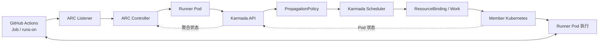

图 3-1 ARC 与 Karmada 联邦 Runner 主路径

**处理阶段：**

| 阶段 | 处理 | 责任组件 |
|---|---|---|
| 任务匹配 | 根据 runs-on 和 Runner Group 匹配 Job | GitHub Actions |
| Runner 供给 | 接收 Job Available，调整 Runner 期望数量并创建临时 Runner | ARC |
| 成员选择 | 根据传播策略、成员资格和调度状态选择目标成员 | Karmada Scheduler |
| 资源传播 | 创建成员 Work，传播 Runner Pod 及声明的依赖 | Karmada |
| 节点调度 | 在目标成员内选择节点并启动 Pod | Kubernetes |
| Runner 执行 | 注册 Runner、领取 Job、执行 Workflow | Runner / GitHub Actions |
| 状态反馈 | 获取成员 Pod 状态并同步到管理面 | Karmada / ARC |
| 资源回收 | 按 ARC 与 Karmada 原生生命周期清理临时对象 | ARC / Karmada |

## 3.4 组件与逻辑架构

### 3.4.1 逻辑架构

图 3-2 ARC 与 Karmada 联邦集群逻辑架构

| 架构构件 | 职责 | 输入与输出 |
|---|---|---|
| GitHub Actions | Job 匹配、Runner 分配及执行结果管理 | Workflow、runs-on、Job 状态 |
| ARC Listener | 接收 Job Available 消息并触发 Runner 扩缩 | GitHub 任务需求、ERS 期望数量 |
| ARC Controller | 管理 RunnerScaleSet、EphemeralRunnerSet、EphemeralRunner 和 Runner Pod 生命周期 | ARC 自定义资源、Runner Pod、JIT 配置 |
| Karmada API / Controller | 接收联邦资源，维护 Binding/Work 和成员资源状态 | Runner Pod、PropagationPolicy、成员对象 |
| Karmada Scheduler | 按策略和成员状态选择 Runner Pod 的目标成员 | 候选成员、调度约束、放置结果 |
| Member Kubernetes | 接收 Work、创建/维护成员 Pod，并执行节点调度 | 成员 Pod、Pod 状态、节点状态 |
| 成员执行组件 | 按工作负载要求提供容器运行、Gang 和设备能力 | Runner 工作负载及其资源请求 |

**边界：** 本功能域的自定义设计集中在 ARC 与 Karmada 的 API、身份、依赖传播、状态解释和生命周期集成。Karmada Scheduler 的内部算法、成员 kube-scheduler、Volcano 和 Device Plugin 不在本仓库重新实现。

### 3.4.2 周边依赖

| 周边元素 | 交互关系 | 约束 |
|---|---|---|
| GitHub Actions | 提供 Job Available 消息和 Runner 注册/执行服务 | 由 GitHub 管理 Job 匹配和结果 |
| 镜像仓库 | 提供 ARC、Runner 和 Workflow 所需镜像 | 镜像版本与 digest 可追溯 |
| 密钥系统 | 提供 GitHub 凭证、Listener Token 和 CA | Secret 不进入日志或 Git |
| 部署系统 | 部署 ARC、Karmada 配置及成员策略 | 配置可审计、可回滚 |
| Prometheus / 日志系统 | 采集控制器、API、Pod 和传播状态 | 指标与日志使用稳定对象标识，不记录凭证值 |
| 成员 Kubernetes | 承载 Runner Pod 并反馈运行状态 | 成员集群保持独立调度和设备管理 |

## 3.5 领域数据模型和归属

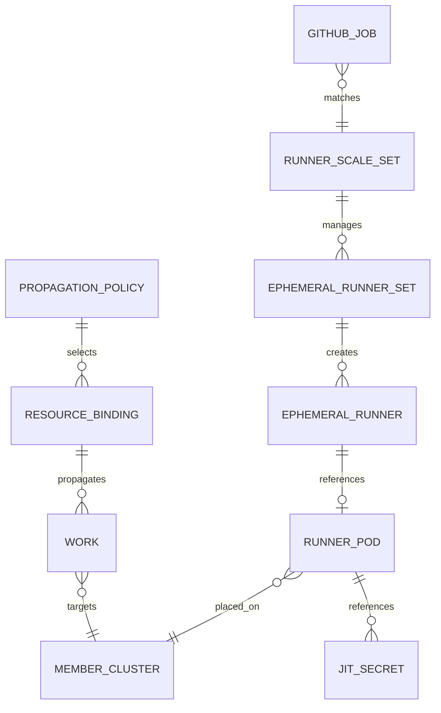

图 3-3 ARC 与 Karmada 领域对象关系

| 对象 | 权威生产者 | 主要关联 | 生命周期与处置 |
|---|---|---|---|
| GitHub Job | GitHub Actions | Workflow、RunnerScaleSet | 由 GitHub 管理；不受 Kubernetes GC 控制 |
| AutoscalingRunnerSet | 平台声明，ARC 调谐 | Runner 服务、Listener | 长期配置；按 ARC 生命周期维护 |
| AutoscalingListener / Listener Pod | ARC | RunnerScaleSet | 随 ScaleSet 生命周期；Token/CA 单独轮换 |
| EphemeralRunnerSet | ARC | AutoscalingRunnerSet | 动态期望副本；由 ARC 调谐和删除 |
| EphemeralRunner | ARC | EphemeralRunnerSet、Runner Pod | 单次 Runner 生命周期；由 ARC 管理 |
| Runner Pod | ARC 创建，Karmada 传播 | EphemeralRunner、目标成员 | 临时执行对象；ARC 发起生命周期回收，Karmada 协调成员副本删除 |
| JIT Secret | ARC | Runner Pod 的 Secret 引用 | 敏感临时数据；传播到目标成员，按引用和控制器行为清理 |
| GitHub 管理凭证 | 密钥管理员 | ARC 管理组件 | 长期敏感数据；按轮换/撤销流程管理 |
| PropagationPolicy | 平台声明，Karmada 消费 | 资源选择器、成员约束、依赖传播 | 长期配置；不代表资源所有权 |
| ResourceBinding / Work | Karmada | Runner Pod、目标成员 | 随资源传播生命周期管理；Work 分发不等于 Pod Ready |
| MemberCluster | Karmada | 成员 Kubernetes API | 长期成员对象；状态由 Karmada 采集 |
| 成员 Pod.status | 成员 Kubernetes / kubelet | 成员 Pod UID | 运行状态权威事实；经 Karmada 同步到管理面 |

### 3.5.1 对象标识与权威事实

- GitHub Job 使用 repository、run_id、job_id 和 run_attempt 等可用标识。
- ARC 对象使用 API group、namespace、name、UID 标识；名称不能替代 UID。
- 控制面 Pod 与成员 Pod 分别使用各自集群上下文和 UID 关联；不能假设跨集群 UID 相同。
- Karmada ResourceBinding/Work 使用其 API 身份和目标成员字段关联传播对象。
- Secret 通过 Pod 的 Secret 引用关联；业务关联不能替代 OwnerReference。
- GitHub 是 Job 结果的权威来源；ARC 是 Runner 生命周期的权威来源；Karmada 是传播与目标成员状态的权威来源；成员 Kubernetes 是真实 Pod/Node 状态的权威来源。

对象状态冲突时保留来源、UID 和观察时间。Pod Ready、Work 已创建或 Secret 已传播均不能推导 GitHub Job 已完成。

### 3.5.2 数据销毁规格

| 数据对象 | 销毁触发 | 执行责任 | 验证要求 |
|---|---|---|---|
| EphemeralRunner / Runner Pod | ARC 判断 Runner 生命周期结束 | ARC 发起删除，Karmada 调谐传播对象 | 核对控制面和成员对象删除状态 |
| ResourceBinding / Work | 对应传播对象删除或策略调谐 | Karmada | 检查成员副本与 Work 残留 |
| JIT Secret | Runner 生命周期结束 | ARC/Karmada 按原生依赖传播和删除机制处理 | 核对目标成员 Secret 副本；不得记录 Secret Data |
| Listener Token / GitHub App 凭证 | 轮换、撤销或服务下线 | 密钥管理员与凭证消费者 | 新凭证可用、旧凭证失效、成员副本清理 |
| PropagationPolicy / RunnerScaleSet | 服务下线或配置变更 | 平台运维 | 确认引用对象及受管资源影响范围 |
| Job 日志与审计数据 | 外部系统保留期到期 | GitHub / 日志平台 | 按各自数据分类和保留策略处理 |

删除控制面对象不等于成员副本已经删除；删除 Secret 不等于外部 Token 已撤销。日志、GitHub 执行历史和镜像不随 Runner Pod 删除自动销毁。具体保留期限遵循组织数据分级销毁规范。

## 3.6 部署拓扑与周边服务

管理集群运行 ARC Controller、Karmada Control Plane 及必要的观测/配置组件。Listener 可按当前部署约束运行在指定集群，并通过受限身份访问 Karmada API。成员集群运行 Karmada Agent、Runner Pod 及本地 Kubernetes 执行组件。

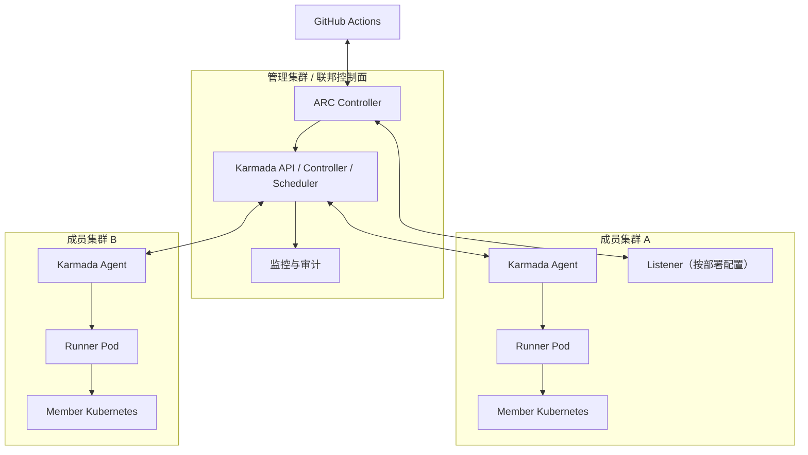

图 3-4 ARC + Karmada 部署关系

成员集群数量、地域、设备类型和 Listener 部署位置由环境配置决定。成员之间不要求 Pod 网络互通；控制面通过 Karmada 成员连接管理资源传播。

### 3.6.1 安装与声明依赖次序

1. 注册并验证成员集群及 Karmada Agent 连接。
2. 部署 ARC Controller、Listener 和 RunnerScaleSet。
3. 配置 Listener 访问 Karmada API 所需的 TLS、身份和 RBAC。
4. 创建 PropagationPolicy、依赖传播配置和状态解释配置。
5. 验证 Runner Pod 在目标成员创建、注册、就绪、执行和回收。
6. 验证成员不可达、Secret 晚到、Pod 状态异常和删除滞后等故障路径。

## 3.7 官方依据与边界

- [ARC 工作原理](https://docs.github.com/en/actions/concepts/runners/actions-runner-controller)：GitHub Job 匹配、Listener 与 Runner 生命周期。
- [Karmada PropagationPolicy](https://karmada.io/docs/userguide/scheduling/propagation-policy/)：候选成员与传播策略。
- [Karmada 依赖传播](https://karmada.io/docs/userguide/scheduling/propagate-dependencies/)：资源依赖传播机制。
- [Karmada ResourceBinding API](https://karmada.io/docs/reference/karmada-api/work-resources/resource-binding-v1alpha2/)：放置结果与联邦资源关联。
- [Kubernetes Pod 生命周期](https://kubernetes.io/docs/concepts/workloads/pods/pod-lifecycle/)：成员 Pod 状态与生命周期。
- [Kubernetes Device Plugins](https://kubernetes.io/docs/concepts/extend-kubernetes/compute-storage-net/device-plugins/)：成员设备资源暴露与分配。

官方组件分别定义其 API 和控制器行为。本功能域描述 ARC 与 Karmada 的集成，不宣称存在上游联合控制器或跨集群事务。

## 4.1 功能域规格变更

| 规格编号 | 当前配置 | 目标设计要求 | 负责方 |
|---|---|---|---|
| SP-01 Runner 服务命名 | 示例的 Scale Set 名称为 `karmada-runner`，`minRunners` 为 0，`maxRunners` 为 5。 | 平台必须保持 GitHub 工作流标签与 Runner 服务名称一致。Runner 数量的上下限由业务容量参数确定。 | 平台配置维护者 |
| SP-02 候选成员策略 | 现有策略仅用 member1、member2 与 `Divided/Weighted`，无 Dispatcher。 | Dispatcher 选成员并按 PL-D03/D04 管理联邦 FIFO、公平、预留及安全 Backfill；成员 Volcano 按 PL-D05 的 NPU Pod PriorityClass 选择节点。 | 联邦调度维护者 |
| SP-03 Runner Pod 选择范围 | 现有策略匹配 `arc-runners` 命名空间的全部 Pod。 | 平台必须只选择 ARC 管理的 Runner Pod。开发人员须按目标 ARC 版本的对象标签定义选择条件，并检查其他 Pod 不会被选中。 | 联邦策略维护者 |
| SP-04 GitHub 主凭证传播 | 现有策略将 `arc-github-secret` 同步到两个成员集群。 | 平台必须按实际凭证使用者确定传播范围。临时 Runner 不应因为需要跨集群运行而自动获得 GitHub 管理凭证。 | 身份管理者 |
| SP-05 Listener API 身份 | 示例通过单独的 Token 和 CA 证书访问固定 API 地址，Token 由脚本签发。 | 平台必须提供可配置的 API 地址、可信 CA、最小权限和凭证更新规则。必须区分网络、证书、身份认证和权限错误。 | 身份管理与部署维护者 |
| SP-06 Runner Pod 状态 | 当前 Lua 解释器选取第一个非空 `status`。 | 状态解释必须保留 ARC 所需的 Pod 字段。该规则只适用于一个 Runner Pod 在一个成员运行且状态来源没有冲突的情况。 | 状态适配维护者 |
| SP-07 临时资源生命周期 | ARC 和 Karmada 分别处理临时对象的删除。 | 平台必须能够关联同一任务的 Runner、Pod、JIT Secret 和联邦对象。删除失败时必须保留原因，不能任意清空未知 Finalizer。 | 控制器维护者和运维人员 |
| SP-08 NPU 资源规格 | 当前示例无 NPU 资源规格与设备插件配置。 | 服务目录发布可信 NPU Resource Profile 并关联 Runner Service；Dispatcher 依据 Profile 做成员容量准入，成员 Volcano 按真实 NPU Pod/PodGroup 执行节点与 Gang 调度，设备插件负责设备分配。 | Runner 服务/联邦调度/成员资源池维护者 |
| SP-09 安全与可观测性 | 现有资料通过 GitHub Run、Pod、Work 和日志进行局部诊断。 | 平台必须保存任务和联邦资源之间可追踪的标识，记录错误类型，禁止将凭证值写入日志。 | 平台运维与安全管理员 |

**配置差异：** 现有 Pod 传播选择器、主凭证传播范围和 Listener/Controller 权限尚未满足 SP-03～SP-05 的目标约束。

## 4.2 SP-01 Runner 服务与任务入口规格设计

**场景：** vLLM 开发者提交 PR 时仍使用同一个 Runner 标签。无论实际运行在 vLLM 还是 vLLM-Omni 成员集群，工作流都不包含集群名称；标签与 Scale Set 名称的一致性由平台配置保证。

### 4.2.1 实现思路

工作流通过 `runs-on` 匹配 `AutoscalingRunnerSet.spec.runnerScaleSetName`。ARC 管理 Runner 生命周期（U）；平台维护服务、模板和候选成员的映射（D）。工作流无需成员名称；硬件或权限不兼容时，应分设服务。

### 4.2.2 实现设计

| 规范字段 | 类型/位置 | 约束 |
|---|---|---|
| 服务标识 | GitHub workflow `runs-on`、`AutoscalingRunnerSet.spec.runnerScaleSetName` | 同一个 Runner 服务在工作流 `runs-on` 与 `spec.runnerScaleSetName` 中必须使用相同名称。`karmada-runner` 是参考名称。 |
| GitHub 目标 | `spec.githubConfigUrl` | 平台管理员必须为 `spec.githubConfigUrl` 设置已授权的仓库或组织地址。Runner 不得注册到未授权的仓库或组织。 |
| 主凭证 | `spec.githubConfigSecret` | `spec.githubConfigSecret` 引用的凭证必须由可信管理域提供，并遵守 SP-04 的分发限制。 |
| 弹性区间 | `spec.minRunners/maxRunners` | `spec.minRunners` 与 `spec.maxRunners` 必须满足 `0 ≤ minRunners ≤ maxRunners`。具体数值由部署配置确定。 |
| Runner 镜像与 Pod 模板 | `spec.template` | `spec.template` 必须声明 Runner 镜像、资源请求、ServiceAccount 及必要的容器安全配置；container mode 下可能仅声明 CPU Runner，实际 NPU 需求另见服务 Profile（PL-D07）。 |
| 版本约束 | ARC CRD/Controller/Listener/RunnerSet label | 部署方必须核对 ARC Controller、CRD 和 Runner 资源的版本兼容性。现有 0.15.0 只是配置示例。 |
| NPU 资源规格关联 | Runner Service 目录中的 `profileVersion` 逻辑关系 | Profile 必须在 Dispatcher 放行前可读取且与实际 NPU Pod/PodGroup 一致；`runs-on` 本身不表达卡数，服务内混合规格须有可信的需求来源。 |

标签无匹配时，不得替换服务；排队由 GitHub 处理。权限不足或容量已满时，保留错误及容量状态，不得绕过隔离。

## 4.3 SP-02/SP-03 Karmada 成员选择与依赖传播规格设计

### 4.3.1 实现思路

Runner Pod 由 ARC 创建并交由 Karmada 管理。Karmada Scheduler 根据 PropagationPolicy 中的资源选择器、成员范围和调度约束选择目标成员；Karmada Controller 创建 Work 并传播 Runner Pod。JIT Secret 等依赖通过 Karmada 依赖传播机制到达目标成员。

本规格只定义 ARC 与 Karmada 的联邦集成。成员选择使用 Karmada 原生调度机制，不增加独立调度器、队列、容量账本、预留节点或自定义回填算法。

### 4.3.2 实现设计

| 项目 | 当前/目标设计 | 约束与异常处理 |
|---|---|---|
| 资源匹配 | PropagationPolicy ResourceSelector 匹配 ARC 创建的 Runner Pod | selector 范围必须精确；不得意外匹配其他工作负载 |
| 成员范围 | ClusterAffinity / ClusterAffinityLabelSelector 限定授权成员 | 候选成员为空时资源保持未放置并产生可诊断状态 |
| 成员选择 | Karmada Scheduler 根据策略和可获得的成员状态选择目标成员 | 不宣称 NPU 拓扑感知、跨成员容量预留或 FIFO 公平 |
| 资源传播 | Karmada Binding/Work 将 Runner Pod 传播至目标成员 | Work 创建不等于成员 Pod 已 Ready |
| 依赖传播 | propagateDeps 传播 Runner Pod 引用的 JIT Secret 等依赖 | 依赖可能异步到达；成员 Pod 在必需 Secret 可用前不能成功启动 |
| 状态回传 | Karmada 获取成员 Pod 状态并通过解释配置同步 | 保留必要的 conditions/containerStatuses；状态来源与目标 Pod 身份必须可关联 |
| 资源回收 | ARC 发起 Runner 生命周期回收，Karmada 清理传播对象 | 控制面删除与成员副本删除异步；成员失联时保留未知状态 |

### 4.3.3 成员选择与容量边界

Karmada 的成员选择基于其支持的调度字段、成员状态和传播策略。PropagationPolicy 的候选成员约束用于限定允许放置范围；它不构成业务级 NPU 容量准入契约。

成员内节点选择由目标成员 Kubernetes 调度器执行。NPU 扩展资源、节点拓扑、PodGroup/Gang 和 Device Plugin 的行为属于成员集群调度栈。本仓库不读取跨成员 NPU 容量账本，也不承诺按 NPU 卡数选择成员。

| 条件 | 本功能域行为 | 不提供的保证 |
|---|---|---|
| 成员满足策略约束且可调度 | Karmada Scheduler 按目标版本机制选择成员 | 不保证按业务租户公平或严格 FIFO |
| 候选成员不满足策略约束 | 资源保持未放置，记录 Karmada 调度状态 | 不自动扩大成员授权范围 |
| 成员资源不足 | 成员调度器报告 Pod Pending / FailedScheduling 等状态 | 不跨成员拼接资源，不自动迁移运行中 Job |
| NPU Pod 无法在成员内调度 | 由成员调度栈处理节点、扩展资源和 Gang 条件 | 不由 ARC/Karmada 联邦层代替 Volcano 或 kube-scheduler |
| 成员暂时不可达 | Karmada 按成员状态与调度策略处理后续放置 | 不承诺正在执行的 Job 无损迁移或 exactly-once |

### 4.3.4 传播依赖与异步一致性

1. Runner Pod 的 Secret 引用必须与目标成员依赖传播规则一致。
2. Pod 和 Secret 的创建/传播是独立异步过程；Secret 未就绪时，Pod 启动失败或等待行为由 Kubernetes 和控制器实际机制决定。
3. 依赖传播失败必须通过 Karmada Work、成员事件和 Pod 状态定位，不得把 Work 已创建解释为依赖已就绪。
4. 同名 Secret 不代表内容版本一致；凭证轮换应核对控制面与成员副本。
5. Runner 删除后，ARC 与 Karmada 分别完成原生对象回收；残留对象通过 UID、Work 和成员上下文定位。

### 4.3.5 备选策略与取舍

| 策略 | 适用性 | 取舍 |
|---|---|---|
| 单一候选成员 | 固定执行集群或隔离场景 | 放置确定性高，但不能利用其他成员 |
| 多成员 ClusterAffinity | 允许 Runner 在多个成员执行 | 由 Karmada Scheduler 选择；结果遵循其版本和配置语义 |
| Divided / Weighted | 适用于具有副本语义且目标版本支持的资源 | 不用于声称多个独立 Runner Pod 按轮询或权重分配 |
| 自定义 Dispatcher / 公平队列 | 属于独立的联邦调度产品能力 | 不在本仓库范围，不作为 ARC + Karmada 集成依赖 |

**设计结论：** 本仓库采用 PropagationPolicy 限定候选成员，由 Karmada Scheduler 选择 Runner Pod 的目标成员。策略字段及行为以仓库锁定的 Karmada CRD/API 版本为准。

### 4.3.6 关键接口与验证

| 接口/资源 | 操作主体 | 输入/输出 | 验证重点 |
|---|---|---|---|
| PropagationPolicy | 平台配置，Karmada 消费 | ResourceSelector、placement、propagateDeps | 只匹配目标 Runner Pod；候选成员范围符合授权 |
| ResourceBinding / Work | Karmada 控制器 | 源资源身份、目标成员、传播状态 | 目标成员唯一性、Work 与成员对象关联 |
| MemberCluster | Karmada / Agent | 成员注册、健康状态和标签 | 不健康成员不应被误判为正常候选 |
| Secret 依赖 | ARC 创建，Karmada 传播 | Pod Secret 引用与依赖对象 | 只传播所需 Secret；验证晚到、更新和删除 |
| Pod 状态解释 | Karmada 状态同步机制 | 成员 Pod status | 保留 ARC 需要的字段；不把空状态解释为 Ready |

### 4.3.7 故障与恢复

- **无候选成员：** 保留资源未放置状态，输出策略匹配和成员资格诊断；不扩大候选范围。
- **成员不可达：** 保留最后一次有效状态及观察时间；由 Karmada 原生成员健康和调度机制处理后续放置。
- **Work 创建失败：** 根据 Karmada 控制器状态重试；不得由 ARC 并行创建同一 Runner 的第二个独立执行对象。
- **依赖未传播：** 检查 Secret 引用、依赖传播规则和目标成员对象；不将 Pod 创建成功视为凭证可用。
- **成员 Pod Pending：** 以成员 Pod events、调度条件和资源请求定位原因；联邦层不伪造容量准入成功。
- **删除滞后：** 分别核对控制面源对象、Binding/Work 和成员副本；成员不可达时将清理状态标记为待确认。

## 4.4 SP-04/SP-05 身份、凭证与跨控制面访问规格设计

**场景：** Runner 被放置到 vLLM-Omni 集群后，需要临时 JIT 注册信息才能连接 GitHub，但不需要持有 ARC 的长期 GitHub 管理凭证。Listener 访问统一 Karmada API 时应使用独立的受限身份。跨成员共享计算资源不意味着跨成员共享管理权限。

### 4.4.1 实现思路

Controller、Listener、Runner 分别授权。Controller 管理 Runner 并持 GitHub 管理凭证；Listener 以最小权限访问 Karmada API；Runner 使用 JIT 注册配置，不持长期管理凭证。身份基于 ServiceAccount、TokenRequest、RBAC（U）；令牌签发、到期、轮换与审计由平台负责（D）。

### 4.4.2 实现设计

| 访问主体和目标 | 认证方式 | 规定的权限与安全限制 |
|---|---|---|
| Controller → Karmada API | Controller 必须通过可信 CA 验证 Karmada API，并使用专门的 Kubernetes API 凭证。 | 平台必须按 ARC 管理资源所需的 API 操作授予权限，不得把管理员级 kubeconfig 作为生产目标权限。 |
| Listener → Karmada API | Listener 必须使用单独的 ServiceAccount 凭证和可验证的 HTTPS 地址。 | 权限应限制为指定 Runner 服务需要的 `EphemeralRunnerSet` 与 `EphemeralRunner` 操作；当前 [RBAC Manifest](../manifests/03-rbac.yaml) 是配置示例。 |
| Runner Pod → GitHub Actions | Runner 使用 ARC 创建的 JIT 注册配置与 GitHub 通信。 | 不得使用管理端的长期 GitHub 凭证；Runner 模板使用 `automountServiceAccountToken: false` 避免自动挂载 Kubernetes API 令牌。 |
| Karmada → 成员 API | Karmada 使用联邦成员注册时配置的访问身份。 | 成员 API 凭证应限制在传播资源和读取必要状态的操作范围内，由平台身份管理者维护。 |

**部署方必须提供的认证参数（P）**：API 地址与端口、服务器证书名称、可信 CA、令牌的使用范围和有效期、凭证颁发者以及更新方法。平台必须规定 Listener 如何加载更新后的令牌或证书。仅修改 Kubernetes Secret 不能证明 Listener 一定会自动使用新凭证。

**异常**：DNS/TCP 失败记网络错误；证书链或名称不匹配记 TLS 错误；HTTP 401 记认证失败，403 记权限不足。保留类别；不得关闭 TLS 校验或授予 `cluster-admin`；日志不得含凭证原文。

### 4.4.3 身份权限与凭证传播矩阵

下表明确生产目标和**当前 Manifest 差异**；具体 `get/list/watch/create/update/patch/delete` 操作须按锁定版本 ARC Controller/Listener 的实际调用审计确定，不凭推测一次性赋予宽权限。

| 主体 → 目标 | 需要的身份及最小权限边界 | 凭证接收范围 | 当前配置事实/差距 |
|---|---|---|---|
| ARC Controller → Karmada API | 独立管理身份，仅允许管理所属 ARC 对象、Pod、JIT Secret 及所需状态；按真实 API 调用细化权限 | Controller 管理域 | `03-rbac.yaml` 注释注明宿主 Controller 使用 **admin kubeconfig**；不符合生产最小权限目标 |
| ARC Controller → GitHub | GitHub App 或受控管理凭证，只允许所授权的组织/仓库与 Runner 管理操作 | 实际管理消费者 | `04-autoscalingrunnerset.yaml` 引用 `arc-github-secret` |
| Listener → Karmada API | 独立 `karmada-listener-sa` 身份；限 `arc-runners` 目标资源，拒绝其他 Scale Set | 定向 Listener 成员；不得下发给普通 Runner | `03-rbac.yaml` 给 ERS 指定 `resourceNames: [karmada-runner]` 的 patch 权限；ER 的 get/patch/status patch 未按资源名约束，属当前版本所需最小能力待审查 |
| Runner → GitHub | ARC 生成的一次性 JIT 注册配置，不允许取得长期 GitHub 管理凭证 | **实际执行成员** | `04-autoscalingrunnerset.yaml` Runner 设置 `automountServiceAccountToken: false` |
| Runner → Kubernetes API | 默认不提供 Kubernetes API 身份，不自动挂载 SA Token | 无 | 配置已禁用自动挂载；仍须区分工作负载自身注入凭证的其他路径 |
| Karmada → 成员 Kubernetes API | 成员访问身份仅用于目标资源传播及状态读取 | 联邦控制器与目标成员 API | 成员凭证权限不在所列 Manifest 中定义，不宣称已经最小化 |
| Karmada → JIT Secret 成员副本 | 依据 Pod 引用及目标 Cluster 传播，**不等于加密或访问控制** | 执行该 Pod 的成员 | Runner Policy 开启 `propagateDeps: true`，需依赖上游版本的引用识别机制 |
| 平台 → GitHub 主 Secret | 长期凭证由指定管理端消费者使用，不应仅为 Runner 执行而向所有成员分发 | 仅实际消费者 | `02-propagation-policies.yaml` 当前向 member1/member2 **显式传播 `arc-github-secret`**；SP-04 目标未满足 |
| 平台 → Listener Karmada Token/CA | 控制面目标 audience、信任 CA 与可验证 SAN，限定具体 Listener 消费者 | 定向 member1（示例） | Listener Policy 显式选取 `karmada-token`，并启用 `propagateDeps`；`hostAliases` 和固定 API 端口为示例依赖 |

**最小权限判定原则**：RBAC `resourceNames` 仅对适用的操作和请求形式起约束作用，不能假定它限制任意 `list/watch` 或 `create`；细粒度鉴权需以 Kubernetes 原生规则与 ARC 实际请求验证。Runner 在隔离成员执行不代表无需控制面外的 GitHub 网络出站权限。

### 4.4.4 凭证发行、轮换、失效与撤销状态

| 凭证 | 发行与绑定 | 更新/轮换契约 | 撤销及故障处理 |
|---|---|---|---|
| GitHub 主凭证 | 由授权凭证方签发，限组织/仓库与应用权限；仅 Controller 等实际消费者读取 | 新旧凭证交叠时先确认消费者加载，再失效旧版本；不得向普通成员复制以解决注册失败 | GitHub 端吊销/失效及消费者替换分别确认；删除 Kubernetes Secret 副本不等于外部授权撤销 |
| Listener Karmada Token | 推荐 TokenRequest：限定 `audience`、`expirationSeconds`，核对目标 Karmada API 接受的颁发者与 audience | 在到期前更新并核实 Listener **重新读取** Token 与 CA；静态 Secret 挂载不等于原生自动续期；必要时按可控方式重启 Listener | 401/过期时停止成功声明，按身份/对象绑定/令牌有效期核查；RBAC 403 单独处理；不得降级为 admin kubeconfig |
| API TLS CA/证书 | 信任锚及服务端 SAN 与访问域名匹配 | 先引入新信任链并验证消费者切换，移除旧信任锚需确认所有消费者 | TLS 错误不得使用 insecure-skip-verify、绕过 SAN 或任意扩展 NO_PROXY 代替证书修复 |
| Runner JIT Secret | ARC 按临时 Runner 生成；受 Pod 引用及成员传播范围约束 | JIT 绑定单次 Runner；过期/不可用按 ARC 原生状态处理，不长期复用 | 结束后核查控制面与成员副本；是否还可在 GitHub 使用按上游机制判定，不把 Secret 删除等同远端即时撤销 |
| 成员 API 访问凭证 | Karmada/成员注册体系管理 | 证书/Token 替换期间需要区分成员连接失败和工作负载失败 | 凭证泄漏时收缩成员访问，保留 Work 清理未知状态以待恢复 |

**Kubernetes 官方机制边界**：投射的 ServiceAccount Token（TokenRequest + projected volume）在支持的 Pod 场景可由 kubelet 更新；但将 Token 放在由其他系统复制的**普通 Secret** 中，并不自动具备这种续期机制。TokenRequest 产生的 Token 还受过期时间、受众与对象绑定约束。应优先使用短期可轮换凭证；明确跨集群 API 对签发者和 audience 的验证。详见 [Kubernetes ServiceAccounts](https://kubernetes.io/docs/concepts/security/service-accounts/) 和 [Managing Service Accounts](https://kubernetes.io/docs/reference/access-authn-authz/service-accounts-admin/)。

**安全不变量**：

- SEC-01：Runner Pod 不获取 GitHub 主凭证或 Listener 控制面凭证；目标仅传播实际引用的 JIT。
- SEC-02：GitHub 主凭证仅向实际消费者授予；当前面向两个成员的传播是**已知差距**。
- SEC-03：Listener 只能操作经授权的 Runner 服务；当前 ER 资源宽度、Controller admin kubeconfig 必须作为生产权限缺口保留。
- SEC-04：轮换完成以**新凭证实际生效、旧凭证失效**两项事实为依据，不能仅以 Secret 更新成功判断。
- SEC-05：所有请求验证 TLS 链与 SAN；不得输出 Token/Secret 值到事件、日志、审计。
- SEC-06：成员失联时 Secret 副本存在性、删除及远端授权状态均记为未知，不伪造已撤销结论。

**配置差异：** 当前主凭证传播、Controller 高权限和 Listener Token 更新机制仍需满足上述安全约束。

## 4.5 SP-06/SP-07 状态与生命周期规格设计

### 4.5.1 实现思路

ARC、Karmada 和成员 Kubernetes 分别维护其负责对象的状态。跨控制面集成通过原生对象引用和状态同步形成可观察的 Runner 生命周期，不引入统一的跨系统事务状态机。

### 4.5.2 实现设计

| 状态对象 | 权威来源 | 消费者 | 状态边界 |
|---|---|---|---|
| GitHub Job | GitHub Actions | ARC / 用户 | Job queued、in_progress、completed 等由 GitHub 定义 |
| Runner CR | ARC Controller | ARC、Karmada 集成 | ERS/ER 的期望与生命周期由 ARC 调谐 |
| ResourceBinding / Work | Karmada | Karmada、运维 | 反映联邦放置与传播进度，不代表 Runner 注册成功 |
| 成员 Runner Pod | 成员 Kubernetes / kubelet | Karmada、ARC | Pod phase、conditions、containerStatuses 是成员执行事实 |
| Runner 注册状态 | GitHub Runner 服务 / ARC 可观测状态 | ARC | 不可仅由 Pod Ready 推断 |
| JIT Secret | ARC 创建，成员副本由传播机制维护 | Runner Pod | Secret 存在不等于 Runner 已成功注册 |

### 4.5.3 生命周期状态与不变量

| 阶段 | 主要事件 | 状态权威 | 必须保持的不变量 |
|---|---|---|---|
| DemandObserved | Listener 收到 Job Available | GitHub / ARC | 消息重复不应被解释为多个不同 Job |
| RunnerDesired | ARC 更新 ERS 期望数量 | ARC | 期望数量与实际 ER/Pod 数量允许短暂不一致 |
| RunnerCreated | ARC 创建 ER/Runner Pod | ARC | 每个对象使用 UID 关联；不以名称推断跨系统唯一性 |
| PlacementPending | Karmada 接收 Runner Pod 并等待调度 | Karmada | 未产生有效目标成员前不得认为成员 Pod 已创建 |
| WorkDispatched | Karmada 创建目标成员 Work | Karmada | Work 已分发不等于成员 Pod Ready |
| PodCreated | 成员 Kubernetes 创建 Pod | 成员 Kubernetes | 成员 Pod UID 与控制面源对象分别记录 |
| RunnerRegistered | Runner 与 GitHub 完成注册 | GitHub / ARC | Pod Ready 不替代 Runner 注册事实 |
| JobRunning / JobCompleted | Runner 执行 Job，GitHub 更新结果 | GitHub Actions | Job 终态以 GitHub 为准 |
| CleanupPending / Cleaned | ARC 删除 Runner，Karmada 清理传播对象 | ARC / Karmada / 成员 Kubernetes | 控制面删除成功不等于成员副本已删除 |

### 4.5.4 异步传播、冲突与恢复

1. **重复事件：** 按 API 对象 UID、Generation、ResourceVersion 和事件来源处理；不得仅凭名称合并对象。
2. **乱序事件：** 使用对象 UID 和当前 API 状态重新读取；旧事件不得覆盖更新后的状态。
3. **成员失联：** 保留最后观察状态和时间，标记状态未知；不得推断 Pod 已停止或资源已释放。
4. **控制面重启：** ARC/Karmada 控制器从持久化 API 对象恢复调谐，不依赖内存事件作为唯一事实。
5. **删除重试：** 对已删除对象的重复删除按 Kubernetes API 语义处理；成员副本清理状态单独核验。
6. **状态不完整：** 缺少必要 conditions/containerStatuses 时保持未知或未就绪，不合成 Ready。

### 4.5.5 状态聚合设计约束

Karmada ResourceInterpreterCustomization 必须针对锁定版本验证输入对象、状态字段提取和状态回传语义。解释器不得把空 statusItems、缺失条件或过期 Ready 映射为当前 Runner Ready。若目标版本无法提供唯一且新鲜的成员 Pod 状态，必须明确标记接口能力缺口，并由 ARC 可读取的原生状态或外部诊断补充；不得仅通过选择首个非空状态掩盖多来源冲突。

## 4.6 SP-08 成员执行环境与 NPU 资源边界

### 4.6.1 实现思路

本功能域负责将 ARC Runner Pod 传播到符合 PropagationPolicy 的成员集群。Runner 所执行的 NPU 工作负载使用成员集群已有的 Kubernetes、Volcano、Device Plugin 和驱动环境。

### 4.6.2 实现设计

- 成员集群必须具备运行 Runner 镜像所需的 CPU 架构、操作系统、容器运行时、网络和存储条件。
- NPU 工作负载的资源请求、设备型号、驱动/CANN 版本、节点拓扑和 Gang 约束由工作负载及成员资源池配置定义。
- 成员 kube-scheduler/Volcano 根据真实 Pod/PodGroup 请求进行节点调度；Device Plugin 向 kubelet 提供设备分配能力。
- Karmada 的成员选择不读取或仲裁跨成员 NPU 容量；Runner Pod 被放置到成员集群也不表示该成员一定有足够 NPU 资源运行后续工作负载。
- 本仓库不定义 Runner Service Resource Profile、跨成员 NPU 容量账本、NPU 预留或成员级 NPU 准入 API。

### 4.6.3 运行约束与诊断

| 条件 | 责任组件 | 诊断依据 |
|---|---|---|
| Runner Pod 无法在成员节点启动 | 成员 Kubernetes | Pod events、节点条件、镜像拉取和挂载状态 |
| NPU Pod 资源不足 | 成员 kube-scheduler / Volcano | Pod Pending、FailedScheduling、PodGroup 状态 |
| 设备插件未就绪 | 成员 Device Plugin / kubelet | Node allocatable、插件日志和设备健康状态 |
| 驱动/CANN 不兼容 | 成员镜像与设备运行环境 | 节点镜像、驱动版本和工作负载启动日志 |
| 多机任务无法成组调度 | 成员 Volcano / 工作负载控制器 | PodGroup、Gang 状态和节点拓扑事件 |

以上属于成员执行环境约束，不构成本仓库的跨集群资源调度功能。

## 4.7 SP-09 跨功能质量与可服务性规格

**场景：** 开发者发现一个 PR 排队很久，运维需要判定任务究竟卡在 GitHub 等待、Dispatcher Hold、Karmada 传播、成员 NPU 节点调度、JIT Secret 准备还是 Runner 注册。每个阶段必须提供明确的状态来源和可追踪标识，才能定位瓶颈及其责任组件。

| 质量属性 | 规定的行为 | 需要确认的部署参数 |
|---|---|---|
| 跨控制面访问安全 | Controller、Listener 和 Runner 使用各自最小权限身份；联邦传播只下发执行依赖，校验 API 的 TLS 证书。 | Token 有效期、凭证发行及成员授权范围。 |
| 可靠性 | 系统必须区分控制器可以重试的资源操作与需要管理员修复的证书、权限、网络错误。不得仅凭 Runner Pod 异常就重新提交同一 GitHub Job。 | 故障恢复目标、告警规则与人工处理责任。 |
| 可用性 | 平台必须明确 GitHub、Karmada 控制面、成员集群和网络连接之间的故障边界。一个成员可用不代表整个 GitHub Runner 服务可用。 | 目标部署拓扑、冗余级别和服务可用性目标。 |
| 性能与并发 | 平台应分别记录 Job 排队、Runner 数量调整、Pod 就绪和 Runner 注册的时间。不能用一次分配结果推定长期负载均衡。 | 服务容量、排队时间与每阶段延迟要求。 |
| 可服务性 | 平台必须能够使用 GitHub Run、Runner Scale Set、临时 Runner、Pod UID、Binding/Work 和成员集群定位同一次任务的处理状态。 | 日志保留期限、审计要求及观测平台。 |
| 升级与兼容 | 部署方必须记录 ARC CRD、Controller、Listener、Runner 镜像及 Karmada API 的版本，并按目标版本的接口检查兼容性。 | 组件版本、镜像摘要和升级回滚窗口。 |

### 4.7.1 关键路径、性能和容量模型

**关键路径**：GitHub Job 进入匹配的 Scale Set 需求 → Listener 接收需求 → ARC 调整 ERS 并调谐临时 Runner → Karmada 成员放置/Pod 与 JIT 依赖传播 → 成员 Kubernetes 调度、镜像与 Secret 准备 → Runner 向 GitHub 注册 → Job 开始。**Job 排队、Runner 供给、联邦成员放置等待、节点资源等待与运行准备是不同阶段**。GitHub queued→started 作为端到端参考，不能直接推断 Karmada 的独立排队耗时；各阶段可能重叠，不能将不一致时钟上的事件简单相减。

| 观测量 | 起止事件与权威来源 | 正确性边界 |
|---|---|---|
| Job 排队耗时 | GitHub Job 可获得的 queued/start 时间及 attempt ID | GitHub 的队列包括匹配/容量影响；无法据此精确分解成 ARC 或 Karmada 内部时间 |
| ARC 需求响应 | Listener 接收可识别的需求事件 → ERS 期望值变化 | 必须使用相同 Runner 服务及事件关联；异步事件丢失时标记未知 |
| Dispatcher 持有时间 | Binding 首次进入 Dispatcher 队列 → Binding 成功放行 Cluster，以联邦控制面事件为准 | 与 GitHub Job queued→started 不同；记录资源族、租户、ProfileVersion、单/多 Pod 形态、Hold 原因及取消样本 |
| Reserve Node 保护开销 | 成员 Node 保护租约有效期 → 释放，按被保护 Node 的完整可调度 NPU 容量记录保护卡时 | 保护卡时与真实 NPU Pod 运行卡时分别统计；多 Node Gang 须记录完整组/部分失败，防止把 Node Taint 当作 2/8 卡精确预留 |
| 联邦成员放置与传播等待 | Dispatcher 放行 Binding → 目标成员 Runner Pod 出现，分段记录 Work 到达 | 无候选与策略 Hold 不等于 Work 已分发；跨控制面时钟未同步不计算精确差值 |
| 节点资源等待与启动准备 | 成员真实 NPU Pod/PodGroup 创建 → PodGroup 可调度/PodScheduled → 容器 Ready | 多 Pod/Gang 未达 `minAvailable` 的等待要与单 Pod FailedScheduling 区分；镜像、Secret、设备初始化单独归因，Pod Ready 不是 GitHub Job 已开始 |
| Runner 注册耗时 | Runner 启动/注册相关事件 → GitHub 确认 Runner 可用 | 需要可靠的关联 ID，未暴露事件不能凭推断填数 |
| 资源回收耗时 | ARC/Karmada 发起删除 → 控制面与成员资源确认消失 | 成员失联时结束时间未知；不可将 API 删除接受时间当作回收完成 |

**容量与并发**：Profile 需要区分单 Pod 完整节点需求与多 Pod 同成员 Gang 需求；ResourceMismatch 不得核销为正常执行。`maxRunners` 仅限制对应 Scale Set 的 Runner 数量，不是 NPU 卡数上限，也不承诺所有 Runner 均已注册或可调度。当前 `minRunners=0/maxRunners=5` 是 Manifest 示例；Runner 的 NPU 请求数量、成员可用节点、硬件兼容性、JIT/镜像准备能力及 GitHub/ARC/Karmada 控制面吞吐均可能进一步收紧有效并发。对独立 Pod，`Divided/Weighted` 不提供跨 Pod 原子容量预留。计算有效可执行容量时，必须同时满足服务上限、成员授权、**单 Pod 单节点 / 多 Pod 整组同成员资源与拓扑可放置性**和运行环境约束，而不是简单汇总各成员空闲卡数。具体吞吐预测、排队分位数和容量水位待业务 SLO 与实际资源模型确定（P）。

**设计验证准则**：应能将一项 Job 分解为可定位的等待阶段，区别需求已收到/成员已选定/Pod 已启动/Runner 已注册；在 `maxRunners` 达上限、节点碎片化、镜像准备慢、JIT 晚到时均能指出限制点，不宣称未核准的性能阈值。

### 4.7.2 故障域、可用性与恢复约束

| 故障域/故障模式 | 影响范围 | 允许的恢复行为 | 禁止的保证与剩余风险 |
|---|---|---|---|
| GitHub API/Job 分配不可用 | 可能影响所有 Scale Set 的新任务/注册 | ARC 按上游定义重试；保留 GitHub 与 Kubernetes 状态差异 | 不承诺离线继续接收 GitHub Job |
| ARC Controller/Listener 不可用 | 对应 Runner 服务需求感知、调谐或回收暂停 | 通过原生恢复和对象重新调谐收敛；按身份和版本恢复 Listener | 不推断已有 Job 必然中止或无损恢复 |
| Karmada API/Dispatcher/Propagation Controller 失效 | 新 Binding 放行或 Work 传播暂停，状态可能滞后 | Dispatcher 冷启动从 Binding/grant/成员 Node 重建；停止旧写者，恢复后再放行 | 普通 Karmada Scheduler/Dispatcher 不得同时写同一 Binding；不承诺 Job 无损迁移 |
| 某成员 Cluster/API/网络失联 | 该成员的分发、状态、删除确认不可靠 | 无关成员仍须按实际可用性分别判断；记录 `CleanupUnknown`，恢复后核对 | 不能仅凭控制面旧 Ready 认为正在执行，不能保证失联成员已销毁 Secret |
| 成员节点资源/设备/镜像不可用 | 局部 Pod Pending 或运行失败 | 保留 Node、Pod、FailedScheduling/FailedMount/镜像事件，遵守硬资源约束 | 不将 CPU 或不兼容 NPU 自动作为替代 |
| Token/CA/RBAC 出错 | 控制面操作失败或权限风险 | 分类 DNS/TLS/401/403，恢复最小授权身份及可信链 | 不能通过关闭 TLS 或升级为管理员权限绕过 |
| 状态聚合错误/延迟 | ARC 可能错误理解 Pod 状态 | 以成员真实状态与唯一目标对象核查；无法判断则 Unknown | 现有 Lua 首个非空来源不能证明多来源安全 |

**故障隔离：** 成员失联时，其他成员能否承接新 Runner 取决于管理面、成员资格及可用容量。运行中的 Job 不具备跨成员无损迁移保证；在确认业务幂等性之前，集成层不得自行重派 Job。恢复时间、冗余规模及可用性目标仍需明确。

### 4.7.3 跨组件诊断契约

**最小关联键**：GitHub `repository/run_id/job_id/run_attempt`（存在时）→ Runner Scale Set 名称及组织/仓库作用域 → ARC ER/ERS 和控制面 Pod 身份 → Karmada Binding/Work 与目标 Cluster → 成员 Pod 身份/状态。记录 Kubernetes `cluster + namespace + kind + name + UID`、事件来源、阶段、非敏感错误类型、观察时间；**不凭 Pod 名称猜测 Job ID**，也不把跨集群 `resourceVersion` 当全局顺序号。缺失关联时输出“未关联”，而不是推测。

| 诊断阶段 | 权威系统/对象 | 必须区分的异常与证据 |
|---|---|---|
| Job 匹配与排队 | GitHub Job、Scale Set | 无匹配、无授权、容量限制、GitHub API 错误 |
| Runner 需求/创建 | Listener、ERS/ER、ARC Controller 事件 | 需求未见、期望与实际数量差、Pod/JIT 创建失败 |
| Dispatcher Hold 与联邦放置 | 队列时间/Policy、ResourceBinding/grant、Work、Node Taint/租约 | 无合格成员、Group Hold、ReserveForHead、ReservationPartial、容量未知、Backfill、放行冲突、保护开销及成员同步失败 |
| 节点与依赖准备 | 成员 Node/Pod/PodGroup/Secret 事件 | ProfileUnknown、ResourceMismatch、Gang Unschedulable、FailedScheduling、FailedMount、ErrImagePull、设备资源不足 |
| Runner 注册与执行 | ARC Runner 与 GitHub Job | 注册失败、Pod Ready 但 GitHub 未确认、Job 中断/完成 |
| 状态与回收 | 成员 Pod.status、控制面聚合、Work/Finalizer | 状态缺失/过期/多来源冲突、删除未知或残留 |

**采集契约与边界**：对 Dispatcher 保留作用域、可信租户、队列顺序、Hold 原因、受保护节点与队首、Backfill、grant 与 PodScheduled 关联；对成员 Volcano 保留真实 NPU Pod 的 PriorityClass、schedulerName 和调度事件，另记录预留租约、清理及非队首占用。事件可按来源重复或乱序到达，必须保留各源原始状态与采集时刻；同一对象内以原生身份/版本判断新旧。不能要求 GitHub、ARC、Karmada 共享单一事务 ID。任何跨域阶段耗时都需明确时间基准与缺失样本处理规则；不把缺失样本当零耗时。审计只记录最小必要的非敏感标识与结果，不采集 GitHub 主 Secret、Listener Token 或 JIT 内容。现有 Manifest **未实现统一查询入口和完整指标采集**，这里只定义功能域与观测系统之间的设计契约。

**设计验证准则**：对于排队、容量不足、Secret 晚到、401/403、成员失联、状态冲突、Finalizer 阻塞七类典型问题，须能够指出相应权威源、所需关联键、不可推断的结论以及恢复责任；数据缺失时不能伪造完成或性能数据。

**官方机制依据**：[GitHub ARC runner scale-set 容量配置](https://docs.github.com/en/actions/how-tos/manage-runners/use-actions-runner-controller/deploy-runner-scale-sets)、[Kubernetes Scheduling Framework](https://kubernetes.io/docs/concepts/scheduling-eviction/scheduling-framework/)、[Pod Conditions](https://kubernetes.io/docs/concepts/workloads/pods/pod-condition/)。上游分别约束 Runner 规模及节点调度/状态语义，**不构成 ARC + Karmada 整体性能或故障切换承诺**。

F-01～F-06 的接口和质量约束由 SP-01～SP-09 统一规定；故障影响、检测与恢复责任见各功能的 DFX 分析。

### 4.7.4 DFX 场景—架构机制—设计验证矩阵

质量属性要求与性能阈值分别由 SR-NF 和 P-SR 定义；待批准参数在对应表格中明确标记。

| 场景/质量属性 | 刺激与环境 | 架构响应与负责组件 | 设计判据、残余风险与追踪 |
|---|---|---|---|
| QA-01 性能/容量 | 需 16 卡 NPU 的 workflow：A 聚合空闲 20 卡但单节点最多 8 卡，B 有单节点 16 卡 | Dispatcher 用成员容量信息过滤 A、选择 B；**B 的成员调度器**决定最终 NPU 节点 | 不把 Dispatcher 估计或预留节点作为实际 Pod 绑定；PL-D01/D02、F03-03、SR-NF-05 |
| QA-02 可靠性/可用性 | Runner 运行期间成员失联，Job 终态不可得 | ARC/GitHub 维持原生生命周期；平台仅标记 ExecutionUnknown，不主动重派 | 没有双实例的**集成层额外创建动作**；上游重试行为另按协议评审；PL-D01、LC-07、SR-NF-03 |
| QA-03 状态正确性 | 旧 A 的 Ready 与新 B 状态冲突 | Karmada Binding/Work 提供目标事实；状态仲裁以成员和 UID 校验，诊断 StatusUnknown | 目标 LC-08 要求冲突/过期 Ready 不能进入 ARC 的有效就绪判断；当前 Lua 尚未满足，需锁定读状态保护扩展点；ST-D01、F05-02/04/05 |
| QA-04 排队与等待归因 | Dispatcher 等待放行 Runner，或成员 NPU workflow Pod 已创建但 Pending | 分别记录 GitHub Job 状态、Dispatcher Binding hold、Karmada 传播、成员 PodScheduled/FailedScheduling；容量未知记 CapacityUnknown | 成员 NPU Pod Pending 不等于 GitHub Job 仍在 queued；不得把单节点绑定责任移给 Dispatcher；PL-D02、F03-04/05 |
| QA-05 可服务性 | Secret 晚到、成员失联或 JIT 删除滞后 | ARC/Karmada/成员各保留 UID、事件和清理来源，平台逐对象关联 | 未确认删除标记 CleanupUnknown，缺失 ID 不猜测；LC-05/06、SR-NF-04 |
| QA-06 可维护性 | 升级 ARC/Karmada 后聚合字段或权限变更 | 目标版本 API/CRD 与 Manifest/身份权限对照；不凭 `next` 文档作为版本承诺 | 版本未锁定前不能完成实现级兼容性验收；SP-05/06、SR-NF-08 |
| QA-07 公平与吞吐 | 16 卡队首等待，另有 2 卡任务可使用非预留容量；成员有 PR/nightly NPU Pod 同时 Pending | Dispatcher 保护联邦队首，非预留容量 Backfill；成员 Volcano 依真实 NPU Pod PriorityClass 排序 | 成员优先级不能越过联邦 Hold、预留和授权；不宣称白天/夜间优先级自动切换；PL-D03/D05、F03-06/08 |
| QA-08 资源泄漏与故障恢复 | Dispatcher Leader 故障，成员存在仍有效的 reserved Node taint | 新 Leader 对账恢复账本，成员 Janitor 对到期保护按归属清理，恢复互斥放行 | 不得因 Dispatcher 故障永久占有节点；降级需显式宣告公平策略减弱；PL-D03、F03-07/09 |
| QA-09 资源预留准确性 | 队首获得候选 Node 预留，但真实 workflow Pod 最终绑定另一个 Node | 由成员 Scheduler 选真实 Node，Dispatcher 观察 PodScheduled 后核对、迁移或释放保护记录 | 不能把 reserved Node 误记作 NPU 已占用或队首已兑现；PL-D02/D03、F03-08 |
| QA-10 公平性正确性 | 相同权重甲租户运行 16 卡×1 h，乙运行 2 卡×1 h | PL-D04 按同资源族 NPU 卡时计算服务量，分别扣除未落地 grant，公平选择下一候选 | Job 数相同不等于公平；异构 NPU 家族不可直接合并；F03-10 |
| QA-11 成员任务优先级 | 相同 runs-on 的 PR/nightly 在同一成员创建真实 NPU Pod；nightly 模板使用较低 PriorityClass | PL-D05/4.3.8.1：nightly 工作负载或可信 hooks 在**实际 NPU Pod**声明低优先级，Volcano 排序 | 同一个静态 Hook 模板无法自动区分 PR/nightly；不能驱逐已经运行的 nightly；F03-11 |
| QA-12 故障降级互斥性 | Dispatcher 仍续约 Leader Lease，但决策循环已停止；应急实例准备接管 | PL-D06 检测真实调度进度；确认旧 Writer 停止后才可 DEGRADED，否则 FAIL_CLOSED | 不允许双写、旧资源预留被忽略或 Job 重复分发；F03-12/13 |
| QA-13 NPU 需求先验正确性 | 相同 Runner Service 接受 2 卡或 36 卡不同请求，Runner Pod 只申请 CPU | PL-D07 要求可信服务 Profile 或放行前资源需求关联；无法知道完整 NPU 需求时产生 ProfileUnknown，不按零卡肯定放行 | 不把 CPU Runner Ready 视为 NPU 成员容量保证；F06-04/06、SR-06-01/03 |
| QA-14 多节点 Gang 可行性 | 总共需要 36 卡的多 Pod 工作负载，某成员聚合卡数充足但节点间拓扑不满足完整请求 | Dispatcher 判断**同成员整组**资源与拓扑可行性；成员 Volcano PodGroup/Gang 做最终 Node 调度；不足时保持不可调度 | 不要求单个 36 卡 Node，也不允许跨独立成员拼接 Gang；F06-05、SR-06-02 |
| QA-15 保护粒度与回填安全 | 8 卡 Node 为 2 卡任务保护，剩余 6 卡表面空闲 | PL-18：Node NoSchedule 以整 Node 阻止普通新 Pod；Dispatcher 只在其他未保护 Node 上 Backfill，并记录保护卡时开销 | Taint 不等于卡级预约，不能把 6 卡视作可安全回填或已运行卡时；F03-14 |
| QA-16 Gang 预留失败恢复 | Dispatcher 为多 Pod Gang 保护 3 台 Node，第 3 台失败，Leader 随后失联 | PL-19：整组 ReservationPartial，按身份/租约回滚已保护 Node；新 Leader 和 Janitor 对账清理 | 不宣称部分成功即完整保护；不能清理其他调度器的 Taint；F03-15/16 |

**可评审性门槛**：PL-D03～06 明确联邦 FIFO/Reserve/Backfill、跨租户公平、成员 Volcano PriorityClass 与降级设计，**当前 Manifest 不包含 Dispatcher 和 NPU 优先级模板**。后续必须对照实际 NPU Pod、Volcano Scheduler 插件及调度动作确认；不再要求 PR/nightly 放行前 Job→Runner→Binding 关联。设计不证明端到端排队 SLA。

# 5 功能实现设计

Kubernetes 资源接口遵循其 OpenAPI，ARC/Karmada 的自定义资源遵循目标版本 CRD。功能时序和接口表分别说明各组件之间的状态与操作契约。

### DFX 风险判定与设计验证规则

FMEA 按失效后果进行定性分级：**严重**＝长期管理凭证错误传播、越权修改联邦资源或错误确认执行；**高**＝任务中断、重复执行风险、凭证失效或资源清理无法确认；**中**＝局部排队、暂时 Pending、可恢复的单功能异常。等级依据影响和隔离能力判定；未经实际评估不填写故障概率或 RPN。恢复措施存在不意味着风险自动降低。

每条 FMEA 追加**设计措施 → 设计验证准则 → 剩余风险**。验证是通过设计文档/API 契约检查可判定的条件，不表示已运行测试或实际验证成功。**设计被接受**与**当前 Manifest 已满足**分别记录；涉及未落实的调度策略、权限或接口，必须标记差距。正式性能 SLO 和数据保留期不在此补写数值。

Kubernetes 关于 [RBAC 最小权限](https://kubernetes.io/docs/concepts/security/rbac-good-practices/)、[ServiceAccount](https://kubernetes.io/docs/concepts/security/service-accounts/) 及 Karmada [状态解释与聚合接口](https://karmada.io/docs/userguide/globalview/customizing-resource-interpreter/) 是风险控制的上游依据。

## 5.1 F-01 统一 Runner 服务入口

**典型场景：** vLLM 开发者只在 Workflow 中选择统一的 Runner 标签。平台在后台调整可执行成员，开发者不需要修改工作流。

### 5.1.1 功能概述

**关联的正式系统需求**：SR-01-01；**用例**：UC-01 通过统一标签提交工作流、UC-02 无匹配或无可用 Runner（异常处理，不单列 SR）；**功能域规格**：SP-01。

F-01 提供统一 Runner 服务名称。开发者通过 `runs-on` 选择服务，无需指定成员；平台配置服务、GitHub 目标与 Runner 模板。

**职责**：维护服务名称与 GitHub 目标映射；成员选择见 F-03，节点调度归 Kubernetes。

### 5.1.3 实现思路

`AutoscalingRunnerSet.spec.runnerScaleSetName` 必须与工作流 `runs-on` 一致。GitHub/ARC 负责匹配、创建和注册；不开发独立队列。硬件或权限不兼容时，分设 Runner 服务。

### 5.1.4 设计思路

GitHub 按 `runs-on` 匹配；Listener 接收需求，Controller 管理 Runner，F-03 选择成员。无匹配服务时，不得替换工作流标签或转交其他服务。

#### 5.1.4.1 UC-01 通过统一标签提交工作流——运行时序（US-01）

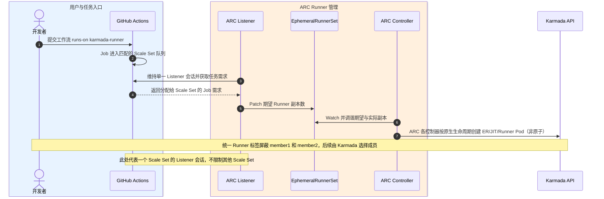

图 5-1-1 统一 Runner 服务提交主路径

说明：开发者继续使用统一 runs-on 标签，成员选择对工作流透明。

### 5.1.5 用户接口设计

通过 `jobs.<job>.runs-on` 选择服务，名称必须与 `spec.runnerScaleSetName` 一致。无独立 UI；复用 GitHub 和配置管理工具。

### 5.1.6 实现接口设计

#### 5.1.6.1 接口设计

| 交互双方 | 原生接口或资源 | 输入、操作与输出 | 权限与前置条件 | 异常处理与限制 | 依据及规格 |
|---|---|---|---|---|---|
| 工作流使用者与 GitHub Actions | GitHub Actions Workflow：`jobs.<job>.runs-on` | 开发者必须填写已发布的 Runner 服务名称。GitHub 根据该名称匹配 Runner。 | 开发者必须具有目标仓库工作流的提交权限。 | 名称未匹配时，GitHub 按其队列机制处理；平台不得改写标签。 | ARC-1；SP-01 |
| 平台配置与 ARC Controller | `AutoscalingRunnerSet`：`actions.github.com/v1alpha1` | 管理员必须配置服务名称、GitHub 目标、凭证引用、Runner 数量范围和 Pod 模板。 | Controller 必须具备所需的 Kubernetes API 与 GitHub 目标权限。 | API 拒绝创建或更新时，必须保留资源名称和错误原因；不能自行扩大权限。 | ARC-2；SP-01 |

**配置责任：** 平台维护 Runner Scale Set 模板及服务名称；Job 匹配和队列由 GitHub 管理。

### 5.1.9 DFX分析

**功能安全与性能约束**：Runner 的最大数量受 `maxRunners` 限制。平台必须防止 Runner 在未授权的 GitHub 仓库或组织中注册。具体并发容量和排队时间由业务方定义。

**可靠性故障分析（FMEA）**

| 编号 | 失效原因 | 业务或系统影响 | 检测方法 | 处理与恢复要求 | 负责方 |
|---|---|---|---|---|---|
| F01-01 | 工作流标签和 Runner 服务名称不一致。 | GitHub Job 不能匹配目标 Runner。 | 对照 `runs-on` 和 `runnerScaleSetName`，检查 GitHub Job 的排队信息。 | 平台管理员应修正不一致的服务配置，并检查修改影响。 | 平台维护者 |
| F01-02 | GitHub 管理凭证失效。 | Runner 无法正常向目标 GitHub 仓库注册。 | 检查 Controller 或 Listener 的认证错误和凭证引用。 | 身份管理者更新凭证；不得通过更改业务标签来规避认证失败。 | 身份管理员、ARC 运维 |

**风险—措施—验证追踪**（关联：SR-01-01、SR-NF-01/05；延续上方 FMEA 编号，不替代已有故障表）

| FMEA | 失效模式 | 影响 | 风险 | 设计措施及对应约束 | 设计验证准则 | 剩余风险 |
|---|---|---|---|---|---|---|
| F01-01 | 标签/服务配置不匹配 | Job 长时间无法获得 Runner | 中 | SP-01 保证服务标识一致；不进行隐式服务回退 | 对照 workflow/Scale Set 的匹配字段；未匹配时只能进入 GitHub 原生等待/错误路径 | 配置变更后仍可能出现短暂不匹配 |
| F01-02 | GitHub 管理凭证过期/授权错误 | Runner 无法注册，队列积压 | 高 | SP-04/SEC-02 凭证按消费者授予；轮换及 401 分类诊断 | 明确新凭证生效、旧凭证失效的判定；错误不以更换 runner 标签绕过 | 依赖 GitHub 可用性和有效授权 |

**运行诊断与敏感信息处理**：运维人员应先比较 `runs-on`、Runner Scale Set 名称和 GitHub 配置，再分析身份认证错误。审计不得记录 GitHub 管理凭证。

## 5.2 F-02 Runner 弹性供给及临时资源回收

**典型场景：** PR 高峰到来时，ARC 根据需求增减临时 Runner；任务结束后，Runner、关联 Pod 与 JIT 凭证逐步回收，避免空闲资源被长期占用。

### 5.2.1 功能概述

**关联需求**：SR-02-01、SR-02-02；**用例**：UC-03 Job 需求驱动 Runner 创建、UC-04 Job 结束回收 Runner 与凭证；**功能域规格**：SP-01、SP-06、SP-07。

F-02 按需供给临时 Runner。ARC 创建 Runner、Pod 和注册配置；作业结束后，ARC/Karmada 分别回收。通过对象 ID 关联同一任务。

**职责**：集成 Runner 需求与回收；注册协议及控制器沿用 ARC。

### 5.2.3 实现思路

复用 ARC `AutoscalingRunnerSet`、`EphemeralRunnerSet`、`EphemeralRunner` 生命周期。Karmada 传播并回收成员对象；不得新增争夺 Runner 所有权的控制器。临时资源按 UID/OwnerReference 关联，不依赖生成名称。

### 5.2.4 设计思路

Listener 更新 `EphemeralRunnerSet`，Controller 创建 Runner；成员启动 Pod 并注册 GitHub。作业结束后 ARC 回收 Runner，Karmada 异步删除传播对象。不要求同时删除，也不得因 Pod 失败重复派发 Job。

#### 5.2.4.1 UC-03 Job 需求驱动 Runner 创建——运行时序（US-02）

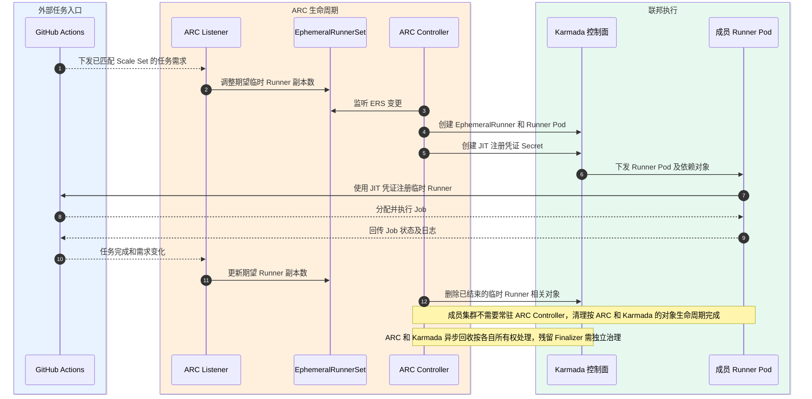

图 5-2-1 Runner 弹性创建主路径

说明：GitHub/ARC 负责 Runner 供给，Karmada 在目标成员传播 Runner 对象。

#### 5.2.4.2 UC-04 Job 结束回收 Runner 与凭证——运行时序（US-07）

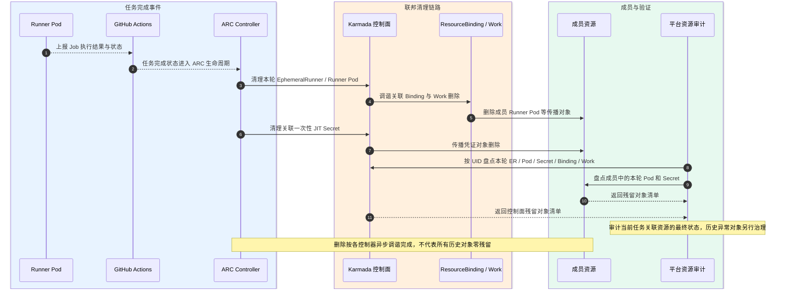

图 5-2-2 Runner 与临时依赖回收

说明：Job 结果、Pod 删除和凭证清理分别由相应权威组件确认。

#### 5.2.4.3 生命周期回收契约和异常时序

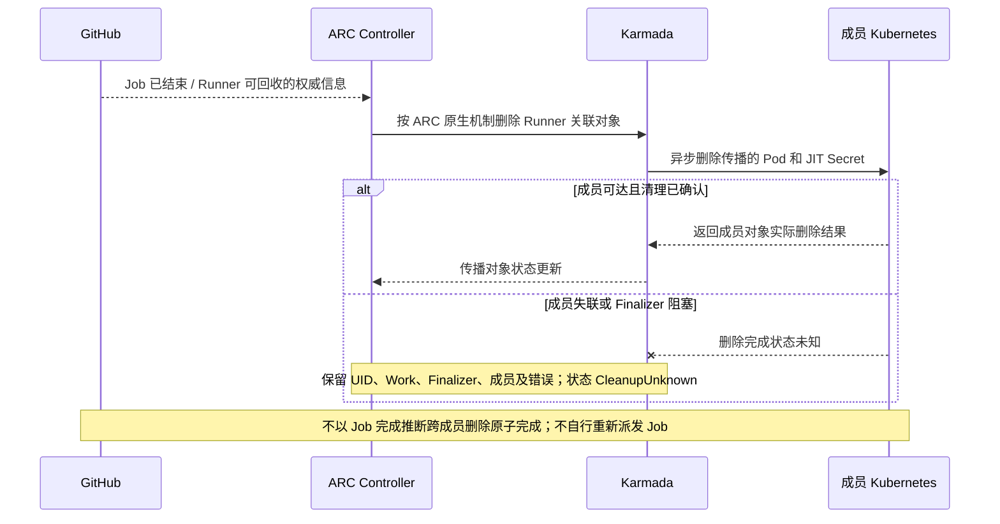

图 5-2-3 Runner 生命周期异常恢复

说明：异常恢复不代表同一个 GitHub Job 可以安全重复执行。

| 触发 | 应核对的事实 | 恢复责任 |
|---|---|---|
| ER/Pod 创建后 JIT 未可用 | 成员 FailedMount、Pod 引用及 Karmada 依赖传播状态 | Karmada/成员继续原生调谐，ARC 按自身版本规则处理失败 |
| Pod Failed / Runner 注册失败 | ARC 原生 Runner 状态和 GitHub 是否已分配 Job | ARC/GitHub 的正式失败策略，不由集成层自创重投 |
| Job completed 后删除中 | ER、控制面 Pod、Binding/Work、成员 Pod、两侧 Secret | ARC 和 Karmada 分别负责自身对象；审计标记未确认项 |
| 删除被 Finalizer 阻塞 | deletionTimestamp、Finalizer 所属控制器与依赖 | 先修复原控制器或依赖，不直接删除未知 Finalizer |

**幂等性**：重复 Watch/Delete 通知只促使核对已有对象，不能生成另一份 Job；跨控制面清理非原子且顺序不固定。

### 5.2.5 用户接口设计

开发者通过 GitHub 查看作业状态；运维通过 Run、Runner、Pod、Work 标识排障。无需手动创建 Pod/Secret；无新增 UI。

### 5.2.6 实现接口设计

#### 5.2.6.1 接口设计

| 交互双方 | 原生接口或资源 | 输入、操作与输出 | 权限与前置条件 | 异常处理与限制 | 依据及规格 |
|---|---|---|---|---|---|
| ARC Listener 与 EphemeralRunnerSet | Kubernetes API：`EphemeralRunnerSet` 更新操作 | Listener 根据 GitHub 返回的任务需求更新指定 Runner 服务的期望数量。 | Listener 身份必须具有指定 Runner 服务所需的更新权限。 | API 返回资源版本冲突或拒绝访问时，必须保留失败原因，不得更新其他 Runner 服务。 | ARC-1；SP-01 |
| ARC Controller 与 Karmada API | `EphemeralRunner`、`Pod` 和 JIT Secret | ARC 创建临时 Runner 对象、Runner Pod 和注册所需的临时 Secret。 | Controller 必须有权管理所在命名空间的对应资源。 | 对象创建失败时记录资源类型和 API 错误，不得报告不存在的 Runner 已注册。 | ARC-1；SP-07 |
| ARC/Karmada 与成员 Kubernetes | Runner Pod、JIT Secret、`ResourceBinding`、`Work` | ARC 按官方生命周期删除临时 Runner，Karmada 调谐被传播对象的删除。 | 每个控制器只能依据其资源所有权处理相关对象。 | 删除未完成时保留对象 UID、Finalizer 和错误，不得清除未知 Finalizer。 | ARC-1、KAR-1；SP-07 |

**配置责任：** 平台维护 Runner Scale Set 及资源权限；ARC 管理动态 Runner 的创建和回收。

### 5.2.9 DFX分析

**功能安全与性能约束**：平台不能超过 Runner 服务规定的容量上限。作业失败后，未经确认的重复执行可能产生副作用，因此不得仅因 Runner Pod 消失而重新提交作业。JIT Secret 的数据不得写入日志。

**可靠性故障分析（FMEA）**

| 编号 | 失效原因 | 业务或系统影响 | 检测方法 | 处理与恢复要求 | 负责方 |
|---|---|---|---|---|---|
| F02-01 | ARC 对任务需求的响应延迟。 | GitHub Job 需要等待 Runner。 | 比较 Runner 的期望数量与实际数量，并检查 ARC Controller 事件。 | ARC 运维人员应检查控制器状态和资源容量；平台按业务阈值发出告警。 | ARC 运维 |
| F02-02 | Runner 注册失败或 Job 执行中断。 | Job 不能完成，错误重试可能导致重复执行。 | 检查 GitHub Run、临时 Runner 状态和 Pod 事件。 | 应按 GitHub 与 ARC 的官方机制处理；没有明确去重依据时不得再次派发。 | GitHub、ARC 运维 |
| F02-03 | 临时资源的 Finalizer 阻止删除。 | 临时 Pod 或 Secret 仍占用资源。 | 按对象 UID 检查 ER、Pod、Binding、Work 和 Secret 的删除状态。 | 由对象所属控制器完成清理；需要人工操作时先确认资源所有者。 | ARC、Karmada 运维 |

**风险—措施—验证追踪**（关联：SR-02-01、SR-02-02、SR-NF-03/06；延续上方 FMEA 编号，不替代已有故障表）

| FMEA | 失效模式 | 影响 | 风险 | 设计措施及对应约束 | 设计验证准则 | 剩余风险 |
|---|---|---|---|---|---|---|
| F02-01 | ARC 供给滞后或已达 maxRunners | Job 排队、服务容量不足 | 中 | SP-01 容量上下限；分离需求、实例和注册三个观测阶段 | 从 ERS 期望数、ER/Pod 数及 GitHub Job 状态能判断瓶颈位置；不得承诺未批准的 SLA | GitHub 与 ARC 响应延迟不可由本系统单方保证 |
| F02-02 | Runner 注册失败/运行中断 | Job 失败或重复执行副作用 | 高 | LC-01/LC-07 区分 Job 权威状态与 ARC 重试；集成层不自发重派 | Pod 丢失时不会由集成逻辑生成第二份相同 Job；结果取自 GitHub | 上游失败重试和业务幂等性仍需按正式机制约束 |
| F02-03 | Finalizer 或成员失联导致残留 | Pod/JIT Secret 持续存在，凭证暴露窗口增加 | 高 | LC-05 与 3.5.2 分域删除确认，CleanupUnknown 和按所有权清理 | 控制面删除后仍能报告未清成员对象、UID、Finalizer 与目标成员 | 失联期间不能保证立即销毁 |

**运行诊断与敏感信息处理**：使用 GitHub Run、临时 Runner、Runner Pod UID、JIT Secret 和 Binding/Work 追踪同一次任务。Finalizer 阻止删除时，必须先确认设置它的控制器。

## 5.3 F-03 Runner 联邦成员调度与依赖传播

**典型场景：** 当 vLLM 本地资源紧张而 vLLM-Omni 仍有合格容量时，Dispatcher 决定是否放行并选择成员，Karmada 将 Runner Pod 和其引用的 JIT Secret 传播到该成员。

### 5.3.1 功能概述

**关联需求**：SR-03-01、SR-03-02；**用例**：UC-05 在合格成员放置 Runner、UC-06 JIT Secret 晚到后的依赖恢复、UC-10 成员不可用或无可调度资源；**功能域规格**：SP-02、SP-03、SP-04。

F-03 将 Runner Pod 与临时注册凭证分发至合格成员，并接收传播和运行状态。

**职责**：Runner Pod 匹配、候选成员和依赖传播；节点调度归 Kubernetes。

### 5.3.3 实现思路

`PropagationPolicy` 定义 Runner Pod 选择器及候选成员，`propagateDeps` 下发 JIT Secret。目标 Dispatcher 根据跨成员队列和资源事实选择成员、放行 Binding；成员 kube-scheduler/Volcano 负责 Node 绑定。GitHub Job 队列保持原样。`Divided/Weighted` 不保证独立 Pod 逐轮均分。

### 5.3.4 设计思路

Controller 创建 Runner Pod，Detector 形成 Binding；目标 Dispatcher 按 PL-D03 排队并选成员，Karmada Work 分发 Runner/JIT，成员调度实际 NPU workflow Pod。Secret 晚到与容量不足分别等待/诊断，不额外提交 GitHub Job。

**UC-05 设计前置条件及后置条件**：前置：Runner Pod 已生成待放行 Binding，Dispatcher 拥有唯一写入权、可信成员容量和确定的排队作用域；后置：放行唯一 Cluster，Karmada Work 传播，成员 Pod/Runner 注册成功后才可执行。预留 Node 不等于已绑定 NPU Pod；`Divided/Weighted` 不具备跨 Binding 排队能力。

| 用例分支 | 设计决策 | 必须保留的诊断证据 |
|---|---|---|
| 有授权候选成员，成员 Pod 正常启动 | 保留 Karmada placement，后续以成员 Pod/Runner 状态判定可执行 | Pod UID、目标 Cluster、Binding/Work、节点/Ready 状态 |
| 无授权或健康候选成员 | 不扩张到未授权成员；不创建重复 Job | 策略选择器、成员状态、调度事件 |
| 目标成员已选但 NPU workflow Pod 因节点不足 Pending | 成员 kube-scheduler/Volcano 负责节点调度和 Pending；Dispatcher 用反馈修正可用容量与后续放行，不擅自重派同一 Job | workflow Pod 的 `FailedScheduling`、节点请求、成员容量快照、Runner/Binding UID |
| 设备资源分散，单节点无法满足完整请求 | 不把成员聚合空闲容量当作单节点可满足证明 | 节点可用资源、亲和性、设备插件状态 |
| 多个 Runner 竞争剩余容量，队首大任务等待 | 目标 Dispatcher 按 PL-D03 Hold/Release，保护队首后仅允许安全 Backfill；不把当前 Karmada 默认能力宣称为 FIFO | 队列顺序、Binding Hold/Release、节点预留、grant 与 NPU workflow PodScheduled |
| 已分发成员失联 | 状态保持可诊断；不将 Job 视作自动迁移完成 | Cluster Ready、Work 状态、Pod/Runner 关联 ID |

**接口契约补充**：Karmada `resourceSelectors` 选取 Runner Pod，`clusterAffinity` 限定授权成员。目标 Dispatcher 以 PL-D03/D04 的 FIFO/跨租户公平/Reserve/Backfill 策略 Hold/Release Binding，选唯一成员；Karmada Work 分发 Runner；成员 kube-scheduler/Volcano 绑定实际 NPU Pod。`Weighted` 不是跨独立 Runner 的队列算法。

#### 5.3.4.1 UC-05 在合格成员放置 Runner——运行时序（US-03）

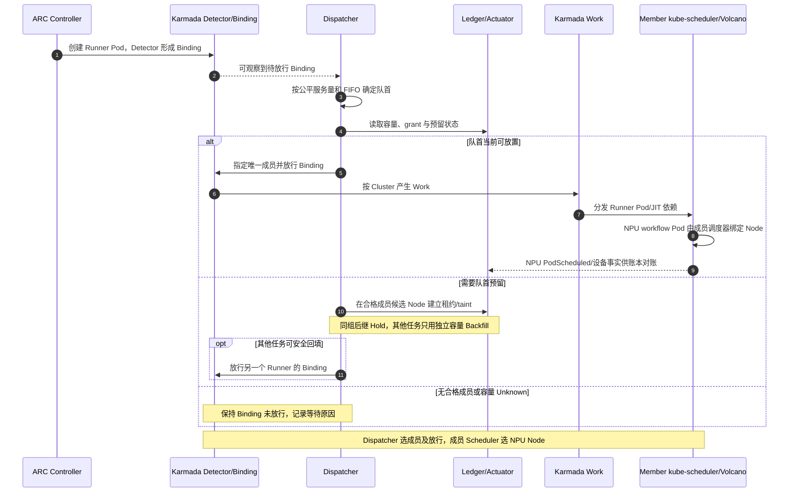

图 5-3-1 Dispatcher 选择成员并放行 Runner

说明：联邦容量判断发生在成员传播前，不替代 Node/Gang 调度。

#### 5.3.4.2 UC-06 JIT Secret 晚到后的依赖恢复——运行时序（US-04）

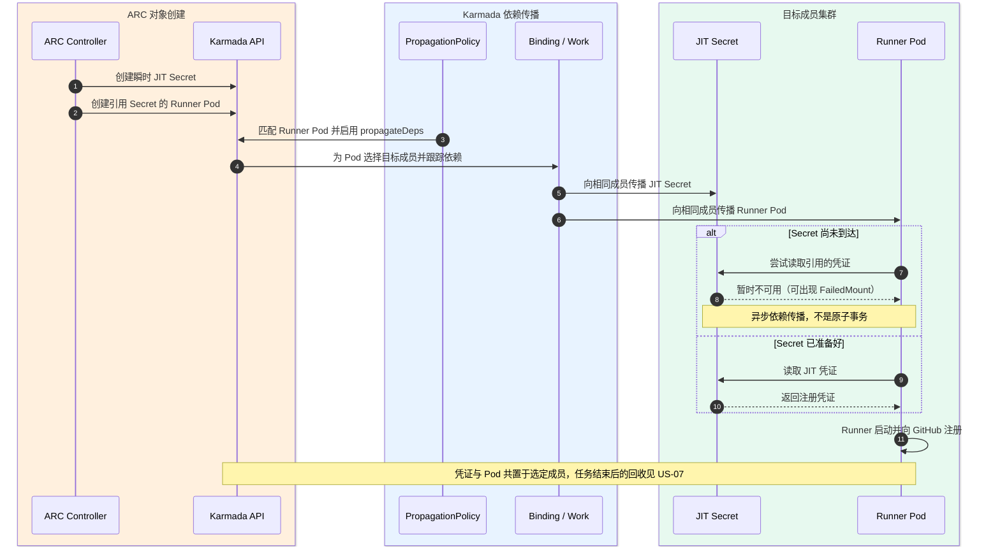

图 5-3-2 JIT Secret 延迟传播与恢复

说明：JIT Secret 未到达时，不得判定 Runner 已具备执行条件。

#### 5.3.4.3 UC-10 成员不可用——异常运行时序

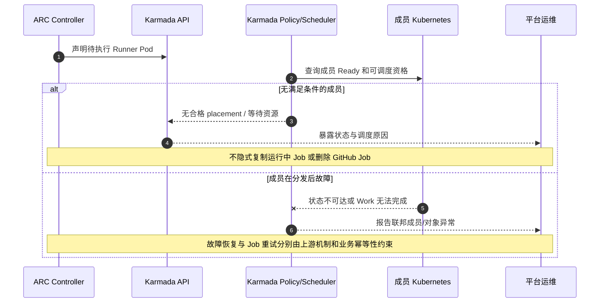

图 5-3-3 成员失联诊断路径

说明：成员失联不自动触发运行中 GitHub Job 的迁移或重复派发。

**异常约束**：不得将成员失联等价于 GitHub Job 已失败或可安全重复执行；设计仅保证可诊断的异常状态和责任边界。

### 5.3.5 用户接口设计

开发者无需选择成员；管理员通过 Cluster、Binding/Work、Pod 事件定位执行成员与未就绪原因。无新增 UI。

### 5.3.6 实现接口设计

#### 5.3.6.1 接口设计

| 交互双方 | 原生接口或资源 | 输入、操作与输出 | 权限与前置条件 | 异常处理与限制 | 依据及规格 |
|---|---|---|---|---|---|
| ARC Controller 与 Karmada API | Kubernetes `Pod`、`Secret`、`ServiceAccount` | ARC 创建带有服务标签、运行身份和 JIT Secret 引用的 Runner Pod。 | Controller 必须具有指定命名空间的所需对象管理权限。 | 对象不存在或 JIT Secret 尚未可用时，必须保留实际状态，不得重新提交 Job。 | ARC-1；SP-03 |
| 平台配置与 Karmada | `PropagationPolicy`：`policy.karmada.io/v1alpha1` | 平台必须设置资源匹配条件、成员候选范围和依赖传播规则。 | 策略维护者只能操作授权范围内的命名空间及成员。 | 策略不匹配或没有合格成员时，保留调度原因，不得默默选择其他租户成员。 | KAR-1、KAR-2；SP-02、SP-03 |
| Karmada 与成员 Kubernetes | `ResourceBinding`、`Work` 及成员对象 | Karmada 将选定 Runner Pod 和它引用的运行依赖分发到指定成员。 | Karmada 必须持有已注册成员的 API 访问身份。 | 成员不可达或资源发生冲突时，按上游调谐语义处理，不强制覆盖其他管理者的对象。 | KAR-1、KAR-2；SP-02 |

**配置责任：** 平台维护 `PropagationPolicy` 及授权范围，限制其只匹配目标 Runner Pod；Karmada 传播失败不得直接触发 GitHub Job 重派。

### 5.3.7 调度正确性约束

| 约束编号 | 不变量/限制 | 反例及处理 |
|---|---|---|
| PL-01 | 被传播的 Runner Pod 必须属于明确的 Runner 服务范围 | 现有全命名空间 Pod 选择器不满足目标隔离要求，属于 SP-03 待改配置 |
| PL-02 | 目标成员必须符合授权的候选集与平台明确声明的硬性约束 | 无匹配成员时报告不可调度，不得越权扩张 |
| PL-03 | 传播完成 ≠ 节点成功调度 ≠ Runner 已注册 ≠ Job 成功 | 分别使用 Karmada、成员 K8s、ARC/GitHub 事实判定 |
| PL-04 | 单个 Runner Pod 不能通过聚合多个节点/成员空闲量证明满足完整资源请求 | 容量碎片化仍可能导致 Pending；保留诊断状态 |
| PL-05 | 独立 Pod 的 `Divided/Weighted` 不构成跨 Pod 比例、NPU 预留或调度公平保证 | 不在设计或验收中使用无依据的成功率/均衡性承诺 |
| PL-06 | 成员不可达或 Pod 未就绪不得触发未经去重证明的 GitHub Job 重派 | 只按上游生命周期和第 4.5 节的状态约束处理 |
| PL-07 | Dispatcher 只能选择成员；需要可靠的单节点可放置容量信号，但不得把估算节点视为已经绑定的 NPU Pod | A 单节点最多 8 卡、B 单节点 16 卡时，16 卡工作流选 B 成员；由 B 的 kube-scheduler/Volcano 决定 Node；见 PL-D02 |
| PL-08 | Dispatcher 的未落地容量授予与节点预留须持续对账；实际 NPU 分配以成员工作流 Pod 的节点绑定及 kubelet 事实为准 | 两个 Runner 不得共用同一份预估空闲容量；预留 Node taint 不等于 workflow Pod 必定绑定该节点；见 PL-D02 |
| PL-09 | Dispatcher 仅按队列身份、可信租户与成员授权对 Binding Hold/Release | GitHub Job 排队与 Binding Hold 不同；PR/nightly 优先级仅在成员 NPU Pod 生效 |
| PL-10 | 预留须由 Node 保护租约、归属、精确 toleration 和同组 Hold 协同执行 | 同组后继不能占队首预留 Node；禁止 `Exists` 通配 |
| PL-11 | Backfill 仅使用不影响队首预留承诺的非预留资源 | 没有可信完成时限时不得借用队首保护 Node 的空闲量 |
| PL-12 | Dispatcher 重启或切主后必须重建队列及账本；Binding 写者互斥，租约具备失效清理 | 两个 Leader 不得同时放行；Dispatcher 退出不能使 Node 永久被 taint |
| PL-13 | Dispatcher 不处理 PR/nightly 类别、分时窗口或 PriorityClass；只管理联邦公平和队首保护 | nightly 低优先级由真实 NPU Pod 声明；不得把成员的优先级当作 Binding 放行优先级 |
| PL-14 | 跨租户按同一资源族的 NPU 卡时和批准权重仲裁；未落地授予与已完成服务分开计量 | 16 卡×1 小时与 2 卡×1 小时不能视为相同服务；PL-D04 |
| PL-15 | nightly 实际 NPU Pod/VolcanoJob 声明低优先级，由成员 Volcano 排序，未经授权不可升权且不得抢占运行中的 Job | 同一 runs-on 的静态 Hook 模板不能凭空区分 PR/nightly；CPU Runner Pod 设置类不等于 NPU Pod 生效；PL-D05 |
| PL-16 | 应急调度接管前必须确认原 Binding Writer 失效 | 决策停止但进程仍续约不能判定 Dispatcher 健康；PL-D06 |
| PL-17 | 切主先对账持久化 grant、Node 预留及实际 NPU Pod；未知容量停止放行 | 空账本不是节点空闲；应急和 Dispatcher 不能双写；PL-D06 |
| PL-18 | Node `NoSchedule` 只阻止不容忍该 Taint 的**新 Pod 调度**，保护粒度是整个 Node 而非指定 NPU 卡数 | 8 卡 Node 为队首 2 卡任务保留时，剩余 6 卡不得按普通 Backfill 复用；计入整节点保护开销；见 4.3.6.1 |
| PL-19 | 多节点 Gang 的候选 Node 保护按同成员整组授权、版本、租期对账；部分写入失败不可宣布完整预留 | 3 台 Node 有 1 台保护失败时标记 ReservationPartial 并安全回滚；同组 Pod 要有精确 Toleration；见 4.3.6.1 |

**设计级验收边界**：PL-07～19 为目标约束，当前 Manifest 没有 Dispatcher。PL-D02 定义两级放置；PL-D03 定义 FIFO/Reserve/Backfill；PL-D04 定义公平计量；PL-D05 定义成员 Volcano Pod PriorityClass；PL-D06 定义故障降级。PriorityClass 相对顺序、Volcano 动作、权重及故障阈值为 P 类；不宣称跨集群 PR 优先、原子资源预约或无损切换。

### 5.3.9 DFX分析

**功能安全与性能约束**：传播策略不能无意包含其他租户的 Pod。JIT Secret 必须只分发到有实际执行需求的成员。监控应分别记录成员选择、Secret 可用和 Runner 注册等阶段，不得宣称未经定义的平均分配比例。

**可靠性故障分析（FMEA）**

| 编号 | 失效原因 | 业务或系统影响 | 检测方法 | 处理与恢复要求 | 负责方 |
|---|---|---|---|---|---|
| F03-01 | 传播策略错误地选择了非 Runner Pod。 | 其他工作负载可能被复制到不应访问的成员。 | 比对策略标签与目标 Runner Pod、非目标 Pod 的标签。 | 策略维护者必须收窄选择条件，并确认其他租户 Pod 不匹配。 | 联邦策略维护者 |
| F03-02 | JIT Secret 晚于 Runner Pod 到达成员。 | Runner Pod 无法挂载所需 Secret，启动推迟。 | 检查成员 Pod 的 `FailedMount` 事件和 JIT Secret 引用。 | Karmada 继续调谐依赖传播；成员 Kubernetes 继续挂载重试。平台不得因此重复派发 Job。 | Karmada、成员运维 |
| F03-03 | 候选成员不可达或资源不足。 | Runner Pod 无法进入可执行状态。 | 检查成员 Cluster Ready、Binding/Work 和 Pod 调度事件。 | 运维人员应恢复成员或调整已授权的候选集；不得重复提交正在执行的 Job。 | 联邦与资源池运维 |
| F03-04 | 资源账本没有扣除未落地的 NPU 授予。 | 多个 Runner 被放行到同一耗尽节点或成员。 | 对照 Binding grant 与真实 workflow Pod 绑定及快照覆盖范围。 | Dispatcher 按 UID 对账并保守停止超售放行。 | Dispatcher/容量维护者 |
| F03-05 | 成员容量快照滞后或拓扑无法建模。 | 队列错误放行、Job 持续等待。 | 比较 Estimator、成员 Node/Pod 与实际 FailedScheduling。 | 将成员标记 CapacityUnknown，恢复观测后重新判断。 | 容量维护者 |
| F03-06 | 队首大任务被后续小任务连续占用资源。 | 大任务长期饥饿。 | 队首等待时间、回填次数、预留兑现率。 | Dispatcher 触发受限 Reserve Node 并拒绝破坏保护的回填；按公平策略老化。 | 调度策略维护者 |
| F03-07 | 预留租约未续或未清理；Dispatcher/Janitor 故障。 | Node 长期被 taint，资源闲置。 | `reserved-until`、reserved-by、Janitor 运行与实际 Node taint。 | 新 Leader 对账，Janitor 按归属/到期回收；限制每集群受保护节点预算。 | Actuator/Janitor 维护者 |
| F03-08 | 回填任务持有过宽 Toleration 或同组未被 Hold。 | 后继任务占用队首保护容量，FIFO 承诺失效。 | 对照 Runner group、Node taint、workflow Pod 的实际 NodeName。 | 仅精确 Equal 容忍，同组后继 Hold；错误保护须告警并恢复。 | Dispatcher/成员调度维护者 |
| F03-09 | 两个 Dispatcher 实例或降级调度器同时放行 Binding。 | 重复分发或队列顺序不可信。 | Leader Lease、Binding resourceVersion、放行决策记录。 | 只保留单写者；完成状态恢复后才放行，接管与降级互斥。 | Dispatcher/联邦控制面维护者 |
| F03-10 | 跨租户按 Job 数而非 NPU 卡时排序，或窗口计量遗漏已运行任务。 | 高耗资源租户长期占优，公平目标失效。 | 比对租户 NPU Pod 卡时、权重、grant 和仲裁决策。 | 按 PL-D04 在同资源族使用实际分配卡时加权仲裁；数据未知则不宣称公平保证。 | Dispatcher 公平策略维护者 |
| F03-11 | nightly 低优先级未传到实际 NPU Pod，或共享 Runner 的静态 Hook 模板未区分类别。 | 成员 PR/nightly 等待顺序无效，或任务被错误升权。 | 对比实际 Pod/PodGroup priorityClassName、提交身份、schedulerName 和 Volcano 插件配置。 | PL-D05：nightly 负载模板设置低优先级，校验准入授权与 Priority Plugin，禁用不受控抢占。 | 成员调度/工作流模板维护者 |
| F03-12 | Dispatcher 租约续约但决策停滞，Watchdog 只看 Lease。 | 全部新增任务长期 Hold。 | 最后成功决策循环、采集新鲜度、放行进度与 Lease 差异。 | PL-D06：独立进度健康检查，进入 RECOVERING/安全降级或 FAIL_CLOSED。 | Dispatcher/Watchdog 维护者 |
| F03-13 | 网络分区造成旧 Dispatcher 与应急 Scheduler 双写。 | Binding 目标冲突或重复传播，资源账本错误。 | 写者身份、进度与 Binding 版本/目标事件。 | PL-D06：证明旧 Writer 失效后才接管；无法排他就 FAIL_CLOSED。 | 联邦控制面维护者 |
| F03-14 | 将 Node NoSchedule 误当作 NPU 2/8 卡精确预留 | 后继任务错误 Backfill，破坏队首保护或统计虚高 | Node Taint、候选 Pod、资源账本与实际 Node allocatable 对照 | PL-18：整 Node 保护、整 Node 开销计量；禁止卡级余量的无证据回填 | Dispatcher/成员调度维护者 |
| F03-15 | 多节点 Gang Node 预留只完成部分节点，仍宣布成功 | 队首工作负载无法同时启动，部分节点长期闲置 | 预留组中所有 Node 版本、租约、实际 Taint 与 PodGroup 状态 | PL-19：标记 ReservationPartial，按归属回滚或安全重试后才宣布整组保护 | Reservation Actuator/成员调度维护者 |
| F03-16 | 不可信 Pod 使用宽泛容忍或 nodeName 绕过 Node Taint | 非队首占用保护资源、全局 FIFO 失效 | Node Taint、Pod Toleration、Pod nodeName 和提交身份 | 成员 admission 限定组权限与 PodSpec，发现绕过则冻结相关成员的新容量放行 | 成员 API 准入/Dispatcher 维护者 |

**风险—措施—验证追踪**（关联：SR-03-01、SR-03-02、SR-NF-02/03；延续上方 FMEA 编号，不替代已有故障表）

| FMEA | 失效模式 | 影响 | 风险 | 设计措施及对应约束 | 设计验证准则 | 剩余风险 |
|---|---|---|---|---|---|---|
| F03-01 | 过宽 Pod 选择器误传播非 Runner 工作负载 | 非目标 Pod 占用成员资源、扩大传播范围 | 高 | SP-03/PL-01 精确匹配 ARC Runner Pod，不改动其他工作负载 | 非目标 Pod 不匹配；当前全命名空间选择器标为未满足 | 策略标签随 ARC 版本改变可能导致误选或漏选 |
| F03-02 | JIT Secret 与 Pod 异步传播 | Pod FailedMount 或启动超时 | 中 | SP-04/LC-04 关联引用依赖、保持 Pending、原生调谐 | Secret 晚到时不出现伪 Ready；可关联失败事件和传播状态 | 异步到达与联邦同步延迟 |
| F03-03 | 成员故障或节点容量碎片化 | Runner/Job 等待，NPU workflow Pod 可能 Pending | 高 | PL-02～PL-07；Dispatcher 参考成员节点可放置容量选择集群，成员调度器选 NPU Node | A 聚合卡数足够但单节点不够、B 有完整节点时 Dispatcher 选 B；成员实际 FailedScheduling 归成员调度器 | 拓扑/快照不完整时仍可能 Pending |
| F03-04 | Dispatcher 容量账本漏计未落地授予 | 多个 Runner 被放行到资源不足的同一成员 | 高 | PL-08、PL-D02：以 Runner/Binding UID 跟踪容量暂计，直到成员 workflow Pod 实际落地并计入快照 | 后一 Dispatcher 决策不能重复使用前一授予的容量；对账不依赖 Runner CPU Pod 的 Node | 控制面异步与外部工作负载竞争仍可能影响成员容量 |
| F03-05 | 成员容量信息过期或设备拓扑模型不完整 | Dispatcher 可能选择错误成员或长时间等待 | 高 | CapacityUnknown、保守 hold、以成员 PodScheduled/FailedScheduling 反馈更新容量 | Unknown 不得判定可放置；成员调度器仍负责实际 Node 选择 | 保守等待可能延长排队，阈值待定 |
| F03-06 | 队首长期等待，连续小任务插队 | 大任务饥饿、等待 SLO 失守 | 高 | PL-09/11/13；PL-D03 保护队首、仅非预留容量 Backfill，按作用域公平仲裁 | 队首需要完整 Node 时，后继任务不能无限占用保护区；提供队首等待和回填证据 | 已运行长任务不可抢占，尚无有界完成时间 |
| F03-07 | Node 预留泄漏或租约清理失效 | 可用 NPU 节点永久闲置 | 高 | PL-10/12；归属标记、短租约续期、成员 Janitor、预算限制 | Leader 死亡后短租约到期可判定清理；错误归属不得被自动接管 | 成员控制面/Janitor 同时故障时仍可能残留 |
| F03-08 | 同组后继绕过 Hold、宽泛 toleration 抢占队首 | 预留失效、队首饥饿 | 高 | PL-10/11；仅匹配 group 的 Equal Toleration、同组 Hold、预留违规观察 | 容忍 Exists/未 Hold 均不满足验收；出现非队首占用必须告警 | 与未纳管调度器之间存在共存约束 |
| F03-09 | 多写者或恢复未对账就放行 | 任务重复传播、账本偏差 | 严重 | PL-12；唯一 Binding 写者、Leader/进度检测、Grant 重建、降级互斥 | 切主前后同 Binding 不能由两个写者放行；未知容量不进入新放行 | Lease 抖动及网络分区导致短时不可用 |
| F03-10 | 按任务数量轮转而忽略 NPU 卡时与租户权重 | 小任务与大任务被错误等价，公平性失真 | 高 | PL-14、PL-D04：按真实 NPU 工作负载的卡时计量，grant 单独占容量预算 | 16 卡×1h 与 2 卡×1h 获得不同的服务量；跨设备家族分别计算 | 不可放置的大任务与非抢占长任务仍影响短期公平 |
| F03-11 | nightly NPU Pod 缺少低优先级类，或低优先级被静态模板错误应用至所有共享 Runner | PR 在成员 Pod 队列中未优先执行或被错误降权 | 高 | PL-15/PL-D05：nightly 的真实 NPU Pod/VolcanoJob 指定 PriorityClass，Hook 生成 Pod 需有可信差异化来源；Volcano Priority Plugin 生效，禁用不受控抢占 | 同成员均 Pending 时 PR 在 nightly 前；运行 nightly 不被抢占；无类别输入时不应盲目应用共享模板 | Pod 来源与 Volcano Action 配置需与目标版本核对 |
| F03-12 | Watchdog 只依据后台 Lease 判活 | Dispatcher 持续 Hold，排队 SLO 失效 | 高 | PL-16、PL-D06：决策进度与主动容量健康检查 | 决策循环停止但续约正常时，进入 RECOVERING/降级状态或 FAIL_CLOSED | 业务恢复阈值仍待批准 |
| F03-13 | 降级接管时旧 Writer 仍能写 Binding | 多 Cluster 传播及对象身份争用 | 严重 | PL-16/17、PL-D06：接管前确认旧 Writer 已失效，重建 grant，更新版本冲突重查 | 旧 Writer 无法被排他时不进入 DEGRADED；不得并行更新同一 Binding | 网络分区下可用性降低，安全优先 |
| F03-14 | Node Taint 粒度被误判为卡级资源预留 | Backfill 违反保护、保护开销漏计 | 高 | PL-18；4.3.6.1 明确完整 Node NoSchedule 与受保护卡时独立计量 | 8 卡 Node 保护 2 卡时，剩余 6 卡不能作为普通 Backfill 安全容量 | 整节点保护牺牲短期利用率 |
| F03-15 | 多 Node 预留部分成功或租约残留 | Gang 无法同时启动、资源闲置 | 高 | PL-19；同成员完整 Node 组版本/租约与失败回滚、Janitor 清理 | 3 台 Node 只保护 2 台时不能宣布完整预留；失败后可按归属释放 | 跨 Node API 无原子提交，竞态保留 |
| F03-16 | 宽泛 toleration 或直接 nodeName 绕过保护 | 队首保护失效、受保护卡被后继占用 | 严重 | PL-10/18/19；成员 admission 限制组授权，精确容忍并拒绝绕过 | 未授权的 Pod 不能绕过 group 保护；若无法验证应停止声称 Reserve 安全 | 节点已有 Pod 和其他调度器可能仍产生资源竞争 |

**运行诊断与敏感信息处理**：诊断时先查看成员集群的 Ready 状态与 Karmada Binding/Work，再检查成员 Pod 事件和 Secret 引用。日志不得保存 Secret 数据。

## 5.4 F-04 Listener 跨控制面认证与访问

**典型场景：** Listener 在成员集群运行，却要修改统一 Karmada 控制面内的 Runner 期望状态。身份或证书配置失效会导致 Runner 无法按 Job 需求扩容。

### 5.4.1 功能概述

**关联需求**：SR-04-01；**用例**：UC-08 Listener 访问统一 Karmada API、UC-11 Token 失效或证书不匹配；**功能域规格**：SP-04、SP-05。

F-04 为成员 Listener 提供 Karmada API 地址、可信证书和最小授权身份，仅允许操作所属 Runner 服务。

**职责**：Listener 访问身份、地址和权限；不修改 API Server 认证。

### 5.4.3 实现思路

用 ServiceAccount、TokenRequest 和 RBAC 建立 Listener 身份。校验 Karmada API 证书链与名称。地址、CA、Token 由部署提供；示例固定 IP 和签发脚本不等于自动轮换。

### 5.4.4 设计思路

凭证方签发 Token/CA；Listener 验证服务器证书，API Server 校验身份与权限。校验通过才能更新指定 `EphemeralRunnerSet`；网络、TLS、401、403 分别记录。

#### 5.4.4.1 UC-08 Listener 访问统一 Karmada API——运行时序（US-05）

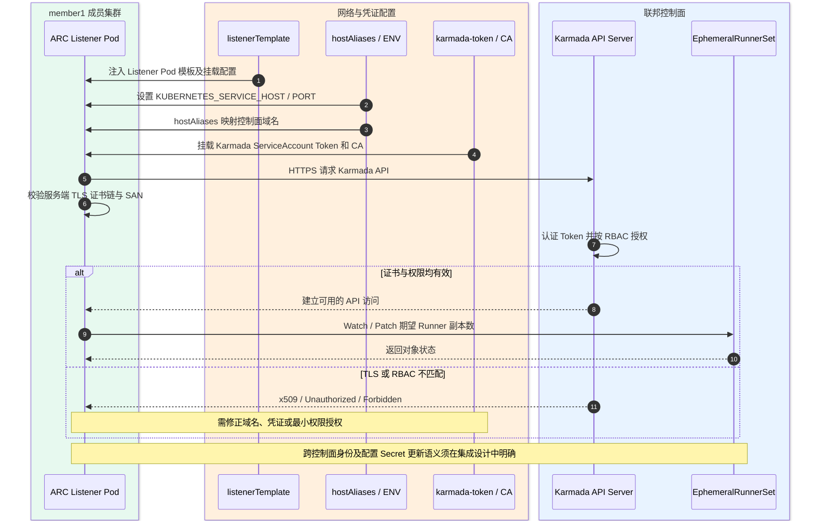

图 5-4-1 Listener 跨控制面访问

说明：TLS、认证、RBAC 权限各有明确控制面与错误归属。

#### 5.4.4.2 UC-11 令牌轮换、权限拒绝和撤销——异常时序

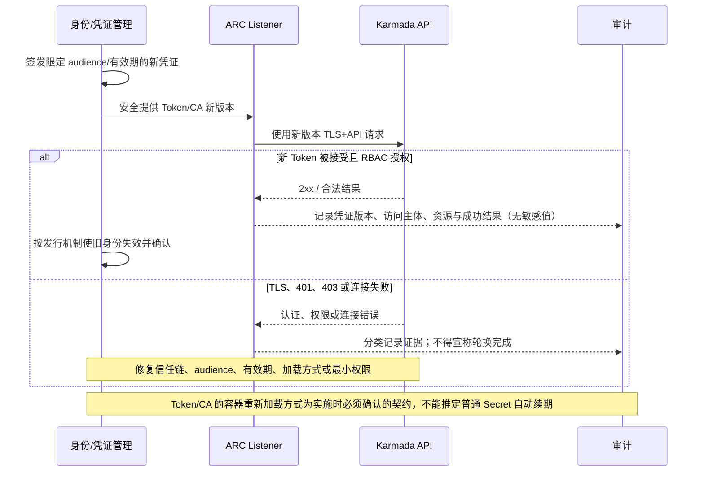

图 5-4-2 控制面访问及凭证异常恢复

说明：区分网络、证书、认证、授权和凭证撤销。

| 情况 | 错误归属 | 设计恢复动作 | 禁止行为 |
|---|---|---|---|
| DNS/TCP/路由失败 | 网络连通性 | 恢复控制面可达，保留目标地址和错误分类 | 不转向未经验证 API |
| TLS CA/SAN 不匹配 | 服务端身份与信任链 | 修正证书链、访问域名、信任锚 | 不关闭 TLS 校验 |
| HTTP 401 | Token 到期、issuer/audience、对象绑定或载入失败 | 重新核对 Token 有效性、消费者加载和 Karmada 认证配置 | 不升级为管理员凭证 |
| HTTP 403 | RBAC 不足或请求作用域不匹配 | 对照实际 API verb、resource、namespace 与 `resourceNames` | 不直接授予 cluster-admin |
| Secret 副本留存/成员失联 | 传播与回收状态未知 | 记录目标成员及副本 UID；恢复后核对，并独立检查远端凭证撤销 | 不宣称删除控制面 Secret 即完成全域撤销 |
| 更新 Secret 但 Listener 仍用旧 Token | 凭证加载机制 | 定义可检查的新凭证加载/Listener 重启流程 | 不把 Secret resourceVersion 变化当成轮换成功 |

**接口审计：** 记录调用身份、目标资源与操作、请求结果、失败类别、非敏感凭证版本及观测时间。`03-rbac.yaml` 中的 `ephemeralrunners` 权限以及 Controller 的管理员 kubeconfig 仍需收敛到最小授权。

### 5.4.5 用户接口设计

身份和轮换由安全管理员维护；运维查看 Listener 状态、错误类型及证书/Token 版本。复用现有工具，无独立 UI。

### 5.4.6 实现接口设计

#### 5.4.6.1 接口设计

| 交互双方 | 原生接口或资源 | 输入、操作与输出 | 权限与前置条件 | 异常处理与限制 | 依据及规格 |
|---|---|---|---|---|---|
| ARC Listener 与 Karmada API | HTTPS Kubernetes API、`EphemeralRunnerSet` | Listener 必须使用指定 API 地址、可信 CA 和访问令牌更新所负责的 Runner 对象。 | Token 必须来自受控身份；RBAC 只授予所需对象和操作。 | 网络、证书、HTTP 401、HTTP 403 和超时必须分别记录，不允许绕过认证。 | K8S-1、K8S-2；SP-05 |
| 部署与密钥管理系统和 Listener Pod | Listener 模板、Secret 或受控凭证投射卷 | 部署方必须提供 CA、Token、有效期及 API 连接信息，并明确更新后的加载方式。 | 凭证应以只读方式提供给需要的容器，禁止出现在日志中。 | Token 到期或未加载时，必须报告身份状态；不得假定修改 Secret 后立即生效。 | SP-04、SP-05 |
| 安全管理员与 Kubernetes RBAC | `Role`、`RoleBinding` | 对指定 `EphemeralRunnerSet` 授予所需 `patch` 权限，对必要的 `EphemeralRunner` 资源授予对应读写和状态权限。 | 必须确认 ServiceAccount 命名空间、绑定对象以及操作范围。 | RBAC 配置与契约不一致时，应修正 Role/Binding；不得赋予 `cluster-admin`。 | K8S-2；SP-05 |

**配置责任：** 身份管理方负责 ServiceAccount、RBAC、Listener 访问地址、证书和 Token 更新机制。

### 5.4.9 DFX分析

**功能安全与性能约束**：Listener 必须验证 HTTPS 服务器证书。凭证只授予必要操作权限，日志不得包含 Token 或私钥。高可用与不中断轮换属于部署参数，不能宣称已自动具备。

**可靠性故障分析（FMEA）**

| 编号 | 失效原因 | 业务或系统影响 | 检测方法 | 处理与恢复要求 | 负责方 |
|---|---|---|---|---|---|
| F04-01 | API 地址不可达或 TLS 证书校验失败。 | Listener 不能访问 Karmada API。 | 分别检查 DNS/TCP 连通性、CA 与证书 SAN。 | 部署维护者应修正服务地址或证书配置，不能关闭 TLS 校验。 | 部署与证书管理员 |
| F04-02 | Token 已到期或 Listener 未加载新 Token。 | Listener 的 Runner 数量更新操作失败。 | 检查 HTTP 401、Token 有效期和凭证加载记录。 | 身份管理员更新 Token；部署维护者按规定重载 Listener。 | 身份与部署维护者 |
| F04-03 | Role 或 RoleBinding 的授权范围错误。 | Listener 无法操作所需资源，或存在越权风险。 | 检查 HTTP 403 与 Role/Binding 中的资源名称及操作。 | 安全管理员按最小权限规则修正配置，保留变更审计。 | 安全管理员 |

**风险—措施—验证追踪**（关联：SR-04-01、SR-NF-01/02；延续上方 FMEA 编号，不替代已有故障表）

| FMEA | 失效模式 | 影响 | 风险 | 设计措施及对应约束 | 设计验证准则 | 剩余风险 |
|---|---|---|---|---|---|---|
| F04-01 | TLS 身份校验错误或连接不可达 | Listener 无法安全访问控制面 | 高 | SP-05 强制 CA/SAN 校验，网络/TLS 分别诊断 | 错误路径不允许 insecure-skip-verify、换用未知地址或管理员凭证 | 证书与网络基础设施失效仍影响供给 |
| F04-02 | Token 到期、新凭证未被加载 | ERS 更新失败、Runner 供给停止 | 高 | SEC-04 轮换双确认；按加载机制更新或安全重启 | Secret 更新但旧 Token 仍在使用不得判为轮换成功；401 可追踪 | 需要目标运行方式的加载/轮换能力 |
| F04-03 | RBAC 过大或过小 | 越权修改/合法操作被拒绝 | 严重 | SEC-03 逐 API verb/resource/namespace 收敛；Controller 禁止生产 admin kubeconfig | 授权身份只可改所属资源；403 单独报告；当前 admin kubeconfig 标记为差距 | 上游版本变更可能改变所需权限 |
| F04-04 | GitHub 主凭证被传播至无消费者成员 | 成员被攻陷后获取长期管理凭证 | 严重 | SEC-01/02 分离管理凭证、JIT 和 Listener 身份；只允许实际消费者读取与传播 | 核对 PropagationPolicy：非消费者成员无长期主 Secret；当前双成员分发标记未满足 | 凭证本身受外部授权与撤销机制限制 |

**运行诊断与敏感信息处理**：平台必须分开记录网络连接错误、证书校验错误、HTTP 401 与 HTTP 403。出现权限失败时，不能通过关闭 TLS 或授予 `cluster-admin` 来绕过。

## 5.5 F-05 Runner Pod 状态反馈与一致性

**典型场景：** Runner 在远端成员已经启动，但管理面仍显示 Pending；或者成员失联而管理面保留旧 Ready。状态解释必须区分真实成员状态与缓存、过期或冲突状态。

### 5.5.1 功能概述

**关联需求**：SR-05-01；**用例**：UC-09 Runner Ready 状态反馈、UC-12 状态缺失、冲突或滞后；**功能域规格**：SP-06、SP-07。

F-05 将成员 Pod 状态回传 Karmada，供 ARC 读取容器名、运行状态与 Ready；仅支持单执行成员。

**职责**：状态解释及来源约束；Job 结果归 GitHub。

### 5.5.3 实现思路

用 Karmada `ResourceInterpreterCustomization` 保留 Pod 状态，不改 ARC/Karmada 控制器。多来源状态须另定冲突规则，不能直接取第一个非空值。

### 5.5.4 设计思路

成员 kubelet 更新 Pod，Karmada 汇总状态，ARC 读取 Ready 和容器信息。目标状态适配契约必须核对当前 Binding/Work 的唯一目标成员和 Pod 身份后，才允许 ARC 所读对象呈现有效 Ready；来源缺失或过期时不得保留先前 Ready 作为可执行证据。此处是目标设计，不表示当前 Lua 已能读取所需全部上下文。

#### 5.5.4.1 UC-09 Runner Ready 状态反馈——运行时序（US-06）

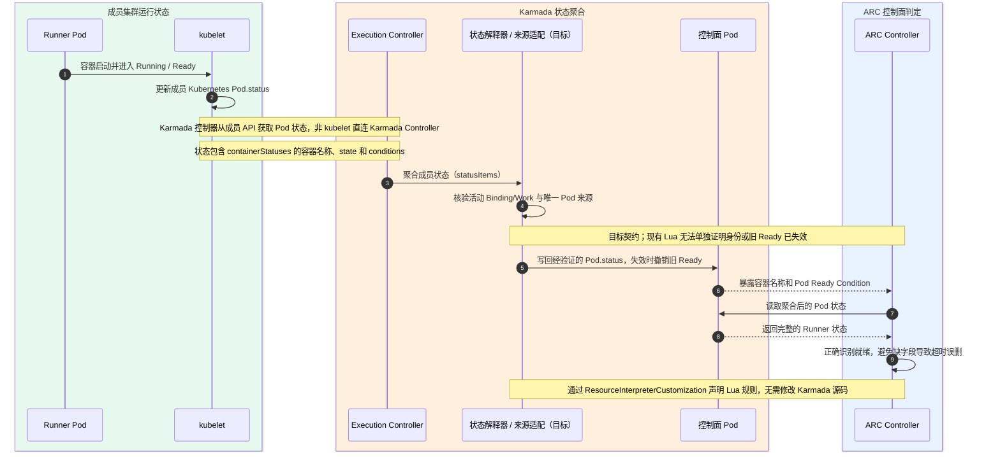

图 5-5-1 成员 Pod 状态反馈到 ARC

说明：旧 Ready 不一定代表当前成员可执行，冲突要回到权威来源核对。

##### 5.5.4.2 多来源状态聚合及过期状态处理

**当前配置差距**：`manifests/01-karmada-interpreter.yaml` 中的 `AggregateStatus` 使用第一个非空 `statusItems[i].status`，只在确实存在唯一可信来源时才适用，**没有实现**按目标成员选择、冲突隔离或过期识别。特别是 `statusItems` 为空时该 Lua 返回未修改的 `desiredObj`，可能留下旧 Ready；不能以`#statusItems == 1` 代替当前 Binding、Pod UID 与状态新鲜度校验。

| 输入/条件 | 设计要求 | 不满足时 |
|---|---|---|
| ResourceBinding/Work 的当前活动目标 Cluster | 聚合源只能来自目标成员 | 无法唯一确认时不产生新的 Ready 结论 |
| 成员 Pod 身份（Cluster、namespace、name、UID） | 来源与当前传播实例匹配，不使用旧 Pod/旧 Work 的状态 | 记为 Unknown 并保留冲突证据 |
| Pod phase、conditions、containerStatuses | 保留 ARC 目标版本实际需要的全部状态字段 | 不合成缺失字段或假造 Ready |
| 最新性 | 在同一对象/集群内使用 UID 和实际可比较的版本/观测时间；跨集群不比较 resourceVersion | 信息不全则保留未确认状态 |
| 空状态/成员失联 | 必须使 ARC 实际读取路径不再将旧 `Pod Ready=True` 当作当前 Ready；保留 StatusUnknown 和证据 | 不能直接返回旧 `desiredObj.status` 并声称安全 |
| 状态恢复 | 重新核对唯一目标成员、当前 Pod UID、来源最新性以及 ARC 可读状态 | 未完成校验不得仅凭原有 Ready 恢复 |

**扩展点与读状态路径**：目标版本 `ResourceInterpreterCustomization` 是否暴露目标 Cluster 和 Pod UID，以及 Lua 是否能查询当前 Binding/Work，必须由该版本接口确认。若缺少这些输入，状态选择必须由能取得 Binding/Work 和成员 Pod 身份的受控适配机制完成，并明确何处阻止旧 Ready 进入 ARC 可读的 Pod 状态。**仅增加监控侧 StatusUnknown 不满足 LC-08**；若目标版本没有可实施的读状态保护路径，应保留阻塞项，不把“无旧 Ready 误判”列为已兑现能力。

**正确性出口**：成员状态、控制面聚合状态和 GitHub Job 状态独立追踪。控制面旧 Ready 不得覆盖成员失联事实；Pod Ready 不等于 GitHub Job 成功。

### 5.5.5 用户接口设计

开发者在 GitHub 查看 Job；运维按 Pod UID、成员、容器名、Ready 排障。无新增 UI。

### 5.5.6 实现接口设计

#### 5.5.6.1 接口设计

| 交互双方 | 原生接口或资源 | 输入、操作与输出 | 权限与前置条件 | 异常处理与限制 | 依据及规格 |
|---|---|---|---|---|---|
| 成员 kubelet 与 Karmada | Kubernetes `Pod.status` | 成员 Kubernetes 提供 `phase`、`conditions`、`containerStatuses` 和容器运行信息。 | Karmada 必须能读取目标成员 Pod 的状态。 | 状态未返回时应保留未确认状态，不得生成不存在的容器状态。 | KAR-3；SP-06 |
| Karmada 状态解释器与控制面 Pod | `ResourceInterpreterCustomization` 的 `AggregateStatus` | 目标机制将已验证的唯一成员 Pod 必需状态字段写入 ARC 可读的控制面对象。 | 目标为 `v1/Pod`，来源与当前 Binding/Work 的唯一目标及当前 Pod 身份一致。 | `statusItems` 为空时旧 Ready 失效；现有 Lua 不能单独保证来源及 UID 核对。 | KAR-3；SP-06、LC-08 |
| 状态来源适配者与 ARC Pod 状态读路径 | 活动 Binding/Work、成员 Pod UID/状态与控制面 Pod | 关联并筛选当前唯一来源；冲突、过期或成员不可达时让 ARC 不再消费旧 Ready，恢复时提供已确认的新鲜状态。 | 必须有可作用于 ARC 读取结果的已核实接口/扩展点；状态与身份来源可追踪。 | 只有独立 StatusUnknown 告警但控制面旧 Ready 未失效时，视为正确性缺口，不宣称完成。 | ST-D01、LC-02/06/08；SR-05-01 |
| ARC Controller 与 Pod 状态 | Kubernetes Pod 读取或监听操作 | ARC 读取 Runner 容器名称、容器状态与 Pod Ready 条件。 | Controller 必须具有读取对应 Pod 的权限。 | 字段缺失时不能假定 Runner 已就绪；必须提供状态与事件诊断。 | ARC-1；SP-06 |

**配置责任：** 状态适配组件维护 `ResourceInterpreterCustomization`，保留 ARC 使用的状态字段。

### 5.5.9 DFX分析

**功能安全与性能约束**：必须保留 ARC 需要的 Pod 状态字段，同时避免在状态聚合或日志中记录凭证数据。状态同步延迟和告警时限由业务 SLO 确定，不得把测试采样参数当作生产指标。

**可靠性故障分析（FMEA）**

| 编号 | 失效原因 | 业务或系统影响 | 检测方法 | 处理与恢复要求 | 负责方 |
|---|---|---|---|---|---|
| F05-01 | 状态解释器遗漏容器名称或 Ready 条件。 | ARC 可能把 Runner 判定为未就绪。 | 逐项比较成员和控制面 Pod 的状态字段。 | 状态适配维护者必须保留 ARC 所需字段并检查映射规则。 | 状态适配维护者 |
| F05-02 | 同一个 Pod 出现多个互相冲突的状态来源。 | 控制面可能显示错误成员的状态。 | 核对 Binding 的目标成员与各来源 Pod 的标识。 | 设计必须先定义状态来源规则；不得静默采用第一个非空状态。 | 状态适配与 Karmada 管理者 |
| F05-03 | 成员状态同步延迟。 | Runner 就绪信息不能及时反映到控制面。 | 比较 Pod 条件时间和控制面状态更新时间。 | 平台应根据批准的时效性目标设计告警，不能填写未经定义的 SLA。 | Karmada、ARC 运维 |
| F05-04 | `statusItems` 为空，Lua 沿用先前 `desiredObj.status`。 | ARC 可能读取已失效的 Ready 并错误推进 Runner 生命周期。 | 用缺失状态与旧 Ready 组合检查读路径。 | 状态适配责任方确保旧 Ready 失效；不能只标告警。 | Karmada 状态适配维护者 |
| F05-05 | 同名 Pod 重建 UID 变化或成员目标切换，旧状态到达。 | 旧 Runner 的状态污染新实例。 | 比对 Binding/Work 目标、Cluster 和当前 Pod UID。 | 拒绝旧实例状态，身份无法验证时 StatusUnknown，恢复时重新校验。 | 状态适配与 ARC 运维 |

**风险—措施—验证追踪**（关联：SR-05-01、SR-NF-03/04；延续上方 FMEA 编号，不替代已有故障表）

| FMEA | 失效模式 | 影响 | 风险 | 设计措施及对应约束 | 设计验证准则 | 剩余风险 |
|---|---|---|---|---|---|---|
| F05-01 | 状态聚合遗漏容器名/Ready 条件 | ARC 误判未就绪、误清理 Runner | 高 | SP-06 保留 ARC 实际读取的 Pod 状态字段 | 对比成员 Pod 与控制面字段集合，缺失不得伪造就绪 | Karmada 传输延迟仍存在 |
| F05-02 | 多来源冲突或旧状态覆盖新目标 | 错误 Ready、异常生命周期推进 | 严重 | LC-02/LC-06 先按 Binding 目标成员和对象 UID 过滤，无法唯一确认则 Unknown | 多来源时不能静默取首个非空；现有 Lua 标为未满足目标设计 | 目标版本 statusItems 可见身份字段及扩展点仍需确认 |
| F05-03 | 成员与控制面状态同步延迟 | Runner 就绪延迟/误判 | 中 | LC-04 区分成员真实状态和异步聚合；附来源及观测时间 | 控制面旧 Ready 不得证明当前成员可执行；有状态滞后诊断路径 | 同步性能目标待业务批准 |
| F05-04 | 空状态沿用旧 Ready | ARC 接单/生命周期错误 | 严重 | LC-08 要求读状态路径撤销旧 Ready | `statusItems` 为空且旧 Ready=True 时，ARC 不再消费该 Ready | 状态扩展点需在目标版本验证 |
| F05-05 | 同名不同 UID 的旧 Pod 状态 | 错误 Runner 实例判定 | 高 | LC-02/06/08 校验活动目标与当前 Pod UID | 旧 UID 不得恢复 Ready；重建实例必须重新取得当前状态 | UID/Binding 关联接口仍需核对 |

**运行诊断与敏感信息处理**：排障时比较目标成员与控制面 Pod 的 UID、容器状态和 Ready 条件。状态来源发生冲突时必须先确认目标成员，不能静默取第一个来源。

## 5.6 F-06 成员执行环境兼容性约束

### 5.6.1 功能概述

ARC Runner 可以被 Karmada 放置到不同成员集群。成员集群必须提供兼容的 Runner 执行环境；NPU 工作负载的设备调度和运行时由成员集群现有组件负责。本功能不实现跨成员 NPU 容量准入或 NPU 调度算法。

### 5.6.3 实现思路

通过成员集群标签和 PropagationPolicy 限定 Runner Pod 的允许放置范围。平台维护成员环境的基础信息，包括 Kubernetes 版本、CPU 架构、容器运行时、网络、存储和 Runner 镜像兼容性。NPU 型号、驱动、CANN、Volcano、Device Plugin 和工作负载拓扑属于成员资源池的运行条件，不由 ARC/Karmada 联邦层推导。

### 5.6.4 设计思路

| 场景 | 处理 | 责任边界 |
|---|---|---|
| Runner 镜像与成员 CPU 架构兼容 | Karmada 可将 Runner Pod 放置到该成员 | 平台维护成员标签与镜像兼容信息 |
| Runner 镜像不兼容 | 从候选成员策略中排除，或由成员 Pod 启动错误暴露 | 不通过重写工作流标签规避 |
| Runner Pod 已启动，NPU 工作负载 Pending | 按成员 Pod/PodGroup 调度事件诊断 | 由成员 Kubernetes/Volcano 处理 |
| Device Plugin 或驱动异常 | 成员资源池告警并恢复设备服务 | 不由 ARC/Karmada 联邦控制器修复 |
| 成员标签或环境信息过期 | 更新成员元数据和传播策略，重新评估后续 Runner | 不迁移正在运行的 Job |

### 5.6.5 用户接口设计

用户继续使用平台公布的 Runner 标签。用户不指定成员集群、NPU 节点或设备插件。成员环境和工作负载规格由平台与资源池维护者管理。

### 5.6.6 实现接口设计

| 交互双方 | 接口/资源 | 输入与输出 | 异常处理 |
|---|---|---|---|
| 平台与 Karmada | Cluster labels、PropagationPolicy | 成员能力标签和 Runner Pod 选择范围 | 缺失/过期标签按不满足候选条件处理 |
| ARC 与成员 Kubernetes | Runner Pod API | PodTemplate、镜像、资源和运行配置 | Pod 创建或启动失败由成员事件诊断 |
| 工作负载与成员调度器 | Pod / PodGroup / VolcanoJob | 工作负载真实资源请求和拓扑约束 | Pending/Unschedulable 由成员调度栈处理 |
| kubelet 与 Device Plugin | Kubernetes Device Plugin API | 节点设备注册与 Allocate | 插件异常由成员设备运维处理 |

### 5.6.9 DFX分析

**关键不变量：** Karmada 只选择成员集群，不保证成员内 NPU 资源一定满足后续工作负载；设备分配以成员 kubelet/Device Plugin 的实际结果为准；成员环境标签必须可追溯。

| 编号 | 失效模式 | 影响 | 检测 | 设计措施 | 验证准则 |
|---|---|---|---|---|---|
| F06-01 | 成员能力标签缺失或过期 | Runner 被放置到不兼容成员 | 对比 Cluster labels 与成员环境清单 | 标签维护纳入成员注册和变更流程 | 不满足标签约束的成员不进入候选集 |
| F06-02 | Runner 镜像与成员架构不兼容 | Runner Pod 无法启动 | Pod events、镜像 manifest、节点架构 | 为 Runner 服务定义支持的架构范围 | 对不兼容成员验证调度过滤或启动失败诊断 |
| F06-03 | 成员网络/存储不满足 Runner 运行要求 | Runner 注册或 Workflow 执行失败 | Pod events、挂载与连通性检查 | 将必要环境能力纳入成员准入标签与巡检 | 环境不满足时可识别具体缺项 |
| F06-04 | NPU Device Plugin 不可用 | 成员 NPU 工作负载无法获得设备 | Node allocatable、插件日志、Pod events | 成员资源池负责插件健康和设备恢复 | 不把 Runner Pod Ready 误判为 NPU 可用 |
| F06-05 | NPU 驱动/CANN 版本不兼容 | NPU 工作负载启动失败 | 节点与镜像版本、启动日志 | 由成员镜像/驱动发布流程维护兼容矩阵 | 不兼容组合可定位到成员环境 |
| F06-06 | 多机工作负载不满足成员 Gang/拓扑条件 | PodGroup 无法调度 | Volcano PodGroup 状态、调度事件 | 由成员 Volcano 和工作负载模板定义 Gang 约束 | 不宣称联邦层跨成员拼接资源或提供 Gang 保证 |

## 5.7 跨功能时序与接口契约

| 功能 / 场景 | 前置条件与输入 | 实现机制与输出 | 异常、并发与幂等边界 |
|---|---|---|---|
| F-01 统一 Runner 服务 | GitHub 仓库/组织授权；runs-on 与 RunnerScaleSet 匹配 | GitHub 匹配 Job，ARC Listener 接收需求 | 不匹配时按 GitHub 原生队列处理；不自动改写标签 |
| F-02 Runner 供给与回收 | ARC Controller、ERS/ER、JIT 配置有效 | ARC 调谐 Runner 期望数量并管理临时对象 | 重复事件由 ARC 控制器幂等调谐；删除状态异步核验 |
| F-03 联邦成员放置与依赖传播 | Runner Pod 匹配 PropagationPolicy；成员范围和依赖规则有效 | Karmada Scheduler 选择成员，Binding/Work 传播 Runner Pod 与 JIT Secret | 无候选成员时保持未放置；依赖晚到时按成员 Pod 状态诊断 |
| F-04 Listener 跨控制面认证 | CA/SAN、Token、RBAC 和 Karmada API endpoint 有效 | Listener 通过 TLS、认证和授权后访问所需 API | DNS/TCP、TLS、401、403、资源版本冲突分别处理 |
| F-05 Runner Pod 状态反馈 | 源 Pod、Work 和成员 Pod 身份可关联 | Karmada 同步成员 Pod 状态，ARC 推进 Runner 生命周期 | 旧 UID、过期状态和缺失字段不得被解释为 Ready |
| F-06 成员环境兼容性 | 成员标签和 Runner 镜像兼容信息有效 | PropagationPolicy 限定候选成员；成员调度器执行 Pod | 不兼容环境由成员事件诊断；不提供 NPU 跨成员容量准入 |

**接口调用语义：**

1. GitHub Job Available → ARC Listener → EphemeralRunnerSet 是 ARC 需求扩缩链路；ERS、ER、JIT Secret 和 Runner Pod 由 ARC 控制器异步调谐，不构成一次原子 API 调用。
2. PropagationPolicy 是声明式策略；Karmada Detector、Scheduler、Binding、Work 和 Agent 通过控制器协调完成资源传播。
3. 成员 Pod.status 由成员 Kubernetes/kubelet 更新；Karmada 负责获取和同步。状态解释字段以锁定版本的 ResourceInterpreterCustomization API 为准。
4. Device Plugin 通过 kubelet Device Plugin API 注册并参与设备分配，不由 Karmada Scheduler 直接调用。
5. GitHub Job 结果与 Kubernetes Pod 状态是两条独立状态链。Pod Ready、Work 分发完成或 Secret 挂载成功均不能替代 GitHub Job 结果。
6. Kubernetes ResourceVersion 只在同一 API 对象上下文内用于并发控制；跨集群同名对象不能视为同一对象。

## 5.8 功能追踪与开发接口清单

| 需求/特性 | 功能 | 规格 | 主要接口 |
|---|---|---|---|
| FT-01 统一 Runner 入口 | F-01 | SP-01 | AutoscalingRunnerSet、GitHub runs-on |
| FT-01/FT-04 Runner 生命周期 | F-02 | SP-01、SP-07 | EphemeralRunnerSet、EphemeralRunner、Runner Pod |
| FT-02 成员放置与依赖传播 | F-03 | SP-02、SP-03 | PropagationPolicy、ResourceBinding、Work、propagateDeps |
| FT-03 Listener 身份与访问 | F-04 | SP-04、SP-05 | Kubernetes ServiceAccount、RBAC、Token、CA |
| FT-03 状态反馈 | F-05 | SP-06、SP-07 | ResourceInterpreterCustomization、Pod.status |
| 成员执行环境兼容 | F-06 | SP-08 | Cluster labels、PropagationPolicy、成员 Pod/事件 |

### 5.8.1 需求—用例—规格—接口—DFX 追踪

| 需求 | 用例 | 功能 | 规格/接口 | DFX |
|---|---|---|---|---|
| 统一 Runner 服务 | UC-01、UC-02 | F-01 | SP-01、AutoscalingRunnerSet | 5.1.9 |
| Runner 按需创建与回收 | UC-03、UC-04、UC-12 | F-02 | SP-01、SP-07、ERS/ER/Pod | 5.2.9 |
| Runner 跨成员放置 | UC-05、UC-10 | F-03 | SP-02、PropagationPolicy、Binding/Work | 5.3.9 |
| JIT Secret 依赖传播 | UC-06 | F-03 | SP-03、propagateDeps | 5.3.9 |
| Listener 跨控制面访问 | UC-08、UC-11 | F-04 | SP-04、SP-05、RBAC/TLS | 5.4.9 |
| Runner 状态反馈 | UC-09、UC-12 | F-05 | SP-06、SP-07、状态解释器 | 5.5.9 |
| 成员执行环境兼容 | UC-07、UC-13、UC-14 | F-06 | SP-08、Cluster labels、成员调度接口 | 5.6.9 |

### 5.8.2 非功能需求与详细设计追踪

| 质量属性 | 设计规格 | 主要章节 |
|---|---|---|
| 安全与最小权限 | SP-04、SP-05 | 4.4、5.4 |
| 凭证保护 | SP-03、SP-04 | 3.5.2、4.4、5.3、5.4 |
| 成员故障隔离 | SP-02、SP-06、SP-07 | 4.3、4.5、5.3、5.5 |
| 可服务性与诊断 | SP-09 | 4.7、5.1～5.6 DFX |
| 性能与容量 | ARC Runner 并发上限、Karmada 控制器和成员 API 容量 | 4.7；业务阈值待确认 |
| 资源利用 | Karmada 成员选择策略和成员资源池运维 | 4.3、4.7；不承诺跨成员 NPU 利用率优化 |
| 可维护性 | 上游 API 解耦、版本锁定、声明式策略 | 3.2、4.3、4.7 |

### 5.8.3 范围外能力与待确认项

| 能力 | 归属 | 本功能域处理 |
|---|---|---|
| 跨成员 FIFO、公平队列、Reserve Node、Backfill | 独立联邦调度产品 | 不实现、不依赖 |
| 跨成员 NPU 容量账本与准入 | CI 资源调度平台 | 不实现；成员内调度结果由成员 Kubernetes/Volcano 提供 |
| NPU 拓扑与 Gang 调度 | 成员集群调度栈 | 本仓库只验证 Runner 联邦放置不破坏成员自治 |
| Job exactly-once 与运行中无损迁移 | GitHub/Runner 执行语义及更高层平台 | 不作保证 |
| 成员选择算法细节 | Karmada Scheduler 上游 | 锁定版本并按官方 API 配置，不复制实现 |
| 业务性能目标 | CI 产品与运维 | 提供计量口径，具体阈值由业务批准 |

### 5.8.3 待确认的能力与配置

| 项目 | 待确认内容 |
|---|---|
| ARC / Karmada 版本 | CRD 字段、控制器行为、状态解释和依赖传播能力 |
| Listener 身份 | 最小 RBAC、Token 加载与轮换行为 |
| Secret 传播 | 依赖识别范围、更新与删除时序 |
| 状态解释 | 目标版本是否能提供唯一、完整且新鲜的成员 Pod 状态 |
| 成员兼容标签 | Kubernetes 版本、CPU 架构、运行时、网络、存储和 Runner 镜像支持范围 |
| 可观测性 | Job、Runner、Pod、Binding、Work 的关联标识及指标口径 |
| 业务 SLO | 排队、Runner 准备、故障恢复和可用性阈值 |

未确认参数不得写成已实现能力或验收阈值。
