# 昇腾CI 联邦集群功能设计文档

> 文档标识：ASCEND-CI-FEDERATED-CLUSTER-FUNCTIONAL-DESIGN
> 状态：统一设计正文（基于现有资料整理；新增决定与待选参数显式标记）
> 目录依据：用户提供的功能域设计模板：第 1 章保留已有内容；第 2 章概述；第 3 章总体方案；第 4 章领域规格；第 5 章功能实现
> **设计证明依据：** 官方 ARC/GitHub Actions、Karmada、Kubernetes 技术文档、当前仓库的 Manifest 与清晰的项目设计决策。**文档完成不要求 PoC、Kind、真实 Runner 或硬件实验**。

**阅读原则**：**U** = 上游文档明确支持的机制；**D** = 昇腾CI针对组件组合定义的集成设计决策；**P** = 实施/厂商选型待定的参数。当前仓库 Manifest 是参考配置，不等于上游产品承诺；“设计完成”也不等于“已部署运行”。

**设计基线与证据优先级（T0）**：本文件是 ARC + Karmada 联邦 Runner 执行功能域的**功能设计**，不是未来昇腾CI整体架构说明书，也不是部署/交付计划。设计首先核对仓库 `manifests/01-karmada-interpreter.yaml`、`02-propagation-policies.yaml`、`03-rbac.yaml`、`04-autoscalingrunnerset.yaml` 的**当前配置事实**；上游功能语义以与目标版本匹配的官方文档、CRD/API 契约为依据；组合行为如无法从两者推出，须作为 **D 类待验证集成约束** 而非已经获得保证的能力。目标设计与 Manifest 不同时明确标注差距，不通过修改 Manifest、编写部署命令或要求 PoC 来宣称闭环。

**设计层次**：第 2 章定义功能需求及用例，第 3 章定义系统总体方案与职责，第 4 章定义跨功能域约束，第 5 章定义功能单元的交互、接口与 DFX。时序图表达设计交互而非实测调用轨迹；不凭抽象交互图推断上游控制器拥有某个 API 或自动恢复能力。

# 1 功能域背景与目的

## 1.1 目标与职责

将项目独占集群纳入 Karmada，统一管理 Runner 供给、分发和回收。

| 职责 | 实现主体 | 边界 |
|---|---|---|
| 任务匹配与 Runner 生命周期 | ARC Listener、Controller、Scale Set | GitHub Actions 提供队列；ARC 调整 Runner 数量 |
| 资源对象传播与成员选择 | Karmada Policy、Scheduler、Binding / Execution Controller | 选择成员集群；不承担每个 Pod 的节点级调度 |
| 资源实际执行 | 成员 Kubernetes、kube-scheduler、kubelet | 创建 Runner Pod；可在 NPU 节点执行有设备请求的工作负载 |
| 状态与凭证适配 | ResourceInterpreterCustomization、Listener Token / RBAC、propagateDeps | 保留 ARC 所需的 Pod 状态和 JIT Secret |
| 设计契约与治理 | 本子系统接口适配、策略、身份与状态约束 | 由本项目负责架构决策；不代替上游内部实现 |

## 1.2 边界

**边界内（设计协作范围）：** ARC Controller、Listener、Runner Scale Set；Karmada 控制面；纳管的 Kubernetes 成员集群及 Runner Pod 的联邦执行路径。上述上游组件属于复用对象；本功能域负责其组合的策略、接口、状态和安全约束，不负责重新设计上游内部算法。NPU 设备适配仅为扩展候选，不构成当前已实现能力。

**边界外：** GitHub Actions 服务、业务项目、镜像仓库及现有企业级监控系统。

图示为参考拓扑：Controller 独立部署，Listener 定向成员，Runner 联邦分发。组件位置可调整；跨控制面访问仍需独立凭证和网络配置。

## 1.3 目标

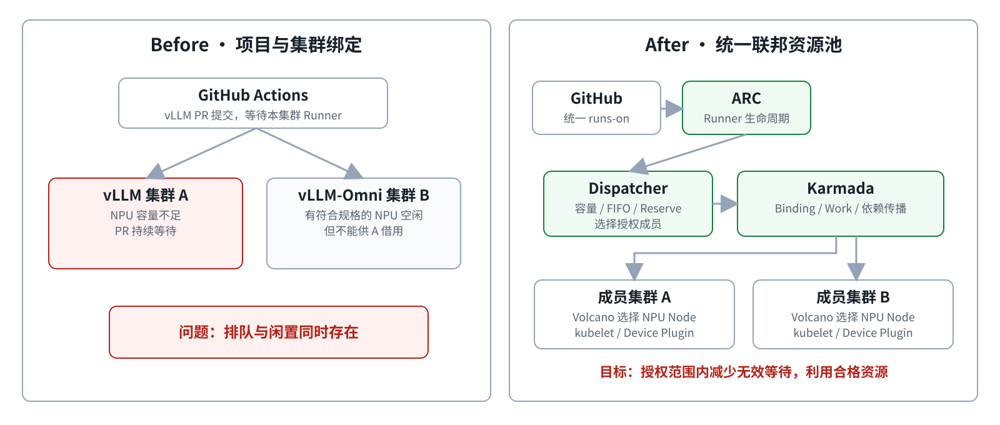

**现状：** 集群按项目独占，空闲容量无法共享，任务排队。

**目标：** ARC 统一供给 Runner，Karmada 选择成员；共享合格容量，减少资源错配和等待。

**边界：** 图为目标示意，不承诺利用率或排队收益；容量、兼容性和 NPU 驱动由部署提供。

## 1.4 整体架构

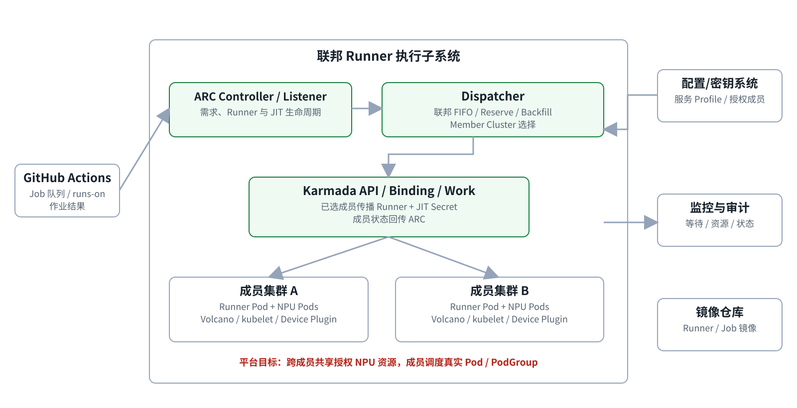

包含 ARC、Karmada、成员 Kubernetes 和 Runner。灰框为边界；外部接口如下。

| 外部子系统 | 方向 | 交互内容 |
|---|---|---|
| GitHub Actions | 输入 | 工作流任务、`runs-on` 标签、Runner 需求 |
| GitHub Actions | 输出 | Runner 注册、Job 执行状态和结果 |
| 配置与部署系统 | 输入 | Scale Set、PropagationPolicy、RBAC、组件版本 |
| 镜像仓库 | 输入 | Runner 镜像、Action 镜像 |
| 监控与审计系统 | 输出 | 运行日志、Kubernetes 事件、验证记录 |

**范围：** 一套 ARC、一套 Karmada、两个成员仅为示例；不限定地域或 Kind。NPU 插件按设备选型提供，不依赖 `karmada-search`。

## 1.5 关键约束

- Runner 工作流使用 `runs-on: karmada-runner`。标签对应一个已注册 Scale Set。
- Scale Set 版本标签与选定的官方 ARC Controller 版本保持一致；仓库当前 0.15.0 为配置示例。
- Listener 运行在成员集群，通过独立 Token、CA 和 DNS 配置访问 Karmada API。
- Runner Pod 的 JIT Secret 必须传播至同一执行成员；传播过程允许短暂异步等待。
- Karmada Pod 状态解释器保留 `containerStatuses[].name` 和 `conditions`。
- `Divided / Weighted` 针对单个资源对象执行。多个独立 Pod 不保证逐轮均匀分布。
- 成员 Kubernetes 负责节点调度。NPU 任务需额外核实节点标签、设备插件、资源请求和工作负载运行环境。

# 2 功能域概述

## 2.1 定位、使用者和边界

开发者仅选 Runner 服务；ARC 按需供给 Runner，Karmada 选择执行成员。复用 GitHub 队列、ARC 生命周期和 Karmada 调度，不重新实现。

**参与者**：开发者、平台工程师、资源池管理员、安全管理员、运维人员。**外部依赖**：GitHub Actions、镜像仓库、密钥服务、部署与观测平台。

## 2.2 核心特性

目标：**统一 Runner 服务，跨成员共享资源；执行成员由平台选定。**

**FT-01 统一入口与资源共享。** 开发者只选 Runner 服务，不指定成员。作业可使用授权成员的空闲容量。

**FT-02 可控成员放置。** 平台配置候选成员，Karmada 选择执行成员，成员 Kubernetes 选择节点。工作流标签不变。

**FT-03 跨控制面执行。** 保障 Listener 访问、临时凭证下发和状态反馈；未就绪 Runner 不得接收作业。

**FT-04 临时资源回收。** 按作业需求创建 Runner，作业结束后回收临时资源。

**执行链路：统一入口 → 成员选择 → 跨集群执行与状态反馈 → 资源回收。**

NPU 专项适配为后续扩展，不单列核心特性。

## 2.3 需求与用例追踪

依据第 1.3 节的问题和第 3.2 节的选型提取需求。下列编号仅为本设计的内部追踪标识，**不是业务方已批准的外部需求编号**；未提供正式需求基线的部分不得声称已完成需求验收。

| 编号 | 定义与粒度 | 本文用法 |
|---|---|---|
| **IR** | 功能级需求：描述平台必须提供的独立业务能力 | IR-01～IR-04 为能力需求；与 F 功能实现单元可多对多关联，不把上游组件直接当作 IR |
| **FT** | 功能域特性：对外可感知的能力归类 | FT-01～FT-04 组织 IR 和 SR，不替代需求验收 |
| **SR** | 场景级需求：描述某一条件下必须实现的行为与验收依据 | SR-xx-xx 和 SR-NF-xx；一个 IR 可关联多个 SR |
| **UC** | 用例：具有参与者、前置条件、主/异常路径的行为场景 | UC-01～UC-13；一个 SR 可由多个 UC 展示 |
| **F** | 功能实现单元：第 5 章可独立评审的设计职责 | F-01～F-05 为本期核心设计单元；F-06 为扩展，不等同正式 IR |
| **AR** | 迭代实现/合入单元：由已批准 SR 分解得到的最小实现变更 | 当前未分配 AR 编号、未定义实现批次；不虚构 AR 或将上游资源对象称为 AR |
| **SP** | 跨功能域设计规格：多个 F 共同遵守的行为/接口约束 | SP-01～SP-09 在第 4 章定义，供第 5 章引用 |

**追踪原则**：IR → SR → UC/F → SP/接口/DFX；在进入迭代实施时再建立 SR → AR → 代码/合入单元映射。本文件只完成设计追踪，不作交付状态声明。

| 需求意图 | 核心场景 | SR | 特性与功能 |
|---|---|---|---|
| IR-01 跨成员资源共享 | UC-01 统一提交；UC-03 按需供给 | SR-01-01、SR-02-01 | FT-01；F-01、F-02 |
| IR-02 可控成员放置 | UC-05 成员选择；UC-10 无合格成员 | SR-03-01 | FT-02；F-03 |
| IR-03 跨控制面执行 | UC-06 凭证未就绪；UC-08 访问控制；UC-09 状态反馈 | SR-03-02、SR-04-01、SR-05-01 | FT-03；F-03～F-05 |
| IR-04 临时资源回收 | UC-04 作业结束；UC-12 状态或清理异常 | SR-02-02 | FT-04；F-02、F-03、F-05 |

**用例概览：**

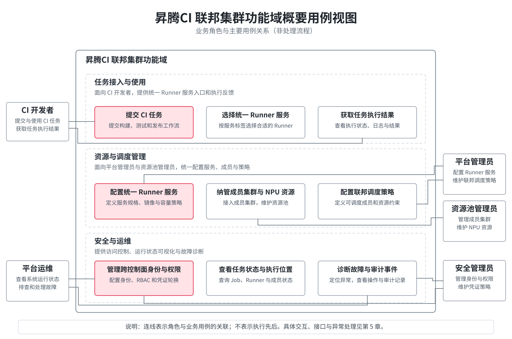

> 图示角色与用例关系，不代表执行顺序。NPU 属后续扩展；Pod、Secret 与状态处理见第 5 章。

## 2.4 需求 SR

只规定联邦调度的**场景、行为、验收条件**。实现字段与控制器交互见第 4、5 章。中文表述借鉴 [ASD-STE100](https://www.asd-ste100.org/about_STE.html) 的术语一致和避免歧义原则，不声称符合该英语标准。

### 2.4.1 功能需求

| SR | 场景 | 必须满足的行为 | 判定方法 | 来源与现状 |
|---|---|---|---|---|
| **SR-01-01** | 开发者通过统一 Runner 服务提交作业。 | 作业可在授权成员执行，无需指定集群。 | 工作流不含成员信息；作业在允许的成员运行。 | FT-01；统一标签已配置 |
| **SR-02-01** | 有待执行作业，且未达容量上限。 | 按需创建临时 Runner，在选定成员执行。 | Runner 数量随需求变化；执行成员符合策略。 | FT-01/FT-04；复用 ARC |
| **SR-03-01** | Runner 服务可使用多个成员。 | 按平台策略选择成员，不得使用被禁止的成员；无需修改工作流。 | 变更候选集后，新 Runner 只在允许的成员运行。 | FT-02；已配置成员范围，未实现复杂容量调度 |
| **SR-03-02** | 执行成员已选定，注册信息尚未就绪。 | 注册信息可用后才能将 Runner 判为可执行。 | 凭证缺失时保持未就绪或报告启动错误。 | FT-03；依赖上游传播 |
| **SR-04-01** | 成员中的 Listener 访问统一控制面。 | 凭有效身份处理所属任务；连接或授权失败不得报成功。 | 可正常更新所属 Runner 服务；错误类别可区分。 | FT-03；已配置 Token/CA/RBAC，轮换未实现 |
| **SR-05-01** | 成员 Runner 启动、就绪或异常。 | 将真实状态反馈到管理面；未就绪不得判为就绪。 | 管理面与成员状态一致，保留关键状态字段。 | FT-03；单成员状态解释 |
| **SR-02-02** | 作业结束。 | 回收临时执行资源；失败时保留残留对象及错误。 | 资源进入回收流程；可定位异常残留。 | FT-04；复用 ARC/Karmada |

原 SR-01-02 属 GitHub 原生匹配异常；原 SR-06-01 属 NPU 扩展设计，均不列为当前核心 SR。

### 2.4.2 非功能需求

| SR | 属性 | 要求 | 判定方法 | 实现边界 |
|---|---|---|---|---|
| **SR-NF-01** | 跨控制面访问安全 | 拒绝未授权访问；不得关闭 TLS 校验。 | 验证授权、未授权身份及证书校验。 | 受限 RBAC/CA 已配置；Controller 权限待收敛 |
| **SR-NF-02** | 跨成员凭证隔离 | 长期 GitHub 管理凭证只提供给实际消费者；临时凭证只供执行成员使用。 | 核对凭证消费者和传播范围。 | **目标未满足**：当前向两个成员分发管理凭证 |
| **SR-NF-03** | 成员故障边界 | 不可用成员的未就绪 Runner 不得作为可执行资源；不承诺运行中 Job 无损迁移。 | 检查成员失联后的 Runner 状态。 | 尚无自动故障迁移依据 |
| **SR-NF-04** | 跨集群问题定位 | 可关联 Job、Runner、执行成员及传播、注册、状态异常。 | 根据 Job 标识查找成员与故障阶段。 | 已有检查脚本，暂无统一查询入口 |
| **SR-NF-05** | 容量与排队性能 | 不得突破 Runner 容量上限；记录排队、Runner 准备耗时。 | 核对并发数和时间指标。 | 已设 min=0/max=5；时延目标待定 |
| **SR-NF-06** | 资源使用与成本 | 无待执行作业且允许零空闲时，应能回收 Runner；成员无需各部署 ARC Controller。 | 检查缩至零和成员部署方式。 | 能力依赖配置和上游；节约目标待定 |
| **SR-NF-08** | 放置策略可维护性 | 可调整候选成员，不要求开发者修改 Runner 服务名称。 | 修改并恢复策略，核对后续执行成员。 | 策略可配置，未开发管理 UI |

### 2.4.3 待定指标

| 参数 | 指标 | 待确认内容 | 状态 |
|---|---|---|---|
| P-SR-01 | Runner 准备耗时 | 起止事件、窗口、分位数、阈值 | 未确定 |
| P-SR-02 | Job 排队时间 | GitHub 等待是否计入、样本、分位数、阈值 | 未确定 |
| P-SR-03 | 成员故障后的新作业执行 | 备用成员条件、故障检测、恢复目标；不含运行中 Job 迁移 | 未确定 |
| P-SR-04 | 资源利用率与成本 | 负载、共享前基线、计量方法、目标值 | 未确定 |

未批准的指标不得作为验收目标；不承诺未经验证的收益。

### 2.4.4 特性与设计追踪

| 特性 | 功能 SR | 非功能 SR | 设计单元 |
|---|---|---|---|
| FT-01 统一入口与共享 | SR-01-01、SR-02-01 | SR-NF-05、SR-NF-06 | F-01～F-03 |
| FT-02 可控成员放置 | SR-03-01 | SR-NF-03、SR-NF-08 | F-03 |
| FT-03 跨控制面执行 | SR-03-02、SR-04-01、SR-05-01 | SR-NF-01、SR-NF-02、SR-NF-04 | F-03～F-05 |
| FT-04 临时资源回收 | SR-02-02 | SR-NF-04、SR-NF-06 | F-02、F-03、F-05 |

**范围**：Manifest 证明现有配置；上游定义组件行为；未实现的目标要求仍须实施，不能标为已交付。

## 2.5 非目标

**阶段边界**：本文件只评审功能设计的正确性、完整性与可追踪性；不要求代码开发、部署脚本、硬件实验、验收测试执行或运维交付报告。没有 PoC 本身不构成设计缺陷，缺少必要的接口语义、状态约束或 DFX 设计则仍属于文档缺陷。

- 不重建 GitHub Job 匹配、排队和结果存储；UC-02 仍保留异常说明。
- ARC/Karmada 内部实现见第 4、5 章，不另列核心 SR。
- NPU 设备适配保留为 F-06/US-08 扩展，当前未实现。
- 不承诺运行中 Job 无损迁移或独立 Runner 逐轮均衡分配。
- 企业级可用性、通用升级、成本预算和监控产品选型不另列核心 SR。
- 只修订设计，不变更 Manifest；文档完成不要求 PoC。

# 3 功能域总体方案

## 3.1 设计原则

**职责及事实来源约束**：GitHub Actions 是 Job 匹配、队列与结果的权威系统；ARC 是 Runner Scale Set、EphemeralRunner 与 Runner 生命周期的管理主体；Karmada 是成员选择、对象传播与联邦对象状态协调主体；成员 Kubernetes/kubelet 是节点放置、Pod 实际运行状态与设备分配事实的来源。各组件的 CRD、对象所有权与事件先后以目标版本实际契约为准；本项目只规定集成边界，不重新实现 GitHub 队列、ARC 生命周期、Karmada Scheduler 或 kube-scheduler。跨系统出现状态分歧时不得用 Pod Ready 推导 Job 成功，具体冲突判定与恢复规则属于后续 T2/T3 设计任务。

1. **职责分离**：GitHub 负责队列，ARC 负责 Runner 期望量与短生命周期，Karmada 负责成员选择和对象传播，成员 Kubernetes 负责节点调度与设备资源分配。
2. **控制面与执行面分离**：Runner 管理请求汇入统一 API；Listener 和 Runner 可以部署于执行域，但其权限、连接地址和证书与目标 API 一致。
3. **最小权限与最小传播**：GitHub 主凭证以管理域为中心，JIT 凭证按具体引用传播至执行成员；Runner 默认不获取 Kubernetes 管控 API Token。
4. **最终一致与无重放假设**：跨组件 Pod/Secret/Binding 传播与清理都是异步流程；没有上游证明不得承诺原子传播、无损迁移或 Job exactly-once 重试。
5. **上游优先**：默认复用 ARC、Karmada、Kubernetes 的正式 API/控制器；本功能域仅增加集成策略、必要权限、状态解释及配置，不重复设计上游模块。

## 3.2 备选方案与最终选型

| 选型 | 方案结构 | 主要优点 | 主要限制 |
|---|---|---|---|
| A：各成员独立 ARC | 各集群部署 Controller 和 Scale Set；同名 Scale Set 分属不同 Runner Group。 | 独立管理和故障隔离。 | **跨 Scale Set 的 Job 分配由 GitHub 决定，平台无法定制调度策略**；同名 Scale Set 之间存在不可配置的 `assignment race`，无法按成员容量、NPU、地域或优先级决定分配。 |
| B：ARC + Liqo | ARC 结合 Liqo 跨集群资源和网络能力。 | 复用资源与网络抽象。 | 需额外设计跨集群网络和资源映射；非当前实现。 |
| **C：ARC + Karmada（选定）** | 统一 Scale Set 接收需求；ARC 供给 Runner，Karmada 分发 Pod。 | **平台控制候选成员和放置约束。** | 需适配身份、JIT Secret、Pod 状态及回收；不保证多个独立 Pod 按固定比例分配。 |

### 3.2.1 调度职责

作业分配与 Runner Pod 放置是两级决策：

1. **GitHub：** 按 `runs-on`、Runner Group 和注册信息分配 Job。方案 A 的跨 Scale Set 选择不可定制。
2. **ARC：** Listener 接收任务需求，调整 `EphemeralRunnerSet` 期望数量；`minRunners` / `maxRunners` 控制容量，**不决定跨 Scale Set 的任务分配**。
3. **Karmada：** 按 `PropagationPolicy` 选择 Runner Pod 的执行成员；成员 Kubernetes 选择节点。平台控制 **Pod 放置**，不控制 GitHub 的 Job 分配。

**结论（D）：选 C。** Karmada 策略由平台控制成员放置；方案 A 的跨 Scale Set Job 分配由 GitHub 决定，平台不可定制。

**上游依据**：

- [GitHub 官方：部署 Runner Scale Sets — High availability and automatic failover](https://docs.github.com/en/actions/how-tos/manage-runners/use-actions-runner-controller/deploy-runner-scale-sets#high-availability-and-automatic-failover)：说明多个独立集群可以在不同 Runner Group 使用同名 Scale Set；多个 Scale Set 同时在线时，分配可能由竞争决定，且不能配置作业分配算法。
- [GitHub 官方：ARC 工作原理](https://docs.github.com/en/actions/concepts/runners/actions-runner-controller)：说明 GitHub Actions 服务进行作业匹配，ARC Listener 接收 `Job Available` 消息后按需求调整 Runner 数量。
- [ARC 源码：`cmd/ghalistener/scaler/scaler.go`](https://github.com/actions/actions-runner-controller/blob/master/cmd/ghalistener/scaler/scaler.go)：`Scale` 处理收到的作业消息与 `TotalAssignedJobs`，后续更新当前 `EphemeralRunnerSet` 的目标 Runner 数量。这里没有跨独立 Scale Set 的成员选择算法。
- [Karmada 官方：PropagationPolicy](https://karmada.io/docs/next/userguide/scheduling/propagation-policy/)：说明通过传播策略选择成员集群。本方案根据这些机制制定跨集群 Runner Pod 放置规则，**不把 ARC 与 Karmada 的组合描述成上游已认证的整体方案**。

### 3.2.2 联邦放置能力与容量保证的边界（T1）

**设计结论：** 当前的基本放置路径为「策略限定候选成员 → Karmada 选择成员 → 成员 kube-scheduler 选择节点」。这能配置**允许放置的成员范围**，但不等于对独立 Runner Pod 提供跨成员最优选择、NPU 拓扑可用性判断、容量预留或排队公平保证。GitHub 的 Job 分配与 Karmada 的 Pod 放置是不同决策，不能相互替代。

| 方案/机制 | 可直接依据的保证 | 无法直接推出的保证 | 本方案处理 |
|---|---|---|---|
| 各成员独立 ARC | GitHub 原生 Job 匹配与各成员独立生命周期 | 平台控制跨 Scale Set 的 Job 分配 | 不采用作为统一放置方案 |
| ARC + Liqo | Liqo 提供跨集群资源与网络抽象能力，具体能力受选用版本约束 | 默认提供与本项目相同的放置策略及资源公平性 | 保留为替代方案，不引入 Liqo 假设 |
| **ARC + Karmada（选定）** | PropagationPolicy 候选成员过滤、Karmada 资源传播、成员原生 Pod 调度 | 独立 Pod 逐轮均衡、跨成员实时容量预留、NPU 节点拓扑匹配、Job exactly-once | 通过 SP-02/03 定义约束；超出上游保证的能力显式保留设计缺口 |
| `Divided / Weighted` | 对**具有副本语义**的受支持资源按策略分配副本 | 当前独立 `v1/Pod` 自动获得跨 Pod 加权轮转 | 不把该字段当成独立 Runner Pod 的负载均衡算法 |
| Karmada 资源建模/动态权重 | 对适用资源、支持的调度路径，依据成员资源建模参与副本选择 | 保证设备插件发布的全部 NPU 资源、节点拓扑及瞬时可用容量都被准确建模 | 需核对目标版本和目标工作负载，不在本阶段作保证 |

**可核查的官方依据：** [Karmada PropagationPolicy](https://karmada.io/docs/next/userguide/scheduling/propagation-policy/) 明确 `clusterAffinity` 定义候选集而非确保全部被选；`replicaScheduling` 的分副本语义针对具有副本规格的资源。目标产品版本应固定后再核对 CRD 与调度器实现；`next` 文档仅供理解能力范围。

**设计取舍：** 本阶段选定 Karmada 解决跨成员传播及可配置放置；不凭该选型直接宣称容量最优、FIFO、公平或 NPU 保留。若目标要求提升为“有空闲合格 NPU 必须直接选中”，需另行定义容量与拓扑事实、调度决策接口及一致性约束，并归入后续明确的功能需求，而不能仅修改 Weighted 参数。

## 3.3 端到端实现思路

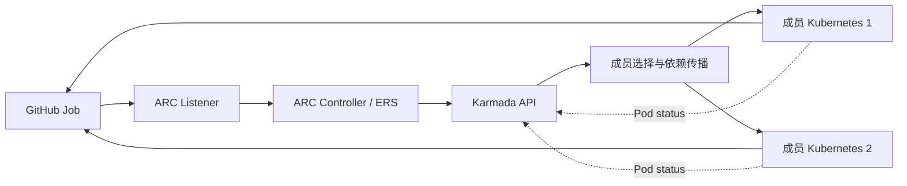

请求：GitHub → Listener → ARC → Karmada → 成员 Runner；反馈：Runner → GitHub，Pod.status → Karmada → ARC。状态与依赖契约见第 4 章。

## 3.4 组件与逻辑架构

### 3.4.1 逻辑架构

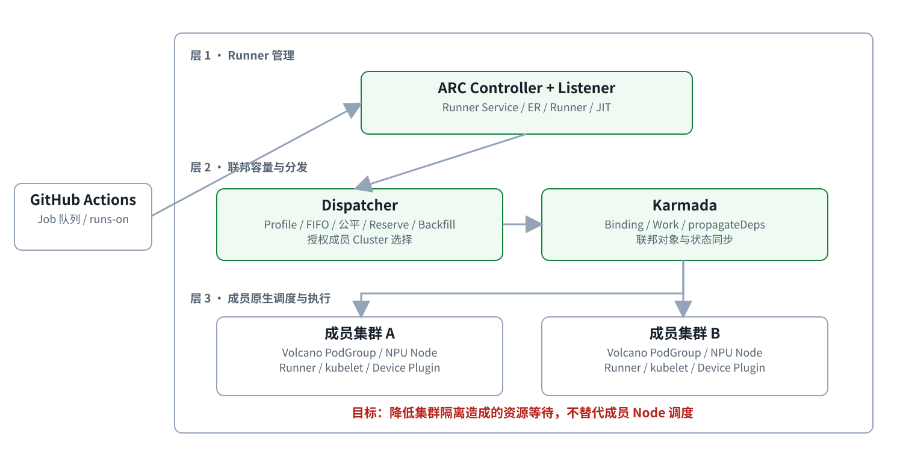

**问题：** 项目与集群绑定，空闲容量难共享、任务排队。**方案：** ARC 统一供给，Karmada 分发，成员 Kubernetes 执行。

| 架构构件 | 主要解决的问题 / 架构职责 | 与其他构件的协作关系 |
|---|---|---|
| ARC Listener | **统一任务入口**：让开发者使用同一个 Runner 标签提交任务，不必为不同成员集群选择专用标签。 | 对接 GitHub Actions 的任务需求，与 ARC Controller 协同完成按需 Runner 供给。 |
| ARC Controller | **集中管理执行实例的生命周期**：使 Runner 的创建、扩缩与回收不再由每个执行集群各自管理。 | 承接 Listener 的需求变化，将 Runner 交给 Karmada 跨集群分发，并根据执行状态管理生命周期。 |
| Karmada（复用的联邦子系统） | **打通相互隔离的执行资源池**：将多个成员集群纳入同一分发范围，使一个项目的任务可以使用其他合格成员的执行资源。 | 接收 ARC 产生的 Runner 对象，将其分发至成员 Kubernetes，并把执行状态返回给 ARC；不取代成员的节点级调度。 |
| 成员 Kubernetes 与 Runner Pod | **提供实际、相互隔离的任务执行能力**：让集中管理的 Runner 在选中的成员集群使用当地计算资源执行 GitHub Job。 | 接收 Karmada 下发的 Runner 工作负载，使用成员原生调度与网络执行任务，并向控制面反馈状态。 |
| ARC–Karmada 集成适配（本系统设计） | **消除两套上游系统之间的语义与环境差异**：保障跨控制面访问、临时注册凭证可用、Runner 就绪状态可被正确识别。 | 在 ARC、Karmada 与成员 Kubernetes 之间补齐通信鉴权、依赖传播和状态聚合约束，使上述管理、分发、执行链路闭环。 |

**边界：** GitHub 提供任务；ARC/Karmada/Kubernetes 为复用组件。`karmada-search` 不在范围内，NPU 插件属成员依赖。不承诺均匀分配或固定收益。

部署关系见 3.6；资源、状态与接口契约见 3.5、4.4～4.6 和第 5 章。

### 3.4.2 周边依赖

| 周边元素 | 职责关系 | 进入/输出的实体 | 约束 |
|---|---|---|---|
| GitHub Actions | 外部任务入口与运行结果接收方 | Job 需求、Runner 注册、运行状态 | 入口标签、GitHub 身份与 JIT |
| 镜像仓库 | 提供 Controller/Runner/Action 镜像 | OCI Image | 可信源、平台架构、版本/digest |
| 密钥系统 | 供给和轮换 GitHub 主凭证、控制面身份 | Credential/CA/Token | 不在仓库明文保存、最小授权 |
| 部署与配置管理 | 安装官方组件及本项目 CRD/Policy | Chart/Manifest/配置参数 | 声明式、回滚与版本兼容 |
| 观测/审计系统 | 关联一次 Job 与执行实例 | Job/ER/Pod/Binding/Work 标识、事件与日志 | 不收集 Secret Data |

## 3.5 领域数据模型和归属

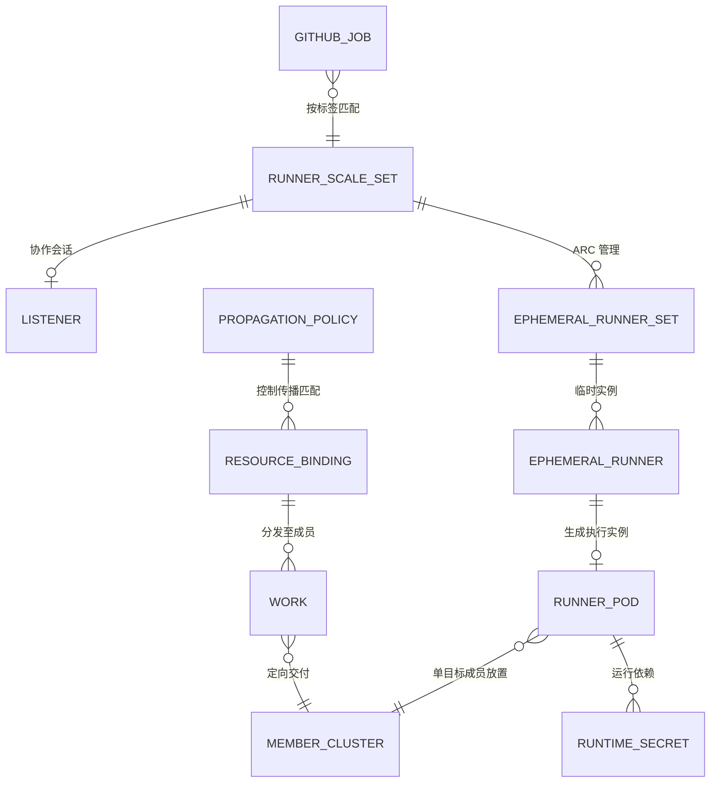

图为**领域概念关系**，不等于原生 Kubernetes OwnerReference；动态资源真实归属由所选 ARC/Karmada 版本定义。以下表格是实现和销毁规格：

| 领域对象 | 权威生产者 | 主要关联/消费者 | 寿命分类 | 处置与销毁要求 |
|---|---|---|---|---|
| GitHub Job | GitHub Actions | 任务来源；不是 Kubernetes API 对象 | 单次/外部保留 | 任务队列、运行状态 |
| AutoscalingRunnerSet | 平台声明；ARC 管理 | Runner 服务及 GitHub 认证入口 | 长期 | ScaleSetName、GitHubConfigSecret、RunnerTemplate |
| AutoscalingListener / Listener Pod | ARC 生成 | 侦听任务需求并调整 ERS | 随 Scale Set | Token、CA、管理控制面 API |
| EphemeralRunnerSet / EphemeralRunner | ARC 生成 | 需求副本/单 Runner 实例生命周期 | 临时 | OwnerReference、状态、Finalizer |
| Runner Pod | ARC 生成 / Karmada 传播 | 成员的实际 Job 执行对象 | 临时 | SA、镜像、JIT Secret 引用、status |
| JIT Secret | ARC 动态生成 | 一次性 Runner 注册凭证 | 临时敏感 | 仅传目标执行成员；作业后回收 |
| 主 GitHub Secret | 平台密钥系统提供 | ARC 管理链路授权 | 受控敏感 | 目标设计不向无消费者成员扩散 |
| PropagationPolicy | 平台声明 / Karmada 消费 | 成员选择、匹配范围、依赖传播 | 长期配置 | ResourceSelectors、Placement、propagateDeps |
| ResourceBinding / Work | Karmada 生成 | 联邦调度与成员期望资源载体 | 随 Pod/策略 | 控制面到执行面的对象关系 |
| Pod.status | 成员 Kubernetes 产生 | 供 ARC 判断 Runner 状态 | 随 Pod | containerStatuses、conditions、Phase |
| MemberCluster / NPU 资源 | Karmada + 成员 K8s / Device Plugin | 集群资格、节点扩展资源 | 长期运行时 | Ready、labels、allocatable、扩展资源 |

**数据分级与销毁（D）**：GitHub PAT/App 凭证、Listener Token、JIT Secret 属敏感数据，禁止在日志、Git、工单附件输出值；运行时对象删除由 ARC/Karmada 所有权规则驱动，审计只保留非敏感 ID/状态。Job 日志、镜像与第三方系统持久数据的保留/销毁服从各自系统策略，**不因 Pod 删除自动消失**。证书/Token 轮换同时考虑控制面存储、成员副本和日志暴露面。销毁保留期/合规等级若需精确数值，由企业数据分类制度提供（P），不虚构默认周期。

### 3.5.1 对象标识、引用关系及权威事实（T2）

**三类关系必须区分**：Kubernetes `OwnerReference/Finalizer` 表示原生控制器及删除语义；Pod 的 Secret 引用、Karmada Binding/Work 表示 API 对象之间的引用/传播关系；GitHub Job 与 Runner/Pod 之间的标识映射是用于追踪的业务关联。任何业务关联**均不能代替原生所有权而直接触发级联删除**。第 3.5 节的 ER 图只表达逻辑关系，不代表 CRD 中逐一存在对应的 OwnerReference。

| 对象与事实 | 最小唯一标识/关联依据 | 权威来源及责任 | 生命周期与限制 |
|---|---|---|---|
| GitHub Job | repository、run_id、job_id、run_attempt（以 API 可用字段为准） | GitHub Actions：Job 匹配、执行结果、历史 | 不受 Kubernetes GC 控制，Pod 删除不代表 Job 完成 |
| AutoscalingRunnerSet | API context + namespace + name + UID；runnerScaleSetName 是服务名称而非对象全局主键 | 平台声明，ARC 调谐 | 长期管理对象；版本字段遵循 ARC CRD |
| AutoscalingListener / Listener Pod | context + namespace + name + UID；依据 ARC 实际标签/引用关联 Scale Set | ARC | 随服务管理；Token/CA 生命周期独立于 Runner |
| EphemeralRunnerSet | context + namespace + name + UID | ARC：期望 Runner 集合及调谐 | 动态资源；不等于单个 Job |
| EphemeralRunner | context + namespace + name + UID；注册后可能获得 GitHub runner ID | ARC：Runner 实例生命周期 | 不假定在创建时已经知道对应 GitHub job_id |
| 控制面 Runner Pod | Karmada context + namespace + name + UID；通过 ARC 实际引用关联 ER | ARC 创建，Karmada 传播 | Pod.status 是成员状态的异步聚合，非 GitHub Job 权威结果 |
| 成员 Runner Pod | member Cluster + namespace + name + UID；通过 Karmada Work/资源身份关联 | 成员 Kubernetes：节点绑定和真实 Pod.status | **成员 UID 不假定等于控制面 UID**；可能发生同步延迟 |
| JIT Secret（控制面及成员） | 各自 context + namespace + name + UID；以 Pod 实际 secretKeyRef/volume 引用关联 | ARC 产生 JIT 配置，Karmada 传播依赖 | 临时敏感对象；副本分别检查清理状态 |
| GitHub 主凭证/Listener Token | context + namespace + name + UID、非敏感版本标识 | 凭证管理员 | 不能依靠删除临时 Runner 来证明凭证被撤销 |
| PropagationPolicy | context + namespace + name + UID | 平台声明，Karmada 消费 | 选择范围，不是 Runner Pod 的 Owner |
| ResourceBinding / Work | context + namespace + name + UID、目标成员与 Karmada 原生关联字段 | Karmada：放置、传播及删除调谐 | Work 已分发不等于成员 Pod Ready |
| Cluster/Node/NPU 资源 | Cluster + Node 身份、扩展资源名称 | Karmada/成员 Kubernetes/Device Plugin | 成员聚合资源不代表单节点可调度 |
| Pod.status | 对应 context + Pod UID + 采样/观察时间 | 成员 kubelet 为运行事实来源；Karmada 为控制面同步者 | Ready 不能推导 GitHub Job 成功 |

**跨域关联链**：GitHub repository/run/job/attempt → Runner Scale Set → ERS/ER → 控制面 Pod UID → ResourceBinding/Work 与目标 Cluster → 成员 Pod UID → 实际 Pod 状态/事件。每条关联须标明具体 API 字段或事件来源、观测时间与关联置信状态；缺失 ID 时保留“未关联”，禁止通过同名猜测。GitHub runner ID、ER UID、Pod UID 和 Job ID 不得混为一个身份。当前 Manifest **没有提供全链路审计实现**，这里规定的是设计契约。

**权威状态原则**：GitHub 管理 Job 结果；ARC 管理 Runner 期望与生命周期；Karmada 管理传播的目标成员和 Work；成员 Kubernetes 管理真实 Pod 状态及节点调度。遇到短暂不一致时保留来源和时间，不以 Pod Ready 伪造 Job Completed，不以控制面 Work 成功伪造节点调度成功。状态冲突的完整转换规则由 T3 完善。

### 3.5.2 创建、删除与数据销毁责任（T2）

| 触发 | 决策与执行责任 | 必须验证/保留的结果 |
|---|---|---|
| Job 需求变化 | GitHub 提供需求，ARC 按原生机制创建/调整 ERS、ER、Pod 及临时注册配置 | 不能以需求数量推断某特定 Job 已绑定 ER |
| Job 结束及 Runner 回收 | ARC 按目标版本的控制器与 GitHub 交互结果回收临时对象 | 记录 ER/Pod/JIT Secret 的真实删除结果 |
| 控制面 Runner Pod 删除 | ARC 发起其管理对象生命周期，Karmada 调谐 Binding/Work 和成员副本 | 控制面删除**不代表**成员 Pod 已实际删除；失联时标记未知 |
| JIT Secret 删除 | ARC/Karmada 根据原生引用关系与传播机制分别处理控制面和成员副本 | 逐成员确认残留；不可把 Secret Data 写入日志 |
| GitHub 主凭证/Listener Token 轮换 | 凭证管理员更新、撤销及审计；控制器按实际加载机制更新 | 删除 Pod 不等于外部凭证立即失效 |
| 删除被 Finalizer 阻塞 | 所属控制器/受权运维确认对象所有权及依赖 | 保留 context、UID、DeletionTimestamp、Finalizer、事件；不删除未知 Finalizer |
| 审计/日志/外部 Job 历史销毁 | 各数据系统所有者依据数据分级与保留制度处理 | 只记录非敏感标识及事件；外部持久数据不随 Pod 删除自动消失 |

**销毁约束**：① 不以跨集群相同 name/UID 推断相同对象；② 不用审计关联代替 OwnerReference；③ 成员失联后不宣称资源已经清理；④ 未确认 Job 状态前不因 Pod 消失而重新执行；⑤ 不在 Git、日志或工单中保存凭证值。分类等级、期限及已下发副本的强制撤销手段须由企业数据管理制度或凭证机制确定（P），不得编造默认期限。目标 ARC/Karmada 版本的 OwnerReference 与 Finalizer 细节仍须以真实 CRD/控制器行为核实，本文不虚构固定引用字段。

**依据**：[GitHub ARC 工作原理](https://docs.github.com/en/actions/concepts/runners/actions-runner-controller)、[Kubernetes 所有权与垃圾回收](https://kubernetes.io/docs/concepts/architecture/garbage-collection/)、[Karmada PropagationPolicy](https://karmada.io/docs/userguide/scheduling/propagation-policy/)。上游文档支持各组件的原生职责，不证明所有跨域清理动作具有原子性或自动完成。

## 3.6 部署拓扑与周边服务

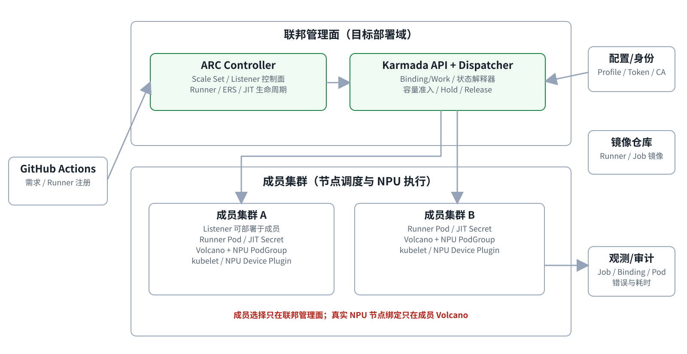

| 部署域 | 构件 | 运行接口 | 设计约束 |
|---|---|---|---|
| ARC 管理域 | 官方 ARC Controller | GitHub API、统一 Karmada API | 可以是管理 Kubernetes/容器部署；不要求在每个成员单独部署 |
| Karmada 控制面 | API、Policy/Scheduler、状态解释扩展 | 多成员 Kubernetes API | API、证书、网络、成员资格、可用性由部署管理提供 |
| Listener 成员域 | Listener Pod、独立控制面身份 | GitHub Actions、Karmada HTTPS API | 示例固定在 member1；目标成员是可配置的 Placement |
| Runner 执行域 | Runner Pod、JIT Secret、Runner SA、可选 NPU 资源 | GitHub Actions、成员 kubelet/Runtime | 只允许在满足资源、镜像和安全约束的成员运行 |
| 平台外 | 镜像仓库、身份/密钥服务、运维/观测 | 拉取、认证、日志/指标 | 不要求跨成员 Pod 网络直连 |

**配置输入清单（P）**：`runnerScaleSetName` / `runs-on`、GitHub URL、Runner 镜像/digest、控制面 API DNS/IP/port/SAN、CA、Token audience/TTL、目标成员集合、调度权重、Namespace、NPU 资源名、节点标签、业务 SLO。当前 Manifest 的 `karmada-runner`、`member1/member2`、`172.22.0.4:32443` 是示例值，后两者不应硬编码到通用部署工具。

### 3.6.1 安装与声明依赖次序

1. 提供 Karmada API、可达的成员 K8s API 和所需 ARC 版本 CRD；目标成员达到可参与传播的状态。
2. 准备命名空间、控制面身份/证书、Runner SA 与 GitHub 管理凭证。
3. 安装状态解释器、角色/绑定和传播策略，再声明 AutoscalingRunnerSet；保证 Listener 访问的是正确控制面。
4. 安装官方 ARC Controller 并由其调谐动态对象。组件顺序、重试和升级回滚在部署计划中实现，不在功能设计中复刻具体 Shell 命令。

## 3.7 官方依据与边界

| ID | 上游组件资料 | 本设计引用的能力 |
|---|---|---|
| ARC-1 | [GitHub：Actions Runner Controller](https://docs.github.com/en/actions/concepts/runners/actions-runner-controller) | Runner Scale Set、Listener、EphemeralRunner、JIT、生命周期 |
| ARC-2 | [GitHub：部署 Runner Scale Sets](https://docs.github.com/en/actions/how-tos/manage-runners/use-actions-runner-controller/deploy-runner-scale-sets) | Scale Set 部署配置、GitHub 凭证、Runner 模板 |
| KAR-1 | [Karmada：PropagationPolicy](https://karmada.io/docs/next/userguide/scheduling/propagation-policy/) | 资源选择器、成员放置、分副本/加权策略 |
| KAR-2 | [Karmada：Propagate dependencies](https://karmada.io/docs/userguide/scheduling/propagate-dependencies/) | 对象引用的 Secret/ConfigMap 依赖传播 |
| KAR-3 | [Karmada：Customizing Resource Interpreter](https://karmada.io/docs/userguide/globalview/customizing-resource-interpreter/) | ResourceInterpreterCustomization、AggregateStatus |
| K8S-1 | [Kubernetes：Service Accounts](https://kubernetes.io/docs/concepts/security/service-accounts/) | TokenRequest、SA 身份与 Token 生命周期 |
| K8S-2 | [Kubernetes：RBAC Good Practices](https://kubernetes.io/docs/concepts/security/rbac-good-practices/) | 角色权限及最小权限原则 |
| K8S-3 | [Kubernetes：Device Plugins](https://kubernetes.io/docs/concepts/extend-kubernetes/compute-storage-net/device-plugins/) | Device Plugin 扩展资源与节点分配 |

**使用边界**：官方文档分别证明 ARC 与 Karmada 等组件的原生能力；**并不证明两者组合的端到端兼容性**。所有跨组件行为应在第 4～5 章以 D 类设计契约表达；性能百分比、Token 自动轮换、多副本 status 和无损故障切换不得当作已有保证。

# 4 功能域规格变更与设计

> 本章定义跨功能规则；实现见第 5 章。**U** 上游能力；**D** 本方案约束；**P** 部署参数。区分 Manifest 现状与目标，差异需处理。

## 4.1 功能域规格变更

| 规格编号 | 当前配置 | 目标设计要求 | 负责方 |
|---|---|---|---|
| SP-01 Runner 服务命名 | 示例的 Scale Set 名称为 `karmada-runner`，`minRunners` 为 0，`maxRunners` 为 5。 | 平台必须保持 GitHub 工作流标签与 Runner 服务名称一致。Runner 数量的上下限由业务容量参数确定。 | 平台配置维护者 |
| SP-02 候选成员策略 | 现有策略包含 member1、member2，并使用 `Divided` 与 `Weighted`。 | 平台必须规定每个 Runner Pod 的合格成员范围。一个临时 Runner Pod 只在一个成员执行；该策略不保证多个 Pod 每轮平均分配。 | 联邦策略维护者 |
| SP-03 Runner Pod 选择范围 | 现有策略匹配 `arc-runners` 命名空间的全部 Pod。 | 平台必须只选择 ARC 管理的 Runner Pod。开发人员须按目标 ARC 版本的对象标签定义选择条件，并检查其他 Pod 不会被选中。 | 联邦策略维护者 |
| SP-04 GitHub 主凭证传播 | 现有策略将 `arc-github-secret` 同步到两个成员集群。 | 平台必须按实际凭证使用者确定传播范围。临时 Runner 不应因为需要跨集群运行而自动获得 GitHub 管理凭证。 | 身份管理者 |
| SP-05 Listener API 身份 | 示例通过单独的 Token 和 CA 证书访问固定 API 地址，Token 由脚本签发。 | 平台必须提供可配置的 API 地址、可信 CA、最小权限和凭证更新规则。必须区分网络、证书、身份认证和权限错误。 | 身份管理与部署维护者 |
| SP-06 Runner Pod 状态 | 当前 Lua 解释器选取第一个非空 `status`。 | 状态解释必须保留 ARC 所需的 Pod 字段。该规则只适用于一个 Runner Pod 在一个成员运行且状态来源没有冲突的情况。 | 状态适配维护者 |
| SP-07 临时资源生命周期 | ARC 和 Karmada 分别处理临时对象的删除。 | 平台必须能够关联同一任务的 Runner、Pod、JIT Secret 和联邦对象。删除失败时必须保留原因，不能任意清空未知 Finalizer。 | 控制器维护者和运维人员 |
| SP-08 NPU 资源规格 | 当前示例没有固定 NPU 资源名称及设备插件。 | 部署方必须从目标设备插件取得扩展资源名称与分配规则。平台据此配置成员筛选和 Runner Pod 资源请求。 | 设备与资源池维护者 |
| SP-09 安全与可观测性 | 现有资料通过 GitHub Run、Pod、Work 和日志进行局部诊断。 | 平台必须保存任务和联邦资源之间可追踪的标识，记录错误类型，禁止将凭证值写入日志。 | 平台运维与安全管理员 |

**待实施差异**：SP-03、SP-04、SP-05；目标不代表已实施。设计不以 PoC 为前提。

## 4.2 SP-01 Runner 服务与任务入口规格设计

### 4.2.1 实现思路

工作流通过 `runs-on` 匹配 `AutoscalingRunnerSet.spec.runnerScaleSetName`。ARC 管理 Runner 生命周期（U）；平台维护服务、模板和候选成员的映射（D）。工作流无需成员名称；硬件或权限不兼容时，应分设服务。

### 4.2.2 实现设计

| 规范字段 | 类型/位置 | 约束 |
|---|---|---|
| 服务标识 | GitHub workflow `runs-on`、`AutoscalingRunnerSet.spec.runnerScaleSetName` | 同一个 Runner 服务在工作流 `runs-on` 与 `spec.runnerScaleSetName` 中必须使用相同名称。`karmada-runner` 是参考名称。 |
| GitHub 目标 | `spec.githubConfigUrl` | 平台管理员必须为 `spec.githubConfigUrl` 设置已授权的仓库或组织地址。Runner 不得注册到未授权的仓库或组织。 |
| 主凭证 | `spec.githubConfigSecret` | `spec.githubConfigSecret` 引用的凭证必须由可信管理域提供，并遵守 SP-04 的分发限制。 |
| 弹性区间 | `spec.minRunners/maxRunners` | `spec.minRunners` 与 `spec.maxRunners` 必须满足 `0 ≤ minRunners ≤ maxRunners`。具体数值由部署配置确定。 |
| Runner 镜像与 Pod 模板 | `spec.template` | `spec.template` 必须声明 Runner 镜像、资源请求、ServiceAccount 及必要的容器安全配置。 |
| 版本约束 | ARC CRD/Controller/Listener/RunnerSet label | 部署方必须核对 ARC Controller、CRD 和 Runner 资源的版本兼容性。现有 0.15.0 只是配置示例。 |

标签无匹配时，不得替换服务；排队由 GitHub 处理。权限不足或容量已满时，保留错误及容量状态，不得绕过隔离。

## 4.3 SP-02/SP-03 联邦调度与依赖传播规格设计

### 4.3.1 实现思路

Karmada `PropagationPolicy` 选择资源与执行成员（U）；每个 Runner Pod 只在一个成员运行（D），成员 Kubernetes 选节点。`propagateDeps` 传播 JIT Secret 等引用依赖。Pod 与 Secret 异步到达；必需的 Secret 未就绪时，容器不能启动。

### 4.3.2 实现设计

| 配置项 | 规定的行为 | 前置条件与异常处理 |
|---|---|---|
| `PropagationPolicy.metadata.namespace` | 策略必须位于待传播 Runner Pod 所属的命名空间。平台必须检查该范围不会包括其他租户的 Pod。 | 当前使用 `arc-runners`。 |
| `resourceSelectors` | 策略必须只选择目标 Runner 服务管理的 Pod，所用标签必须符合选定 ARC 版本的对象定义。 | 除检查目标 Pod 被选中，还必须检查其他 Pod 不被选中；当前全命名空间匹配属于待修改配置。 |
| `placement.clusterAffinity` | 平台必须指定可以接收 Runner Pod 的成员集群，并根据设备类型、节点架构及隔离条件确定候选集。 | 当前示例为 member1 和 member2，不能把它们当成通用常量。 |
| `replicaScheduling` | 使用 `Divided` 或 `Weighted` 时，必须遵循所选 Karmada 版本的接口语义。 | 多个独立的单 Pod 任务不保证逐轮平均分配。 |
| `propagateDeps` | Karmada 必须将 Runner Pod 引用的 JIT Secret 等依赖资源传播到该 Pod 所在的成员。 | 依赖到达顺序不保证是原子事务；Secret 缺失时保留 Pod 挂载或启动异常状态。 |
| 主凭证 | 平台不得仅因为传播 Runner Pod 就把 GitHub 管理凭证分发到所有成员。 | 只有明确存在成员侧消费者并已授权时，才允许额外分发相应凭证。 |
| 执行态 | 成员 Kubernetes 负责维护 Pod 的 `Pending`、`FailedMount`、`ErrImagePull` 等状态或事件。 | 平台必须显示或保存异常原因，不得因此重复提交同一个 GitHub 作业。 |

无合格成员时，Pod 保持未就绪或不可调度，并保留原因。成员失联后，区分待运行 Pod 与执行中 Job；重新分发不等于无损迁移或安全重试。资源冲突按 Karmada 规则处理，不覆盖非本方案资源。

### 4.3.3 成员准入、容量与放置判定（T1）

**输入**：Runner Pod 的资源请求与节点约束、目标 Runner 服务的授权成员集合、PropagationPolicy、成员健康状态和来自成员 Kubernetes 的实际 Node/Pod 调度事实。不能把成员级空闲总量等同于某个节点或某个拓扑域可以满足整个请求。

**硬性准入约束**（D）：只允许在授权成员范围内选择目标；不得删除 Runner 的架构/设备/租户约束来促成调度；每个独立 Runner Pod 在正常设计中至多关联一个目标执行成员；不得把两个不同成员上的零散 NPU 资源拼成单个 Pod 可用设备。对 NPU 工作负载，还必须满足资源名、数量、节点级可放置性及设备环境兼容性，设备能力未获得可靠事实时不得声称满足。

**职责分界与判定：**

| 阶段 | 执行主体 | 可以确定的事实 | 不能据此确定的事实 | 失败时行为 |
|---|---|---|---|---|
| 服务匹配 | GitHub/ARC | 标签、服务授权及需求 | 可用的执行节点或 NPU 卡 | 按 GitHub/ARC 的原生等待和报错机制处理 |
| 候选过滤 | Karmada Policy/Scheduler | 策略允许的 Cluster 和可见的成员状态 | 所有节点瞬时可调度、设备拓扑无碎片 | 无合格成员时不得扩大授权范围；保留不可调度原因 |
| 成员放置 | Karmada Binding/Work | 已选择的目标成员及传播状态 | Pod 已经被 kube-scheduler 放到合格节点 | 不把 Work 分发成功记为 Runner 就绪 |
| 节点调度 | 成员 kube-scheduler | 节点上的资源请求、污点/亲和性及可调度性 | GitHub Job 已成功执行 | 资源不足时 Pending/FailedScheduling；保留请求不降级 |
| 实际运行 | kubelet/Device Plugin/Runner | 设备分配、Pod 状态及 Runner 注册过程 | 单凭 Pod Ready 判断 GitHub Job 结果 | 运行异常按状态与生命周期契约处理，不自行重派 Job |

**容量正确性边界**：跨成员调度时若容量数据来自异步快照，即使某成员总空闲卡数大于请求，也不构成节点级可放置或原子容量承诺。当前 Manifest 只配置 `member1/member2` 候选集及 Pod 级传播，不包含 NPU 资源请求、拓扑判定器或跨成员容量预留。故本设计只承诺**不有意放宽配置约束**和**错误状态可诊断**，不承诺“只要任一成员有空闲容量就必然一次放置成功”。容量可满足性、并发竞争及迁移策略的强保证属于后续独立能力设计，不伪装成现有能力。

**失败/竞争处理规则**：

1. 策略未匹配、成员无资格：不得自动扩大候选集、创建第二份 Job 或改用其他 Runner 类型。
2. 传播已完成但成员 Pod Pending：诊断节点资源、设备插件、亲和性和镜像/凭证状态；不得把 Pending 自动解释为 GitHub 重新排队。
3. 成员状态或容量快照滞后：以成员实际调度状态为最终运行事实；不根据旧快照宣称可执行。
4. 成员失联：记录 Binding/Work、Pod 和 Runner 状态分歧；运行中 Job 不自动推断为可安全迁移，具体身份/生命周期由 T2/T3 定义。

**验收性设计检查**：针对授权/未授权成员、无候选成员、成员空闲但节点碎片化、JIT Secret 晚到、节点设备不足、成员故障六类场景，应能从本章规则唯一确定职责和允许/禁止的处理动作；这是一组文档检查场景，不要求在 T1 执行测试。

## 4.4 SP-04/SP-05 身份、凭证与跨控制面访问规格设计

### 4.4.1 实现思路

Controller、Listener、Runner 分别授权。Controller 管理 Runner 并持 GitHub 管理凭证；Listener 以最小权限访问 Karmada API；Runner 使用 JIT 注册配置，不持长期管理凭证。身份基于 ServiceAccount、TokenRequest、RBAC（U）；令牌签发、到期、轮换与审计由平台负责（D）。

### 4.4.2 实现设计

| 访问主体和目标 | 认证方式 | 规定的权限与安全限制 |
|---|---|---|
| Controller → Karmada API | Controller 必须通过可信 CA 验证 Karmada API，并使用专门的 Kubernetes API 凭证。 | 平台必须按 ARC 管理资源所需的 API 操作授予权限，不得把管理员级 kubeconfig 作为生产目标权限。 |
| Listener → Karmada API | Listener 必须使用单独的 ServiceAccount 凭证和可验证的 HTTPS 地址。 | 权限应限制为指定 Runner 服务需要的 `EphemeralRunnerSet` 与 `EphemeralRunner` 操作；当前 [RBAC Manifest](../manifests/03-rbac.yaml) 是配置示例。 |
| Runner Pod → GitHub Actions | Runner 使用 ARC 创建的 JIT 注册配置与 GitHub 通信。 | 不得使用管理端的长期 GitHub 凭证；Runner 模板使用 `automountServiceAccountToken: false` 避免自动挂载 Kubernetes API 令牌。 |
| Karmada → 成员 API | Karmada 使用联邦成员注册时配置的访问身份。 | 成员 API 凭证应限制在传播资源和读取必要状态的操作范围内，由平台身份管理者维护。 |

**部署方必须提供的认证参数（P）**：API 地址与端口、服务器证书名称、可信 CA、令牌的使用范围和有效期、凭证颁发者以及更新方法。平台必须规定 Listener 如何加载更新后的令牌或证书。仅修改 Kubernetes Secret 不能证明 Listener 一定会自动使用新凭证。

**异常**：DNS/TCP 失败记网络错误；证书链或名称不匹配记 TLS 错误；HTTP 401 记认证失败，403 记权限不足。保留类别；不得关闭 TLS 校验或授予 `cluster-admin`；日志不得含凭证原文。

### 4.4.3 身份权限与凭证传播矩阵（T4）

下表明确生产目标和**当前 Manifest 差异**；具体 `get/list/watch/create/update/patch/delete` 操作须按锁定版本 ARC Controller/Listener 的实际调用审计确定，不凭推测一次性赋予宽权限。

| 主体 → 目标 | 需要的身份及最小权限边界 | 凭证接收范围 | 当前配置事实/差距 |
|---|---|---|---|
| ARC Controller → Karmada API | 独立管理身份，仅允许管理所属 ARC 对象、Pod、JIT Secret 及所需状态；按真实 API 调用细化权限 | Controller 管理域 | `03-rbac.yaml` 注释注明宿主 Controller 使用 **admin kubeconfig**；不符合生产最小权限目标 |
| ARC Controller → GitHub | GitHub App 或受控管理凭证，只允许所授权的组织/仓库与 Runner 管理操作 | 实际管理消费者 | `04-autoscalingrunnerset.yaml` 引用 `arc-github-secret` |
| Listener → Karmada API | 独立 `karmada-listener-sa` 身份；限 `arc-runners` 目标资源，拒绝其他 Scale Set | 定向 Listener 成员；不得下发给普通 Runner | `03-rbac.yaml` 给 ERS 指定 `resourceNames: [karmada-runner]` 的 patch 权限；ER 的 get/patch/status patch 未按资源名约束，属当前版本所需最小能力待审查 |
| Runner → GitHub | ARC 生成的一次性 JIT 注册配置，不允许取得长期 GitHub 管理凭证 | **实际执行成员** | `04-autoscalingrunnerset.yaml` Runner 设置 `automountServiceAccountToken: false` |
| Runner → Kubernetes API | 默认不提供 Kubernetes API 身份，不自动挂载 SA Token | 无 | 配置已禁用自动挂载；仍须区分工作负载自身注入凭证的其他路径 |
| Karmada → 成员 Kubernetes API | 成员访问身份仅用于目标资源传播及状态读取 | 联邦控制器与目标成员 API | 成员凭证权限不在所列 Manifest 中定义，不宣称已经最小化 |
| Karmada → JIT Secret 成员副本 | 依据 Pod 引用及目标 Cluster 传播，**不等于加密或访问控制** | 执行该 Pod 的成员 | Runner Policy 开启 `propagateDeps: true`，需依赖上游版本的引用识别机制 |
| 平台 → GitHub 主 Secret | 长期凭证由指定管理端消费者使用，不应仅为 Runner 执行而向所有成员分发 | 仅实际消费者 | `02-propagation-policies.yaml` 当前向 member1/member2 **显式传播 `arc-github-secret`**；SP-04 目标未满足 |
| 平台 → Listener Karmada Token/CA | 控制面目标 audience、信任 CA 与可验证 SAN，限定具体 Listener 消费者 | 定向 member1（示例） | Listener Policy 显式选取 `karmada-token`，并启用 `propagateDeps`；`hostAliases` 和固定 API 端口为示例依赖 |

**最小权限判定原则**：RBAC `resourceNames` 仅对适用的操作和请求形式起约束作用，不能假定它限制任意 `list/watch` 或 `create`；细粒度鉴权需以 Kubernetes 原生规则与 ARC 实际请求验证。Runner 在隔离成员执行不代表无需控制面外的 GitHub 网络出站权限。

### 4.4.4 凭证发行、轮换、失效与撤销状态（T4）

| 凭证 | 发行与绑定 | 更新/轮换契约 | 撤销及故障处理 |
|---|---|---|---|
| GitHub 主凭证 | 由授权凭证方签发，限组织/仓库与应用权限；仅 Controller 等实际消费者读取 | 新旧凭证交叠时先确认消费者加载，再失效旧版本；不得向普通成员复制以解决注册失败 | GitHub 端吊销/失效及消费者替换分别确认；删除 Kubernetes Secret 副本不等于外部授权撤销 |
| Listener Karmada Token | 推荐 TokenRequest：限定 `audience`、`expirationSeconds`，核对目标 Karmada API 接受的颁发者与 audience | 在到期前更新并核实 Listener **重新读取** Token 与 CA；静态 Secret 挂载不等于原生自动续期；必要时按可控方式重启 Listener | 401/过期时停止成功声明，按身份/对象绑定/令牌有效期核查；RBAC 403 单独处理；不得降级为 admin kubeconfig |
| API TLS CA/证书 | 信任锚及服务端 SAN 与访问域名匹配 | 先引入新信任链并验证消费者切换，移除旧信任锚需确认所有消费者 | TLS 错误不得使用 insecure-skip-verify、绕过 SAN 或任意扩展 NO_PROXY 代替证书修复 |
| Runner JIT Secret | ARC 按临时 Runner 生成；受 Pod 引用及成员传播范围约束 | JIT 绑定单次 Runner；过期/不可用按 ARC 原生状态处理，不长期复用 | 结束后核查控制面与成员副本；是否还可在 GitHub 使用按上游机制判定，不把 Secret 删除等同远端即时撤销 |
| 成员 API 访问凭证 | Karmada/成员注册体系管理 | 证书/Token 替换期间需要区分成员连接失败和工作负载失败 | 凭证泄漏时收缩成员访问，保留 Work 清理未知状态以待恢复 |

**Kubernetes 官方机制边界**：投射的 ServiceAccount Token（TokenRequest + projected volume）在支持的 Pod 场景可由 kubelet 更新；但将 Token 放在由其他系统复制的**普通 Secret** 中，并不自动具备这种续期机制。TokenRequest 产生的 Token 还受过期时间、受众与对象绑定约束。应优先使用短期可轮换凭证；明确跨集群 API 对签发者和 audience 的验证。详见 [Kubernetes ServiceAccounts](https://kubernetes.io/docs/concepts/security/service-accounts/) 和 [Managing Service Accounts](https://kubernetes.io/docs/reference/access-authn-authz/service-accounts-admin/)。

**安全不变量**：

- SEC-01：Runner Pod 不获取 GitHub 主凭证或 Listener 控制面凭证；目标仅传播实际引用的 JIT。
- SEC-02：GitHub 主凭证仅向实际消费者授予；当前面向两个成员的传播是**已知差距**。
- SEC-03：Listener 只能操作经授权的 Runner 服务；当前 ER 资源宽度、Controller admin kubeconfig 必须作为生产权限缺口保留。
- SEC-04：轮换完成以**新凭证实际生效、旧凭证失效**两项事实为依据，不能仅以 Secret 更新成功判断。
- SEC-05：所有请求验证 TLS 链与 SAN；不得输出 Token/Secret 值到事件、日志、审计。
- SEC-06：成员失联时 Secret 副本存在性、删除及远端授权状态均记为未知，不伪造已撤销结论。

**范围边界**：这里定义所需安全机制及校验要求，**不声称当前 Manifest 已满足**；对应实施变更及自动轮换能力不是 T4 的代码交付。

## 4.5 SP-06/SP-07 状态与生命周期规格设计

### 4.5.1 实现思路

成员 Kubernetes 生成 Pod 状态，Karmada 回传控制面（U），ARC 据此管理生命周期。`ResourceInterpreterCustomization` 保留单目标状态（D），不改变 ARC 判断；对象回收沿用 OwnerReference/Finalizer。

### 4.5.2 实现设计

**下列阶段是设计描述，不是 Kubernetes 或 ARC 的 API 枚举。**

| 逻辑阶段 | 进入条件 | 规定的行为 |
|---|---|---|
| 任务需求已接收（Requested） | Listener 接收到 Runner 服务的任务数量需求。 | ARC 按 Runner Scale Set 管理期望 Runner 数量。Karmada 不负责 GitHub 任务排队。 |
| 执行成员已选定（Scheduled） | Karmada 为 Runner Pod 选择一个成员集群。 | Karmada 分发资源；没有合格成员时不得把 Pod 视为已调度。 |
| Pod 尚未就绪（Pending） | 成员 Kubernetes 尚未完成调度、镜像获取或必需 Secret 挂载。 | 平台保留 Pod 事件和未就绪原因，不因此重复提交 GitHub Job。 |
| Pod 已就绪（Ready） | 成员 Pod 状态满足 ARC 需要的容器状态及 Ready 条件。 | Karmada 必须保留并同步这些字段。Pod Ready 不等于 GitHub Job 成功。 |
| 作业执行中（Executing） | Runner 已注册并开始执行 GitHub 分配的 Job。 | GitHub Actions 管理 Job 的执行结果；Pod 状态用于 Runner 运行诊断。 |
| 作业结束（Completed / Failed） | ARC 和 GitHub 按各自接口识别任务结束状态。 | ARC 开始相应的临时资源回收流程，平台保留失败原因。 |
| 资源删除中（Deleting） | ARC 或 Karmada 开始删除关联的临时对象。 | 各控制器处理其拥有的资源；删除失败时保留对象标识、Finalizer 和错误原因。 |

**状态解释**：保留 `status.phase`、`status.conditions`、`status.containerStatuses[].name` 及 ARC 所需的容器状态。无成员状态时不得生成 Ready。当前 Lua 取第一个非空 `status`，仅适用于单目标、无冲突；支持迁移或多副本前须定义冲突处理。

**删除**：关联 Runner、Pod、JIT Secret、Binding/Work。各控制器独立删除；Finalizer 阻塞时先查所有者和未完成操作，不得直接清空。

### 4.5.3 跨域逻辑状态机及正确性约束（T3）

以下状态仅用于设计推理，不是 ARC、Karmada 或 GitHub 的原生状态字段；状态事实分别由其权威系统提供，不建立新的统一状态控制器。

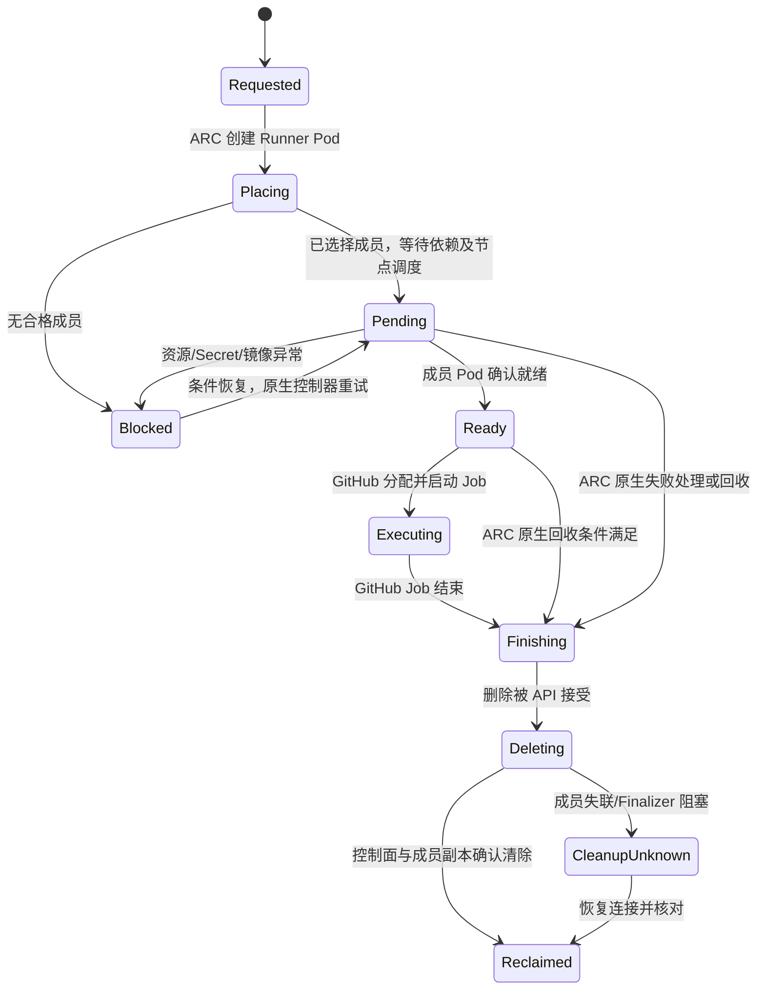

| 约束 | 不变量与禁止行为 |
|---|---|
| LC-01 Job 权威性 | 只有 GitHub Job 事实能够确认执行结果；Pod Ready/Failed、Work 同步不能推导 Job 成败或触发自行重派 |
| LC-02 单一目标 | 每个 Runner Pod 正常只对应一个活动目标成员；不能在多份 status 中任取第一份作为执行事实 |
| LC-03 控制器所有权 | ARC 管理 Runner 生命周期，Karmada 管理传播；集成层不能绕过其原生回收规则 |
| LC-04 阶段隔离 | Secret 已到达、Pod Ready、Runner 已注册、Job 已开始是不同事件，任何一步不代表后续一步成立 |
| LC-05 删除收敛 | 删除请求被接受不代表 Pod、Work、成员 Secret 已清除；未核实副本时只可标记清理结果未知 |
| LC-06 重复及乱序事件 | 按对象 UID、所属 Cluster、目标成员和各系统权威状态核对；不同集群 resourceVersion 不可相互比较 |
| LC-07 无重放承诺 | 未经 GitHub/ARC 协议及业务幂等性证明，不承诺 exactly-once Job、无损迁移或任意失败自动重新执行 |

**状态判定**：GitHub 是 Job 终态权威；ARC 是 Runner 实例及回收权威；Karmada 是传播目标和 Work 状态权威；成员 kubelet/Kubernetes 是 Pod 实际运行状态权威。控制面同步落后时保留来源、对象身份与时间，使用 Unknown/未确认表达不确定性，不以旧 Ready 推导当前可执行。

### 4.5.4 异步传播、状态冲突及恢复决策（T3）

| 失效或竞态 | 设计处理 | 禁止行为 |
|---|---|---|
| JIT Secret 晚到，Pod FailedMount | 保留 Pending，依赖成员原生挂载重试并诊断 Secret 引用 | 不伪造 Ready |
| 成员 Ready、控制面仍 Pending | 保留成员实际状态与 Karmada 同步滞后证据，继续原生调谐 | 不直接篡改 ARC 状态 |
| 控制面 Ready、成员失联或状态缺失 | 核对 Binding 当前目标并标记事实过期/未知 | 不把缓存 Ready 当作新任务可执行保证 |
| statusItems 多来源冲突 | 先依据活动 Binding/Work 和成员 Pod 身份确认唯一权威来源 | 不选择第一个非空状态 |
| GitHub Job 已完成但 Pod 未删除 | GitHub 结果与 ARC 回收状态分别记录 | 不宣称所有临时资源已销毁 |
| Pod 消失但 GitHub Job 未结束 | 依 GitHub/ARC 原生失败策略和生命周期处理 | 集成层不得自行重复派发 Job |
| Work/Secret 删除滞后或成员失联 | 标记 CleanupUnknown；恢复连通后逐对象核查 UID、Finalizer、删除状态 | 不以 API 202/删除请求代表完成，也不强删未知 Finalizer |
| 事件重复、乱序、旧资源同名重建 | 核对来源 Cluster、UID 与当前权威快照；旧事件不覆盖新对象 | 不跨集群比较 resourceVersion |

**上游边界**：ARC 官方机制本身可能重试失败的 Runner Pod；这里禁止的是额外集成逻辑擅自重放 GitHub Job，而非禁止上游机制。具体超时值及重试限制必须对齐目标 ARC 版本，不在设计中杜撰统一 SLA。

## 4.6 SP-08 NPU 资源规格设计

### 4.6.1 实现思路

Device Plugin 发布扩展资源（U）。按设备需求设置候选成员和 Pod 请求（D）；Karmada 选成员、Kubernetes 选节点，不重实现设备分配。架构、OS、驱动、固件、插件及运行时由设备选型确定（P）。

### 4.6.2 实现设计

| 配置项 | 参数来源 | 规定的行为与限制 |
|---|---|---|
| NPU 扩展资源名 | 目标设备插件发布的 Kubernetes 资源定义。 | Runner Pod 必须使用插件实际发布的扩展资源名称。不得假定所有设备都使用 `npu`。 |
| 设备份额与数量 | 设备插件定义的资源单位与可共享规则。 | 平台必须按插件支持的分配单位设置请求数量。没有厂商资料时不得承诺共享或超额分配。 |
| 成员/节点标签 | 资源池配置、成员标签及节点标签。 | Karmada 应选合格成员，成员调度器再按资源请求和节点约束选节点。两层约束必须一致。 |
| 镜像/驱动/Runtime | 设备驱动、固件和容器运行时的兼容资料。 | 部署方必须核对 Runner 镜像与目标设备的兼容性；不能因为安装了设备插件就推定全部软件栈可用。 |
| Runner Scale Set | 服务目录及 GitHub 工作流标签。 | 硬件能力不能互换时，平台必须配置不同 Runner 服务，不能默默把 NPU Job 交给普通 CPU Runner。 |

设备不足时，Pod 保持不可调度并保留原因；插件未就绪时不得删掉 NPU 请求或降级至 CPU 节点。成员 Kubernetes、设备插件和运维人员分别排障；型号、资源名、性能指标为部署参数（P）。

## 4.7 SP-09 跨功能质量与可服务性规格

| 质量属性 | 规定的行为 | 需要确认的部署参数 |
|---|---|---|
| 安全 | Controller、Listener 和 Runner 必须使用彼此独立且满足最小权限原则的身份。平台只下发执行所需的 Secret，并校验 TLS 证书。 | Token 有效期、凭证系统和租户隔离规则。 |
| 可靠性 | 系统必须区分控制器可以重试的资源操作与需要管理员修复的证书、权限、网络错误。不得仅凭 Runner Pod 异常就重新提交同一 GitHub Job。 | 故障恢复目标、告警规则与人工处理责任。 |
| 可用性 | 平台必须明确 GitHub、Karmada 控制面、成员集群和网络连接之间的故障边界。一个成员可用不代表整个 GitHub Runner 服务可用。 | 目标部署拓扑、冗余级别和服务可用性目标。 |
| 性能与并发 | 平台应分别记录 Job 排队、Runner 数量调整、Pod 就绪和 Runner 注册的时间。不能用一次分配结果推定长期负载均衡。 | 服务容量、排队时间与每阶段延迟要求。 |
| 可服务性 | 平台必须能够使用 GitHub Run、Runner Scale Set、临时 Runner、Pod UID、Binding/Work 和成员集群定位同一次任务的处理状态。 | 日志保留期限、审计要求及观测平台。 |
| 升级与兼容 | 部署方必须记录 ARC CRD、Controller、Listener、Runner 镜像及 Karmada API 的版本，并按目标版本的接口检查兼容性。 | 组件版本、镜像摘要和升级回滚窗口。 |

F-01～F-06 遵守 SP-01～SP-09。FMEA 写明原因、影响、检测、恢复和责任。未确认的性能、设备、安全参数标待定，不编造数值。

# 5 功能实现设计

> 各功能保留时序、接口和 FMEA/DFX；共享规格见第 4 章。Kubernetes 原生资源遵循对应 OpenAPI；ARC/Karmada 自定义资源遵循 CRD Schema。未新增 REST API，不编造 Swagger Endpoint。
>
> US-01～US-08 时序图及异常场景均为设计，不是实测调用记录；上游行为以目标版本文档为准。
>
> FMEA 仅作定性分析；风险评分标准未批准，不填数值。

### 5.0.1 DFX 风险判定与设计验证规则（T6）

本章对全部功能使用统一的**定性 FMEA**，风险等级是设计评审优先级，**不是测得的故障概率或正式 RPN**：**严重**＝可能跨租户/长期凭证泄露、执行错误身份、失去关键安全边界或错误确认执行；**高**＝任务中断、重复执行风险、凭证失效或资源清理无法确认；**中**＝局部排队、暂时 Pending、可恢复的单功能异常。等级按潜在影响与可隔离性保守判定；不虚构概率、检测率或分数。风险高低不能仅凭恢复流程是否存在而自动下降。

每条 FMEA 追加**设计措施 → 设计验证准则 → 剩余风险**。验证是通过设计文档/API 契约检查可判定的条件，不表示已运行测试或实际验证成功。**设计被接受**与**当前 Manifest 已满足**分别记录；涉及未落实的策略、隔离或接口，必须标记差距。正式性能 SLO、企业数据保留期和设备硬隔离能力不在此补写数值。

Kubernetes 关于 [RBAC 最小权限和租户安全边界](https://kubernetes.io/docs/concepts/security/rbac-good-practices/)、[ServiceAccount](https://kubernetes.io/docs/concepts/security/service-accounts/) 及 Karmada [状态解释与聚合接口](https://karmada.io/docs/userguide/globalview/customizing-resource-interpreter/) 是风险控制的上游依据。

## 5.1 F-01 统一 Runner 服务入口

### 5.1.1 功能概述

**关联的正式系统需求**：SR-01-01；**用例**：UC-01 通过统一标签提交工作流、UC-02 无匹配或无可用 Runner（异常处理，不单列 SR）；**功能域规格**：SP-01。

F-01 提供统一 Runner 服务名称。开发者通过 `runs-on` 选择服务，无需指定成员；平台配置服务、GitHub 目标与 Runner 模板。

**职责**：维护服务名称与 GitHub 目标映射；成员选择见 F-03，节点调度归 Kubernetes。

### 5.1.3 实现思路

`AutoscalingRunnerSet.spec.runnerScaleSetName` 必须与工作流 `runs-on` 一致。GitHub/ARC 负责匹配、创建和注册；不开发独立队列。硬件或权限不兼容时，分设 Runner 服务。

### 5.1.4 设计思路

GitHub 按 `runs-on` 匹配；Listener 接收需求，Controller 管理 Runner，F-03 选择成员。无匹配服务时，不得替换工作流标签或转交其他服务。

#### 5.1.4.1 UC-01 通过统一标签提交工作流——运行时序（US-01）

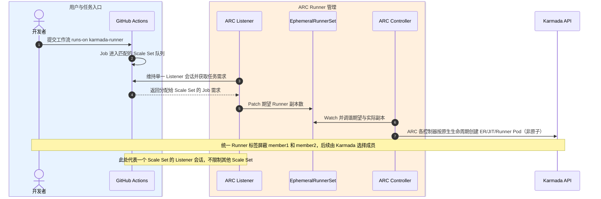

### 5.1.5 用户接口设计

通过 `jobs.<job>.runs-on` 选择服务，名称必须与 `spec.runnerScaleSetName` 一致。无独立 UI；复用 GitHub 和配置管理工具。

### 5.1.6 实现接口设计

#### 5.1.6.1 接口设计

| 交互双方 | 原生接口或资源 | 输入、操作与输出 | 权限与前置条件 | 异常处理与限制 | 依据及规格 |
|---|---|---|---|---|---|
| 工作流使用者与 GitHub Actions | GitHub Actions Workflow：`jobs.<job>.runs-on` | 开发者必须填写已发布的 Runner 服务名称。GitHub 根据该名称匹配 Runner。 | 开发者必须具有目标仓库工作流的提交权限。 | 名称未匹配时，GitHub 按其队列机制处理；平台不得改写标签。 | ARC-1；SP-01 |
| 平台配置与 ARC Controller | `AutoscalingRunnerSet`：`actions.github.com/v1alpha1` | 管理员必须配置服务名称、GitHub 目标、凭证引用、Runner 数量范围和 Pod 模板。 | Controller 必须具备所需的 Kubernetes API 与 GitHub 目标权限。 | API 拒绝创建或更新时，必须保留资源名称和错误原因；不能自行扩大权限。 | ARC-2；SP-01 |

**开发交付边界**：开发人员应维护 Runner Scale Set 模板与服务名称配置。不新增用于代替 GitHub Job Queue 的接口。

### 5.1.9 DFX分析

**功能安全与性能约束**：Runner 的最大数量受 `maxRunners` 限制。平台必须防止 Runner 在未授权的 GitHub 仓库或组织中注册。具体并发容量和排队时间由业务方定义。

**可靠性故障分析（FMEA）**

| 编号 | 失效原因 | 业务或系统影响 | 检测方法 | 处理与恢复要求 | 负责方 |
|---|---|---|---|---|---|
| F01-01 | 工作流标签和 Runner 服务名称不一致。 | GitHub Job 不能匹配目标 Runner。 | 对照 `runs-on` 和 `runnerScaleSetName`，检查 GitHub Job 的排队信息。 | 平台管理员应修正不一致的服务配置，并检查修改影响。 | 平台维护者 |
| F01-02 | GitHub 管理凭证失效。 | Runner 无法正常向目标 GitHub 仓库注册。 | 检查 Controller 或 Listener 的认证错误和凭证引用。 | 身份管理者更新凭证；不得通过更改业务标签来规避认证失败。 | 身份管理员、ARC 运维 |

**T6 风险—措施—验证追踪**（关联：SR-01-01、SR-NF-01/05；延续上方 FMEA 编号，不替代已有故障表）

| FMEA | 失效模式 | 影响 | 风险 | 设计措施及对应约束 | 设计验证准则 | 剩余风险 |
|---|---|---|---|---|---|---|
| F01-01 | 标签/服务配置不匹配 | Job 长时间无法获得 Runner | 中 | SP-01 保证服务标识一致；不进行隐式服务回退 | 对照 workflow/Scale Set 的匹配字段；未匹配时只能进入 GitHub 原生等待/错误路径 | 配置变更后仍可能出现短暂不匹配 |\n| F01-02 | GitHub 管理凭证过期/授权错误 | Runner 无法注册，队列积压 | 高 | SP-04/SEC-02 凭证按消费者授予；轮换及 401 分类诊断 | 明确新凭证生效、旧凭证失效的判定；错误不以更换 runner 标签绕过 | 依赖 GitHub 可用性和有效授权 |

**运行诊断与敏感信息处理**：运维人员应先比较 `runs-on`、Runner Scale Set 名称和 GitHub 配置，再分析身份认证错误。审计不得记录 GitHub 管理凭证。

## 5.2 F-02 Runner 弹性供给及临时资源回收

### 5.2.1 功能概述

**关联需求**：SR-02-01、SR-02-02；**用例**：UC-03 Job 需求驱动 Runner 创建、UC-04 Job 结束回收 Runner 与凭证；**功能域规格**：SP-01、SP-06、SP-07。

F-02 按需供给临时 Runner。ARC 创建 Runner、Pod 和注册配置；作业结束后，ARC/Karmada 分别回收。通过对象 ID 关联同一任务。

**职责**：集成 Runner 需求与回收；注册协议及控制器沿用 ARC。

### 5.2.3 实现思路

复用 ARC `AutoscalingRunnerSet`、`EphemeralRunnerSet`、`EphemeralRunner` 生命周期。Karmada 传播并回收成员对象；不得新增争夺 Runner 所有权的控制器。临时资源按 UID/OwnerReference 关联，不依赖生成名称。

### 5.2.4 设计思路

Listener 更新 `EphemeralRunnerSet`，Controller 创建 Runner；成员启动 Pod 并注册 GitHub。作业结束后 ARC 回收 Runner，Karmada 异步删除传播对象。不要求同时删除，也不得因 Pod 失败重复派发 Job。

#### 5.2.4.1 UC-03 Job 需求驱动 Runner 创建——运行时序（US-02）

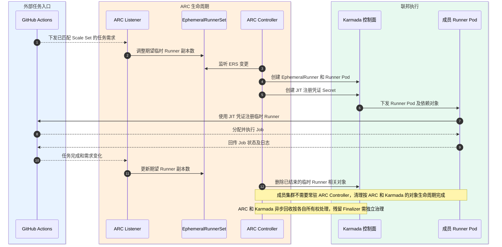

#### 5.2.4.2 UC-04 Job 结束回收 Runner 与凭证——运行时序（US-07）

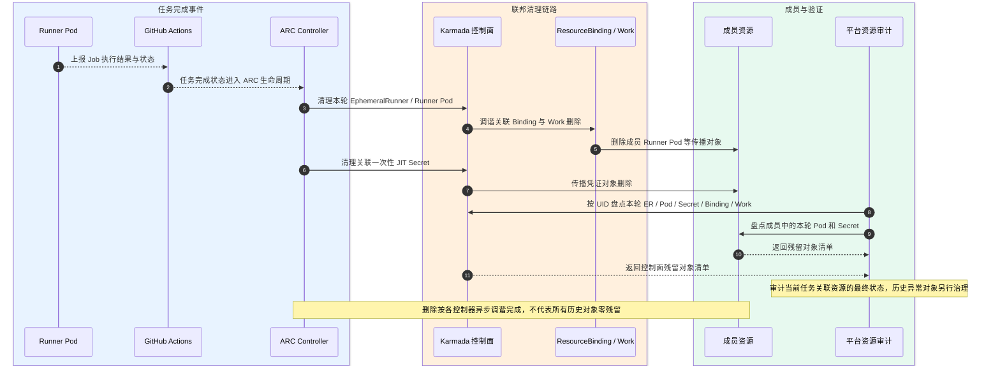

### 5.2.4.3 生命周期回收契约和异常时序（T3）

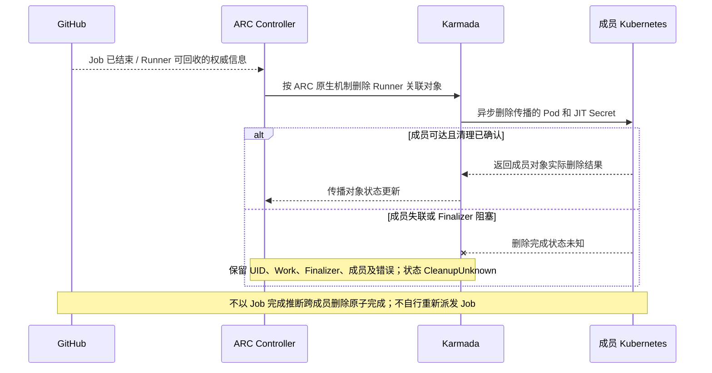

| 触发 | 应核对的事实 | 恢复责任 |
|---|---|---|
| ER/Pod 创建后 JIT 未可用 | 成员 FailedMount、Pod 引用及 Karmada 依赖传播状态 | Karmada/成员继续原生调谐，ARC 按自身版本规则处理失败 |
| Pod Failed / Runner 注册失败 | ARC 原生 Runner 状态和 GitHub 是否已分配 Job | ARC/GitHub 的正式失败策略，不由集成层自创重投 |
| Job completed 后删除中 | ER、控制面 Pod、Binding/Work、成员 Pod、两侧 Secret | ARC 和 Karmada 分别负责自身对象；审计标记未确认项 |
| 删除被 Finalizer 阻塞 | deletionTimestamp、Finalizer 所属控制器与依赖 | 先修复原控制器或依赖，不直接删除未知 Finalizer |

**幂等性**：重复 Watch/Delete 通知只促使核对已有对象，不能生成另一份 Job；跨控制面清理非原子且顺序不固定。

### 5.2.5 用户接口设计

开发者通过 GitHub 查看作业状态；运维通过 Run、Runner、Pod、Work 标识排障。无需手动创建 Pod/Secret；无新增 UI。

### 5.2.6 实现接口设计

#### 5.2.6.1 接口设计

| 交互双方 | 原生接口或资源 | 输入、操作与输出 | 权限与前置条件 | 异常处理与限制 | 依据及规格 |
|---|---|---|---|---|---|
| ARC Listener 与 EphemeralRunnerSet | Kubernetes API：`EphemeralRunnerSet` 更新操作 | Listener 根据 GitHub 返回的任务需求更新指定 Runner 服务的期望数量。 | Listener 身份必须具有指定 Runner 服务所需的更新权限。 | API 返回资源版本冲突或拒绝访问时，必须保留失败原因，不得更新其他 Runner 服务。 | ARC-1；SP-01 |
| ARC Controller 与 Karmada API | `EphemeralRunner`、`Pod` 和 JIT Secret | ARC 创建临时 Runner 对象、Runner Pod 和注册所需的临时 Secret。 | Controller 必须有权管理所在命名空间的对应资源。 | 对象创建失败时记录资源类型和 API 错误，不得报告不存在的 Runner 已注册。 | ARC-1；SP-07 |
| ARC/Karmada 与成员 Kubernetes | Runner Pod、JIT Secret、`ResourceBinding`、`Work` | ARC 按官方生命周期删除临时 Runner，Karmada 调谐被传播对象的删除。 | 每个控制器只能依据其资源所有权处理相关对象。 | 删除未完成时保留对象 UID、Finalizer 和错误，不得清除未知 Finalizer。 | ARC-1、KAR-1；SP-07 |

**开发交付边界**：开发人员维护 Runner Scale Set 配置、资源关联和必要权限；动态 Runner 的创建与回收由 ARC 的官方控制器完成。

### 5.2.9 DFX分析

**功能安全与性能约束**：平台不能超过 Runner 服务规定的容量上限。作业失败后，未经确认的重复执行可能产生副作用，因此不得仅因 Runner Pod 消失而重新提交作业。JIT Secret 的数据不得写入日志。

**可靠性故障分析（FMEA）**

| 编号 | 失效原因 | 业务或系统影响 | 检测方法 | 处理与恢复要求 | 负责方 |
|---|---|---|---|---|---|
| F02-01 | ARC 对任务需求的响应延迟。 | GitHub Job 需要等待 Runner。 | 比较 Runner 的期望数量与实际数量，并检查 ARC Controller 事件。 | ARC 运维人员应检查控制器状态和资源容量；平台按业务阈值发出告警。 | ARC 运维 |
| F02-02 | Runner 注册失败或 Job 执行中断。 | Job 不能完成，错误重试可能导致重复执行。 | 检查 GitHub Run、临时 Runner 状态和 Pod 事件。 | 应按 GitHub 与 ARC 的官方机制处理；没有明确去重依据时不得再次派发。 | GitHub、ARC 运维 |
| F02-03 | 临时资源的 Finalizer 阻止删除。 | 临时 Pod 或 Secret 仍占用资源。 | 按对象 UID 检查 ER、Pod、Binding、Work 和 Secret 的删除状态。 | 由对象所属控制器完成清理；需要人工操作时先确认资源所有者。 | ARC、Karmada 运维 |

**T6 风险—措施—验证追踪**（关联：SR-02-01、SR-02-02、SR-NF-03/06；延续上方 FMEA 编号，不替代已有故障表）

| FMEA | 失效模式 | 影响 | 风险 | 设计措施及对应约束 | 设计验证准则 | 剩余风险 |
|---|---|---|---|---|---|---|
| F02-01 | ARC 供给滞后或已达 maxRunners | Job 排队、服务容量不足 | 中 | SP-01 容量上下限；分离需求、实例和注册三个观测阶段 | 从 ERS 期望数、ER/Pod 数及 GitHub Job 状态能判断瓶颈位置；不得承诺未批准的 SLA | GitHub 与 ARC 响应延迟不可由本系统单方保证 |\n| F02-02 | Runner 注册失败/运行中断 | Job 失败或重复执行副作用 | 高 | LC-01/LC-07 区分 Job 权威状态与 ARC 重试；集成层不自发重派 | Pod 丢失时不会由集成逻辑生成第二份相同 Job；结果取自 GitHub | 上游失败重试和业务幂等性仍需按正式机制约束 |\n| F02-03 | Finalizer 或成员失联导致残留 | Pod/JIT Secret 持续存在，凭证暴露窗口增加 | 高 | LC-05 与 3.5.2 分域删除确认，CleanupUnknown 和按所有权清理 | 控制面删除后仍能报告未清成员对象、UID、Finalizer 与目标成员 | 失联期间不能保证立即销毁 |

**运行诊断与敏感信息处理**：使用 GitHub Run、临时 Runner、Runner Pod UID、JIT Secret 和 Binding/Work 追踪同一次任务。Finalizer 阻止删除时，必须先确认设置它的控制器。

## 5.3 F-03 Runner 联邦成员调度与依赖传播

### 5.3.1 功能概述

**关联需求**：SR-03-01、SR-03-02；**用例**：UC-05 在合格成员放置 Runner、UC-06 JIT Secret 晚到后的依赖恢复、UC-10 成员不可用或无可调度资源；**功能域规格**：SP-02、SP-03、SP-04。

F-03 将 Runner Pod 与临时注册凭证分发至合格成员，并接收传播和运行状态。

**职责**：Runner Pod 匹配、候选成员和依赖传播；节点调度归 Kubernetes。

### 5.3.3 实现思路

`PropagationPolicy` 定义 Runner Pod 选择器和候选成员；`propagateDeps` 下发 JIT Secret。标签须匹配目标 ARC 版本。Karmada 选成员、Kubernetes 选节点；不另建 GitHub 调度器。`Divided/Weighted` 不保证独立 Pod 逐轮均分。

### 5.3.4 设计思路

Controller 创建 Pod；Karmada 选成员、分发 Pod 和依赖；成员挂载 Secret 并启动。JIT Secret 晚到时 Pod 等待，不得判为可执行。成员故障保留原因，不重复提交 Job。

**UC-05 设计前置条件及后置条件（T1）**：前置：已创建目标 Runner Pod，策略及授权成员集合已定义；后置：可记录其目标成员与传播结果，但只有成员节点调度和 Pod/Runner 注册条件满足后，才可认为具备执行条件。调度选中成员不等于节点容量已经保留。当前 `Divided/Weighted` 配置不能证明独立 Pod 之间的负载均衡。

| 用例分支 | 设计决策 | 必须保留的诊断证据 |
|---|---|---|
| 有授权候选成员，成员 Pod 正常启动 | 保留 Karmada placement，后续以成员 Pod/Runner 状态判定可执行 | Pod UID、目标 Cluster、Binding/Work、节点/Ready 状态 |
| 无授权或健康候选成员 | 不扩张到未授权成员；不创建重复 Job | 策略选择器、成员状态、调度事件 |
| 成员放置成功但节点资源不足 | Pod 保持 Pending；不删除设备请求、不误报 Ready | `FailedScheduling`、Pod 资源请求、Node allocatable |
| 设备资源分散，单节点无法满足完整请求 | 不把成员聚合空闲容量当作单节点可满足证明 | 节点可用资源、亲和性、设备插件状态 |
| 同时多个 Pod 竞争剩余容量 | 不宣称原子预留、FIFO、公平或成功放置保证 | Binding/Work 与成员 Pod 的创建及调度事件 |
| 已分发成员失联 | 状态保持可诊断；不将 Job 视作自动迁移完成 | Cluster Ready、Work 状态、Pod/Runner 关联 ID |

**接口契约补充（T1）**：`PropagationPolicy.resourceSelectors` 负责选取资源对象，`placement.clusterAffinity` 只限制候选成员；`ResourceBinding/Work` 表达传播目标及同步结果，不能替代成员 `Pod.status`；成员实际节点调度失败以 Kubernetes 事件及 Pod 状态为准。出现多个可行目标时，本功能域不规定上游 Karmada 的具体打分顺序，也不将当前 `Weighted` 解释为跨 Pod 轮转策略。

#### 5.3.4.1 UC-05 在合格成员放置 Runner——运行时序（US-03）

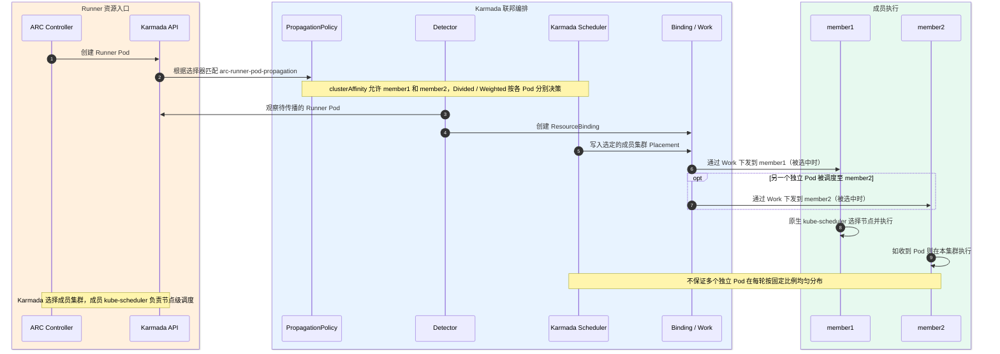

#### 5.3.4.2 UC-06 JIT Secret 晚到后的依赖恢复——运行时序（US-04）

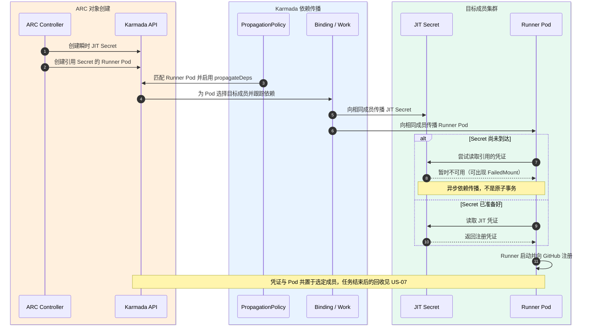

#### 5.3.4.3 UC-10 成员不可用——异常运行时序

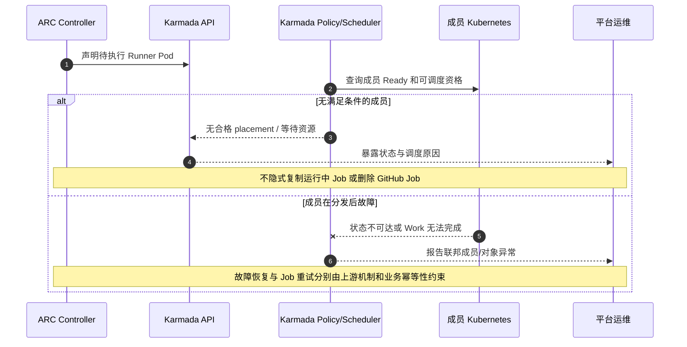

**异常约束**：不得将成员失联等价于 GitHub Job 已失败或可安全重复执行；设计仅保证可诊断的异常状态和责任边界。

### 5.3.5 用户接口设计

开发者无需选择成员；管理员通过 Cluster、Binding/Work、Pod 事件定位执行成员与未就绪原因。无新增 UI。

### 5.3.6 实现接口设计

#### 5.3.6.1 接口设计

| 交互双方 | 原生接口或资源 | 输入、操作与输出 | 权限与前置条件 | 异常处理与限制 | 依据及规格 |
|---|---|---|---|---|---|
| ARC Controller 与 Karmada API | Kubernetes `Pod`、`Secret`、`ServiceAccount` | ARC 创建带有服务标签、运行身份和 JIT Secret 引用的 Runner Pod。 | Controller 必须具有指定命名空间的所需对象管理权限。 | 对象不存在或 JIT Secret 尚未可用时，必须保留实际状态，不得重新提交 Job。 | ARC-1；SP-03 |
| 平台配置与 Karmada | `PropagationPolicy`：`policy.karmada.io/v1alpha1` | 平台必须设置资源匹配条件、成员候选范围和依赖传播规则。 | 策略维护者只能操作授权范围内的命名空间及成员。 | 策略不匹配或没有合格成员时，保留调度原因，不得默默选择其他租户成员。 | KAR-1、KAR-2；SP-02、SP-03 |
| Karmada 与成员 Kubernetes | `ResourceBinding`、`Work` 及成员对象 | Karmada 将选定 Runner Pod 和它引用的运行依赖分发到指定成员。 | Karmada 必须持有已注册成员的 API 访问身份。 | 成员不可达或资源发生冲突时，按上游调谐语义处理，不强制覆盖其他管理者的对象。 | KAR-1、KAR-2；SP-02 |

**开发交付边界**：开发人员维护 `PropagationPolicy` 及关联权限，并检查目标 Runner Pod 被选中、非目标 Pod 不被选中。不得将 GitHub Job 重新派发作为 Karmada 对象传播失败的默认恢复动作。

### 5.3.7 T1 调度正确性约束

| 约束编号 | 不变量/限制 | 反例及处理 |
|---|---|---|
| PL-01 | 被传播的 Runner Pod 必须属于明确的 Runner 服务范围 | 现有全命名空间 Pod 选择器不满足目标隔离要求，属于 SP-03 待改配置 |
| PL-02 | 目标成员必须符合授权的候选集与平台明确声明的硬性约束 | 无匹配成员时报告不可调度，不得越权扩张 |
| PL-03 | 传播完成 ≠ 节点成功调度 ≠ Runner 已注册 ≠ Job 成功 | 分别使用 Karmada、成员 K8s、ARC/GitHub 事实判定 |
| PL-04 | 单个 Runner Pod 不能通过聚合多个节点/成员空闲量证明满足完整资源请求 | 容量碎片化仍可能导致 Pending；保留诊断状态 |
| PL-05 | 独立 Pod 的 `Divided/Weighted` 不构成跨 Pod 比例、NPU 预留或调度公平保证 | 不在设计或验收中使用无依据的成功率/均衡性承诺 |
| PL-06 | 成员不可达或 Pod 未就绪不得触发未经去重证明的 GitHub Job 重派 | 只按上游生命周期和后续 T3 约束处理 |

**设计级验收边界**：以上约束限定当前方案能够主张的正确性范围。若要求跨成员实时最优放置、容量预约或特定排队算法，应先形成独立功能规格、确定状态所有者及相应实现扩展点；不把后续功能写成已完成的原生 Karmada 能力。

### 5.3.9 DFX分析

**功能安全与性能约束**：传播策略不能无意包含其他租户的 Pod。JIT Secret 必须只分发到有实际执行需求的成员。监控应分别记录成员选择、Secret 可用和 Runner 注册等阶段，不得宣称未经定义的平均分配比例。

**可靠性故障分析（FMEA）**

| 编号 | 失效原因 | 业务或系统影响 | 检测方法 | 处理与恢复要求 | 负责方 |
|---|---|---|---|---|---|
| F03-01 | 传播策略错误地选择了非 Runner Pod。 | 其他工作负载可能被复制到不应访问的成员。 | 比对策略标签与目标 Runner Pod、非目标 Pod 的标签。 | 策略维护者必须收窄选择条件，并确认其他租户 Pod 不匹配。 | 联邦策略维护者 |
| F03-02 | JIT Secret 晚于 Runner Pod 到达成员。 | Runner Pod 无法挂载所需 Secret，启动推迟。 | 检查成员 Pod 的 `FailedMount` 事件和 JIT Secret 引用。 | Karmada 继续调谐依赖传播；成员 Kubernetes 继续挂载重试。平台不得因此重复派发 Job。 | Karmada、成员运维 |
| F03-03 | 候选成员不可达或资源不足。 | Runner Pod 无法进入可执行状态。 | 检查成员 Cluster Ready、Binding/Work 和 Pod 调度事件。 | 运维人员应恢复成员或调整已授权的候选集；不得重复提交正在执行的 Job。 | 联邦与资源池运维 |

**T6 风险—措施—验证追踪**（关联：SR-03-01、SR-03-02、SR-NF-02/03；延续上方 FMEA 编号，不替代已有故障表）

| FMEA | 失效模式 | 影响 | 风险 | 设计措施及对应约束 | 设计验证准则 | 剩余风险 |
|---|---|---|---|---|---|---|
| F03-01 | 过宽 Pod 选择器误传播其他租户负载 | 越权运行、泄露或横向访问 | 严重 | SP-03/PL-01 精确选择 Runner Pod；成员准入与跨租户安全约束 | 非目标 Pod 不匹配选择器；未经授权成员不接收对象；现有全命名空间选择器明确标为未满足 | 仅命名空间隔离不足以防御不可信 PR 代码 |\n| F03-02 | JIT Secret 与 Pod 异步传播 | Pod FailedMount 或启动超时 | 中 | SP-04/LC-04 关联引用依赖、保持 Pending、原生调谐 | Secret 晚到时不出现伪 Ready；可关联失败事件和传播状态 | 异步到达与联邦同步延迟 |\n| F03-03 | 成员故障或节点容量碎片化 | Runner Pending、排队且可用性下降 | 高 | PL-02～PL-05 禁止越权放置，成员与节点可调度分层判定 | 即使成员汇总资源足够但单节点不满足，也不得宣称可执行；保留 FailedScheduling | 当前无跨成员强制最优放置/容量预留 |\n| F03-04 | 不可信开源 PR 在共享物理 NPU 节点执行 | 容器逃逸、宿主机/其他租户/设备数据受影响 | 严重 | 设计明确**容器+RBAC 不足以作为强租户隔离保证**；共享物理设备前需选定与设备/驱动兼容的强化隔离（如经验证的 VM 沙箱或等效硬隔离），限制主机权限与敏感设备访问 | 设计中存在明确隔离信任边界、允许的宿主机/设备接口和未满足条件时拒绝共享执行的规则；不能仅凭 Pod 成功启动验收 | 目标 Ascend NPU 虚拟机/沙箱兼容性与设备隔离能力待专项选型，未完成前不得宣称安全共享 |

**运行诊断与敏感信息处理**：诊断时先查看成员集群的 Ready 状态与 Karmada Binding/Work，再检查成员 Pod 事件和 Secret 引用。日志不得保存 Secret 数据。

## 5.4 F-04 Listener 跨控制面认证与访问

### 5.4.1 功能概述

**关联需求**：SR-04-01；**用例**：UC-08 Listener 访问统一 Karmada API、UC-11 Token 失效或证书不匹配；**功能域规格**：SP-04、SP-05。

F-04 为成员 Listener 提供 Karmada API 地址、可信证书和最小授权身份，仅允许操作所属 Runner 服务。

**职责**：Listener 访问身份、地址和权限；不修改 API Server 认证。

### 5.4.3 实现思路

用 ServiceAccount、TokenRequest 和 RBAC 建立 Listener 身份。校验 Karmada API 证书链与名称。地址、CA、Token 由部署提供；示例固定 IP 和签发脚本不等于自动轮换。

### 5.4.4 设计思路

凭证方签发 Token/CA；Listener 验证服务器证书，API Server 校验身份与权限。校验通过才能更新指定 `EphemeralRunnerSet`；网络、TLS、401、403 分别记录。

#### 5.4.4.1 UC-08 Listener 访问统一 Karmada API——运行时序（US-05）

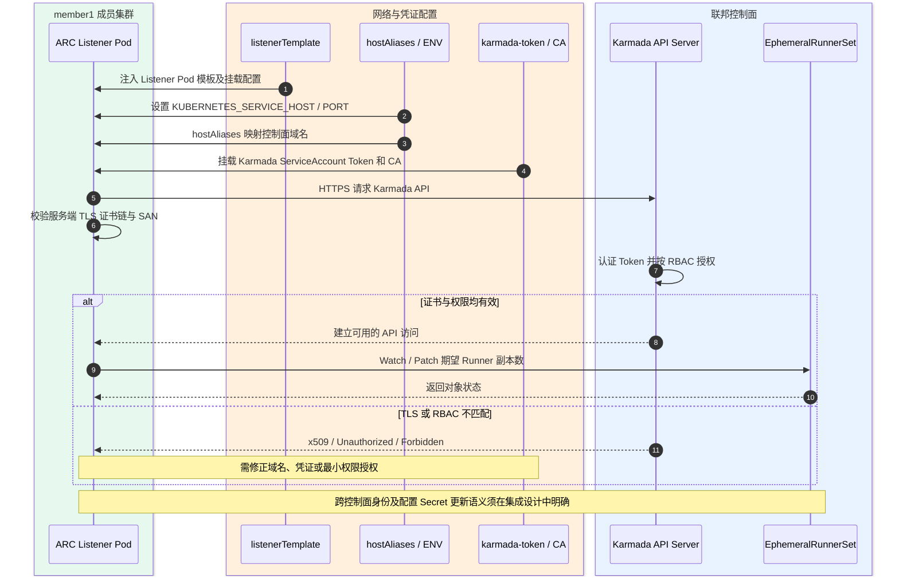

### 5.4.4.2 UC-11 令牌轮换、权限拒绝和撤销——异常时序（T4）

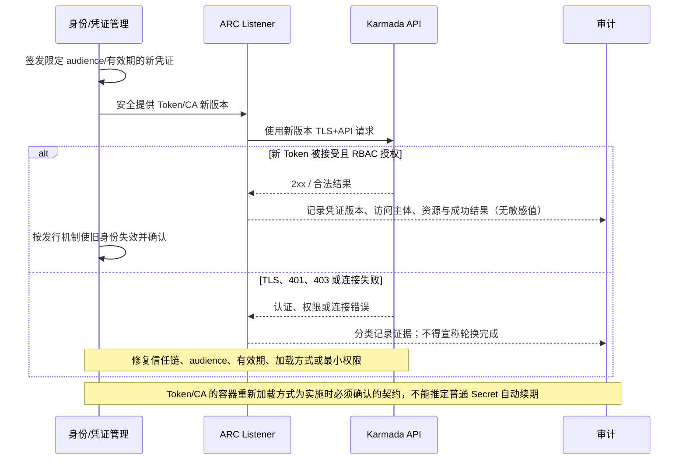

| 情况 | 错误归属 | 设计恢复动作 | 禁止行为 |
|---|---|---|---|
| DNS/TCP/路由失败 | 网络连通性 | 恢复控制面可达，保留目标地址和错误分类 | 不转向未经验证 API |
| TLS CA/SAN 不匹配 | 服务端身份与信任链 | 修正证书链、访问域名、信任锚 | 不关闭 TLS 校验 |
| HTTP 401 | Token 到期、issuer/audience、对象绑定或载入失败 | 重新核对 Token 有效性、消费者加载和 Karmada 认证配置 | 不升级为管理员凭证 |
| HTTP 403 | RBAC 不足或请求作用域不匹配 | 对照实际 API verb、resource、namespace 与 `resourceNames` | 不直接授予 cluster-admin |
| Secret 副本留存/成员失联 | 传播与回收状态未知 | 记录目标成员及副本 UID；恢复后核对，并独立检查远端凭证撤销 | 不宣称删除控制面 Secret 即完成全域撤销 |
| 更新 Secret 但 Listener 仍用旧 Token | 凭证加载机制 | 定义可检查的新凭证加载/Listener 重启流程 | 不把 Secret resourceVersion 变化当成轮换成功 |

**接口检查**：应记录 Caller 身份、目标资源及操作、请求结果、失败类别、凭证非敏感版本和观测时间。原则上仅记录不含敏感信息的可追踪标识。对当前 `03-rbac.yaml` 的 `ephemeralrunners` 授权范围及 Controller admin kubeconfig，必须标为生产目标权限整改点；不能通过本次文档更新宣布配置已整改。

### 5.4.5 用户接口设计

身份和轮换由安全管理员维护；运维查看 Listener 状态、错误类型及证书/Token 版本。复用现有工具，无独立 UI。

### 5.4.6 实现接口设计

#### 5.4.6.1 接口设计

| 交互双方 | 原生接口或资源 | 输入、操作与输出 | 权限与前置条件 | 异常处理与限制 | 依据及规格 |
|---|---|---|---|---|---|
| ARC Listener 与 Karmada API | HTTPS Kubernetes API、`EphemeralRunnerSet` | Listener 必须使用指定 API 地址、可信 CA 和访问令牌更新所负责的 Runner 对象。 | Token 必须来自受控身份；RBAC 只授予所需对象和操作。 | 网络、证书、HTTP 401、HTTP 403 和超时必须分别记录，不允许绕过认证。 | K8S-1、K8S-2；SP-05 |
| 部署与密钥管理系统和 Listener Pod | Listener 模板、Secret 或受控凭证投射卷 | 部署方必须提供 CA、Token、有效期及 API 连接信息，并明确更新后的加载方式。 | 凭证应以只读方式提供给需要的容器，禁止出现在日志中。 | Token 到期或未加载时，必须报告身份状态；不得假定修改 Secret 后立即生效。 | SP-04、SP-05 |
| 安全管理员与 Kubernetes RBAC | `Role`、`RoleBinding` | 对指定 `EphemeralRunnerSet` 授予所需 `patch` 权限，对必要的 `EphemeralRunner` 资源授予对应读写和状态权限。 | 必须确认 ServiceAccount 命名空间、绑定对象以及操作范围。 | RBAC 配置与契约不一致时，应修正 Role/Binding；不得赋予 `cluster-admin`。 | K8S-2；SP-05 |

**开发交付边界**：开发人员维护 ServiceAccount、Role/RoleBinding、Listener 模板和证书/令牌加载配置。Token 的到期处理和重新加载方式必须在部署方案中确定。

### 5.4.9 DFX分析

**功能安全与性能约束**：Listener 必须验证 HTTPS 服务器证书。凭证只授予必要操作权限，日志不得包含 Token 或私钥。高可用与不中断轮换属于部署参数，不能宣称已自动具备。

**可靠性故障分析（FMEA）**

| 编号 | 失效原因 | 业务或系统影响 | 检测方法 | 处理与恢复要求 | 负责方 |
|---|---|---|---|---|---|
| F04-01 | API 地址不可达或 TLS 证书校验失败。 | Listener 不能访问 Karmada API。 | 分别检查 DNS/TCP 连通性、CA 与证书 SAN。 | 部署维护者应修正服务地址或证书配置，不能关闭 TLS 校验。 | 部署与证书管理员 |
| F04-02 | Token 已到期或 Listener 未加载新 Token。 | Listener 的 Runner 数量更新操作失败。 | 检查 HTTP 401、Token 有效期和凭证加载记录。 | 身份管理员更新 Token；部署维护者按规定重载 Listener。 | 身份与部署维护者 |
| F04-03 | Role 或 RoleBinding 的授权范围错误。 | Listener 无法操作所需资源，或存在越权风险。 | 检查 HTTP 403 与 Role/Binding 中的资源名称及操作。 | 安全管理员按最小权限规则修正配置，保留变更审计。 | 安全管理员 |

**T6 风险—措施—验证追踪**（关联：SR-04-01、SR-NF-01/02；延续上方 FMEA 编号，不替代已有故障表）

| FMEA | 失效模式 | 影响 | 风险 | 设计措施及对应约束 | 设计验证准则 | 剩余风险 |
|---|---|---|---|---|---|---|
| F04-01 | TLS 身份校验错误或连接不可达 | Listener 无法安全访问控制面 | 高 | SP-05 强制 CA/SAN 校验，网络/TLS 分别诊断 | 错误路径不允许 insecure-skip-verify、换用未知地址或管理员凭证 | 证书与网络基础设施失效仍影响供给 |\n| F04-02 | Token 到期、新凭证未被加载 | ERS 更新失败、Runner 供给停止 | 高 | SEC-04 轮换双确认；按加载机制更新或安全重启 | Secret 更新但旧 Token 仍在使用不得判为轮换成功；401 可追踪 | 需要目标运行方式的加载/轮换能力 |\n| F04-03 | RBAC 过大或过小 | 越权修改/合法操作被拒绝 | 严重 | SEC-03 逐 API verb/resource/namespace 收敛；Controller 禁止生产 admin kubeconfig | 授权身份只可改所属资源；403 单独报告；当前 admin kubeconfig 标记为差距 | 上游版本变更可能改变所需权限 |\n| F04-04 | GitHub 主凭证被传播至无消费者成员 | 成员被攻陷后获取长期管理凭证 | 严重 | SEC-01/02 分离管理凭证、JIT 和 Listener 身份；只允许实际消费者读取与传播 | 核对 PropagationPolicy：非消费者成员无长期主 Secret；当前双成员分发标记未满足 | 凭证本身受外部授权与撤销机制限制 |

**运行诊断与敏感信息处理**：平台必须分开记录网络连接错误、证书校验错误、HTTP 401 与 HTTP 403。出现权限失败时，不能通过关闭 TLS 或授予 `cluster-admin` 来绕过。

## 5.5 F-05 Runner Pod 状态反馈与一致性

### 5.5.1 功能概述

**关联需求**：SR-05-01；**用例**：UC-09 Runner Ready 状态反馈、UC-12 状态缺失、冲突或滞后；**功能域规格**：SP-06、SP-07。

F-05 将成员 Pod 状态回传 Karmada，供 ARC 读取容器名、运行状态与 Ready；仅支持单执行成员。

**职责**：状态解释及来源约束；Job 结果归 GitHub。

### 5.5.3 实现思路

用 Karmada `ResourceInterpreterCustomization` 保留 Pod 状态，不改 ARC/Karmada 控制器。多来源状态须另定冲突规则，不能直接取第一个非空值。

### 5.5.4 设计思路

成员 kubelet 更新 Pod，Karmada 汇总状态，ARC 读取 Ready 和容器信息。无成员状态时不得伪造 Ready 或判定 Job 成功。

#### 5.5.4.1 UC-09 Runner Ready 状态反馈——运行时序（US-06）

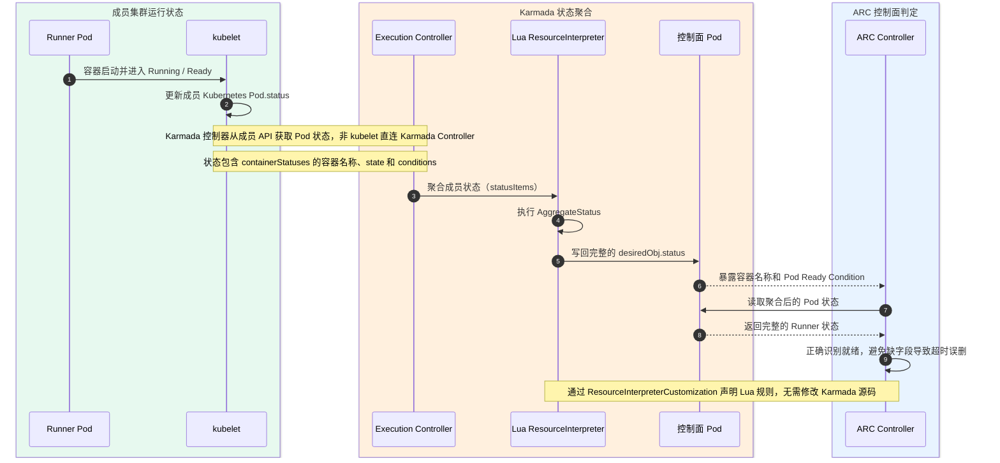

### 5.5.4.2 多来源状态聚合及过期状态处理（T3）

**当前实现差距**：`manifests/01-karmada-interpreter.yaml` 中的 `AggregateStatus` 使用第一个非空 `statusItems[i].status`，只在确实存在唯一可信来源时才适用，**没有实现**按目标成员选择、冲突隔离或过期识别。

| 输入/条件 | 设计要求 | 不满足时 |
|---|---|---|
| ResourceBinding/Work 的当前活动目标 Cluster | 聚合源只能来自目标成员 | 无法唯一确认时不产生新的 Ready 结论 |
| 成员 Pod 身份（Cluster、namespace、name、UID） | 来源与当前传播实例匹配，不使用旧 Pod/旧 Work 的状态 | 记为 Unknown 并保留冲突证据 |
| Pod phase、conditions、containerStatuses | 保留 ARC 目标版本实际需要的全部状态字段 | 不合成缺失字段或假造 Ready |
| 最新性 | 在同一对象/集群内使用 UID 和实际可比较的版本/观测时间；跨集群不比较 resourceVersion | 信息不全则保留未确认状态 |

**扩展点边界**：目标版本 `ResourceInterpreterCustomization` 是否暴露目标 Cluster 和 Pod UID，以及 Lua 是否能查询当前 Binding/Work，必须由该版本接口确认。若缺少这些输入，则不能声称上述规则由现有 Lua 单独实现；只能保留严格的单来源前提，或在后续设计确定合适的外部状态选择机制。状态算法不得通过猜测字段伪实现。

**正确性出口**：成员状态、控制面聚合状态和 GitHub Job 状态独立追踪。控制面旧 Ready 不得覆盖成员失联事实；Pod Ready 不等于 GitHub Job 成功。

### 5.5.5 用户接口设计

开发者在 GitHub 查看 Job；运维按 Pod UID、成员、容器名、Ready 排障。无新增 UI。

### 5.5.6 实现接口设计

#### 5.5.6.1 接口设计

| 交互双方 | 原生接口或资源 | 输入、操作与输出 | 权限与前置条件 | 异常处理与限制 | 依据及规格 |
|---|---|---|---|---|---|
| 成员 kubelet 与 Karmada | Kubernetes `Pod.status` | 成员 Kubernetes 提供 `phase`、`conditions`、`containerStatuses` 和容器运行信息。 | Karmada 必须能读取目标成员 Pod 的状态。 | 状态未返回时应保留未确认状态，不得生成不存在的容器状态。 | KAR-3；SP-06 |
| Karmada 状态解释器与控制面 Pod | `ResourceInterpreterCustomization` 的 `AggregateStatus` | Lua 规则必须将单目标成员的必要 Pod 状态字段写入控制面对象。 | 目标对象为 `apiVersion: v1`、`kind: Pod`；来源必须与选定执行成员一致。 | 没有状态时不能伪造 Ready；出现多个状态来源时必须有明确的选择规则。 | KAR-3；SP-06 |
| ARC Controller 与 Pod 状态 | Kubernetes Pod 读取或监听操作 | ARC 读取 Runner 容器名称、容器状态与 Pod Ready 条件。 | Controller 必须具有读取对应 Pod 的权限。 | 字段缺失时不能假定 Runner 已就绪；必须提供状态与事件诊断。 | ARC-1；SP-06 |

**开发交付边界**：开发人员维护 `ResourceInterpreterCustomization` 中的 Lua 解释规则，并保证目标版本的 ARC 所需字段完整保留。

### 5.5.9 DFX分析

**功能安全与性能约束**：必须保留 ARC 需要的 Pod 状态字段，同时避免在状态聚合或日志中记录凭证数据。状态同步延迟和告警时限由业务 SLO 确定，不得把测试采样参数当作生产指标。

**可靠性故障分析（FMEA）**

| 编号 | 失效原因 | 业务或系统影响 | 检测方法 | 处理与恢复要求 | 负责方 |
|---|---|---|---|---|---|
| F05-01 | 状态解释器遗漏容器名称或 Ready 条件。 | ARC 可能把 Runner 判定为未就绪。 | 逐项比较成员和控制面 Pod 的状态字段。 | 状态适配维护者必须保留 ARC 所需字段并检查映射规则。 | 状态适配维护者 |
| F05-02 | 同一个 Pod 出现多个互相冲突的状态来源。 | 控制面可能显示错误成员的状态。 | 核对 Binding 的目标成员与各来源 Pod 的标识。 | 设计必须先定义状态来源规则；不得静默采用第一个非空状态。 | 状态适配与 Karmada 管理者 |
| F05-03 | 成员状态同步延迟。 | Runner 就绪信息不能及时反映到控制面。 | 比较 Pod 条件时间和控制面状态更新时间。 | 平台应根据批准的时效性目标设计告警，不能填写未经定义的 SLA。 | Karmada、ARC 运维 |

**T6 风险—措施—验证追踪**（关联：SR-05-01、SR-NF-03/04；延续上方 FMEA 编号，不替代已有故障表）

| FMEA | 失效模式 | 影响 | 风险 | 设计措施及对应约束 | 设计验证准则 | 剩余风险 |
|---|---|---|---|---|---|---|
| F05-01 | 状态聚合遗漏容器名/Ready 条件 | ARC 误判未就绪、误清理 Runner | 高 | SP-06 保留 ARC 实际读取的 Pod 状态字段 | 对比成员 Pod 与控制面字段集合，缺失不得伪造就绪 | Karmada 传输延迟仍存在 |\n| F05-02 | 多来源冲突或旧状态覆盖新目标 | 错误 Ready、异常生命周期推进 | 严重 | LC-02/LC-06 先按 Binding 目标成员和对象 UID 过滤，无法唯一确认则 Unknown | 多来源时不能静默取首个非空；现有 Lua 标为未满足目标设计 | 目标版本 statusItems 可见身份字段及扩展点仍需确认 |\n| F05-03 | 成员与控制面状态同步延迟 | Runner 就绪延迟/误判 | 中 | LC-04 区分成员真实状态和异步聚合；附来源及观测时间 | 控制面旧 Ready 不得证明当前成员可执行；有状态滞后诊断路径 | 同步性能目标待业务批准 |

**运行诊断与敏感信息处理**：排障时比较目标成员与控制面 Pod 的 UID、容器状态和 Ready 条件。状态来源发生冲突时必须先确认目标成员，不能静默取第一个来源。

## 5.6 F-06 异构 NPU Runner 执行资源适配

### 5.6.1 功能概述

**扩展设计，当前无正式核心 SR**：原候选需求 SR-06-01 暂不纳入第 2.4 节；**用例**：UC-07 请求 NPU Runner 并在兼容节点执行、UC-13 NPU 资源不足或设备插件不可用；**功能域规格**：SP-02、SP-08。仓库当前没有 NPU 资源请求或插件部署配置，本节仅提供未来选型后的实施参考。

F-06（扩展）提供 NPU Runner 服务；按设备资源请求，将 Pod 放置到兼容成员。

**职责**：NPU 请求、成员约束、兼容配置；实际设备分配归 Kubernetes/插件。

### 5.6.3 实现思路

Device Plugin 提供资源名和单位；Runner 模板声明请求，Karmada 选成员、kube-scheduler 选节点。设备型号、驱动和运行时由设备规格确定；NPU 不可默认互换。

### 5.6.4 设计思路

选择 NPU Runner 后，ARC 创建带设备请求的 Pod；Karmada 选成员，Kubernetes 选节点，插件分配设备。设备不足则保持不可调度并报告原因，不得降级为 CPU Runner。

#### 5.6.4.1 UC-07 请求 NPU Runner 并在兼容节点执行——运行时序（US-08）

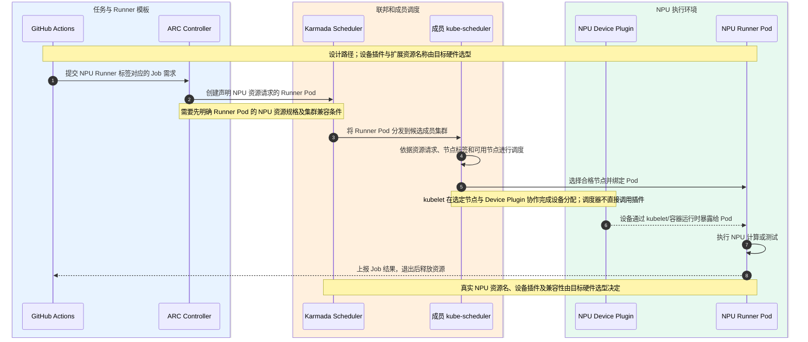

#### 5.6.4.2 UC-13 NPU 资源不足——异常运行时序

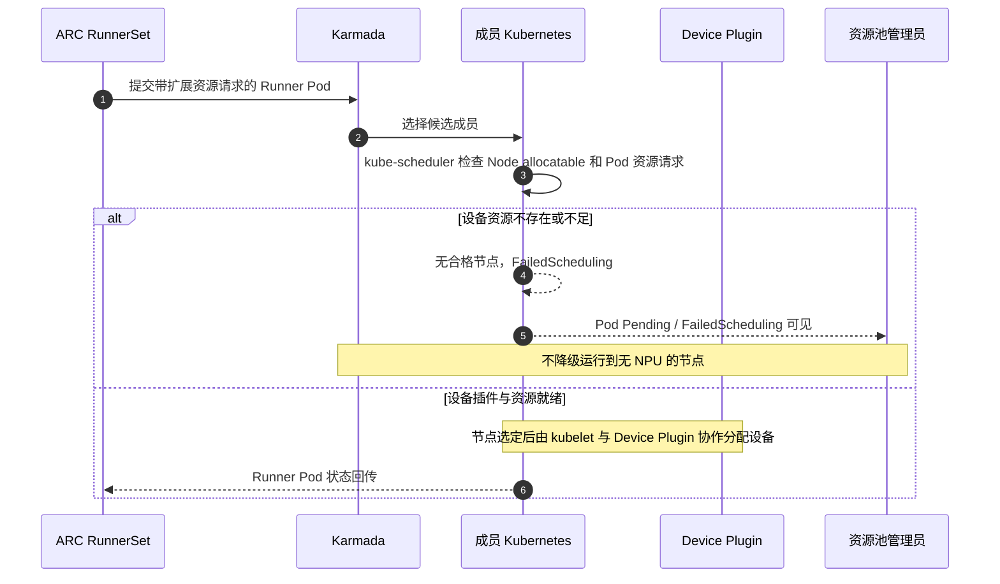

### 5.6.5 用户接口设计

通过独立 `runs-on` 名称选择 NPU 服务；需说明设备与软件栈约束。无新增 UI。

### 5.6.6 实现接口设计

#### 5.6.6.1 接口设计

| 交互双方 | 原生接口或资源 | 输入、操作与输出 | 权限与前置条件 | 异常处理与限制 | 依据及规格 |
|---|---|---|---|---|---|
| 工作流使用者与 NPU Runner 服务 | GitHub Actions `runs-on` | 开发者必须选择明确标注 NPU 能力的 Runner 服务名称。 | 目标仓库必须获得相应服务的使用授权。 | 没有匹配的服务时，按 GitHub 队列机制显示状态；不得改选普通 CPU Runner。 | ARC-1；SP-08 |
| Runner Pod 与成员 Kubernetes | `Pod.spec.containers[].resources` | Pod 必须声明实际设备插件提供的扩展资源名称和数量，并配置必要的节点约束。 | 成员必须安装与所选设备相符的插件、驱动和运行时。 | 资源不足时保持 Pending 并记录调度原因，不得删除 NPU 请求。 | K8S-3；SP-08 |
| Karmada 传播策略与成员候选集 | `PropagationPolicy.spec.placement` | 传播策略必须把 NPU Runner Pod 分发到满足设备与隔离条件的成员。 | 平台必须提供正确的成员标签及资源条件。 | 无合格成员时保留不可调度原因，不得分发到不兼容集群。 | KAR-1；SP-02、SP-08 |

**开发交付边界**：开发人员在 Runner Pod 模板及传播策略中配置扩展资源请求和目标成员条件；具体值必须来源于选定的设备插件和设备兼容清单。

### 5.6.9 DFX分析

**功能安全与性能约束**：目标 NPU 的驱动、资源隔离、并发容量和租户权限应由设备管理员提供。没有真实负载指标时，不能写入性能改善百分比或设备共享保证。

**可靠性故障分析（FMEA）**

| 编号 | 失效原因 | 业务或系统影响 | 检测方法 | 处理与恢复要求 | 负责方 |
|---|---|---|---|---|---|
| F06-01 | Runner 请求的资源名称与插件发布的名称不同。 | Runner Pod 无法匹配需要的 NPU 资源。 | 比较 Pod 资源请求与 Node `status.allocatable`。 | 资源池维护者应按插件正式资源名修正服务模板。 | 设备与平台维护者 |
| F06-02 | 设备驱动、固件或容器运行时不兼容。 | Runner 容器启动失败，或者 NPU 作业执行失败。 | 检查节点事件、容器退出原因及设备运行环境版本。 | 设备维护者按厂商兼容资料调整镜像、驱动及运行时版本。 | 设备与运维维护者 |
| F06-03 | NPU 设备资源耗尽或候选成员不可达。 | Pod 不能调度，GitHub Job 需要等待可用 Runner。 | 检查 Karmada 目标成员、Node allocatable 与 `FailedScheduling` 事件。 | 平台必须报告资源不足并维持 NPU 约束，不能改用普通 CPU 节点。 | 调度与资源池维护者 |

**T6 风险—措施—验证追踪**（关联：扩展候选：非本期正式 SR；SP-08；延续上方 FMEA 编号，不替代已有故障表）

| FMEA | 失效模式 | 影响 | 风险 | 设计措施及对应约束 | 设计验证准则 | 剩余风险 |
|---|---|---|---|---|---|---|
| F06-01 | 扩展资源名或设备数量配置错误 | NPU Pod 无法调度 | 中 | SP-08 使用 Device Plugin 发布的实际资源名/数量与硬件服务目录 | 资源不存在时保持 Pending/FailedScheduling，不删除请求 | 设备插件及资源名称随目标硬件选型变化 |\n| F06-02 | 驱动/Runtime/镜像不兼容 | NPU 任务无法运行或错误结果 | 高 | SP-08 建立架构、驱动、固件、容器 Runtime 兼容约束 | 设计中逐项列出版本兼容条件，不把 Pod Running 当作计算成功 | 需具体设备厂商兼容资料 |\n| F06-03 | NPU 容量耗尽/拓扑不满足 | 持续排队或 Pending | 高 | PL-04/05 不拼接多节点空闲资源，不将单成员候选等同真实可调度 | 检查 Node allocatable、资源请求、拓扑及 FailedScheduling；不得回退 CPU | 容量公平与预留功能不在当前原生方案保证范围 |

**运行诊断与敏感信息处理**：平台应保留 Node allocatable、Runner Pod 的资源请求、成员调度结果和 FailedScheduling 事件。设备异常时，不得通过删除 NPU 请求使错误任务运行在 CPU 节点。

### 5.6.10 T5：各功能端到端时序及接口契约复核

本节统一明确 F-01～F-06 的**输入、输出、前置条件、异常与幂等边界**。本节是现有功能设计的补充约束，不新增控制器、REST API 或 Swagger Endpoint。上游 ARC/Karmada/Kubernetes 的 API 定义优先于设计示意图。既有 US-01～US-08 的箭头表示业务协作关系；涉及实际对象创建顺序时，以目标版本控制器实现为准，不能把“ARC 创建 Pod/Secret”理解为 Listener 直接调用 Pod API。

| 功能 / 场景 | 前置条件与输入 | 实现机制与输出 | 异常、并发与幂等边界 |
|---|---|---|---|
| F-01 统一 Runner 服务；UC-01/02 | GitHub 仓库/组织授权；workflow `runs-on` 与 `AutoscalingRunnerSet.spec.runnerScaleSetName` 匹配；Scale Set、凭证与 Listener 可用 | GitHub 匹配 Job，Listener 接收需求，ARC 调谐期望 Runner；输出服务匹配及需求状态 | 未匹配/未授权时按 GitHub 原生队列与报错处理；不得自动改写标签或跨授权服务降级；重试提交工作流不属于集成层能力 |
| F-02 按需供给与回收；UC-03/04 | Listener 收到 GitHub 的 Job Available 信息；ERS、ER、JIT 和 Controller 权限满足 ARC 版本要求 | Listener 经 K8s API 更新 ERS；ARC 的 ER/Pod/JIT 依版本原生机制调谐；Job 结束后的删除由 ARC/Karmada 分别完成 | 创建失败、Pod Failed、注册失败和删除滞后分开记录；重复 Watch 不能自行生成额外 Job；删除 API 成功不等于成员清理完成 |
| F-03 联邦放置及依赖；UC-05/06/10 | Pod 被精确的 PropagationPolicy 选择、成员获得授权；Pod.spec 引用 JIT Secret | Karmada Detector/Scheduler/Binding/Work 定位目标成员并传播；成员 kube-scheduler 放置节点；输出成员关联、Pod 和依赖传播状态 | 无合格成员、成员失联、Secret 晚到时保留调度/挂载错误；不得扩张授权成员、修改设备请求或重派 GitHub Job |
| F-04 Listener 跨控制面认证；UC-08/11 | CA/SAN、有效 Token、受限 RBAC、正确 Karmada API endpoint | Listener 通过认证和授权后对目标 ERS/ER 执行所需 API 操作；输出 API 返回值与非敏感审计记录 | DNS/TCP、TLS、401、403、资源版本冲突分别处理；仅对授权资源重新读取并重试；轮换必须核实新凭证加载与旧身份失效 |
| F-05 状态反馈；UC-09/12 | 控制面 Pod 与当前 Binding/Work 可关联；成员 Pod 身份及状态可信 | Karmada 汇总成员 `Pod.status`；ARC 读取必要 `conditions`、`containerStatuses`；输出控制面可见状态 | 当前 Lua 只支持唯一可信状态来源；多来源/过期状态不能取首个非空；重复和乱序事件按 UID/目标 Cluster 核对，不伪造 Ready |
| F-06 NPU 扩展；UC-07/13 | **非本期正式 SR**；选定设备插件发布的扩展资源名、数量、成员/节点约束及兼容环境 | ARC Runner Pod 模板携带扩展资源请求；Karmada 选成员，成员 kube-scheduler/kubelet/设备插件分配资源；输出 Pod 调度状态 | 设备不足或插件不可用时保持 Pending/异常；不得将单节点所需 NPU 跨成员拼接、移除资源请求或自动降级 CPU |

**接口调用语义与真实上游分工（T5 纠偏）**：

1. `GitHub Job Available → Listener → EphemeralRunnerSet` 是 ARC 的需求扩缩链路；`EphemeralRunnerSet → EphemeralRunner Controller → JIT configuration/Runner Pod` 才是细化后的动态对象管理链路。F-01/02 现有图的 `C→K: 创建 EphemeralRunner 与 Runner Pod` 仅为跨子系统简写，**不是一次原子 API 调用**，并不保证两个对象同时存在。
2. `Karmada Policy` 为声明式配置，`Detector/Scheduler/Binding/Work` 是控制器协调的资源与状态；F-03 图中 `API→Policy`、`Binding→Member` 为说明性箭头，不代表 Policy/Binding 对象主动发起网络调用。成员实际资源分发与状态回传由 Karmada 相关控制器协调。
3. `Pod.status` 由成员 Kubernetes/kubelet 更新，Karmada 对应控制器获取并聚合。F-05 图的 `kubelet→Execution Controller` 是数据来源关系，不代表 kubelet 直接调用 Karmada Execution Controller。状态聚合输入以目标版本 `ResourceInterpreterCustomization` API 为准。
4. NPU 设备插件通过 kubelet 的 Device Plugin API 注册并参与设备分配，**不是 kube-scheduler 直接调用 Device Plugin**。F-06 原 UC-07/UC-13 图中的 `kube-scheduler→Device Plugin` 只表示最终依赖，应按 kube-scheduler 选择节点、kubelet 经插件完成设备分配的原生交互理解。
5. `Runner/Job → GitHub` 的执行状态/结果与 `Pod.status → Karmada → ARC` 的生命周期状态是两条独立链路。Secret 挂载成功、Pod Ready 或 Work 分发完成都不能替代 GitHub 的 Job 结果。
6. `ResourceVersion` 冲突只在同一 Kubernetes API 对象上下文中按读后重试处理；不能以跨集群 resourceVersion、同名 Pod 或观察时间判定全局唯一执行。不存在跨 GitHub、ARC、Karmada 的原子提交或 exactly-once Job 保证。

**接口设计出口**：现有 5.1.6～5.6.6 的原生 API/资源表分别承载各功能契约；第 4 章 SP-01～SP-09 规定跨功能约束；T2 的身份关联与 T3 状态机规定跨域前后条件。对尚未锁定的上游版本字段（尤其状态解释器多来源字段和 NPU 插件兼容性）保留显式待核对项，不编造 Swagger 字段、响应码或自动恢复行为。

**依据**：[GitHub ARC 官方工作原理](https://docs.github.com/en/actions/concepts/runners/actions-runner-controller)、[Karmada 依赖传播](https://karmada.io/docs/userguide/scheduling/propagate-dependencies/)、[Kubernetes Device Plugins](https://kubernetes.io/docs/concepts/extend-kubernetes/compute-storage-net/device-plugins/)。

## 5.7 功能追踪与开发接口清单

| SR | 功能 | 关联规格 | 运行视图 | 开发实现入口 |
|---|---|---|---|---|
| FT-01：SR-01-01 | F-01 | SP-01 | 5.1.4.1（UC-02 为异常场景） | `04-autoscalingrunnerset.yaml`、GitHub Workflow |
| FT-01/FT-04：SR-02-01、SR-02-02 | F-02 | SP-01、SP-07 | 5.2.4.1 / 5.2.4.2 | 官方 ARC、RunnerSet、对象生命周期契约 |
| FT-02/FT-03：SR-03-01、SR-03-02 | F-03 | SP-02、SP-03、SP-04 | 5.3.4.1 / 5.3.4.2 / 5.3.4.3 | `02-propagation-policies.yaml`、关联资源 |
| FT-03：SR-04-01 | F-04 | SP-04、SP-05 | 5.4.4.1 | `03-rbac.yaml`、`04-autoscalingrunnerset.yaml` Listener Template |
| FT-03：SR-05-01 | F-05 | SP-06 | 5.5.4.1 | `01-karmada-interpreter.yaml` |
| **扩展候选：原 SR-06-01，当前非正式 SR** | F-06 | SP-02、SP-08 | 5.6.4.1 / 5.6.4.2 | 尚需设备选型；仓库未配置 NPU 扩展资源 |

### 5.7.1 非功能需求与详细设计追踪

| 非功能需求 | 功能域规格 | 主要实现设计章节 |
|---|---|---|
| SR-NF-01 身份与权限 | SP-01、SP-05 | 5.1.9、5.4.6、5.4.9 |
| SR-NF-02 凭证保护 | SP-04、SP-09 | 5.2.9、5.3.9、5.4.9 |
| SR-NF-03 成员故障隔离 | SP-02、SP-07 | 5.2.9、5.3.4.3、5.3.9 |
| SR-NF-04 可服务性 | SP-09 | 5.1～5.6 各功能的 DFX |
| SR-NF-05 性能与容量 | SP-01、SP-09 | 5.1.9、5.2.9；量化参数 P-SR-01、P-SR-02 |
| SR-NF-06 成本与资源利用 | SP-01、SP-07 | 5.2.3、5.2.9；量化参数 P-SR-04 |
| SR-NF-08 策略可维护性 | SP-01、SP-02 | 4.2、4.3、5.3.6 |

本表只将与 FT-01～FT-04 相关的正式 SR 关联至详细设计。第 4、5 章仍可保存 ARC/Karmada 的必要技术契约和 NPU 扩展参考，但不把所有实现机制或通用 DFX 项目升级为正式系统需求。量化参数未获得业务批准时，对应指标保持待定。

**统一资料来源及版本边界**：本文件 3.7 给出 ARC/GitHub Actions、Karmada、Kubernetes 官方文档索引；本仓库现有 Manifest 用于定位配置差异；任何仅有内部运行记录支持、而无上游接口规范支持的声明都应标明为集成设计假设。缺少 PoC 不构成功能设计缺口，但 **SR/接口/异常/DFX 未定义**属于设计缺口。

**实施前需选择的参数（P）**：GitHub 组织/仓库与权限、目标版本和镜像 digest、联邦控制面 API/DNS/CA、凭证发行及轮换、成员与资源标签、NPU 型号与扩展资源名、隔离与容量策略、性能/可用性 SLO。若有正式输入来源，则填写批准值；如果尚无，不得硬编码临时 Kind IP 或杜撰业务 SLA。
