# 昇腾CI 联邦集群功能设计文档

> 文档标识：ASCEND-CI-FEDERATED-CLUSTER-FUNCTIONAL-DESIGN
> 状态：统一设计正文（基于现有资料整理；新增决定与待选参数显式标记）
> 目录依据：用户提供的功能域设计模板：第 1 章保留已有内容；第 2 章概述；第 3 章总体方案；第 4 章领域规格；第 5 章功能实现
> **设计证明依据：** 官方 ARC/GitHub Actions、Karmada、Kubernetes 技术文档、当前仓库的 Manifest 与清晰的项目设计决策。**文档完成不要求 PoC、Kind、真实 Runner 或硬件实验**。

**阅读原则**：**U** = 上游文档明确支持的机制；**D** = 昇腾CI针对组件组合定义的集成设计决策；**P** = 实施/厂商选型待定的参数。当前仓库 Manifest 是参考配置，不等于上游产品承诺；“设计完成”也不等于“已部署运行”。

**设计基线与证据优先级**：本文件是 ARC + Karmada 联邦 Runner 执行功能域的**功能设计**，不是未来昇腾CI整体架构说明书，也不是部署/交付计划。设计首先核对仓库 `manifests/01-karmada-interpreter.yaml`、`02-propagation-policies.yaml`、`03-rbac.yaml`、`04-autoscalingrunnerset.yaml` 的**当前配置事实**；上游功能语义以与目标版本匹配的官方文档、CRD/API 契约为依据；组合行为如无法从两者推出，须作为 **D 类待验证集成约束** 而非已经获得保证的能力。目标设计与 Manifest 不同时明确标注差距，不通过修改 Manifest、编写部署命令或要求 PoC 来宣称闭环。

**设计层次**：第 2 章定义功能需求及用例，第 3 章定义系统总体方案与职责，第 4 章定义跨功能域约束，第 5 章定义功能单元的交互、接口与 DFX。时序图表达设计交互而非实测调用轨迹；不凭抽象交互图推断上游控制器拥有某个 API 或自动恢复能力。

# 1 功能域背景与目的

## 1.1 目标与职责

将项目独占集群纳入 Karmada，统一管理 Runner 供给、分发和回收。

| 职责 | 实现主体 | 边界 |
|---|---|---|
| 任务匹配与 Runner 生命周期 | ARC Listener、Controller、Scale Set | GitHub Actions 提供队列；ARC 调整 Runner 数量 |
| 资源对象传播与成员选择 | Karmada Policy、Detector、Binding/Execution Controller；目标 Dispatcher | Dispatcher 选择成员并决定放行时机，Karmada 分发；不承担 NPU Pod 节点级调度 |
| 资源实际执行 | 成员 Kubernetes、kube-scheduler、kubelet | 创建 Runner Pod；可在 NPU 节点执行有设备请求的工作负载 |
| 状态与凭证适配 | ResourceInterpreterCustomization、Listener Token / RBAC、propagateDeps | 保留 ARC 所需的 Pod 状态和 JIT Secret |
| 设计契约与治理 | 本子系统接口适配、策略、身份与状态约束 | 由本项目负责架构决策；不代替上游内部实现 |

## 1.2 边界

**边界内（设计协作范围）：** 统一 Runner 入口、跨成员资源调度、容量不足时的等待与诊断、Runner 供给和回收；ARC Controller/Listener/Scale Set、Karmada 控制面及成员 Kubernetes 为复用组件。本设计负责成员候选、资源请求、状态回传及必要的跨控制面访问契约，不重写上游排队和节点调度算法。NPU 设备规格仅作为调度约束扩展。

**边界外：** GitHub Actions 队列算法及 Job 结果管理、业务工作负载、镜像仓库、现有监控系统和工作负载执行环境的安全选型。

图示为参考拓扑：Controller 独立部署，Listener 定向成员，Runner 联邦分发。组件位置可调整；跨控制面访问仍需独立凭证和网络配置。

## 1.3 目标

**现状：** 集群按项目独占，空闲容量无法共享，任务排队。

**目标：** ARC 统一供给 Runner，Dispatcher 在 Karmada 控制面按授权、容量及 FIFO/Reserve Node/Backfill 决定何时放行并选择成员，成员 Kubernetes 完成 NPU 节点调度。资源共享减少因集群割裂造成的等待；公平策略、时间窗口和目标阈值仍需批准。

**边界：** 图为目标示意，不承诺利用率或排队收益；容量、兼容性和 NPU 驱动由部署提供。

## 1.4 整体架构

包含 ARC、Karmada、成员 Kubernetes 和 Runner。灰框为边界；外部接口如下。

| 外部子系统 | 方向 | 交互内容 |
|---|---|---|
| GitHub Actions | 输入 | 工作流任务、`runs-on` 标签、Runner 需求 |
| GitHub Actions | 输出 | Runner 注册、Job 执行状态和结果 |
| 配置与部署系统 | 输入 | Scale Set、PropagationPolicy、RBAC、组件版本 |
| 镜像仓库 | 输入 | Runner 镜像、Action 镜像 |
| 监控与审计系统 | 输出 | 运行日志、Kubernetes 事件、验证记录 |

**范围：** 一套 ARC、一套 Karmada、两个成员仅为示例；不限定地域或 Kind。NPU 插件按设备选型提供，不依赖 `karmada-search`。

## 1.5 关键约束

- Runner 工作流使用 `runs-on: karmada-runner`。标签对应一个已注册 Scale Set。
- Scale Set 版本标签与选定的官方 ARC Controller 版本保持一致；仓库当前 0.15.0 为配置示例。
- Listener 运行在成员集群，通过独立 Token、CA 和 DNS 配置访问 Karmada API。
- Runner Pod 的 JIT Secret 必须传播至同一执行成员；传播过程允许短暂异步等待。
- Karmada Pod 状态解释器保留 `containerStatuses[].name` 和 `conditions`。
- `Divided / Weighted` 针对单个资源对象执行。多个独立 Pod 不保证逐轮均匀分布。
- 成员 Kubernetes 负责节点调度。NPU 任务需额外核实节点标签、设备插件、资源请求和工作负载运行环境。

# 2 功能域概述

## 2.1 定位、使用者和边界

开发者只选择 Runner 服务；ARC 按需供给，Karmada 选择执行成员。**GitHub 负责 Job 排队，ARC 负责 Runner 供给，Karmada 负责成员放置，成员 kube-scheduler 负责节点资源不足时的 Pending。** 本方案通过跨成员资源共享与放置减少不必要的等待，不实现新的 GitHub 队列或 FIFO 算法。

**参与者**：开发者、平台工程师、资源池管理员、安全管理员、运维人员。**外部依赖**：GitHub Actions、镜像仓库、密钥服务、部署与观测平台。

## 2.2 核心特性

目标：**统一 Runner 服务，跨成员共享资源；执行成员由平台选定。**

**FT-01 统一入口与资源共享。** 开发者只选 Runner 服务，不指定成员。作业可使用授权成员的空闲容量。

**FT-02 可控成员放置。** 平台配置授权候选成员，Karmada 选择执行成员，成员 Kubernetes 选择节点。成员或节点资源不足时保留未就绪及等待原因；工作流标签不变。

**FT-03 跨控制面执行。** 保障 Listener 访问、临时凭证下发和状态反馈；未就绪 Runner 不得接收作业。

**FT-04 临时资源回收。** 按作业需求创建 Runner，作业结束后回收临时资源。

**执行链路：统一入口 → 成员选择 → 跨集群执行与状态反馈 → 资源回收。**

NPU 专项适配为后续扩展，不单列核心特性。

## 2.3 需求与用例追踪

依据第 1.3 节的问题和第 3.2 节的选型提取需求。下列编号仅为本设计的内部追踪标识，**不是业务方已批准的外部需求编号**；未提供正式需求基线的部分不得声称已完成需求验收。

| 编号 | 定义与粒度 | 本文用法 |
|---|---|---|
| **IR** | 功能级需求：描述平台必须提供的独立业务能力 | IR-01～IR-04 为能力需求；与 F 功能实现单元可多对多关联，不把上游组件直接当作 IR |
| **FT** | 功能域特性：对外可感知的能力归类 | FT-01～FT-04 组织 IR 和 SR，不替代需求验收 |
| **SR** | 场景级需求：描述某一条件下必须实现的行为与验收依据 | SR-xx-xx 和 SR-NF-xx；一个 IR 可关联多个 SR |
| **UC** | 用例：具有参与者、前置条件、主/异常路径的行为场景 | UC-01～UC-13；一个 SR 可由多个 UC 展示 |
| **F** | 功能实现单元：第 5 章可独立评审的设计职责 | F-01～F-05 为本期核心设计单元；F-06 为扩展，不等同正式 IR |
| **AR** | 迭代实现/合入单元：由已批准 SR 分解得到的最小实现变更 | 当前未分配 AR 编号、未定义实现批次；不虚构 AR 或将上游资源对象称为 AR |
| **SP** | 跨功能域设计规格：多个 F 共同遵守的行为/接口约束 | SP-01～SP-09 在第 4 章定义，供第 5 章引用 |

**追踪原则**：IR → SR → UC/F → SP/接口/DFX；在进入迭代实施时再建立 SR → AR → 代码/合入单元映射。本文件只完成设计追踪，不作交付状态声明。

| 需求意图 | 核心场景 | SR | 特性与功能 |
|---|---|---|---|
| IR-01 跨成员资源共享 | UC-01 统一提交；UC-03 按需供给 | SR-01-01、SR-02-01 | FT-01；F-01、F-02 |
| IR-02 可控成员放置 | UC-05 成员选择；UC-10 无合格成员 | SR-03-01 | FT-02；F-03 |
| IR-03 跨控制面执行 | UC-06 凭证未就绪；UC-08 访问控制；UC-09 状态反馈 | SR-03-02、SR-04-01、SR-05-01 | FT-03；F-03～F-05 |
| IR-04 临时资源回收 | UC-04 作业结束；UC-12 状态或清理异常 | SR-02-02 | FT-04；F-02、F-03、F-05 |

**用例概览：**

> 图示角色与用例关系，不代表执行顺序。NPU 属后续扩展；Pod、Secret 与状态处理见第 5 章。

## 2.4 需求 SR

只规定联邦调度的**场景、行为、验收条件**。实现字段与控制器交互见第 4、5 章。中文表述借鉴 [ASD-STE100](https://www.asd-ste100.org/about_STE.html) 的术语一致和避免歧义原则，不声称符合该英语标准。

### 2.4.1 功能需求

| SR | 场景 | 必须满足的行为 | 判定方法 | 来源与现状 |
|---|---|---|---|---|
| **SR-01-01** | 开发者通过统一 Runner 服务提交作业。 | 作业可在授权成员执行，无需指定集群。 | 工作流不含成员信息；作业在允许的成员运行。 | FT-01；统一标签已配置 |
| **SR-02-01** | 有待执行作业，且未达容量上限。 | 按需创建临时 Runner，在选定成员执行。 | Runner 数量随需求变化；执行成员符合策略。 | FT-01/FT-04；复用 ARC |
| **SR-03-01** | Runner 服务可使用多个成员。 | 按平台策略选择成员，不得使用被禁止的成员；无需修改工作流。 | 变更候选集后，新 Runner 只在允许的成员运行。 | FT-02；已配置成员范围，未实现复杂容量调度 |
| **SR-03-02** | 执行成员已选定，注册信息尚未就绪。 | 注册信息可用后才能将 Runner 判为可执行。 | 凭证缺失时保持未就绪或报告启动错误。 | FT-03；依赖上游传播 |
| **SR-04-01** | 成员中的 Listener 访问统一控制面。 | 凭有效身份处理所属任务；连接或授权失败不得报成功。 | 可正常更新所属 Runner 服务；错误类别可区分。 | FT-03；已配置 Token/CA/RBAC，轮换未实现 |
| **SR-05-01** | 成员 Runner 启动、就绪或异常。 | 将真实状态反馈到管理面；未就绪不得判为就绪。 | 管理面与成员状态一致，保留关键状态字段。 | FT-03；单成员状态解释 |
| **SR-02-02** | 作业结束。 | 回收临时执行资源；失败时保留残留对象及错误。 | 资源进入回收流程；可定位异常残留。 | FT-04；复用 ARC/Karmada |

原 SR-01-02 属 GitHub 原生匹配异常；原 SR-06-01 属 NPU 扩展设计，均不列为当前核心 SR。

### 2.4.2 非功能需求

| SR | 属性 | 要求 | 判定方法 | 实现边界 |
|---|---|---|---|---|
| **SR-NF-01** | 跨控制面访问安全 | 拒绝未授权访问；不得关闭 TLS 校验。 | 验证授权、未授权身份及证书校验。 | 受限 RBAC/CA 已配置；Controller 权限待收敛 |
| **SR-NF-02** | 跨成员凭证隔离 | 长期 GitHub 管理凭证只提供给实际消费者；临时凭证只供执行成员使用。 | 核对凭证消费者和传播范围。 | **目标未满足**：当前向两个成员分发管理凭证 |
| **SR-NF-03** | 成员故障边界 | 不可用成员的未就绪 Runner 不得作为可执行资源；不承诺运行中 Job 无损迁移。 | 检查成员失联后的 Runner 状态。 | 尚无自动故障迁移依据 |
| **SR-NF-04** | 跨集群问题定位 | 可关联 Job、Runner、执行成员及传播、注册、状态异常。 | 根据 Job 标识查找成员与故障阶段。 | 已有检查脚本，暂无统一查询入口 |
| **SR-NF-05** | 容量与排队性能 | 不得突破 Runner 数量上限；区分 GitHub Job 等待、Dispatcher Hold、Runner 供给、成员放置和 NPU 节点等待。Reserve/Backfill 不得破坏已保护的队首容量。 | 对照各阶段权威事件、容量账本、队首保护和回填行为；缺失样本不得填零。 | 当前无 Dispatcher；公平与等待目标待批准 |
| **SR-NF-06** | 资源使用与成本 | 无待执行作业且允许零空闲时，应能回收 Runner；成员无需各部署 ARC Controller。 | 检查缩至零和成员部署方式。 | 能力依赖配置和上游；节约目标待定 |
| **SR-NF-08** | 放置策略可维护性 | 可调整候选成员，不要求开发者修改 Runner 服务名称。 | 修改并恢复策略，核对后续执行成员。 | 策略可配置，未开发管理 UI |

### 2.4.3 待定指标

| 参数 | 指标 | 待确认内容 | 状态 |
|---|---|---|---|
| P-SR-01 | Runner 准备耗时 | 起止事件、窗口、分位数、阈值 | 未确定 |
| P-SR-02 | Job 排队与联邦放置等待 | GitHub queued→started 与 Dispatcher Binding hold→release 分开；批准样本、分位数、阈值、租户公平范围与 PR/nightly 优先级时段 | 未批准 |
| P-SR-03 | 成员故障后的新作业执行 | 备用成员条件、故障检测、恢复目标；不含运行中 Job 迁移 | 未确定 |
| P-SR-04 | 资源利用率与成本 | 负载、共享前基线、计量方法、目标值 | 未确定 |

未批准的指标不得作为验收目标；不承诺未经验证的收益。

### 2.4.4 特性与设计追踪

| 特性 | 功能 SR | 非功能 SR | 设计单元 |
|---|---|---|---|
| FT-01 统一入口与共享 | SR-01-01、SR-02-01 | SR-NF-05、SR-NF-06 | F-01～F-03 |
| FT-02 可控成员放置 | SR-03-01 | SR-NF-03、SR-NF-08 | F-03 |
| FT-03 跨控制面执行 | SR-03-02、SR-04-01、SR-05-01 | SR-NF-01、SR-NF-02、SR-NF-04 | F-03～F-05 |
| FT-04 临时资源回收 | SR-02-02 | SR-NF-04、SR-NF-06 | F-02、F-03、F-05 |

**范围**：Manifest 证明现有配置；上游定义组件行为；未实现的目标要求仍须实施，不能标为已交付。

## 2.5 非目标

**阶段边界**：本文件只评审功能设计的正确性、完整性与可追踪性；不要求代码开发、部署脚本、硬件实验、验收测试执行或运维交付报告。没有 PoC 本身不构成设计缺陷，缺少必要的接口语义、状态约束或 DFX 设计则仍属于文档缺陷。

- 不重建 GitHub Job 匹配、队列排序和结果存储；UC-02 仍保留异常说明。
- 不涉及 Runner 沙箱、虚拟机、工作负载强隔离或云平台安全选型；必要的联邦 API 鉴权、凭证传播与放置权限仍属集成契约。
- ARC/Karmada 内部实现见第 4、5 章，不另列核心 SR。
- NPU 设备适配保留为 F-06/US-08 扩展，当前未实现。
- 不承诺运行中 Job 无损迁移或独立 Runner 逐轮均衡分配。
- 企业级可用性、通用升级、成本预算和监控产品选型不另列核心 SR。
- 只修订设计，不变更 Manifest；文档完成不要求 PoC。

# 3 功能域总体方案

## 3.1 设计原则

**职责及事实来源约束**：GitHub Actions 是 Job 匹配、队列与结果的权威系统；ARC 是 Runner Scale Set、EphemeralRunner 与 Runner 生命周期的管理主体；Karmada 是成员选择、对象传播与联邦对象状态协调主体；成员 Kubernetes/kubelet 是节点放置、Pod 实际运行状态与设备分配事实的来源。各组件的 CRD、对象所有权与事件先后以目标版本实际契约为准；本项目只规定集成边界，不重新实现 GitHub 队列、ARC 生命周期、Karmada Scheduler 或 kube-scheduler。跨系统出现状态分歧时不得用 Pod Ready 推导 Job 成功，具体冲突判定与恢复规则属于后续 T2/T3 设计任务。

1. **职责分离**：GitHub 负责队列，ARC 负责 Runner 期望量与短生命周期，Karmada 负责成员选择和对象传播，成员 Kubernetes 负责节点调度与设备资源分配。
2. **控制面与执行面分离**：Runner 管理请求汇入统一 API；Listener 和 Runner 可以部署于执行域，但其权限、连接地址和证书与目标 API 一致。
3. **最小权限与最小传播**：GitHub 主凭证以管理域为中心，JIT 凭证按具体引用传播至执行成员；Runner 默认不获取 Kubernetes 管控 API Token。
4. **最终一致与无重放假设**：跨组件 Pod/Secret/Binding 传播与清理都是异步流程；没有上游证明不得承诺原子传播、无损迁移或 Job exactly-once 重试。
5. **上游优先**：默认复用 ARC、Karmada、Kubernetes 的正式 API/控制器；本功能域仅增加集成策略、必要权限、状态解释及配置，不重复设计上游模块。

## 3.2 备选方案与最终选型

| 选型 | 方案结构 | 主要优点 | 主要限制 |
|---|---|---|---|
| A：各成员独立 ARC | 各集群部署 Controller 和 Scale Set；同名 Scale Set 分属不同 Runner Group。 | 独立管理和故障隔离。 | **跨 Scale Set 的 Job 分配由 GitHub 决定，平台无法定制调度策略**；同名 Scale Set 之间存在不可配置的 `assignment race`，无法按成员容量、NPU、地域或优先级决定分配。 |
| B：ARC + Liqo | ARC 结合 Liqo 跨集群资源和网络能力。 | 复用资源与网络抽象。 | 需额外设计跨集群网络和资源映射；非当前实现。 |
| **C：ARC + Karmada（选定）** | 统一 Scale Set 接收需求；ARC 供给 Runner，Karmada 分发 Pod。 | **平台控制候选成员和放置约束。** | 需适配身份、JIT Secret、Pod 状态及回收；不保证多个独立 Pod 按固定比例分配。 |

### 3.2.1 调度职责

作业分配与 Runner Pod 放置是两级决策：

1. **GitHub：** 按 `runs-on`、Runner Group 和注册信息分配 Job。方案 A 的跨 Scale Set 选择不可定制。
2. **ARC：** Listener 接收任务需求，调整 `EphemeralRunnerSet` 期望数量；`minRunners` / `maxRunners` 控制容量，**不决定跨 Scale Set 的任务分配**。
3. **Karmada：** 按 `PropagationPolicy` 选择 Runner Pod 的执行成员；成员 Kubernetes 选择节点。平台控制 **Pod 放置**，不控制 GitHub 的 Job 分配。

**结论（D）：选 C。** Karmada 策略由平台控制成员放置；方案 A 的跨 Scale Set Job 分配由 GitHub 决定，平台不可定制。

**上游依据**：

- [GitHub 官方：部署 Runner Scale Sets — High availability and automatic failover](https://docs.github.com/en/actions/how-tos/manage-runners/use-actions-runner-controller/deploy-runner-scale-sets#high-availability-and-automatic-failover)：说明多个独立集群可以在不同 Runner Group 使用同名 Scale Set；多个 Scale Set 同时在线时，分配可能由竞争决定，且不能配置作业分配算法。
- [GitHub 官方：ARC 工作原理](https://docs.github.com/en/actions/concepts/runners/actions-runner-controller)：说明 GitHub Actions 服务进行作业匹配，ARC Listener 接收 `Job Available` 消息后按需求调整 Runner 数量。
- [ARC 源码：`cmd/ghalistener/scaler/scaler.go`](https://github.com/actions/actions-runner-controller/blob/master/cmd/ghalistener/scaler/scaler.go)：`Scale` 处理收到的作业消息与 `TotalAssignedJobs`，后续更新当前 `EphemeralRunnerSet` 的目标 Runner 数量。这里没有跨独立 Scale Set 的成员选择算法。
- [Karmada 官方：PropagationPolicy](https://karmada.io/docs/next/userguide/scheduling/propagation-policy/)：说明通过传播策略选择成员集群。本方案根据这些机制制定跨集群 Runner Pod 放置规则，**不把 ARC 与 Karmada 的组合描述成上游已认证的整体方案**。

### 3.2.2 联邦放置能力与容量保证的边界

**设计结论：** 当前配置是「策略限定成员 → Karmada 选择成员 → 成员 kube-scheduler 选择节点」；目标设计是「Karmada 提供联邦事实/资源分发 → Dispatcher 排队并选择成员 → 成员 kube-scheduler/Volcano 选择实际 NPU 节点」。这能配置**允许放置的成员范围**，但不等于对独立 Runner Pod 提供跨成员最优选择、NPU 拓扑可用性判断、容量预留或排队公平保证。GitHub 的 Job 分配与 Karmada 的 Pod 放置是不同决策，不能相互替代。

| 方案/机制 | 可直接依据的保证 | 无法直接推出的保证 | 本方案处理 |
|---|---|---|---|
| 各成员独立 ARC | GitHub 原生 Job 匹配与各成员独立生命周期 | 平台控制跨 Scale Set 的 Job 分配 | 不采用作为统一放置方案 |
| ARC + Liqo | Liqo 提供跨集群资源与网络抽象能力，具体能力受选用版本约束 | 默认提供与本项目相同的放置策略及资源公平性 | 保留为替代方案，不引入 Liqo 假设 |
| **ARC + Karmada（选定）** | PropagationPolicy 候选成员过滤、Karmada 资源传播、成员原生 Pod 调度 | 独立 Pod 逐轮均衡、跨成员实时容量预留、NPU 节点拓扑匹配、Job exactly-once | 通过 SP-02/03 定义约束；超出上游保证的能力显式保留设计缺口 |
| `Divided / Weighted` | 对**具有副本语义**的受支持资源按策略分配副本 | 当前独立 `v1/Pod` 自动获得跨 Pod 加权轮转 | 不把该字段当成独立 Runner Pod 的负载均衡算法 |
| Karmada 资源建模/动态权重 | 对适用资源、支持的调度路径，依据成员资源建模参与副本选择 | 保证设备插件发布的全部 NPU 资源、节点拓扑及瞬时可用容量都被准确建模 | 需核对目标版本和目标工作负载，不在本阶段作保证 |

**可核查的官方依据：** [Karmada PropagationPolicy](https://karmada.io/docs/next/userguide/scheduling/propagation-policy/) 明确 `clusterAffinity` 定义候选集而非确保全部被选；`replicaScheduling` 的分副本语义针对具有副本规格的资源。目标产品版本应固定后再核对 CRD 与调度器实现；`next` 文档仅供理解能力范围。

**设计取舍：** Karmada 负责联邦资源对象和传播；目标 Dispatcher 持有 Runner Binding，负责跨成员队列、容量估计、预留与选择成员。**成员调度器拥有 NPU Pod 的节点 Filter/Score/Bind 权限**。PL-D02 明确双层权威；已绑定 Runner 遵循 PL-D01，不宣称原子资源预约或无损迁移。

## 3.3 端到端实现思路

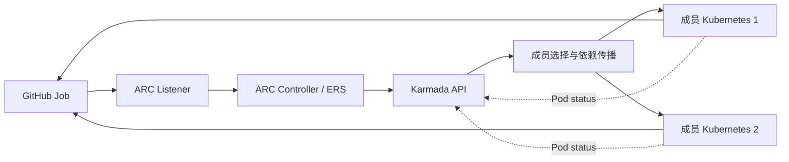

请求：GitHub → Listener → ARC → Karmada → 成员 Runner；反馈：Runner → GitHub，Pod.status → Karmada → ARC。状态与依赖契约见第 4 章。

## 3.4 组件与逻辑架构

### 3.4.1 逻辑架构

**问题：** 项目与集群绑定，空闲容量难共享、任务排队。**方案：** ARC 统一供给，Karmada 分发，成员 Kubernetes 执行。

| 架构构件 | 主要解决的问题 / 架构职责 | 与其他构件的协作关系 |
|---|---|---|
| ARC Listener | **统一任务入口**：让开发者使用同一个 Runner 标签提交任务，不必为不同成员集群选择专用标签。 | 对接 GitHub Actions 的任务需求，与 ARC Controller 协同完成按需 Runner 供给。 |
| ARC Controller | **集中管理执行实例的生命周期**：使 Runner 的创建、扩缩与回收不再由每个执行集群各自管理。 | 承接 Listener 的需求变化，将 Runner 交给 Karmada 跨集群分发，并根据执行状态管理生命周期。 |
| Karmada（复用的联邦子系统） | **打通相互隔离的执行资源池**：将多个成员集群纳入同一分发范围，使一个项目的任务可以使用其他合格成员的执行资源。 | 接收 ARC 产生的 Runner 对象，将其分发至成员 Kubernetes，并把执行状态返回给 ARC；不取代成员的节点级调度。 |
| 成员 Kubernetes 与 Runner Pod | **提供实际、相互隔离的任务执行能力**：让集中管理的 Runner 在选中的成员集群使用当地计算资源执行 GitHub Job。 | 接收 Karmada 下发的 Runner 工作负载，使用成员原生调度与网络执行任务，并向控制面反馈状态。 |
| ARC–Karmada 集成适配（本系统设计） | **消除两套上游系统之间的语义与环境差异**：保障跨控制面访问、临时注册凭证可用、Runner 就绪状态可被正确识别。 | 在 ARC、Karmada 与成员 Kubernetes 之间补齐通信鉴权、依赖传播和状态聚合约束，使上述管理、分发、执行链路闭环。 |

**边界：** GitHub 提供任务；ARC/Karmada/Kubernetes 为复用组件。`karmada-search` 不在范围内，NPU 插件属成员依赖。不承诺均匀分配或固定收益。

部署关系见 3.6；资源、状态与接口契约见 3.5、4.4～4.6 和第 5 章。

### 3.4.2 周边依赖

| 周边元素 | 职责关系 | 进入/输出的实体 | 约束 |
|---|---|---|---|
| GitHub Actions | 外部任务入口与运行结果接收方 | Job 需求、Runner 注册、运行状态 | 入口标签、GitHub 身份与 JIT |
| 镜像仓库 | 提供 Controller/Runner/Action 镜像 | OCI Image | 可信源、平台架构、版本/digest |
| 密钥系统 | 供给和轮换 GitHub 主凭证、控制面身份 | Credential/CA/Token | 不在仓库明文保存、最小授权 |
| 部署与配置管理 | 安装官方组件及本项目 CRD/Policy | Chart/Manifest/配置参数 | 声明式、回滚与版本兼容 |
| 观测/审计系统 | 关联一次 Job 与执行实例 | Job/ER/Pod/Binding/Work 标识、事件与日志 | 不收集 Secret Data |

## 3.5 领域数据模型和归属

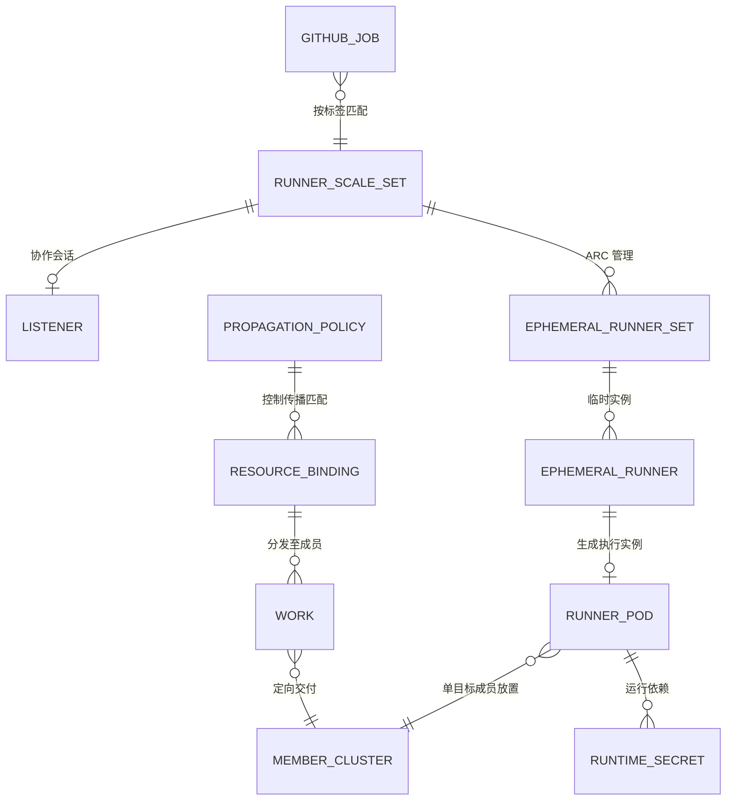

图为**领域概念关系**，不等于原生 Kubernetes OwnerReference；动态资源真实归属由所选 ARC/Karmada 版本定义。以下表格是实现和销毁规格：

| 领域对象 | 权威生产者 | 主要关联/消费者 | 寿命分类 | 处置与销毁要求 |
|---|---|---|---|---|
| GitHub Job | GitHub Actions | 任务来源；不是 Kubernetes API 对象 | 单次/外部保留 | 任务队列、运行状态 |
| AutoscalingRunnerSet | 平台声明；ARC 管理 | Runner 服务及 GitHub 认证入口 | 长期 | ScaleSetName、GitHubConfigSecret、RunnerTemplate |
| AutoscalingListener / Listener Pod | ARC 生成 | 侦听任务需求并调整 ERS | 随 Scale Set | Token、CA、管理控制面 API |
| EphemeralRunnerSet / EphemeralRunner | ARC 生成 | 需求副本/单 Runner 实例生命周期 | 临时 | OwnerReference、状态、Finalizer |
| Runner Pod | ARC 生成 / Karmada 传播 | 成员的实际 Job 执行对象 | 临时 | SA、镜像、JIT Secret 引用、status |
| JIT Secret | ARC 动态生成 | 一次性 Runner 注册凭证 | 临时敏感 | 仅传目标执行成员；作业后回收 |
| 主 GitHub Secret | 平台密钥系统提供 | ARC 管理链路授权 | 受控敏感 | 目标设计不向无消费者成员扩散 |
| PropagationPolicy | 平台声明 / Karmada 消费 | 成员选择、匹配范围、依赖传播 | 长期配置 | ResourceSelectors、Placement、propagateDeps |
| ResourceBinding / Work | Karmada 生成 | 联邦调度与成员期望资源载体 | 随 Pod/策略 | 控制面到执行面的对象关系 |
| Pod.status | 成员 Kubernetes 产生 | 供 ARC 判断 Runner 状态 | 随 Pod | containerStatuses、conditions、Phase |
| MemberCluster / NPU 资源 | Karmada + 成员 K8s / Device Plugin | 集群资格、节点扩展资源 | 长期运行时 | Ready、labels、allocatable、扩展资源 |

**数据分级与销毁（D）**：GitHub PAT/App 凭证、Listener Token、JIT Secret 属敏感数据，禁止在日志、Git、工单附件输出值；运行时对象删除由 ARC/Karmada 所有权规则驱动，审计只保留非敏感 ID/状态。Job 日志、镜像与第三方系统持久数据的保留/销毁服从各自系统策略，**不因 Pod 删除自动消失**。证书/Token 轮换同时考虑控制面存储、成员副本和日志暴露面。销毁保留期/合规等级若需精确数值，由企业数据分类制度提供（P），不虚构默认周期。

### 3.5.1 对象标识、引用关系及权威事实

**三类关系必须区分**：Kubernetes `OwnerReference/Finalizer` 表示原生控制器及删除语义；Pod 的 Secret 引用、Karmada Binding/Work 表示 API 对象之间的引用/传播关系；GitHub Job 与 Runner/Pod 之间的标识映射是用于追踪的业务关联。任何业务关联**均不能代替原生所有权而直接触发级联删除**。第 3.5 节的 ER 图只表达逻辑关系，不代表 CRD 中逐一存在对应的 OwnerReference。

| 对象与事实 | 最小唯一标识/关联依据 | 权威来源及责任 | 生命周期与限制 |
|---|---|---|---|
| GitHub Job | repository、run_id、job_id、run_attempt（以 API 可用字段为准） | GitHub Actions：Job 匹配、执行结果、历史 | 不受 Kubernetes GC 控制，Pod 删除不代表 Job 完成 |
| AutoscalingRunnerSet | API context + namespace + name + UID；runnerScaleSetName 是服务名称而非对象全局主键 | 平台声明，ARC 调谐 | 长期管理对象；版本字段遵循 ARC CRD |
| AutoscalingListener / Listener Pod | context + namespace + name + UID；依据 ARC 实际标签/引用关联 Scale Set | ARC | 随服务管理；Token/CA 生命周期独立于 Runner |
| EphemeralRunnerSet | context + namespace + name + UID | ARC：期望 Runner 集合及调谐 | 动态资源；不等于单个 Job |
| EphemeralRunner | context + namespace + name + UID；注册后可能获得 GitHub runner ID | ARC：Runner 实例生命周期 | 不假定在创建时已经知道对应 GitHub job_id |
| 控制面 Runner Pod | Karmada context + namespace + name + UID；通过 ARC 实际引用关联 ER | ARC 创建，Karmada 传播 | Pod.status 是成员状态的异步聚合，非 GitHub Job 权威结果 |
| 成员 Runner Pod | member Cluster + namespace + name + UID；通过 Karmada Work/资源身份关联 | 成员 Kubernetes：节点绑定和真实 Pod.status | **成员 UID 不假定等于控制面 UID**；可能发生同步延迟 |
| JIT Secret（控制面及成员） | 各自 context + namespace + name + UID；以 Pod 实际 secretKeyRef/volume 引用关联 | ARC 产生 JIT 配置，Karmada 传播依赖 | 临时敏感对象；副本分别检查清理状态 |
| GitHub 主凭证/Listener Token | context + namespace + name + UID、非敏感版本标识 | 凭证管理员 | 不能依靠删除临时 Runner 来证明凭证被撤销 |
| PropagationPolicy | context + namespace + name + UID | 平台声明，Karmada 消费 | 选择范围，不是 Runner Pod 的 Owner |
| ResourceBinding / Work | context + namespace + name + UID、目标成员与 Karmada 原生关联字段 | Karmada：放置、传播及删除调谐 | Work 已分发不等于成员 Pod Ready |
| Cluster/Node/NPU 资源 | Cluster + Node 身份、扩展资源名称 | Karmada/成员 Kubernetes/Device Plugin | 成员聚合资源不代表单节点可调度 |
| Pod.status | 对应 context + Pod UID + 采样/观察时间 | 成员 kubelet 为运行事实来源；Karmada 为控制面同步者 | Ready 不能推导 GitHub Job 成功 |

**跨域关联链**：GitHub repository/run/job/attempt → Runner Scale Set → ERS/ER → 控制面 Pod UID → ResourceBinding/Work 与目标 Cluster → 成员 Pod UID → 实际 Pod 状态/事件。每条关联须标明具体 API 字段或事件来源、观测时间与关联置信状态；缺失 ID 时保留“未关联”，禁止通过同名猜测。GitHub runner ID、ER UID、Pod UID 和 Job ID 不得混为一个身份。当前 Manifest **没有提供全链路审计实现**，这里规定的是设计契约。

**权威状态原则**：GitHub 管理 Job 结果；ARC 管理 Runner 期望与生命周期；Karmada 管理传播的目标成员和 Work；成员 Kubernetes 管理真实 Pod 状态及节点调度。遇到短暂不一致时保留来源和时间，不以 Pod Ready 伪造 Job Completed，不以控制面 Work 成功伪造节点调度成功。状态冲突的完整转换规则由 T3 完善。

### 3.5.2 创建、删除与数据销毁责任

| 触发 | 决策与执行责任 | 必须验证/保留的结果 |
|---|---|---|
| Job 需求变化 | GitHub 提供需求，ARC 按原生机制创建/调整 ERS、ER、Pod 及临时注册配置 | 不能以需求数量推断某特定 Job 已绑定 ER |
| Job 结束及 Runner 回收 | ARC 按目标版本的控制器与 GitHub 交互结果回收临时对象 | 记录 ER/Pod/JIT Secret 的真实删除结果 |
| 控制面 Runner Pod 删除 | ARC 发起其管理对象生命周期，Karmada 调谐 Binding/Work 和成员副本 | 控制面删除**不代表**成员 Pod 已实际删除；失联时标记未知 |
| JIT Secret 删除 | ARC/Karmada 根据原生引用关系与传播机制分别处理控制面和成员副本 | 逐成员确认残留；不可把 Secret Data 写入日志 |
| GitHub 主凭证/Listener Token 轮换 | 凭证管理员更新、撤销及审计；控制器按实际加载机制更新 | 删除 Pod 不等于外部凭证立即失效 |
| 删除被 Finalizer 阻塞 | 所属控制器/受权运维确认对象所有权及依赖 | 保留 context、UID、DeletionTimestamp、Finalizer、事件；不删除未知 Finalizer |
| 审计/日志/外部 Job 历史销毁 | 各数据系统所有者依据数据分级与保留制度处理 | 只记录非敏感标识及事件；外部持久数据不随 Pod 删除自动消失 |

**销毁约束**：① 不以跨集群相同 name/UID 推断相同对象；② 不用审计关联代替 OwnerReference；③ 成员失联后不宣称资源已经清理；④ 未确认 Job 状态前不因 Pod 消失而重新执行；⑤ 不在 Git、日志或工单中保存凭证值。分类等级、期限及已下发副本的强制撤销手段须由企业数据管理制度或凭证机制确定（P），不得编造默认期限。目标 ARC/Karmada 版本的 OwnerReference 与 Finalizer 细节仍须以真实 CRD/控制器行为核实，本文不虚构固定引用字段。

**依据**：[GitHub ARC 工作原理](https://docs.github.com/en/actions/concepts/runners/actions-runner-controller)、[Kubernetes 所有权与垃圾回收](https://kubernetes.io/docs/concepts/architecture/garbage-collection/)、[Karmada PropagationPolicy](https://karmada.io/docs/userguide/scheduling/propagation-policy/)。上游文档支持各组件的原生职责，不证明所有跨域清理动作具有原子性或自动完成。

## 3.6 部署拓扑与周边服务

| 部署域 | 构件 | 运行接口 | 设计约束 |
|---|---|---|---|
| ARC 管理域 | 官方 ARC Controller | GitHub API、统一 Karmada API | 可以是管理 Kubernetes/容器部署；不要求在每个成员单独部署 |
| Karmada 控制面 | API、Policy/Scheduler、状态解释扩展 | 多成员 Kubernetes API | API、证书、网络、成员资格、可用性由部署管理提供 |
| Listener 成员域 | Listener Pod、独立控制面身份 | GitHub Actions、Karmada HTTPS API | 示例固定在 member1；目标成员是可配置的 Placement |
| Runner 执行域 | Runner Pod、JIT Secret、Runner SA、可选 NPU 资源 | GitHub Actions、成员 kubelet/Runtime | 只允许在满足资源、镜像和安全约束的成员运行 |
| 平台外 | 镜像仓库、身份/密钥服务、运维/观测 | 拉取、认证、日志/指标 | 不要求跨成员 Pod 网络直连 |

**配置输入清单（P）**：`runnerScaleSetName` / `runs-on`、GitHub URL、Runner 镜像/digest、控制面 API DNS/IP/port/SAN、CA、Token audience/TTL、目标成员集合、调度权重、Namespace、NPU 资源名、节点标签、业务 SLO。当前 Manifest 的 `karmada-runner`、`member1/member2`、`172.22.0.4:32443` 是示例值，后两者不应硬编码到通用部署工具。

### 3.6.1 安装与声明依赖次序

1. 提供 Karmada API、可达的成员 K8s API 和所需 ARC 版本 CRD；目标成员达到可参与传播的状态。
2. 准备命名空间、控制面身份/证书、Runner SA 与 GitHub 管理凭证。
3. 安装状态解释器、角色/绑定和传播策略，再声明 AutoscalingRunnerSet；保证 Listener 访问的是正确控制面。
4. 安装官方 ARC Controller 并由其调谐动态对象。组件顺序、重试和升级回滚在部署计划中实现，不在功能设计中复刻具体 Shell 命令。

## 3.7 官方依据与边界

| ID | 上游组件资料 | 本设计引用的能力 |
|---|---|---|
| ARC-1 | [GitHub：Actions Runner Controller](https://docs.github.com/en/actions/concepts/runners/actions-runner-controller) | Runner Scale Set、Listener、EphemeralRunner、JIT、生命周期 |
| ARC-2 | [GitHub：部署 Runner Scale Sets](https://docs.github.com/en/actions/how-tos/manage-runners/use-actions-runner-controller/deploy-runner-scale-sets) | Scale Set 部署配置、GitHub 凭证、Runner 模板 |
| KAR-1 | [Karmada：PropagationPolicy](https://karmada.io/docs/next/userguide/scheduling/propagation-policy/) | 资源选择器、成员放置、分副本/加权策略 |
| KAR-2 | [Karmada：Propagate dependencies](https://karmada.io/docs/userguide/scheduling/propagate-dependencies/) | 对象引用的 Secret/ConfigMap 依赖传播 |
| KAR-3 | [Karmada：Customizing Resource Interpreter](https://karmada.io/docs/userguide/globalview/customizing-resource-interpreter/) | ResourceInterpreterCustomization、AggregateStatus |
| K8S-1 | [Kubernetes：Service Accounts](https://kubernetes.io/docs/concepts/security/service-accounts/) | TokenRequest、SA 身份与 Token 生命周期 |
| K8S-2 | [Kubernetes：RBAC Good Practices](https://kubernetes.io/docs/concepts/security/rbac-good-practices/) | 角色权限及最小权限原则 |
| K8S-3 | [Kubernetes：Device Plugins](https://kubernetes.io/docs/concepts/extend-kubernetes/compute-storage-net/device-plugins/) | Device Plugin 扩展资源与节点分配 |

**使用边界**：官方文档分别证明 ARC 与 Karmada 等组件的原生能力；**并不证明两者组合的端到端兼容性**。所有跨组件行为应在第 4～5 章以 D 类设计契约表达；性能百分比、Token 自动轮换、多副本 status 和无损故障切换不得当作已有保证。

# 4 功能域规格变更与设计

> 本章定义跨功能规则；实现见第 5 章。**U** 上游能力；**D** 本方案约束；**P** 部署参数。区分 Manifest 现状与目标，差异需处理。

## 4.1 功能域规格变更

| 规格编号 | 当前配置 | 目标设计要求 | 负责方 |
|---|---|---|---|
| SP-01 Runner 服务命名 | 示例的 Scale Set 名称为 `karmada-runner`，`minRunners` 为 0，`maxRunners` 为 5。 | 平台必须保持 GitHub 工作流标签与 Runner 服务名称一致。Runner 数量的上下限由业务容量参数确定。 | 平台配置维护者 |
| SP-02 候选成员策略 | 现有策略仅用 member1、member2 与 `Divided/Weighted`，无 Dispatcher。 | Dispatcher 选成员并按 **PL-D03** 管理 FIFO、优先级、公平、预留和安全 Backfill；PL-D01/02 管理已放行 Runner 与两级容量。NPU Node 由成员 Scheduler 绑定。 | 联邦调度维护者 |
| SP-03 Runner Pod 选择范围 | 现有策略匹配 `arc-runners` 命名空间的全部 Pod。 | 平台必须只选择 ARC 管理的 Runner Pod。开发人员须按目标 ARC 版本的对象标签定义选择条件，并检查其他 Pod 不会被选中。 | 联邦策略维护者 |
| SP-04 GitHub 主凭证传播 | 现有策略将 `arc-github-secret` 同步到两个成员集群。 | 平台必须按实际凭证使用者确定传播范围。临时 Runner 不应因为需要跨集群运行而自动获得 GitHub 管理凭证。 | 身份管理者 |
| SP-05 Listener API 身份 | 示例通过单独的 Token 和 CA 证书访问固定 API 地址，Token 由脚本签发。 | 平台必须提供可配置的 API 地址、可信 CA、最小权限和凭证更新规则。必须区分网络、证书、身份认证和权限错误。 | 身份管理与部署维护者 |
| SP-06 Runner Pod 状态 | 当前 Lua 解释器选取第一个非空 `status`。 | 状态解释必须保留 ARC 所需的 Pod 字段。该规则只适用于一个 Runner Pod 在一个成员运行且状态来源没有冲突的情况。 | 状态适配维护者 |
| SP-07 临时资源生命周期 | ARC 和 Karmada 分别处理临时对象的删除。 | 平台必须能够关联同一任务的 Runner、Pod、JIT Secret 和联邦对象。删除失败时必须保留原因，不能任意清空未知 Finalizer。 | 控制器维护者和运维人员 |
| SP-08 NPU 资源规格 | 当前示例没有固定 NPU 资源名称及设备插件。 | 部署方必须从目标设备插件取得扩展资源名称与分配规则。平台据此配置成员筛选和 Runner Pod 资源请求。 | 设备与资源池维护者 |
| SP-09 安全与可观测性 | 现有资料通过 GitHub Run、Pod、Work 和日志进行局部诊断。 | 平台必须保存任务和联邦资源之间可追踪的标识，记录错误类型，禁止将凭证值写入日志。 | 平台运维与安全管理员 |

**待实施差异**：SP-03、SP-04、SP-05；目标不代表已实施。设计不以 PoC 为前提。

## 4.2 SP-01 Runner 服务与任务入口规格设计

### 4.2.1 实现思路

工作流通过 `runs-on` 匹配 `AutoscalingRunnerSet.spec.runnerScaleSetName`。ARC 管理 Runner 生命周期（U）；平台维护服务、模板和候选成员的映射（D）。工作流无需成员名称；硬件或权限不兼容时，应分设服务。

### 4.2.2 实现设计

| 规范字段 | 类型/位置 | 约束 |
|---|---|---|
| 服务标识 | GitHub workflow `runs-on`、`AutoscalingRunnerSet.spec.runnerScaleSetName` | 同一个 Runner 服务在工作流 `runs-on` 与 `spec.runnerScaleSetName` 中必须使用相同名称。`karmada-runner` 是参考名称。 |
| GitHub 目标 | `spec.githubConfigUrl` | 平台管理员必须为 `spec.githubConfigUrl` 设置已授权的仓库或组织地址。Runner 不得注册到未授权的仓库或组织。 |
| 主凭证 | `spec.githubConfigSecret` | `spec.githubConfigSecret` 引用的凭证必须由可信管理域提供，并遵守 SP-04 的分发限制。 |
| 弹性区间 | `spec.minRunners/maxRunners` | `spec.minRunners` 与 `spec.maxRunners` 必须满足 `0 ≤ minRunners ≤ maxRunners`。具体数值由部署配置确定。 |
| Runner 镜像与 Pod 模板 | `spec.template` | `spec.template` 必须声明 Runner 镜像、资源请求、ServiceAccount 及必要的容器安全配置。 |
| 版本约束 | ARC CRD/Controller/Listener/RunnerSet label | 部署方必须核对 ARC Controller、CRD 和 Runner 资源的版本兼容性。现有 0.15.0 只是配置示例。 |

标签无匹配时，不得替换服务；排队由 GitHub 处理。权限不足或容量已满时，保留错误及容量状态，不得绕过隔离。

## 4.3 SP-02/SP-03 联邦调度与依赖传播规格设计

### 4.3.1 实现思路

现有 `PropagationPolicy` 指定候选成员并由 Karmada 调度（U）；目标 Dispatcher 选择唯一成员并放行 Binding（D），成员 Kubernetes 选节点。`propagateDeps` 传播 JIT Secret 等引用依赖。Pod 与 Secret 异步到达；必需的 Secret 未就绪时，容器不能启动。

### 4.3.2 实现设计

| 配置项 | 规定的行为 | 前置条件与异常处理 |
|---|---|---|
| `PropagationPolicy.metadata.namespace` | 策略必须位于待传播 Runner Pod 所属的命名空间。平台必须检查该范围不会包括其他租户的 Pod。 | 当前使用 `arc-runners`。 |
| `resourceSelectors` | 策略必须只选择目标 Runner 服务管理的 Pod，所用标签必须符合选定 ARC 版本的对象定义。 | 除检查目标 Pod 被选中，还必须检查其他 Pod 不被选中；当前全命名空间匹配属于待修改配置。 |
| `placement.clusterAffinity` | 平台必须指定可以接收 Runner Pod 的成员集群，并根据设备类型、节点架构及隔离条件确定候选集。 | 当前示例为 member1 和 member2，不能把它们当成通用常量。 |
| `replicaScheduling` / `spec.schedulerName` | 对独立 Runner Binding，在版本确认后由 `spec.schedulerName` 指向 Dispatcher；`Divided/Weighted` 不提供独立 Runner FIFO、预留或 Backfill。 | 需保证只有 Dispatcher 写入目标 `spec.clusters`，Karmada 负责后续 Binding/Work 传播；当前未配置。 |
| `propagateDeps` | Karmada 必须将 Runner Pod 引用的 JIT Secret 等依赖资源传播到该 Pod 所在的成员。 | 依赖到达顺序不保证是原子事务；Secret 缺失时保留 Pod 挂载或启动异常状态。 |
| 主凭证 | 平台不得仅因为传播 Runner Pod 就把 GitHub 管理凭证分发到所有成员。 | 只有明确存在成员侧消费者并已授权时，才允许额外分发相应凭证。 |
| 执行态 | 成员 Kubernetes 负责维护 Pod 的 `Pending`、`FailedMount`、`ErrImagePull` 等状态或事件。 | 平台必须显示或保存异常原因，不得因此重复提交同一个 GitHub 作业。 |

无合格成员时，Pod 保持未就绪或不可调度，并保留原因。成员失联后，区分待运行 Pod 与执行中 Job；重新分发不等于无损迁移或安全重试。资源冲突按 Karmada 规则处理，不覆盖非本方案资源。

### 4.3.3 成员准入、容量与放置判定

**输入**：Runner Pod 的资源请求与节点约束、目标 Runner 服务的授权成员集合、PropagationPolicy、成员健康状态和来自成员 Kubernetes 的实际 Node/Pod 调度事实。不能把成员级空闲总量等同于某个节点或某个拓扑域可以满足整个请求。

**硬性准入约束**（D）：只允许在授权成员范围内选择目标；不得删除 Runner 的架构/设备/租户约束来促成调度；每个独立 Runner Pod 在正常设计中至多关联一个目标执行成员；不得把两个不同成员上的零散 NPU 资源拼成单个 Pod 可用设备。对 NPU 工作负载，还必须满足资源名、数量、节点级可放置性及设备环境兼容性，设备能力未获得可靠事实时不得声称满足。

**职责分界与判定：**

| 阶段 | 执行主体 | 可以确定的事实 | 不能据此确定的事实 | 失败时行为 |
|---|---|---|---|---|
| 服务匹配 | GitHub/ARC | 标签、服务授权及需求 | 可用的执行节点或 NPU 卡 | 按 GitHub/ARC 的原生等待和报错机制处理 |
| 候选过滤 | Karmada Policy/Scheduler | 策略允许的 Cluster 和可见的成员状态 | 所有节点瞬时可调度、设备拓扑无碎片 | 无合格成员时不得扩大授权范围；保留不可调度原因 |
| 成员放置 | Karmada Binding/Work | 已选择的目标成员及传播状态 | Pod 已经被 kube-scheduler 放到合格节点 | 不把 Work 分发成功记为 Runner 就绪 |
| 节点调度 | 成员 kube-scheduler | 节点上的资源请求、污点/亲和性及可调度性 | GitHub Job 已成功执行 | 资源不足时 Pending/FailedScheduling；保留请求不降级 |
| 实际运行 | kubelet/Device Plugin/Runner | 设备分配、Pod 状态及 Runner 注册过程 | 单凭 Pod Ready 判断 GitHub Job 结果 | 运行异常按状态与生命周期契约处理，不自行重派 Job |

**容量正确性边界**：当前 Manifest 没有 Dispatcher 或未落地占用跟踪。PL-D02 要求 Dispatcher 在成员选择前参考成员可放置容量，**但不运行 NPU Pod 的节点 Filter/Score/Bind**。PL-D03 在同一容量事实上管理 Binding Hold/Release、候选 Node 预留及 Backfill；成员实际 Node 绑定仍是最终事实。异步快照不是原子容量预约；已放行 Runner 的边界见 PL-D01。

**失败/竞争处理规则**：

1. 策略未匹配、成员无资格：不得自动扩大候选集、创建第二份 Job 或改用其他 Runner 类型。
2. 传播已完成但成员 Pod Pending：诊断节点资源、设备插件、亲和性和镜像/凭证状态；不得把 Pending 自动解释为 GitHub 重新排队。
3. 成员状态或容量快照滞后：以成员实际调度状态为最终运行事实；不根据旧快照宣称可执行。
4. 成员失联：记录 Binding/Work、Pod 和 Runner 状态分歧；运行中 Job 不自动推断为可安全迁移，具体身份/生命周期由 T2/T3 定义。

**验收性设计检查**：针对授权/未授权成员、无候选成员、成员空闲但节点碎片化、JIT Secret 晚到、节点设备不足、成员故障六类场景，应能从本章规则唯一确定职责和允许/禁止的处理动作；这是一组文档检查场景，不要求在 T1 执行测试。

### 4.3.4 独立 Runner 放置失败的决策与降级（PL-D01）

**设计决策（D）：单 Runner Pod、单目标成员；已创建 Runner 不自动跨成员重放。** 当前功能域选择安全的原地等待与故障诊断，允许后续新建 Runner 按更新后的合格成员策略放置；不把已有 Runner Pod 的重绑定等价于新作业重试。原因是 GitHub Job 分配、ARC Runner 生命周期、Karmada Work 与成员 Pod 不共享原子事务，也没有跨域 exactly-once 保证。

| 候选方案 | 优点 | 不采用或采用的理由 |
|---|---|---|
| A：放置失败立即将同一 Runner 复制到其他成员 | 潜在降低等待 | 旧成员可能仍运行；JIT 注册与 Job 关联未确认，存在双执行和凭证扩散风险；**不采用** |
| B：已放置 Runner 保留单目标，等待原生调谐；新 Runner 使用最新策略 | 保持所有权与任务身份，避免引入平台重派协议 | 可能因放错成员而持续 Pending；**当前采用** |
| C：增加跨成员准入与安全重选控制器 | 可向容量感知与受控迁移演进 | 必须先定义节点拓扑快照、保留/释放、任务身份、撤销及幂等协议；**本子系统当前不实现** |

| 触发场景 | 决策主体和权威事实 | 设计响应 | DFX 出口 |
|---|---|---|---|
| 策略不匹配或无授权成员 | Karmada Policy/Binding | 保持不可放置；禁止扩大租户候选集 | 说明策略拒绝原因；不生成替代 Job |
| 成员 A 被选中，但所有节点都无法容纳完整 NPU 请求；成员 B 有合格节点 | 成员 kube-scheduler 的 FailedScheduling 为实际节点结论；Karmada Binding 为当前成员决定 | A 上的已有 Pod 保持 Pending；**不得宣称自动改选 B**；后续新 Runner 可以由更新后的策略选择 B | 记录 A 的绑定及节点失败证据、B 的可用性事实；公开有效容量缺口 |
| 多个 Pod 同时竞争同一空闲资源 | 成员 kube-scheduler 实际调度结果 | 不凭异步成员容量快照作原子预留；先到的 Binding 不等于设备已占用 | 记录每个 Pod 的目标、实际 Node 与失败事件 |
| 已放置成员失联，Runner 是否注册/Job 是否启动未知 | GitHub Job/Runner、ARC ER、Karmada Binding、成员 Pod 各有事实权威 | 进入 **ExecutionUnknown** 诊断状态；平台不得复制同一个 Runner 或自行重新派发 Job | 旧成员销毁未确认、JIT 副本未确认时保留高风险告警 |
| 有明确证据 Runner 未注册且旧实例已删除 | ARC 的 Runner 生命周期与成员副本清理事实 | 仍按 **ARC/GitHub 官方机制**产生后续实例；不得把 Karmada 重定位视为同一 Job 的安全重试 | 关联新旧 Runner 身份；禁止复用过期 JIT |

**容量语义**：合格成员数、成员可用卡数、**单节点可放置的完整资源请求**、Runner 并发上限分别记录；跨成员空闲卡数之和不构成放置成功保证。该设计**不满足**“有任意合格空闲节点时旧 Pod 必然自动重选成功”的强 SLO；若业务批准此要求，必须新增独立的准入/重选规格，不可用 `Divided/Weighted` 替代。

**故障迁移边界**：Karmada 的 `PropagationPolicy.spec.failover` 是可选机制；官方文档对其迁移保证主要以可管理副本工作负载说明。即使目标版本支持某种 Pod 迁移，也不能推出 GitHub Job 与 ARC Runner 的安全切换。当前不启用对已创建 Runner 的自动跨成员 failover。验收只检查策略、对象身份与异常决策链，不进行 PoC。[Karmada PropagationPolicy](https://karmada.io/docs/next/userguide/scheduling/propagation-policy/)；[Failover Analysis](https://karmada.io/docs/next/userguide/failover/failover-analysis/)。

### 4.3.5 Dispatcher 与成员调度器的两级调度设计（PL-D02）

**架构决策（D）**：**Dispatcher 负责跨成员排队、资源容量判断、选择成员以及放行 ResourceBinding；成员 kube-scheduler/Volcano 负责将真正请求 NPU 的 Pod 绑定到具体节点。** Karmada 提供联邦 API、Binding/Work 和成员分发，不在 Karmada 控制面替代成员节点调度。当前 Manifest 没有 Dispatcher；此处是目标设计，不表示已经实现。

**资源对象区别**：ARC 管理的 Runner Pod 与 workflow/step Pod 不是同一对象。使用 `containerMode` 和 runner-container-hooks 时，Runner Pod 可以只消耗 CPU，真正的 NPU 请求由成员集群内创建的 workflow Pod 声明；不使用 container mode 时 Job 可直接在 Runner 内执行，必须以实际工作负载模板确定哪一个 Pod 申请设备。成员放置决策与设备占用统计不能把 CPU Runner Pod 当作已分配 NPU 的事实。

| 层级 | 决策主体 | 输入与输出 | 不承担的职责 |
|---|---|---|---|
| 任务需求 | GitHub + ARC Listener/Controller | GitHub `runs-on`、RunnerSet/ER/Pod，ARC 供给需求 | 不决定执行成员或 NPU 节点 |
| 联邦排队与选择 | **Dispatcher**（目标） | 读取待放行的 Runner `ResourceBinding`、成员可用容量与授权约束；执行 FIFO/优先级/Reserve Node/Backfill 策略；选择**一个成员**，向 Karmada 写入放置决定 | 不直接设置 workflow Pod 的 `spec.nodeName`，不替代 kube-scheduler/Volcano |
| 联邦资源分发 | **Karmada** | 按 Dispatcher 的 Binding 选择与 `Work`、`propagateDeps` 分发 Runner Pod 和 JIT 依赖 | 不作 NPU 物理设备分配；对同一个 Binding 不与 Dispatcher 双重决策 |
| 成员节点调度 | **成员 kube-scheduler 或 Volcano** | 按实际 NPU workflow Pod 的 resources、NodeAffinity、污点/容忍、拓扑及节点状态过滤/评分/绑定 | 不改跨成员 Runner 队列顺序和成员选择 |
| 设备分配 | **成员 kubelet + NPU Device Plugin** | 设备插件向 kubelet 发布扩展资源；节点绑定后由 kubelet 协同设备插件分配设备 | 设备插件不替 Karmada 选成员 |

**NPU 需求声明与容量证据**：当 Runner Pod 本身不申请 NPU，Runner 服务必须向 Dispatcher 提供可核对的预期 NPU 类型和数量（例如 Runner 规格/元数据经资源解释器形成的需求），不能从 CPU Runner Pod 的 requests 推断未来 workflow Pod 的 NPU 需求。**成员容量上报不等于节点选定**：Dispatcher 需要判断成员能否运行完整的 NPU 请求，必要时参考该成员的 **Node/Pod 快照或 Karmada Scheduler Estimator** 获得单节点可放置性与拓扑约束，而不是只看 Cluster 聚合空闲卡数。Dispatcher 可基于候选节点估算进行**资源账本与预留**，但它记录的节点是容量保护目标，不是对 workflow Pod 的最终节点绑定；由成员调度器保留实际 Filter/Score/Bind 决策权。Estimator 对厂商 NPU 拓扑和实际工作负载的覆盖需核对锁定版本。

**单一调度决策者**：Runner Binding 使用经版本验证的 `spec.schedulerName` 指向 Dispatcher；普通 Karmada Scheduler 不应同时修改该 Binding 的 `spec.clusters`。Dispatcher 按队列策略持有或放行 Binding，放行后由 Karmada 原生控制器创建 Work。不能用 Karmada 的普通 Filter/Score 插件替代跨 Runner 的 FIFO、等待与回填，也不能用 `Divided/Weighted` 宣称跨独立 Pod 均匀调度。对 Karmada failover、descheduler 与应急调度器是否会修改同一 Binding，须定义互斥、接管和恢复规则。

**FIFO、预留与回填的边界（目标）**：Dispatcher 维护按已定义作用域排序的待放行 Runner 队列；队首大任务暂时无法放置时，可根据剩余可用容量选择候选节点并使用带有效期的 Node 污点/租约**保护容量**，阻止无关任务抢占该资源；其他不消耗受保护容量的任务可以 Backfill。成员调度器识别污点和精确 Toleration 后决定具体节点。Dispatcher 必须避免同组年轻任务利用相同容忍规则抢占队首的预留，并提供失效回收和故障解除机制。**预留是 Dispatcher 协调成员调度约束，不是直接给 Pod 绑定 Node。**

**容量事实与并发契约**：Dispatcher 记录 `allocatable − 已占用请求 − 未落地授予 − 其他租户占用` 的可用量；未落地授予以 Runner/Binding UID、成员与资源请求关联，直到真实 workflow Pod 绑定并纳入成员容量快照才对账核销。成员不可达、快照过旧、设备拓扑未知、账本重建未完成时标记 `CapacityUnknown`，不得把 Unknown 当作可用容量或进行盲目放行。异步快照不产生物理原子预留保证。

**工作负载与节点耦合前提**：必须核对所用 runner-container-hooks 版本是否把 workflow Pod 强制固定到 Runner Pod 节点（`spec.nodeName` 或 required NodeAffinity）。若存在强制同节点，Dispatcher 仅选成员不足以保证后续 NPU workflow 能被节点调度器独立放置；应优先在适用的 container mode 中解除不必要的同节点耦合，或明确另一种受约束放置路径。在确认该前提前，**不得宣称成员调度器能独立为 NPU 工作流选择任意节点**。

**分层运行时序**：

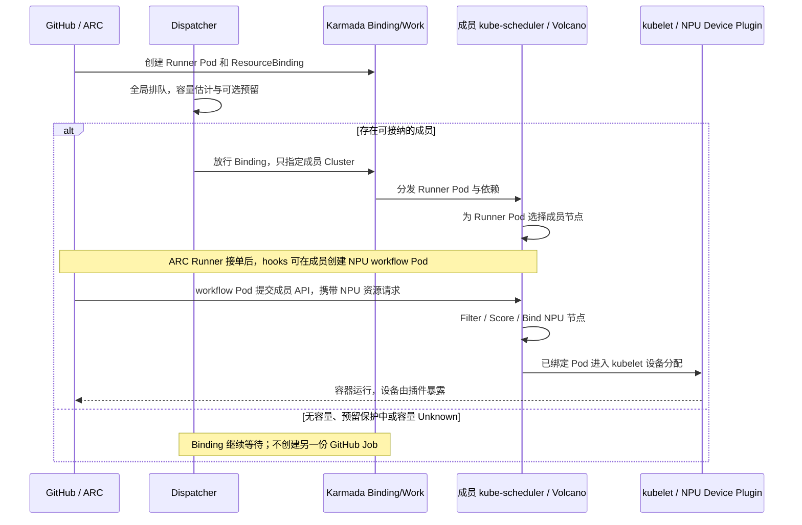

**静态反例与判据**：

| 场景 | 联邦层决定 | 成员层决定 |
|---|---|---|
| A 的总空闲为 20 卡但单节点最多 8 卡，B 有单节点 16 卡；workflow 需要 16 卡 | 根据成员节点可放置信息过滤 A，选择 B；不选择具体节点 | B 的调度器选择最终 NPU 节点；kubelet 分配设备 |
| A 空闲 8 卡、B 空闲 10 卡；workflow 需要单节点 12 卡 | 无可行成员，Dispatcher 持有 Binding 并记录等待 | 不尝试跨成员拼接设备 |
| FIFO 队首 16 卡任务等待，空闲碎片可运行独立的 2 卡任务 | 按 Reserve Node 与安全 Backfill 保护队首，决定何时放行小任务 | 按节点实际约束调度已放行的 workflow Pod |
| Dispatcher 已为队首保护某 Node，但 member kube-scheduler 最终选择其他 Node | 观察成员反馈，更新/释放预留，不能把预留当绑定成功 | 根据真实节点状态决定绑定；保留调度事件 |
| workflow 被 hooks 固定到 CPU Runner 节点 | 未确认 hooks 是否支持解耦前，不承诺全局可放置性 | 遵循实际的 Pod nodeName/affinity 限制，失败要报告 |

**接口证据**：[Karmada Components](https://karmada.io/docs/next/core-concepts/components/)、[Karmada Scheduler Framework](https://karmada.io/docs/next/developers/customize-karmada-scheduler/)、[Karmada Scheduler Estimator](https://karmada.io/docs/next/core-concepts/components/)、[Kubernetes kube-scheduler](https://kubernetes.io/docs/concepts/scheduling-eviction/kube-scheduler/)、[Kubernetes Device Plugins](https://kubernetes.io/docs/concepts/extend-kubernetes/compute-storage-net/device-plugins/)。具体 `schedulerName`、Binding 更新字段、hooks 行为和节点预留机制需按目标版本与对应代码核对；本节不修改运行代码或 Manifest。

### 4.3.6 Dispatcher 队列、Reserve Node 与安全 Backfill（PL-D03）

**目标与责任（D）**：Dispatcher 对一个联邦资源池内的待放行 Runner Binding 排序、准入、预留、回填和选择成员；Karmada 仅负责 Binding/Work 分发；**成员 kube-scheduler/Volcano 为实际 NPU workflow Pod 选择节点**。本策略解决成员间资源闲置、队首大任务长期阻塞、小任务浪费碎片的问题。**不重排 GitHub 服务端 Job 队列**；Dispatcher 的等待对象是尚未放行的 Runner `ResourceBinding`，不是已经在成员运行的 Job。

| 备选 | 性质 | 设计取舍 |
|---|---|---|
| 严格 FIFO | 队首不满足则全部等待，顺序清晰但可能浪费空闲碎片 | 作为可对照的基线策略 |
| 贪心 First Fit | 小任务吞吐高，但大任务可能持续被插队 | 不作为默认公平策略 |
| **FIFO + Reserve Node + 安全 Backfill** | 队首在无法立即放置时获得容量保护，其他任务使用不受保护的资源 | **目标策略**；依赖成员预留执行契约 |
| 仅 Karmada Filter/Score | 负责单次成员选择，无法承担跨 Binding 的 Hold、队列顺序和预留生命周期 | 不采用作为队列控制器 |

**组件分工及权威状态**：

| 构件 | 负责事项 | 持久化/输入输出契约 |
|---|---|---|
| ARC / GitHub | 产生 Runner 需求；GitHub 决定 Job 与 Runner 关联、重试及终态 | ER/ERS/Pod；Dispatcher 不创建额外 Job |
| Karmada Detector / Binding / Work | 为 Runner Pod 形成可观察 Binding，按放行结果传播 | 目标 Binding 以 `spec.schedulerName` 定向 Dispatcher；同一 Binding 只能有一个有效写入方 |
| Dispatcher Queue/Policy | 在同一公平作用域内维护候选、资格、次序、优先级和回填判断；只选择 Cluster | Binding UID、队列时间、资源族、可信租户/任务类别及版本；无匹配候选时继续 Hold |
| Capacity Ledger | 节点可用容量估算、未落地授予、其他负载占用、预留与成员观测一致性 | `allocatable - bound - inflight - background`；账本异常停止新的肯定放行判断 |
| Reservation Actuator | 在成员候选节点建立、续租及撤销容量保护约束 | 有限范围的 Node taint/annotations、归属身份、队首标识、逻辑过期和短租约 |
| 成员 Scheduler / kubelet | 实际 NPU Pod 的 Filter/Score/Bind 与 Device Plugin Allocate | PodScheduled/NodeName/设备结果为最终事实；Dispatcher 的预留节点不等于实际绑定节点 |

**队列身份、作用域与顺序**：

1. 队列按可互换的**联邦资源族/拓扑域**定义，不跨无法共享设备、网络约束或租户授权的资源池拼接。成员资格先过滤，队列排序后不得越权扩大候选集。
2. 入队时间采用 Dispatcher **首次可信观察时刻**并持久化关联 Runner/Binding UID；相同时间以固定键确定顺序。`queued-since` 是目标逻辑字段，不伪称为官方 Karmada 字段。ARC 删除重建 Runner 时，仅在可验证同一等待需求及授权关系后恢复原先队列位置；禁止仅凭同名对象继承。
3. **同一租户、同一优先级内 FIFO**；跨租户采用 **PL-D04 的已分配 NPU 卡时/租户权重** 仲裁，按资源族分别计量。未落地授予单独计入容量预算，不等于已完成服务。
4. **分时优先级（目标）**：仅在 PL-D05 所需的可信预调度分类可用时，执行批准时段内白天 PR、夜间 nightly 优先；只重排未放行队列，保留已有预留与正在执行任务。窗口、老化门槛和服务份额为 P 类。
5. **分类的可信前提**：PL-D05 要求可信 Job 需求与 Runner/Binding 的唯一映射；在放行前无法证实时以 `ClassUnknown` 普通类别处理，不得凭用户自定义 Label 授予高优先级。

**单次决策与放行**：

1. 收集已入队且未取消的 Binding，确认唯一调度者、成员健康和账本快照；恢复阶段先对账持久化未落地授予与预留。
2. 在当前优先级/公平轮次内确定队首；计算合格成员下的**单节点可放置容量候选**，而非跨 Node/Cluster 累加。若队首已有 Feasible 容量，选择成员并使用资源版本前置条件放行 Binding。
3. 若队首暂不可行且达到已批准的预留触发条件，选择一个具备完整硬件容量但因可回收占用尚不可放置的**候选节点**，通过 Actuator 施加特定资源族的保护；不直接修改目标 workflow Pod 的 `nodeName`。若节点已有不受控长期占用或容量未知，不得承诺能靠等待排空。
4. 允许其他任务在**不消耗保留容量、不会抢走队首保护节点、不会突破授权/公平上限**时 Backfill。已启用某资源组预留时，该组其他 Runner 保持 Hold，防止共享 Toleration 的后继任务越过队首。
5. 放行必须提交**唯一 Cluster**的 Binding 写入与持久化 grant，更新 ledger；若资源版本冲突、对象已取消、授权/策略发生变化，则重新读取并决定，不因失败创建第二份 Runner。
6. Runner 到成员后，只有实际 NPU workflow Pod 绑定并被容量快照覆盖，才能从“未落地授予”转换为“已占用”。等待成员反馈不代表 GitHub Job 正在运行；异常按 PL-D01、PL-D02 处理。

**Reserve Node 安全条件（D）**：

- **候选节点**：必须是该资源族的授权成员、可容纳完整请求且能被成员真实 Scheduler 接纳的 Node；Actuator 仅允许在白名单 NPU Node 修改预留 taint。禁止抢占、驱逐已有 Job 或盲目抢注其他调度器的预留。
- **保护机制**：Node `NoSchedule` taint + 受信任的特定 reservation group 的精确 `Equal` toleration；禁止 `Exists` 通配。同组后继 Runner 也可能具有相同 toleration，必须由 Dispatcher **同时执行同组 Hold**；仅配置 taint 不能证明队首安全。
- **时钟和失效**：逻辑预留到期时间与短租约 `reserved-until` **独立**；Dispatcher 持续续租，成员 Janitor 在归属和期限核验后清理过期保护。自动回收必须阻止 Dispatcher 死亡造成长期资源冻结。具体 TTL/续租/巡检时间为 P 类，不借用其他项目的示例数值冒充业务目标。
- **生命周期**：`Eligible → Reserved → Draining → HeadReleased → WorkflowBound → Released`；队首取消、失去资格、节点故障、超时、Dispatcher 切主、预留被其他调度器占用必须分别有清理/重建分支。**仅 Dispatcher 放行 Runner、成员 Pod 已 Bound 不等于本预留成功完成**；需要关联被保护的队首实际 NPU Pod 的节点状态。
- **回填不变量**：在队首等待期间，任何 Backfill Job 不得占用为队首保留的设备容量，也不得延后既定的队首放行承诺。无可信执行时长上界时只使用**完全独立的非预留容量**回填；不能靠猜测“小任务会先结束”作为安全条件。

**调度交互（目标，不是现有 API 调用记录）**：

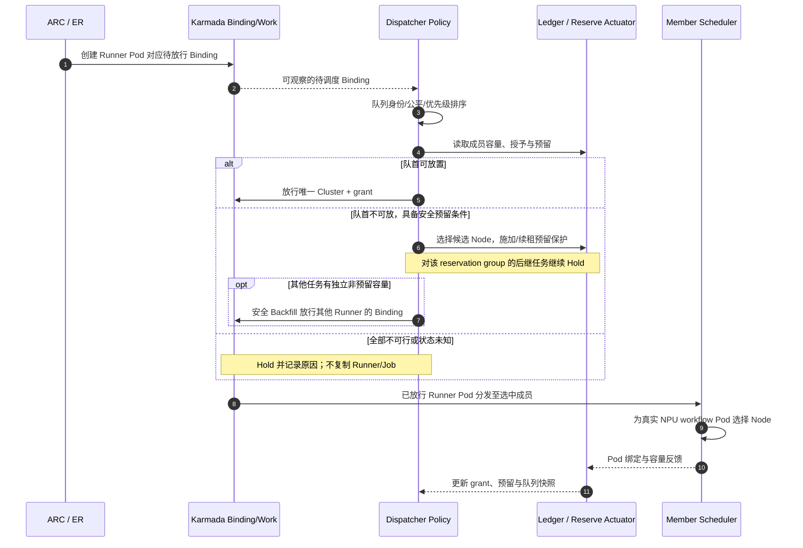

**故障域、恢复和退化契约**：

| 事件 | 必须执行的响应 | 不能做的事 |
|---|---|---|
| Dispatcher Leader/进度丢失 | 以 Lease/进度区分活锁和主备；新 Leader 从 Binding、grant 与成员 Node 事实重建，重建未完成前禁止放行；Janitor 清理未续租保护 | 并发两个 Writer 改同一 Binding；仅凭内存队列恢复原队首 |
| Dispatcher 不可用超过恢复窗口 | 启用**互斥**的降级调度路径；明确先停止旧 Writer，再允许官方 Scheduler/应急实例接管；降级期间 FIFO/Reserve 语义可能弱化，需显式告警 | 在旧预留仍生效、授权未知时盲目按聚合容量释放所有任务 |
| 队首取消或 ARC 回收等待中的 ER | 按绑定身份从 Hold 队列移除，关闭对应 grant，核对并撤销预留；队列不会自行创建替代 Job | Dispatcher 与 ARC 并行删除同一等待需求，误删后继 Runner |
| 预留 Taint 残留或被非队首占用 | 记录 `ForeignEngagement`；禁止假称 Reserve 生效，按归属/租约清理并重新判定是否能安全预留 | 用 `Exists` 容忍、增加无限租期或越权强制迁移正在运行的 Pod |
| 成员失联、调度事件滞后或容量估计分歧 | 标记 `CapacityUnknown`，冻结相关成员新的肯定放行，保留其他成员的可信候选；观察恢复并对账 | 用旧节点空闲数直接作为确认授予 |
| 队首跨优先级时段或长期等待 | 仅重排未放行 Binding，保留已生效的保护承诺；通过老化与最小服务规则防止持续饥饿 | 删除运行 Pod、撤销有效队首预留来强制改优先级 |

**DFX 设计证据和待选参数（P）**：分成员/资源族/租户/任务类别统计队列长度、队首等待、Hold 原因、分配卡时、Backfill 数、被保护容量、预留实际兑现、意外占用、租约过期、Leader 切换与容量快照滞后。区分 `GitHub queued → started` 与 `Binding hold → release`，后者是 Dispatcher 自身等待，不可写成 GitHub 原生排队时间。优先级时间窗口、权重/公平阈值、预留时长、故障切换时限、最大排队时间和利用率目标均需正式批准；没有证据不填写性能承诺。

**现有可复用设计**：组织现有 [`arc-fedsched` 的 `DESIGN.md`](https://github.com/opensourceways/arc-fedsched/blob/main/docs/DESIGN.md) 已定义按 Binding Hold/Release、`fifo-reserve-node` 策略、Node 预留、同组 Hold、grant/ledger 和成员 janitor；本节将其作为设计参考，**不将其代码或部署状态自动视为本仓库已实现**。Karmada API 及会更改 Binding 的其他控制器行为仍需针对目标版本核对：[Karmada Scheduler](https://karmada.io/docs/next/developers/customize-karmada-scheduler/)；[Kubernetes Scheduling](https://kubernetes.io/docs/concepts/scheduling-eviction/kube-scheduler/)。

### 4.3.7 跨租户加权公平仲裁（PL-D04）

**设计决策（D）**：Dispatcher 在 PL-D03 的**可互换 NPU 资源族/拓扑域**内做跨租户加权公平仲裁；各租户在相同有效优先级内按 FIFO 取出候选。公平计量用**已分配 NPU 卡时**而非 AI Core 利用率或 GitHub Job 数量；成员容量、拓扑和授权是硬约束，公平排序不得越过硬性准入。该机制不改变 GitHub 队列，也不抢占已运行 Pod。

| 备选机制 | 结论 |
|---|---|
| 全局 FIFO | 容易因单租户大任务占据长期队首，不能表达不同租户配额；仅作为顺序基线 |
| 仅按任务数轮转租户 | 2 卡任务和 16 卡任务成本不同，不适用于异构 NPU 池；不采用 |
| 基于 CPU/NPU 混合资源的 DRF | 适合多资源竞争，但本设计的仲裁目标是同型号 NPU 卡时；CPU 仍作为准入约束，不在此引入无法比较的跨设备资源权重 |
| **按资源族计量的 Weighted Fair Service（加权服务量）** | **选择为目标仲裁算法**：资源分配量和时间均入账，允许定义各租户权重，符合单个 NPU 资源维度的公平目标 |

**作用域与输入**：公平域是 `(federation, NPU-family, topology-domain)`；不同设备型号/资源单位不能未经批准合并为一项卡时。租户身份来自经授权的 Runner 服务/资源池访问配置，必须在 Runner Binding 进入队列时可信可见；`tenantId` 为空或来源不可验证则进入默认受限租户，不享受额外权重。`weight(t) > 0` 由平台批准，默认权重策略必须显式定义；分配上限、保底与借用策略属于 P 类。

**计量和选择（D）**：

1. 对公平窗口 `W`，记租户已消耗服务量 `A(t,W)=Σ[实际 NPU 请求卡数 × NPU 工作负载占用秒数]`（单位：NPU 卡秒）；以真实 NPU workflow Pod 的请求和运行时间为事实，缺失结束事件不填零。任务已放行但 NPU Pod 尚未绑定的 grant 另入 `I(t)`，用于并发放行限额/超售控制，**不能将它当作已完成服务量**。保护中的预留 `R(t)` 计入资源预算和公平配额占用，避免单租户长期冻结其他租户容量，但不得重复计入 `A`。
2. 活跃且具备合格成员容量的租户按 `A(t,W)/weight(t)` 从小到大选择；同值采用稳定租户 ID；每租户优先选择**有效优先级最高、同级最早入队**的候选 Binding。窗口老数据过期且新需求到来时正常参与竞争，不继承不可追踪的历史债务。
3. 同一轮决定内先检查有效优先级（PL-D05）、资源授权和配额，再进行加权公平；对低于当前优先级但等待时间达到已批准的老化门槛的任务进行有限提升，避免跨类别长期饥饿。高优先级任务也不得打破成员授权或既有队首预留。
4. 队首因资源碎片化不可放置时，遵守 PL-D03 的 Reserve Node/安全 Backfill；回填任务仍需经过租户配额与公平排序，且不能因自己总是能放置而连续绕过同一被保护队首。
5. 仅在资源供给可行、成员调度有进展、长期运行任务最终释放资源、类别与租户身份可靠时，才能讨论长期公平收敛。**不承诺短期严格比例、固定等待上界或在无抢占条件下绝对不饥饿**。公平窗口 `W`、配额上限、权重和老化阈值必须批准后才能确定量化目标。

**设计反例**：租户甲的 16 卡任务与乙的 2 卡任务不能按“每人各获得一个任务”认作公平；已经执行 16 卡×1 h 的服务量高于 2 卡×1 h。若甲的队首因拓扑无法运行，乙可以在独立资源 Backfill，但不得消费甲的有效预留。某租户身份缺失时不得继承其他租户的剩余配额或高权重。

### 4.3.8 PR/nightly 可信分类与分时优先级（PL-D05）

**设计决策（D）**：Dispatcher 优先级必须依据**放行前可验证、与本 Binding 一一关联**的授权任务类别。用户填写的 `runs-on` 标签仅是 Runner 服务选择，不能单凭标签认定当前 Job 是 PR/nightly。保持用户现有 `runs-on` 接口不变；默认不可判定时按普通类别处理，不伪造优先级身份。

| 路径 | 可行性与风险 | 结论 |
|---|---|---|
| 按 `runs-on`/Pod 自定义 Label 猜测 PR 或 nightly | 相同 Scale Set 服务不同任务，标签可被提交者修改，且 Binder 创建时 Job 信息可能尚不可见 | **不采用作可信来源** |
| 对已经启动的 Job 使用 ARC `JobID` / workflow 信息反推待放行 Runner | Job 关联通常发生在 Runner 可接单后，时序晚于调度决策 | **不能保证预调度分类** |
| **经授权的预调度需求元数据契约** | 由可信 Listener/工作流事件接入层提供 job-key、repository、事件类别、信任域和匹配身份，关联到确切待调度 Binding；须定义先于放行的身份一致性 | **目标选型；必须确认上游可获取性，未确认前禁用类别差异化** |

**分类契约及安全门槛**：权威输入至少包含 `provider, repository, workflowRunId, jobId, attempt, eventType, jobClass, tenantId, runnerServiceId, issuedAt, expiry, provenance`（仅设计逻辑字段，**不是 ARC/Karmada 原生字段清单**）；`jobClass` 由受信任平台分类器根据已授权事件与规则产生。接入组件需建立 job-key → 待供给 Runner demand → ER/Pod → Binding UID 的唯一可验证映射，跨回调重试与重建保证幂等；**如果一个 Scale Set 无法把 queued Job 一一映射至 Runner Binding，不能制造这种映射**。当来源冲突、签发已过期、多对一、多对多、无提前分类时，返回 `ClassUnknown` 并采用普通类别；不得提升到 PR 高优先级。

**分时窗口**：目标支持本地业务时区的白天 PR 优先、夜间 nightly 优先；使用 IANA 时区及明确起止时间，跨夏令时由统一规则转换；变更需可审计的 `policyVersion`。时间窗变化只重排尚未放行的 Binding；已放行 NPU Pod、已保护的队首预留不被抢占或撤销。优先级按 `Class → EffectivePriority(now,age,policyVersion)` 计算；老化上限及最低服务份额是 P 类参数。高优先级不能无限推迟低类，公平依 PL-D04 限制单租户独占。

**不可绕过的判断**：同一 `runs-on` 服务同时收到 PR/nightly，且预调度 job-key 无法绑定到某 Runner 时，两个 Binding 都是 `ClassUnknown`；**本方案这时只能按默认 FIFO/公平执行，不能声称已经完成白天 PR 优先、夜间 nightly 优先**。若业务明确要求这种体验而上游缺少映射，需先批准独立可信任务准入/关联机制的接口设计；不能通过改优先级字符串绕过身份缺口。

**证据**：[ARC Job metadata labels proposal #4485](https://github.com/actions/actions-runner-controller/issues/4485) 是“Job 关联后同步元数据”的社区请求，**不能证明放行前可得 Job 类别**；目标 ARC 版本的 Listener/ER 生命周期须单独核对。

### 4.3.9 Dispatcher 故障接管与安全降级（PL-D06）

**设计决策（D）**：正常态由 Dispatcher 独占其 `schedulerName` 对应 Binding 的 Hold/Release/Cluster 选择。故障时先尝试**同等语义的另一 Dispatcher Leader 接管**；仅在新 Leader 不能恢复且由明确的健康判据触发时，才允许互斥的 break-glass 官方 Karmada Scheduler 用同一 `schedulerName` 恢复基本成员放置。**降级可损失 FIFO、跨租户公平、Reserve/Backfill，但不能丢失成员授权、NPU 请求与已绑定 Runner 的单目标/不重复执行约束。**

| 状态 | 进入证据与允许操作 | 不变量与退出条件 |
|---|---|---|
| `ACTIVE` | 唯一 Dispatcher Leader 的进度新鲜；账本与成员容量可信 | Dispatcher 是唯一 Binding Writer，正常按 PL-D03～05 排序、保护及放行 |
| `RECOVERING` | Leader 进度丢失、租约易主或 Provider 账本不可信 | 暂停新的 release；从 Binding、grant、成员 Pod/Node、预留标记重建队列和容量，完成核对后才回到 ACTIVE |
| `DEGRADED` | 进度/恢复超出已批准的控制面阈值，watchdog 确认旧 Dispatcher 已失去写入权 | 官方 Karmada Scheduler 以**相同 schedulerName** 处理仍待调度 Binding，仅在合格成员中按可实现的安全容量约束放置；明示公平/预留策略降级 |
| `FAIL_CLOSED` | 无法证明单写者互斥、授权成员/容量事实可信或原有预留约束安全 | 禁止新的 Binding 放行；允许现有 Pod 在成员层继续原生调度和清理；人工排除歧义后再切换 |
| `RESTORING` | Dispatcher 恢复、正常版本/配置一致，且应急实例已确认停止写入 | 重建账本、队列和活跃保护，修正异常 grant；验证唯一 Writer 后恢复 ACTIVE，不重新处理已经成功放行的 Binding |

**接管顺序和 Fencing 契约**：

1. **健康证据必须包括调度进度**，不能只检查 Leader 进程存活或后台自动续约的 Lease；需要 `lease freshness`、`last placing progress`、成员状态采集新鲜度、循环调谐超时及 API 写入故障。空闲联邦允许无放行动作，但必须仍有成功决策循环/主动健康探测，避免“没有任务”被误判为卡死。
2. Leader 只有在自己的租约和写入期限均有效时才可发送 Binding/Node 写入；租约失效需停止写入并释放身份。Watchdog 触发 break-glass **必须先完成旧 Writer 禁止写入的可验证条件**（进程停止或 fencing/权限收回），仅将另一 Deployment 扩至 1 并不足以自动证明网络分区下不存在双写。
3. 新 Leader 在放行前重建未落地 grant 与 Node 预留，核对实际 PodScheduled 和租约；未完成先 `RECOVERING`，不要让内存状态为空就认为资源全部空闲。乐观并发更新检查 Binding `resourceVersion`，冲突必须重新读取而不是双份提交。
4. break-glass 使用与目标 `ResourceBinding.spec.schedulerName` 相同的调度器名，并以目标版本确认能实际处理该 GVK、`Divided` 独立 Pod 单目标、容量 Estimator 开关与约束。若目标版本无法安全处理或需要覆盖未知预留，进入 FAIL_CLOSED。它不管理 Dispatcher 的全局 FIFO/同组 Hold，**不能宣称降级仍保有原公平与队首预约保证**。
5. 恢复时先停止应急 Writer，再归并尚未放行 Binding 和被打断的预留；已在成员运行的 Runner 保持单目标，不因集成层恢复而复制或重派 GitHub Job。逻辑预留可释放但 Node taint 必须以归属与短租约安全撤销；成员 Janitor 负责失去 Dispatcher 续租后的清理。
6. 故障切换时长、进度阈值、授权/账本一致性条件和控制面超时必须作为 P 类参数批准。宁可新增任务等待，也不能通过不可信容量或双写来追求虚假的可用性。

**DFX 静态反例**：

| 反例 | 设计预期 | 失败判据 |
|---|---|---|
| Leader Lease 仍被后台续约，决策循环已停止 | 进度 Watchdog 判定不可用并触发接管/FAIL_CLOSED | 仅看 Lease 判为健康，全部新 Runner 永久 Hold |
| 两个节点网络分区，旧 Dispatcher 仍可访问 Karmada API | 只有完成旧 Writer Fencing 才允许应急实例写 Binding | 同一 Binding 先后被两个 Writer 改写到不同 Cluster |
| 冷启动观察不到先前 grant，但 Node 上有已绑定 workflow Pod | RECOVERING 先重建账本；未知资源不放行 | 仅凭空内存 ledger 当作全量可用 NPU |
| 应急调度期间有带 reservation taint 的 Node | 不将 taint 当成空闲资源；确认成员实际可调度或保持等待 | 因错误 Estimator 结果把队首/后继引向被保护 Node |
| Dispatcher 恢复时应急调度器仍在写入 | 保持 DEGRADED/FAIL_CLOSED，确认降级写者退出后再恢复 | 双写、旧 Binding 重新传播或复制运行 Job |

**上游机制证据**：[Karmada `ResourceBinding` v1alpha2 API](https://karmada.io/docs/reference/karmada-api/work-resources/resource-binding-v1alpha2/) 和 [`PropagationPolicy` API](https://karmada.io/docs/reference/karmada-api/policy-resources/propagation-policy-v1alpha1/) 包含 schedulerName 等能力，**不表示官方内建 Dispatcher 的队列/fencing**；组织 [arc-fedsched 设计](https://github.com/opensourceways/arc-fedsched/blob/main/docs/DESIGN.md) 的 Hold/Release 与 break-glass 论证可复用。具体升级版本、Karmada failover/descheduler 共写风险、保护 taint 兼容性均须锁定 API 和控制器机制；本文只描述目标架构。

## 4.4 SP-04/SP-05 身份、凭证与跨控制面访问规格设计

### 4.4.1 实现思路

Controller、Listener、Runner 分别授权。Controller 管理 Runner 并持 GitHub 管理凭证；Listener 以最小权限访问 Karmada API；Runner 使用 JIT 注册配置，不持长期管理凭证。身份基于 ServiceAccount、TokenRequest、RBAC（U）；令牌签发、到期、轮换与审计由平台负责（D）。

### 4.4.2 实现设计

| 访问主体和目标 | 认证方式 | 规定的权限与安全限制 |
|---|---|---|
| Controller → Karmada API | Controller 必须通过可信 CA 验证 Karmada API，并使用专门的 Kubernetes API 凭证。 | 平台必须按 ARC 管理资源所需的 API 操作授予权限，不得把管理员级 kubeconfig 作为生产目标权限。 |
| Listener → Karmada API | Listener 必须使用单独的 ServiceAccount 凭证和可验证的 HTTPS 地址。 | 权限应限制为指定 Runner 服务需要的 `EphemeralRunnerSet` 与 `EphemeralRunner` 操作；当前 [RBAC Manifest](../manifests/03-rbac.yaml) 是配置示例。 |
| Runner Pod → GitHub Actions | Runner 使用 ARC 创建的 JIT 注册配置与 GitHub 通信。 | 不得使用管理端的长期 GitHub 凭证；Runner 模板使用 `automountServiceAccountToken: false` 避免自动挂载 Kubernetes API 令牌。 |
| Karmada → 成员 API | Karmada 使用联邦成员注册时配置的访问身份。 | 成员 API 凭证应限制在传播资源和读取必要状态的操作范围内，由平台身份管理者维护。 |

**部署方必须提供的认证参数（P）**：API 地址与端口、服务器证书名称、可信 CA、令牌的使用范围和有效期、凭证颁发者以及更新方法。平台必须规定 Listener 如何加载更新后的令牌或证书。仅修改 Kubernetes Secret 不能证明 Listener 一定会自动使用新凭证。

**异常**：DNS/TCP 失败记网络错误；证书链或名称不匹配记 TLS 错误；HTTP 401 记认证失败，403 记权限不足。保留类别；不得关闭 TLS 校验或授予 `cluster-admin`；日志不得含凭证原文。

### 4.4.3 身份权限与凭证传播矩阵

下表明确生产目标和**当前 Manifest 差异**；具体 `get/list/watch/create/update/patch/delete` 操作须按锁定版本 ARC Controller/Listener 的实际调用审计确定，不凭推测一次性赋予宽权限。

| 主体 → 目标 | 需要的身份及最小权限边界 | 凭证接收范围 | 当前配置事实/差距 |
|---|---|---|---|
| ARC Controller → Karmada API | 独立管理身份，仅允许管理所属 ARC 对象、Pod、JIT Secret 及所需状态；按真实 API 调用细化权限 | Controller 管理域 | `03-rbac.yaml` 注释注明宿主 Controller 使用 **admin kubeconfig**；不符合生产最小权限目标 |
| ARC Controller → GitHub | GitHub App 或受控管理凭证，只允许所授权的组织/仓库与 Runner 管理操作 | 实际管理消费者 | `04-autoscalingrunnerset.yaml` 引用 `arc-github-secret` |
| Listener → Karmada API | 独立 `karmada-listener-sa` 身份；限 `arc-runners` 目标资源，拒绝其他 Scale Set | 定向 Listener 成员；不得下发给普通 Runner | `03-rbac.yaml` 给 ERS 指定 `resourceNames: [karmada-runner]` 的 patch 权限；ER 的 get/patch/status patch 未按资源名约束，属当前版本所需最小能力待审查 |
| Runner → GitHub | ARC 生成的一次性 JIT 注册配置，不允许取得长期 GitHub 管理凭证 | **实际执行成员** | `04-autoscalingrunnerset.yaml` Runner 设置 `automountServiceAccountToken: false` |
| Runner → Kubernetes API | 默认不提供 Kubernetes API 身份，不自动挂载 SA Token | 无 | 配置已禁用自动挂载；仍须区分工作负载自身注入凭证的其他路径 |
| Karmada → 成员 Kubernetes API | 成员访问身份仅用于目标资源传播及状态读取 | 联邦控制器与目标成员 API | 成员凭证权限不在所列 Manifest 中定义，不宣称已经最小化 |
| Karmada → JIT Secret 成员副本 | 依据 Pod 引用及目标 Cluster 传播，**不等于加密或访问控制** | 执行该 Pod 的成员 | Runner Policy 开启 `propagateDeps: true`，需依赖上游版本的引用识别机制 |
| 平台 → GitHub 主 Secret | 长期凭证由指定管理端消费者使用，不应仅为 Runner 执行而向所有成员分发 | 仅实际消费者 | `02-propagation-policies.yaml` 当前向 member1/member2 **显式传播 `arc-github-secret`**；SP-04 目标未满足 |
| 平台 → Listener Karmada Token/CA | 控制面目标 audience、信任 CA 与可验证 SAN，限定具体 Listener 消费者 | 定向 member1（示例） | Listener Policy 显式选取 `karmada-token`，并启用 `propagateDeps`；`hostAliases` 和固定 API 端口为示例依赖 |

**最小权限判定原则**：RBAC `resourceNames` 仅对适用的操作和请求形式起约束作用，不能假定它限制任意 `list/watch` 或 `create`；细粒度鉴权需以 Kubernetes 原生规则与 ARC 实际请求验证。Runner 在隔离成员执行不代表无需控制面外的 GitHub 网络出站权限。

### 4.4.4 凭证发行、轮换、失效与撤销状态

| 凭证 | 发行与绑定 | 更新/轮换契约 | 撤销及故障处理 |
|---|---|---|---|
| GitHub 主凭证 | 由授权凭证方签发，限组织/仓库与应用权限；仅 Controller 等实际消费者读取 | 新旧凭证交叠时先确认消费者加载，再失效旧版本；不得向普通成员复制以解决注册失败 | GitHub 端吊销/失效及消费者替换分别确认；删除 Kubernetes Secret 副本不等于外部授权撤销 |
| Listener Karmada Token | 推荐 TokenRequest：限定 `audience`、`expirationSeconds`，核对目标 Karmada API 接受的颁发者与 audience | 在到期前更新并核实 Listener **重新读取** Token 与 CA；静态 Secret 挂载不等于原生自动续期；必要时按可控方式重启 Listener | 401/过期时停止成功声明，按身份/对象绑定/令牌有效期核查；RBAC 403 单独处理；不得降级为 admin kubeconfig |
| API TLS CA/证书 | 信任锚及服务端 SAN 与访问域名匹配 | 先引入新信任链并验证消费者切换，移除旧信任锚需确认所有消费者 | TLS 错误不得使用 insecure-skip-verify、绕过 SAN 或任意扩展 NO_PROXY 代替证书修复 |
| Runner JIT Secret | ARC 按临时 Runner 生成；受 Pod 引用及成员传播范围约束 | JIT 绑定单次 Runner；过期/不可用按 ARC 原生状态处理，不长期复用 | 结束后核查控制面与成员副本；是否还可在 GitHub 使用按上游机制判定，不把 Secret 删除等同远端即时撤销 |
| 成员 API 访问凭证 | Karmada/成员注册体系管理 | 证书/Token 替换期间需要区分成员连接失败和工作负载失败 | 凭证泄漏时收缩成员访问，保留 Work 清理未知状态以待恢复 |

**Kubernetes 官方机制边界**：投射的 ServiceAccount Token（TokenRequest + projected volume）在支持的 Pod 场景可由 kubelet 更新；但将 Token 放在由其他系统复制的**普通 Secret** 中，并不自动具备这种续期机制。TokenRequest 产生的 Token 还受过期时间、受众与对象绑定约束。应优先使用短期可轮换凭证；明确跨集群 API 对签发者和 audience 的验证。详见 [Kubernetes ServiceAccounts](https://kubernetes.io/docs/concepts/security/service-accounts/) 和 [Managing Service Accounts](https://kubernetes.io/docs/reference/access-authn-authz/service-accounts-admin/)。

**安全不变量**：

- SEC-01：Runner Pod 不获取 GitHub 主凭证或 Listener 控制面凭证；目标仅传播实际引用的 JIT。
- SEC-02：GitHub 主凭证仅向实际消费者授予；当前面向两个成员的传播是**已知差距**。
- SEC-03：Listener 只能操作经授权的 Runner 服务；当前 ER 资源宽度、Controller admin kubeconfig 必须作为生产权限缺口保留。
- SEC-04：轮换完成以**新凭证实际生效、旧凭证失效**两项事实为依据，不能仅以 Secret 更新成功判断。
- SEC-05：所有请求验证 TLS 链与 SAN；不得输出 Token/Secret 值到事件、日志、审计。
- SEC-06：成员失联时 Secret 副本存在性、删除及远端授权状态均记为未知，不伪造已撤销结论。

**范围边界**：这里定义所需安全机制及校验要求，**不声称当前 Manifest 已满足**；对应实施变更及自动轮换能力不是 T4 的代码交付。

## 4.5 SP-06/SP-07 状态与生命周期规格设计

### 4.5.1 实现思路

成员 Kubernetes 生成 Pod 状态，Karmada 回传控制面（U），ARC 据此管理生命周期。`ResourceInterpreterCustomization` 保留单目标状态（D），不改变 ARC 判断；对象回收沿用 OwnerReference/Finalizer。

### 4.5.2 实现设计

**下列阶段是设计描述，不是 Kubernetes 或 ARC 的 API 枚举。**

| 逻辑阶段 | 进入条件 | 规定的行为 |
|---|---|---|
| 任务需求已接收（Requested） | Listener 接收到 Runner 服务的任务数量需求。 | ARC 按 Runner Scale Set 管理期望 Runner 数量。Karmada 不负责 GitHub 任务排队。 |
| 执行成员已选定（Scheduled） | Karmada 为 Runner Pod 选择一个成员集群。 | Karmada 分发资源；没有合格成员时不得把 Pod 视为已调度。 |
| Pod 尚未就绪（Pending） | 成员 Kubernetes 尚未完成调度、镜像获取或必需 Secret 挂载。 | 平台保留 Pod 事件和未就绪原因，不因此重复提交 GitHub Job。 |
| Pod 已就绪（Ready） | 成员 Pod 状态满足 ARC 需要的容器状态及 Ready 条件。 | Karmada 必须保留并同步这些字段。Pod Ready 不等于 GitHub Job 成功。 |
| 作业执行中（Executing） | Runner 已注册并开始执行 GitHub 分配的 Job。 | GitHub Actions 管理 Job 的执行结果；Pod 状态用于 Runner 运行诊断。 |
| 作业结束（Completed / Failed） | ARC 和 GitHub 按各自接口识别任务结束状态。 | ARC 开始相应的临时资源回收流程，平台保留失败原因。 |
| 资源删除中（Deleting） | ARC 或 Karmada 开始删除关联的临时对象。 | 各控制器处理其拥有的资源；删除失败时保留对象标识、Finalizer 和错误原因。 |

**状态解释**：保留 `status.phase`、`status.conditions`、`status.containerStatuses[].name` 及 ARC 所需的容器状态。无成员状态时不得生成 Ready。当前 Lua 取第一个非空 `status`，仅适用于单目标、无冲突；支持迁移或多副本前须定义冲突处理。

**删除**：关联 Runner、Pod、JIT Secret、Binding/Work。各控制器独立删除；Finalizer 阻塞时先查所有者和未完成操作，不得直接清空。

### 4.5.3 跨域逻辑状态机及正确性约束

以下状态仅用于设计推理，不是 ARC、Karmada 或 GitHub 的原生状态字段；状态事实分别由其权威系统提供，不建立新的统一状态控制器。

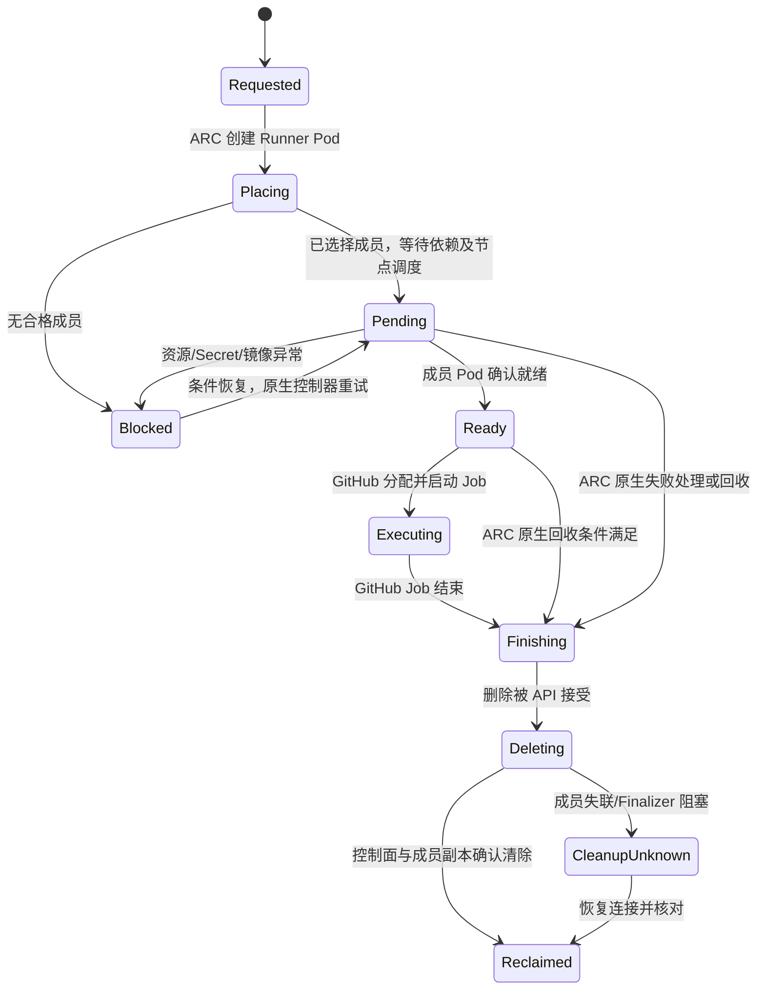

| 约束 | 不变量与禁止行为 |
|---|---|
| LC-01 Job 权威性 | 只有 GitHub Job 事实能够确认执行结果；Pod Ready/Failed、Work 同步不能推导 Job 成败或触发自行重派 |
| LC-02 单一目标 | 每个 Runner Pod 正常只对应一个活动目标成员；不能在多份 status 中任取第一份作为执行事实 |
| LC-03 控制器所有权 | ARC 管理 Runner 生命周期，Karmada 管理传播；集成层不能绕过其原生回收规则 |
| LC-04 阶段隔离 | Secret 已到达、Pod Ready、Runner 已注册、Job 已开始是不同事件，任何一步不代表后续一步成立 |
| LC-05 删除收敛 | 删除请求被接受不代表 Pod、Work、成员 Secret 已清除；未核实副本时只可标记清理结果未知 |
| LC-06 重复及乱序事件 | 按对象 UID、所属 Cluster、目标成员和各系统权威状态核对；不同集群 resourceVersion 不可相互比较 |
| LC-07 无重放承诺 | 未经 GitHub/ARC 协议及业务幂等性证明，不承诺 exactly-once Job、无损迁移或任意失败自动重新执行 |

**状态判定**：GitHub 是 Job 终态权威；ARC 是 Runner 实例及回收权威；Karmada 是传播目标和 Work 状态权威；成员 kubelet/Kubernetes 是 Pod 实际运行状态权威。控制面同步落后时保留来源、对象身份与时间，使用 Unknown/未确认表达不确定性，不以旧 Ready 推导当前可执行。

### 4.5.4 异步传播、状态冲突及恢复决策

| 失效或竞态 | 设计处理 | 禁止行为 |
|---|---|---|
| JIT Secret 晚到，Pod FailedMount | 保留 Pending，依赖成员原生挂载重试并诊断 Secret 引用 | 不伪造 Ready |
| 成员 Ready、控制面仍 Pending | 保留成员实际状态与 Karmada 同步滞后证据，继续原生调谐 | 不直接篡改 ARC 状态 |
| 控制面 Ready、成员失联或状态缺失 | 核对 Binding 当前目标并标记事实过期/未知 | 不把缓存 Ready 当作新任务可执行保证 |
| statusItems 多来源冲突 | 先依据活动 Binding/Work 和成员 Pod 身份确认唯一权威来源 | 不选择第一个非空状态 |
| GitHub Job 已完成但 Pod 未删除 | GitHub 结果与 ARC 回收状态分别记录 | 不宣称所有临时资源已销毁 |
| Pod 消失但 GitHub Job 未结束 | 依 GitHub/ARC 原生失败策略和生命周期处理 | 集成层不得自行重复派发 Job |
| Work/Secret 删除滞后或成员失联 | 标记 CleanupUnknown；恢复连通后逐对象核查 UID、Finalizer、删除状态 | 不以 API 202/删除请求代表完成，也不强删未知 Finalizer |
| 事件重复、乱序、旧资源同名重建 | 核对来源 Cluster、UID 与当前权威快照；旧事件不覆盖新对象 | 不跨集群比较 resourceVersion |

**上游边界**：ARC 官方机制本身可能重试失败的 Runner Pod；这里禁止的是额外集成逻辑擅自重放 GitHub Job，而非禁止上游机制。具体超时值及重试限制必须对齐目标 ARC 版本，不在设计中杜撰统一 SLA。

### 4.5.5 多来源状态仲裁的设计取舍（ST-D01）

**设计决策（D）**：只接受一个活动成员目标与一个可识别的状态来源；不支持同一个 Runner 实例在不同成员间带 Job 迁移。区分**控制面 Pod.status 给 ARC 读取**与**平台诊断系统的可信状态判定**，二者不能因文字约束而被假定自动一致。

| 方案 | 评价 | 结论 |
|---|---|---|
| 任取 `statusItems` 第一个非空 `status` | 最少修改，但来源冲突/旧 Work 可能制造伪 Ready | **仅当前单来源前提下有效；不是多来源仲裁算法** |
| 在 Lua `AggregateStatus` 内按 `clusterName` 过滤 | 聚合条目携带成员信息，但 Lua 是否能得到**当前唯一 Binding 目标/UID**须以锁定版本的 API 为准 | **不以未经确认的输入宣称可实现** |
| 先由 Karmada 原生 Binding/Work 确定活动目标，再将成员状态与 Pod 身份比对 | 能区分传播目标、同步状态、成员实际就绪与旧实例 | **选为目标的状态仲裁契约**；若目标版本仅有 Lua 且无法获得身份输入，应使用独立状态观察/适配扩展点，而非伪造字段 |

**状态仲裁输入与输出：**
1. 输入以 `Cluster + namespace + name + UID` 标识控制面 Pod、成员 Pod 与 Work/Binding；以 GitHub `run_id/job_id/attempt` 和 ARC ER/Runner ID 追踪业务实例。使用实际可提供的 API 字段和事件构建关联，不以同名 Pod 推断 UID 相同。
2. 按当前活动 Binding/Work 取得**唯一目标成员**；只认可与该目标成员及当前 Pod 实例一致的 `AggregatedStatusItem.clusterName/status` 和成员侧 Pod 快照。
3. 目标成员唯一且状态来源一致时，可判定 `MemberReady`；目标丢失、多个来源、成员失联、旧 UID 或超出批准的新鲜度阈值时，平台判定 `StatusUnknown`，不推导 `JobCompleted`、`RunnerRegistered` 或可安全迁移。
4. **重要限制**：如果已有控制面 Pod.status 仍缓存旧 Ready，平台的 `StatusUnknown` 诊断结论**不会自动覆盖 ARC 对该 Pod 的读取**。要对 ARC 做出“绝不接收旧 Ready”的强保证，必须锁定可实施的状态覆盖/准入扩展机制；当前组合未证明这一点，禁止宣称运行时保证已达成。

| 反例 | 必须给出的设计判断 | 禁止行为 |
|---|---|---|
| 成员 A Ready，旧 Work 未清，Binding 指向 B | 发生身份与目标冲突，结果 `StatusUnknown` | 取 A 的首个非空状态 |
| A 曾 Ready，随后成员失联，聚合状态未刷新 | 诊断状态过期；ARC 读到旧 Ready 的风险保留为未闭环的运行时限制 | 仅凭旧 Ready 承诺 Runner 可接单 |
| GitHub Job 完成，成员 Pod 仍存在 | GitHub 结果完成、资源清理未知分别记录 | 以 Job 完成判定 JIT Secret 已销毁 |
| 同名 Pod 删除后重建，UID 改变 | 旧事件不属于新实例 | 用同名和跨集群 resourceVersion 合并事件 |

**落地接口分界**：Karmada 的 `AggregatedStatusItem` 包含 `clusterName` 与 `status`；`ResourceInterpreterCustomization.AggregateStatus(desiredObj, statusItems)` 只声明这两类输入，**不提供直接读取当前 Binding 的保证**。在锁定 API 版本并证明聚合阶段具有必要身份输入前，保留“单成员、无自动重定位”的功能域约束。任何升级到状态驱动的自动切换，必须先完成状态仲裁扩展点与 ARC 读状态路径的设计评审。

**依据**：[Karmada ResourceInterpreterCustomization API](https://github.com/karmada-io/karmada/blob/master/pkg/apis/config/v1alpha1/resourceinterpretercustomization_types.go)；[Karmada AggregatedStatusItem API](https://pkg.go.dev/github.com/karmada-io/karmada/pkg/generated/applyconfigurations/work/v1alpha1)；[Karmada Customizing Resource Interpreter](https://karmada.io/docs/userguide/globalview/customizing-resource-interpreter/)。

## 4.6 SP-08 NPU 资源规格设计

### 4.6.1 实现思路

Device Plugin 发布扩展资源（U）。按设备需求设置候选成员和 Pod 请求（D）；Karmada 选成员、Kubernetes 选节点，不重实现设备分配。架构、OS、驱动、固件、插件及运行时由设备选型确定（P）。

### 4.6.2 实现设计

| 配置项 | 参数来源 | 规定的行为与限制 |
|---|---|---|
| NPU 扩展资源名 | 目标设备插件发布的 Kubernetes 资源定义。 | **真正申请 NPU 的 Pod** 必须使用插件发布的扩展资源名称；container mode 通常是 workflow Pod，不是 CPU Runner Pod。 |
| 设备份额与数量 | 设备插件定义的资源单位与可共享规则。 | Dispatcher 的任务容量声明必须能映射到实际 NPU Pod requests；成员调度器按插件支持的分配单位判定节点容量。 |
| 成员/节点标签 | 资源池配置、成员标签及节点标签。 | Karmada + Dispatcher 控制成员候选和放行；成员 kube-scheduler/Volcano 对实际 NPU Pod 选择节点。 |
| 镜像/驱动/Runtime | 设备驱动、固件和容器运行时的兼容资料。 | 部署方必须核对 Runner 镜像与目标设备的兼容性；不能因为安装了设备插件就推定全部软件栈可用。 |
| Runner Scale Set | 服务目录及 GitHub 工作流标签。 | 硬件能力不能互换时，平台必须配置不同 Runner 服务，不能默默把 NPU Job 交给普通 CPU Runner。 |

设备不足时，Pod 保持不可调度并保留原因；插件未就绪时不得删掉 NPU 请求或降级至 CPU 节点。成员 Kubernetes、设备插件和运维人员分别排障；型号、资源名、性能指标为部署参数（P）。

## 4.7 SP-09 跨功能质量与可服务性规格

| 质量属性 | 规定的行为 | 需要确认的部署参数 |
|---|---|---|
| 跨控制面访问安全 | Controller、Listener 和 Runner 使用各自最小权限身份；联邦传播只下发执行依赖，校验 API 的 TLS 证书。 | Token 有效期、凭证发行及成员授权范围。 |
| 可靠性 | 系统必须区分控制器可以重试的资源操作与需要管理员修复的证书、权限、网络错误。不得仅凭 Runner Pod 异常就重新提交同一 GitHub Job。 | 故障恢复目标、告警规则与人工处理责任。 |
| 可用性 | 平台必须明确 GitHub、Karmada 控制面、成员集群和网络连接之间的故障边界。一个成员可用不代表整个 GitHub Runner 服务可用。 | 目标部署拓扑、冗余级别和服务可用性目标。 |
| 性能与并发 | 平台应分别记录 Job 排队、Runner 数量调整、Pod 就绪和 Runner 注册的时间。不能用一次分配结果推定长期负载均衡。 | 服务容量、排队时间与每阶段延迟要求。 |
| 可服务性 | 平台必须能够使用 GitHub Run、Runner Scale Set、临时 Runner、Pod UID、Binding/Work 和成员集群定位同一次任务的处理状态。 | 日志保留期限、审计要求及观测平台。 |
| 升级与兼容 | 部署方必须记录 ARC CRD、Controller、Listener、Runner 镜像及 Karmada API 的版本，并按目标版本的接口检查兼容性。 | 组件版本、镜像摘要和升级回滚窗口。 |

### 4.7.1 关键路径、性能和容量模型

**关键路径**：GitHub Job 进入匹配的 Scale Set 需求 → Listener 接收需求 → ARC 调整 ERS 并调谐临时 Runner → Karmada 成员放置/Pod 与 JIT 依赖传播 → 成员 Kubernetes 调度、镜像与 Secret 准备 → Runner 向 GitHub 注册 → Job 开始。**Job 排队、Runner 供给、联邦成员放置等待、节点资源等待与运行准备是不同阶段**。GitHub queued→started 作为端到端参考，不能直接推断 Karmada 的独立排队耗时；各阶段可能重叠，不能将不一致时钟上的事件简单相减。

| 观测量 | 起止事件与权威来源 | 正确性边界 |
|---|---|---|
| Job 排队耗时 | GitHub Job 可获得的 queued/start 时间及 attempt ID | GitHub 的队列包括匹配/容量影响；无法据此精确分解成 ARC 或 Karmada 内部时间 |
| ARC 需求响应 | Listener 接收可识别的需求事件 → ERS 期望值变化 | 必须使用相同 Runner 服务及事件关联；异步事件丢失时标记未知 |
| Dispatcher 持有时间 | Binding 首次进入 Dispatcher 队列 → Binding 成功放行 Cluster，均以联邦控制面事件为准 | 与 GitHub Job queued→started 不同；记录资源族、租户、类别、Hold 原因及取消样本 |
| 联邦成员放置与传播等待 | Dispatcher 放行 Binding → 目标成员 Runner Pod 出现，分段记录 Work 到达 | 无候选与策略 Hold 不等于 Work 已分发；跨控制面时钟未同步不计算精确差值 |
| 节点资源等待与启动准备 | 成员 Pod 创建 → `PodScheduled` → 容器准备及 Ready | `PodScheduled=False`/`FailedScheduling` 归于节点资源等待；镜像、Secret、设备初始化另行归因；Pod Ready 不是 GitHub Job 已开始 |
| Runner 注册耗时 | Runner 启动/注册相关事件 → GitHub 确认 Runner 可用 | 需要可靠的关联 ID，未暴露事件不能凭推断填数 |
| 资源回收耗时 | ARC/Karmada 发起删除 → 控制面与成员资源确认消失 | 成员失联时结束时间未知；不可将 API 删除接受时间当作回收完成 |

**容量与并发**：`maxRunners` 仅限制对应 Scale Set 的 Runner 数量，不是 NPU 卡数上限，也不承诺所有 Runner 均已注册或可调度。当前 `minRunners=0/maxRunners=5` 是 Manifest 示例；Runner 的 NPU 请求数量、成员可用节点、硬件兼容性、JIT/镜像准备能力及 GitHub/ARC/Karmada 控制面吞吐均可能进一步收紧有效并发。对独立 Pod，`Divided/Weighted` 不提供跨 Pod 原子容量预留。计算有效可执行容量时，必须同时满足服务上限、成员授权、**单节点完整资源可放置性**和运行环境约束，而不是简单汇总各成员空闲卡数。具体吞吐预测、排队分位数和容量水位待业务 SLO 与实际资源模型确定（P）。

**设计验证准则**：应能将一项 Job 分解为可定位的等待阶段，区别需求已收到/成员已选定/Pod 已启动/Runner 已注册；在 `maxRunners` 达上限、节点碎片化、镜像准备慢、JIT 晚到时均能指出限制点，不宣称未核准的性能阈值。

### 4.7.2 故障域、可用性与恢复约束

| 故障域/故障模式 | 影响范围 | 允许的恢复行为 | 禁止的保证与剩余风险 |
|---|---|---|---|
| GitHub API/Job 分配不可用 | 可能影响所有 Scale Set 的新任务/注册 | ARC 按上游定义重试；保留 GitHub 与 Kubernetes 状态差异 | 不承诺离线继续接收 GitHub Job |
| ARC Controller/Listener 不可用 | 对应 Runner 服务需求感知、调谐或回收暂停 | 通过原生恢复和对象重新调谐收敛；按身份和版本恢复 Listener | 不推断已有 Job 必然中止或无损恢复 |
| Karmada API/Dispatcher/Propagation Controller 失效 | 新 Binding 放行或 Work 传播暂停，状态可能滞后 | Dispatcher 冷启动从 Binding/grant/成员 Node 重建；停止旧写者，恢复后再放行 | 普通 Karmada Scheduler/Dispatcher 不得同时写同一 Binding；不承诺 Job 无损迁移 |
| 某成员 Cluster/API/网络失联 | 该成员的分发、状态、删除确认不可靠 | 无关成员仍须按实际可用性分别判断；记录 `CleanupUnknown`，恢复后核对 | 不能仅凭控制面旧 Ready 认为正在执行，不能保证失联成员已销毁 Secret |
| 成员节点资源/设备/镜像不可用 | 局部 Pod Pending 或运行失败 | 保留 Node、Pod、FailedScheduling/FailedMount/镜像事件，遵守硬资源约束 | 不将 CPU 或不兼容 NPU 自动作为替代 |
| Token/CA/RBAC 出错 | 控制面操作失败或权限风险 | 分类 DNS/TLS/401/403，恢复最小授权身份及可信链 | 不能通过关闭 TLS 或升级为管理员权限绕过 |
| 状态聚合错误/延迟 | ARC 可能错误理解 Pod 状态 | 以成员真实状态与唯一目标对象核查；无法判断则 Unknown | 现有 Lua 首个非空来源不能证明多来源安全 |

**故障隔离原则**：一个成员失效不意味着联邦整体立即失效，但需要可用的管理面、合格的其他成员和上游正常调谐，才能主张新的 Runner 可在其他成员执行。**正在执行的 Job 不承诺跨成员无损迁移**。未确认业务幂等性时禁止集成层自行重派 Job。可靠性设计遵循 T3 的 LC 约束、T4 的 SEC 约束、T6 的 FMEA；恢复时间、冗余副本数和可用性 SLO 均为待定参数，不冒充现有保证。

### 4.7.3 跨组件诊断契约

**最小关联键**：GitHub `repository/run_id/job_id/run_attempt`（存在时）→ Runner Scale Set 名称及组织/仓库作用域 → ARC ER/ERS 和控制面 Pod 身份 → Karmada Binding/Work 与目标 Cluster → 成员 Pod 身份/状态。记录 Kubernetes `cluster + namespace + kind + name + UID`、事件来源、阶段、非敏感错误类型、观察时间；**不凭 Pod 名称猜测 Job ID**，也不把跨集群 `resourceVersion` 当全局顺序号。缺失关联时输出“未关联”，而不是推测。

| 诊断阶段 | 权威系统/对象 | 必须区分的异常与证据 |
|---|---|---|
| Job 匹配与排队 | GitHub Job、Scale Set | 无匹配、无授权、容量限制、GitHub API 错误 |
| Runner 需求/创建 | Listener、ERS/ER、ARC Controller 事件 | 需求未见、期望与实际数量差、Pod/JIT 创建失败 |
| Dispatcher Hold 与联邦放置 | 队列时间/Policy、ResourceBinding/grant、Work | 无合格成员、Group Hold、ReserveForHead、CapacityUnknown、Backfill、放行冲突和成员同步失败 |
| 节点与依赖准备 | 成员 Node/Pod/Secret 事件 | FailedScheduling、FailedMount、ErrImagePull、设备资源不足 |
| Runner 注册与执行 | ARC Runner 与 GitHub Job | 注册失败、Pod Ready 但 GitHub 未确认、Job 中断/完成 |
| 状态与回收 | 成员 Pod.status、控制面聚合、Work/Finalizer | 状态缺失/过期/多来源冲突、删除未知或残留 |

**采集契约与边界**：对 Dispatcher 保留作用域、可信租户/任务类别、排队顺序、Hold 原因、受保护节点与对应队首、Backfill 决策、grant 与 PodScheduled 关联，另记录预留租约、清理及非队首占用。事件可按来源重复或乱序到达，必须保留各源原始状态与采集时刻；同一对象内以原生身份/版本判断新旧。不能要求 GitHub、ARC、Karmada 共享单一事务 ID。任何跨域阶段耗时都需明确时间基准与缺失样本处理规则；不把缺失样本当零耗时。审计只记录最小必要的非敏感标识与结果，不采集 GitHub 主 Secret、Listener Token 或 JIT 内容。现有 Manifest **未实现统一查询入口和完整指标采集**，这里只定义功能域与观测系统之间的设计契约。

**设计验证准则**：对于排队、容量不足、Secret 晚到、401/403、成员失联、状态冲突、Finalizer 阻塞七类典型问题，须能够指出相应权威源、所需关联键、不可推断的结论以及恢复责任；数据缺失时不能伪造完成或性能数据。

**官方机制依据**：[GitHub ARC runner scale-set 容量配置](https://docs.github.com/en/actions/how-tos/manage-runners/use-actions-runner-controller/deploy-runner-scale-sets)、[Kubernetes Scheduling Framework](https://kubernetes.io/docs/concepts/scheduling-eviction/scheduling-framework/)、[Pod Conditions](https://kubernetes.io/docs/concepts/workloads/pods/pod-condition/)。上游分别约束 Runner 规模及节点调度/状态语义，**不构成 ARC + Karmada 整体性能或故障切换承诺**。

F-01～F-06 遵守 SP-01～SP-09。FMEA 写明原因、影响、检测、恢复和责任。未确认的性能、设备、安全参数标待定，不编造数值。

### 4.7.4 DFX 场景—架构机制—设计验证矩阵

本节描述**可静态评审的架构响应**。不将未批准的故障检测、重试、数据保留或性能分位数填写为既成数值。质量指标的目标值仍由 SR-NF 与 P-SR 参数批准后约束。

| 场景/质量属性 | 刺激与环境 | 架构响应与负责组件 | 设计判据、残余风险与追踪 |
|---|---|---|---|
| QA-01 性能/容量 | 需 16 卡 NPU 的 workflow：A 聚合空闲 20 卡但单节点最多 8 卡，B 有单节点 16 卡 | Dispatcher 用成员容量信息过滤 A、选择 B；**B 的成员调度器**决定最终 NPU 节点 | 不把 Dispatcher 估计或预留节点作为实际 Pod 绑定；PL-D01/D02、F03-03、SR-NF-05 |
| QA-02 可靠性/可用性 | Runner 运行期间成员失联，Job 终态不可得 | ARC/GitHub 维持原生生命周期；平台仅标记 ExecutionUnknown，不主动重派 | 没有双实例的**集成层额外创建动作**；上游重试行为另按协议评审；PL-D01、LC-07、SR-NF-03 |
| QA-03 状态正确性 | 旧 A 的 Ready 与新 B 状态冲突 | Karmada Binding/Work 提供目标事实；状态仲裁以成员和 UID 校验，诊断 StatusUnknown | 当前 Lua 不能证明已有缓存 Ready 不被 ARC 读取；这是**显式保留的高风险可实现性缺口**；ST-D01、F05-02 |
| QA-04 排队与等待归因 | Dispatcher 等待放行 Runner，或成员 NPU workflow Pod 已创建但 Pending | 分别记录 GitHub Job 状态、Dispatcher Binding hold、Karmada 传播、成员 PodScheduled/FailedScheduling；容量未知记 CapacityUnknown | 成员 NPU Pod Pending 不等于 GitHub Job 仍在 queued；不得把单节点绑定责任移给 Dispatcher；PL-D02、F03-04/05 |
| QA-05 可服务性 | Secret 晚到、成员失联或 JIT 删除滞后 | ARC/Karmada/成员各保留 UID、事件和清理来源，平台逐对象关联 | 未确认删除标记 CleanupUnknown，缺失 ID 不猜测；LC-05/06、SR-NF-04 |
| QA-06 可维护性 | 升级 ARC/Karmada 后聚合字段或权限变更 | 目标版本 API/CRD 与 Manifest/身份权限对照；不凭 `next` 文档作为版本承诺 | 版本未锁定前不能完成实现级兼容性验收；SP-05/06、SR-NF-08 |
| QA-07 公平与吞吐 | 白天 PR、夜间 nightly 形成不同优先级；16 卡队首等待时，2 卡任务可运行在其他节点 | Dispatcher 在可信类别与配置窗口内重排未放行 Binding；队首享有保护，其他组用非预留容量 Backfill | 未经授权的高优先级标签无效；保护不被后继消耗；跨租户权重与抗饥饿指标未批准前不宣称已达标；PL-D03、F03-06/08 |
| QA-08 资源泄漏与故障恢复 | Dispatcher Leader 故障，成员存在仍有效的 reserved Node taint | 新 Leader 对账恢复账本，成员 Janitor 对到期保护按归属清理，恢复互斥放行 | 不得因 Dispatcher 故障永久占有节点；降级需显式宣告公平策略减弱；PL-D03、F03-07/09 |
| QA-09 资源预留准确性 | 队首获得候选 Node 预留，但真实 workflow Pod 最终绑定另一个 Node | 由成员 Scheduler 选真实 Node，Dispatcher 观察 PodScheduled 后核对、迁移或释放保护记录 | 不能把 reserved Node 误记作 NPU 已占用或队首已兑现；PL-D02/D03、F03-08 |

**可评审性门槛**：每项场景必须指出输入事实、决策归属、响应、禁止动作、可追踪对象和残余风险。PL-D03 已明确目标 FIFO/Reserve/Backfill 与失效安全规则，**但当前 Manifest 不包含 Dispatcher**；类别来源、租户公平参数、节点预留对成员调度器的真实约束及故障接管仍需目标版本接口确认。旧 Ready、容量估计偏差和运行时效果均不是设计文字可以证明已解决的事实。

# 5 功能实现设计

> 各功能保留时序、接口和 FMEA/DFX；共享规格见第 4 章。Kubernetes 原生资源遵循对应 OpenAPI；ARC/Karmada 自定义资源遵循 CRD Schema。未新增 REST API，不编造 Swagger Endpoint。
>
> US-01～US-08 时序图及异常场景均为设计，不是实测调用记录；上游行为以目标版本文档为准。
>
> FMEA 仅作定性分析；风险评分标准未批准，不填数值。

### DFX 风险判定与设计验证规则

本章对全部功能使用统一的**定性 FMEA**，风险等级是设计评审优先级，**不是测得的故障概率或正式 RPN**：**严重**＝长期管理凭证错误传播、越权修改联邦资源或错误确认执行；**高**＝任务中断、重复执行风险、凭证失效或资源清理无法确认；**中**＝局部排队、暂时 Pending、可恢复的单功能异常。等级按潜在影响与可隔离性保守判定；不虚构概率、检测率或分数。风险高低不能仅凭恢复流程是否存在而自动下降。

每条 FMEA 追加**设计措施 → 设计验证准则 → 剩余风险**。验证是通过设计文档/API 契约检查可判定的条件，不表示已运行测试或实际验证成功。**设计被接受**与**当前 Manifest 已满足**分别记录；涉及未落实的调度策略、权限或接口，必须标记差距。正式性能 SLO 和数据保留期不在此补写数值。

Kubernetes 关于 [RBAC 最小权限](https://kubernetes.io/docs/concepts/security/rbac-good-practices/)、[ServiceAccount](https://kubernetes.io/docs/concepts/security/service-accounts/) 及 Karmada [状态解释与聚合接口](https://karmada.io/docs/userguide/globalview/customizing-resource-interpreter/) 是风险控制的上游依据。

## 5.1 F-01 统一 Runner 服务入口

### 5.1.1 功能概述

**关联的正式系统需求**：SR-01-01；**用例**：UC-01 通过统一标签提交工作流、UC-02 无匹配或无可用 Runner（异常处理，不单列 SR）；**功能域规格**：SP-01。

F-01 提供统一 Runner 服务名称。开发者通过 `runs-on` 选择服务，无需指定成员；平台配置服务、GitHub 目标与 Runner 模板。

**职责**：维护服务名称与 GitHub 目标映射；成员选择见 F-03，节点调度归 Kubernetes。

### 5.1.3 实现思路

`AutoscalingRunnerSet.spec.runnerScaleSetName` 必须与工作流 `runs-on` 一致。GitHub/ARC 负责匹配、创建和注册；不开发独立队列。硬件或权限不兼容时，分设 Runner 服务。

### 5.1.4 设计思路

GitHub 按 `runs-on` 匹配；Listener 接收需求，Controller 管理 Runner，F-03 选择成员。无匹配服务时，不得替换工作流标签或转交其他服务。

#### 5.1.4.1 UC-01 通过统一标签提交工作流——运行时序（US-01）

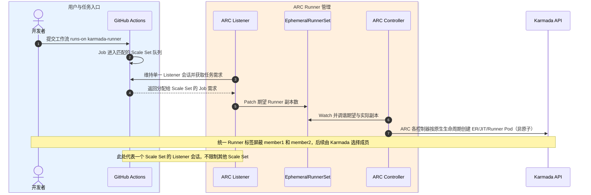

### 5.1.5 用户接口设计

通过 `jobs.<job>.runs-on` 选择服务，名称必须与 `spec.runnerScaleSetName` 一致。无独立 UI；复用 GitHub 和配置管理工具。

### 5.1.6 实现接口设计

#### 5.1.6.1 接口设计

| 交互双方 | 原生接口或资源 | 输入、操作与输出 | 权限与前置条件 | 异常处理与限制 | 依据及规格 |
|---|---|---|---|---|---|
| 工作流使用者与 GitHub Actions | GitHub Actions Workflow：`jobs.<job>.runs-on` | 开发者必须填写已发布的 Runner 服务名称。GitHub 根据该名称匹配 Runner。 | 开发者必须具有目标仓库工作流的提交权限。 | 名称未匹配时，GitHub 按其队列机制处理；平台不得改写标签。 | ARC-1；SP-01 |
| 平台配置与 ARC Controller | `AutoscalingRunnerSet`：`actions.github.com/v1alpha1` | 管理员必须配置服务名称、GitHub 目标、凭证引用、Runner 数量范围和 Pod 模板。 | Controller 必须具备所需的 Kubernetes API 与 GitHub 目标权限。 | API 拒绝创建或更新时，必须保留资源名称和错误原因；不能自行扩大权限。 | ARC-2；SP-01 |

**开发交付边界**：开发人员应维护 Runner Scale Set 模板与服务名称配置。不新增用于代替 GitHub Job Queue 的接口。

### 5.1.9 DFX分析

**功能安全与性能约束**：Runner 的最大数量受 `maxRunners` 限制。平台必须防止 Runner 在未授权的 GitHub 仓库或组织中注册。具体并发容量和排队时间由业务方定义。

**可靠性故障分析（FMEA）**

| 编号 | 失效原因 | 业务或系统影响 | 检测方法 | 处理与恢复要求 | 负责方 |
|---|---|---|---|---|---|
| F01-01 | 工作流标签和 Runner 服务名称不一致。 | GitHub Job 不能匹配目标 Runner。 | 对照 `runs-on` 和 `runnerScaleSetName`，检查 GitHub Job 的排队信息。 | 平台管理员应修正不一致的服务配置，并检查修改影响。 | 平台维护者 |
| F01-02 | GitHub 管理凭证失效。 | Runner 无法正常向目标 GitHub 仓库注册。 | 检查 Controller 或 Listener 的认证错误和凭证引用。 | 身份管理者更新凭证；不得通过更改业务标签来规避认证失败。 | 身份管理员、ARC 运维 |

**风险—措施—验证追踪**（关联：SR-01-01、SR-NF-01/05；延续上方 FMEA 编号，不替代已有故障表）

| FMEA | 失效模式 | 影响 | 风险 | 设计措施及对应约束 | 设计验证准则 | 剩余风险 |
|---|---|---|---|---|---|---|
| F01-01 | 标签/服务配置不匹配 | Job 长时间无法获得 Runner | 中 | SP-01 保证服务标识一致；不进行隐式服务回退 | 对照 workflow/Scale Set 的匹配字段；未匹配时只能进入 GitHub 原生等待/错误路径 | 配置变更后仍可能出现短暂不匹配 |
| F01-02 | GitHub 管理凭证过期/授权错误 | Runner 无法注册，队列积压 | 高 | SP-04/SEC-02 凭证按消费者授予；轮换及 401 分类诊断 | 明确新凭证生效、旧凭证失效的判定；错误不以更换 runner 标签绕过 | 依赖 GitHub 可用性和有效授权 |

**运行诊断与敏感信息处理**：运维人员应先比较 `runs-on`、Runner Scale Set 名称和 GitHub 配置，再分析身份认证错误。审计不得记录 GitHub 管理凭证。

## 5.2 F-02 Runner 弹性供给及临时资源回收

### 5.2.1 功能概述

**关联需求**：SR-02-01、SR-02-02；**用例**：UC-03 Job 需求驱动 Runner 创建、UC-04 Job 结束回收 Runner 与凭证；**功能域规格**：SP-01、SP-06、SP-07。

F-02 按需供给临时 Runner。ARC 创建 Runner、Pod 和注册配置；作业结束后，ARC/Karmada 分别回收。通过对象 ID 关联同一任务。

**职责**：集成 Runner 需求与回收；注册协议及控制器沿用 ARC。

### 5.2.3 实现思路

复用 ARC `AutoscalingRunnerSet`、`EphemeralRunnerSet`、`EphemeralRunner` 生命周期。Karmada 传播并回收成员对象；不得新增争夺 Runner 所有权的控制器。临时资源按 UID/OwnerReference 关联，不依赖生成名称。

### 5.2.4 设计思路

Listener 更新 `EphemeralRunnerSet`，Controller 创建 Runner；成员启动 Pod 并注册 GitHub。作业结束后 ARC 回收 Runner，Karmada 异步删除传播对象。不要求同时删除，也不得因 Pod 失败重复派发 Job。

#### 5.2.4.1 UC-03 Job 需求驱动 Runner 创建——运行时序（US-02）

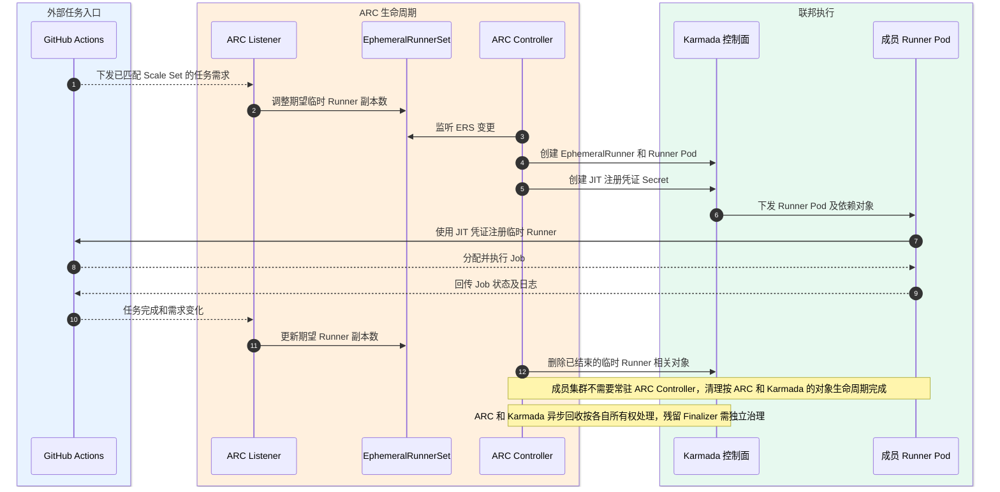

#### 5.2.4.2 UC-04 Job 结束回收 Runner 与凭证——运行时序（US-07）

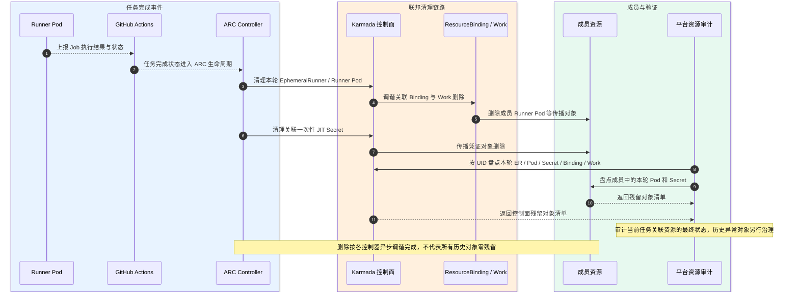

#### 5.2.4.3 生命周期回收契约和异常时序

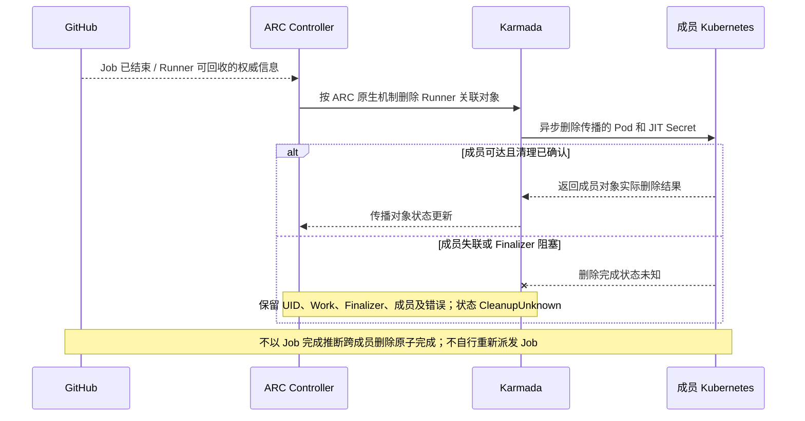

| 触发 | 应核对的事实 | 恢复责任 |
|---|---|---|
| ER/Pod 创建后 JIT 未可用 | 成员 FailedMount、Pod 引用及 Karmada 依赖传播状态 | Karmada/成员继续原生调谐，ARC 按自身版本规则处理失败 |
| Pod Failed / Runner 注册失败 | ARC 原生 Runner 状态和 GitHub 是否已分配 Job | ARC/GitHub 的正式失败策略，不由集成层自创重投 |
| Job completed 后删除中 | ER、控制面 Pod、Binding/Work、成员 Pod、两侧 Secret | ARC 和 Karmada 分别负责自身对象；审计标记未确认项 |
| 删除被 Finalizer 阻塞 | deletionTimestamp、Finalizer 所属控制器与依赖 | 先修复原控制器或依赖，不直接删除未知 Finalizer |

**幂等性**：重复 Watch/Delete 通知只促使核对已有对象，不能生成另一份 Job；跨控制面清理非原子且顺序不固定。

### 5.2.5 用户接口设计

开发者通过 GitHub 查看作业状态；运维通过 Run、Runner、Pod、Work 标识排障。无需手动创建 Pod/Secret；无新增 UI。

### 5.2.6 实现接口设计

#### 5.2.6.1 接口设计

| 交互双方 | 原生接口或资源 | 输入、操作与输出 | 权限与前置条件 | 异常处理与限制 | 依据及规格 |
|---|---|---|---|---|---|
| ARC Listener 与 EphemeralRunnerSet | Kubernetes API：`EphemeralRunnerSet` 更新操作 | Listener 根据 GitHub 返回的任务需求更新指定 Runner 服务的期望数量。 | Listener 身份必须具有指定 Runner 服务所需的更新权限。 | API 返回资源版本冲突或拒绝访问时，必须保留失败原因，不得更新其他 Runner 服务。 | ARC-1；SP-01 |
| ARC Controller 与 Karmada API | `EphemeralRunner`、`Pod` 和 JIT Secret | ARC 创建临时 Runner 对象、Runner Pod 和注册所需的临时 Secret。 | Controller 必须有权管理所在命名空间的对应资源。 | 对象创建失败时记录资源类型和 API 错误，不得报告不存在的 Runner 已注册。 | ARC-1；SP-07 |
| ARC/Karmada 与成员 Kubernetes | Runner Pod、JIT Secret、`ResourceBinding`、`Work` | ARC 按官方生命周期删除临时 Runner，Karmada 调谐被传播对象的删除。 | 每个控制器只能依据其资源所有权处理相关对象。 | 删除未完成时保留对象 UID、Finalizer 和错误，不得清除未知 Finalizer。 | ARC-1、KAR-1；SP-07 |

**开发交付边界**：开发人员维护 Runner Scale Set 配置、资源关联和必要权限；动态 Runner 的创建与回收由 ARC 的官方控制器完成。

### 5.2.9 DFX分析

**功能安全与性能约束**：平台不能超过 Runner 服务规定的容量上限。作业失败后，未经确认的重复执行可能产生副作用，因此不得仅因 Runner Pod 消失而重新提交作业。JIT Secret 的数据不得写入日志。

**可靠性故障分析（FMEA）**

| 编号 | 失效原因 | 业务或系统影响 | 检测方法 | 处理与恢复要求 | 负责方 |
|---|---|---|---|---|---|
| F02-01 | ARC 对任务需求的响应延迟。 | GitHub Job 需要等待 Runner。 | 比较 Runner 的期望数量与实际数量，并检查 ARC Controller 事件。 | ARC 运维人员应检查控制器状态和资源容量；平台按业务阈值发出告警。 | ARC 运维 |
| F02-02 | Runner 注册失败或 Job 执行中断。 | Job 不能完成，错误重试可能导致重复执行。 | 检查 GitHub Run、临时 Runner 状态和 Pod 事件。 | 应按 GitHub 与 ARC 的官方机制处理；没有明确去重依据时不得再次派发。 | GitHub、ARC 运维 |
| F02-03 | 临时资源的 Finalizer 阻止删除。 | 临时 Pod 或 Secret 仍占用资源。 | 按对象 UID 检查 ER、Pod、Binding、Work 和 Secret 的删除状态。 | 由对象所属控制器完成清理；需要人工操作时先确认资源所有者。 | ARC、Karmada 运维 |

**风险—措施—验证追踪**（关联：SR-02-01、SR-02-02、SR-NF-03/06；延续上方 FMEA 编号，不替代已有故障表）

| FMEA | 失效模式 | 影响 | 风险 | 设计措施及对应约束 | 设计验证准则 | 剩余风险 |
|---|---|---|---|---|---|---|
| F02-01 | ARC 供给滞后或已达 maxRunners | Job 排队、服务容量不足 | 中 | SP-01 容量上下限；分离需求、实例和注册三个观测阶段 | 从 ERS 期望数、ER/Pod 数及 GitHub Job 状态能判断瓶颈位置；不得承诺未批准的 SLA | GitHub 与 ARC 响应延迟不可由本系统单方保证 |
| F02-02 | Runner 注册失败/运行中断 | Job 失败或重复执行副作用 | 高 | LC-01/LC-07 区分 Job 权威状态与 ARC 重试；集成层不自发重派 | Pod 丢失时不会由集成逻辑生成第二份相同 Job；结果取自 GitHub | 上游失败重试和业务幂等性仍需按正式机制约束 |
| F02-03 | Finalizer 或成员失联导致残留 | Pod/JIT Secret 持续存在，凭证暴露窗口增加 | 高 | LC-05 与 3.5.2 分域删除确认，CleanupUnknown 和按所有权清理 | 控制面删除后仍能报告未清成员对象、UID、Finalizer 与目标成员 | 失联期间不能保证立即销毁 |

**运行诊断与敏感信息处理**：使用 GitHub Run、临时 Runner、Runner Pod UID、JIT Secret 和 Binding/Work 追踪同一次任务。Finalizer 阻止删除时，必须先确认设置它的控制器。

## 5.3 F-03 Runner 联邦成员调度与依赖传播

### 5.3.1 功能概述

**关联需求**：SR-03-01、SR-03-02；**用例**：UC-05 在合格成员放置 Runner、UC-06 JIT Secret 晚到后的依赖恢复、UC-10 成员不可用或无可调度资源；**功能域规格**：SP-02、SP-03、SP-04。

F-03 将 Runner Pod 与临时注册凭证分发至合格成员，并接收传播和运行状态。

**职责**：Runner Pod 匹配、候选成员和依赖传播；节点调度归 Kubernetes。

### 5.3.3 实现思路

`PropagationPolicy` 定义 Runner Pod 选择器及候选成员，`propagateDeps` 下发 JIT Secret。目标 Dispatcher 根据跨成员队列和资源事实选择成员、放行 Binding；成员 kube-scheduler/Volcano 负责 Node 绑定。GitHub Job 队列保持原样。`Divided/Weighted` 不保证独立 Pod 逐轮均分。

### 5.3.4 设计思路

Controller 创建 Runner Pod，Detector 形成 Binding；目标 Dispatcher 按 PL-D03 排队并选成员，Karmada Work 分发 Runner/JIT，成员调度实际 NPU workflow Pod。Secret 晚到与容量不足分别等待/诊断，不额外提交 GitHub Job。

**UC-05 设计前置条件及后置条件**：前置：Runner Pod 已生成待放行 Binding，Dispatcher 拥有唯一写入权、可信成员容量和确定的排队作用域；后置：放行唯一 Cluster，Karmada Work 传播，成员 Pod/Runner 注册成功后才可执行。预留 Node 不等于已绑定 NPU Pod；`Divided/Weighted` 不具备跨 Binding 排队能力。

| 用例分支 | 设计决策 | 必须保留的诊断证据 |
|---|---|---|
| 有授权候选成员，成员 Pod 正常启动 | 保留 Karmada placement，后续以成员 Pod/Runner 状态判定可执行 | Pod UID、目标 Cluster、Binding/Work、节点/Ready 状态 |
| 无授权或健康候选成员 | 不扩张到未授权成员；不创建重复 Job | 策略选择器、成员状态、调度事件 |
| 目标成员已选但 NPU workflow Pod 因节点不足 Pending | 成员 kube-scheduler/Volcano 负责节点调度和 Pending；Dispatcher 用反馈修正可用容量与后续放行，不擅自重派同一 Job | workflow Pod 的 `FailedScheduling`、节点请求、成员容量快照、Runner/Binding UID |
| 设备资源分散，单节点无法满足完整请求 | 不把成员聚合空闲容量当作单节点可满足证明 | 节点可用资源、亲和性、设备插件状态 |
| 多个 Runner 竞争剩余容量，队首大任务等待 | 目标 Dispatcher 按 PL-D03 Hold/Release，保护队首后仅允许安全 Backfill；不把当前 Karmada 默认能力宣称为 FIFO | 队列顺序、Binding Hold/Release、节点预留、grant 与 NPU workflow PodScheduled |
| 已分发成员失联 | 状态保持可诊断；不将 Job 视作自动迁移完成 | Cluster Ready、Work 状态、Pod/Runner 关联 ID |

**接口契约补充**：Karmada `resourceSelectors` 选取 Runner Pod，`clusterAffinity` 限定授权成员。目标 Dispatcher 以 PL-D03 的 FIFO/优先级/Reserve/Backfill 策略 Hold/Release Binding，选唯一成员；Karmada Work 分发 Runner；成员 kube-scheduler/Volcano 绑定实际 NPU Pod。`Weighted` 不是跨独立 Runner 的队列算法。

#### 5.3.4.1 UC-05 在合格成员放置 Runner——运行时序（US-03）

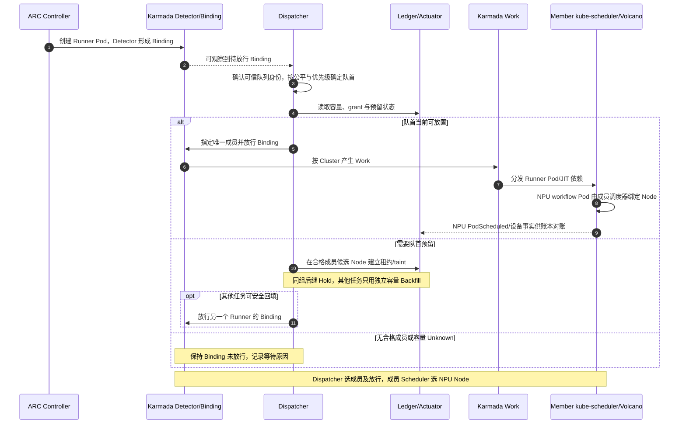

#### 5.3.4.2 UC-06 JIT Secret 晚到后的依赖恢复——运行时序（US-04）

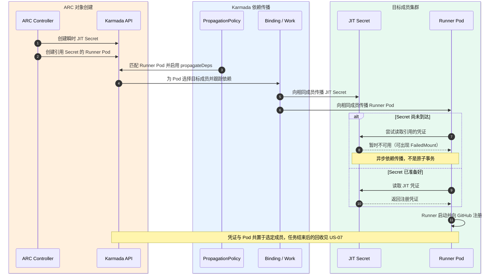

#### 5.3.4.3 UC-10 成员不可用——异常运行时序

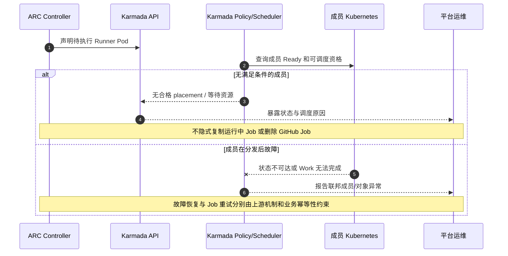

**异常约束**：不得将成员失联等价于 GitHub Job 已失败或可安全重复执行；设计仅保证可诊断的异常状态和责任边界。

### 5.3.5 用户接口设计

开发者无需选择成员；管理员通过 Cluster、Binding/Work、Pod 事件定位执行成员与未就绪原因。无新增 UI。

### 5.3.6 实现接口设计

#### 5.3.6.1 接口设计

| 交互双方 | 原生接口或资源 | 输入、操作与输出 | 权限与前置条件 | 异常处理与限制 | 依据及规格 |
|---|---|---|---|---|---|
| ARC Controller 与 Karmada API | Kubernetes `Pod`、`Secret`、`ServiceAccount` | ARC 创建带有服务标签、运行身份和 JIT Secret 引用的 Runner Pod。 | Controller 必须具有指定命名空间的所需对象管理权限。 | 对象不存在或 JIT Secret 尚未可用时，必须保留实际状态，不得重新提交 Job。 | ARC-1；SP-03 |
| 平台配置与 Karmada | `PropagationPolicy`：`policy.karmada.io/v1alpha1` | 平台必须设置资源匹配条件、成员候选范围和依赖传播规则。 | 策略维护者只能操作授权范围内的命名空间及成员。 | 策略不匹配或没有合格成员时，保留调度原因，不得默默选择其他租户成员。 | KAR-1、KAR-2；SP-02、SP-03 |
| Karmada 与成员 Kubernetes | `ResourceBinding`、`Work` 及成员对象 | Karmada 将选定 Runner Pod 和它引用的运行依赖分发到指定成员。 | Karmada 必须持有已注册成员的 API 访问身份。 | 成员不可达或资源发生冲突时，按上游调谐语义处理，不强制覆盖其他管理者的对象。 | KAR-1、KAR-2；SP-02 |

**开发交付边界**：开发人员维护 `PropagationPolicy` 及关联权限，并检查目标 Runner Pod 被选中、非目标 Pod 不被选中。不得将 GitHub Job 重新派发作为 Karmada 对象传播失败的默认恢复动作。

### 5.3.7 调度正确性约束

| 约束编号 | 不变量/限制 | 反例及处理 |
|---|---|---|
| PL-01 | 被传播的 Runner Pod 必须属于明确的 Runner 服务范围 | 现有全命名空间 Pod 选择器不满足目标隔离要求，属于 SP-03 待改配置 |
| PL-02 | 目标成员必须符合授权的候选集与平台明确声明的硬性约束 | 无匹配成员时报告不可调度，不得越权扩张 |
| PL-03 | 传播完成 ≠ 节点成功调度 ≠ Runner 已注册 ≠ Job 成功 | 分别使用 Karmada、成员 K8s、ARC/GitHub 事实判定 |
| PL-04 | 单个 Runner Pod 不能通过聚合多个节点/成员空闲量证明满足完整资源请求 | 容量碎片化仍可能导致 Pending；保留诊断状态 |
| PL-05 | 独立 Pod 的 `Divided/Weighted` 不构成跨 Pod 比例、NPU 预留或调度公平保证 | 不在设计或验收中使用无依据的成功率/均衡性承诺 |
| PL-06 | 成员不可达或 Pod 未就绪不得触发未经去重证明的 GitHub Job 重派 | 只按上游生命周期和后续 T3 约束处理 |
| PL-07 | Dispatcher 只能选择成员；需要可靠的单节点可放置容量信号，但不得把估算节点视为已经绑定的 NPU Pod | A 单节点最多 8 卡、B 单节点 16 卡时，16 卡工作流选 B 成员；由 B 的 kube-scheduler/Volcano 决定 Node；见 PL-D02 |
| PL-08 | Dispatcher 的未落地容量授予与节点预留须持续对账；实际 NPU 分配以成员工作流 Pod 的节点绑定及 kubelet 事实为准 | 两个 Runner 不得共用同一份预估空闲容量；预留 Node taint 不等于 workflow Pod 必定绑定该节点；见 PL-D02 |
| PL-09 | Dispatcher 只在具备可信队列身份和成员授权时对 Binding Hold/Release，按公平作用域决定顺序 | GitHub Job 排队与 Binding Hold 不是同一阶段；ClassUnknown 不获得高优先级 |
| PL-10 | 预留须由 Node 保护租约、归属、精确 toleration 和同组 Hold 协同执行 | 同组后继不能占队首预留 Node；禁止 `Exists` 通配 |
| PL-11 | Backfill 仅使用不影响队首预留承诺的非预留资源 | 没有可信完成时限时不得借用队首保护 Node 的空闲量 |
| PL-12 | Dispatcher 重启或切主后必须重建队列及账本；Binding 写者互斥，租约具备失效清理 | 两个 Leader 不得同时放行；Dispatcher 退出不能使 Node 永久被 taint |
| PL-13 | 分时优先级仅重排未放行任务，需有可信 PR/nightly 分类与抗饥饿策略 | 未知任务类别不冒充 PR；旧任务不因每天切换窗口无限期等待 |
| PL-14 | 跨租户按同一资源族的 NPU 卡时和批准权重仲裁；未落地授予与已完成服务分开计量 | 16 卡×1 小时与 2 卡×1 小时不能视为相同服务；PL-D04 |
| PL-15 | 类别在 Binding 放行前可信关联；不从可修改的标签推导 PR/nightly | 同 runs-on 无法映射 queued Job 时按 ClassUnknown 普通优先；PL-D05 |
| PL-16 | 应急调度接管前必须确认原 Binding Writer 失效 | 决策停止但进程仍续约不能判定 Dispatcher 健康；PL-D06 |
| PL-17 | 切主先对账持久化 grant、Node 预留及实际 NPU Pod；未知容量停止放行 | 空账本不是节点空闲；应急和 Dispatcher 不能双写；PL-D06 |

**设计级验收边界**：PL-07～17 为目标约束，当前 Manifest 没有 Dispatcher。PL-D02 定义两级放置；PL-D03 定义 FIFO/Reserve/Backfill；PL-D04 定义公平计量；PL-D05 定义可信分类；PL-D06 定义故障降级。权重、类别关联、时间窗口及故障阈值均为 P 类，不宣称运行时已经具备公平或无损切换。

### 5.3.9 DFX分析

**功能安全与性能约束**：传播策略不能无意包含其他租户的 Pod。JIT Secret 必须只分发到有实际执行需求的成员。监控应分别记录成员选择、Secret 可用和 Runner 注册等阶段，不得宣称未经定义的平均分配比例。

**可靠性故障分析（FMEA）**

| 编号 | 失效原因 | 业务或系统影响 | 检测方法 | 处理与恢复要求 | 负责方 |
|---|---|---|---|---|---|
| F03-01 | 传播策略错误地选择了非 Runner Pod。 | 其他工作负载可能被复制到不应访问的成员。 | 比对策略标签与目标 Runner Pod、非目标 Pod 的标签。 | 策略维护者必须收窄选择条件，并确认其他租户 Pod 不匹配。 | 联邦策略维护者 |
| F03-02 | JIT Secret 晚于 Runner Pod 到达成员。 | Runner Pod 无法挂载所需 Secret，启动推迟。 | 检查成员 Pod 的 `FailedMount` 事件和 JIT Secret 引用。 | Karmada 继续调谐依赖传播；成员 Kubernetes 继续挂载重试。平台不得因此重复派发 Job。 | Karmada、成员运维 |
| F03-03 | 候选成员不可达或资源不足。 | Runner Pod 无法进入可执行状态。 | 检查成员 Cluster Ready、Binding/Work 和 Pod 调度事件。 | 运维人员应恢复成员或调整已授权的候选集；不得重复提交正在执行的 Job。 | 联邦与资源池运维 |
| F03-04 | 资源账本没有扣除未落地的 NPU 授予。 | 多个 Runner 被放行到同一耗尽节点或成员。 | 对照 Binding grant 与真实 workflow Pod 绑定及快照覆盖范围。 | Dispatcher 按 UID 对账并保守停止超售放行。 | Dispatcher/容量维护者 |
| F03-05 | 成员容量快照滞后或拓扑无法建模。 | 队列错误放行、Job 持续等待。 | 比较 Estimator、成员 Node/Pod 与实际 FailedScheduling。 | 将成员标记 CapacityUnknown，恢复观测后重新判断。 | 容量维护者 |
| F03-06 | 队首大任务被后续小任务连续占用资源。 | 大任务长期饥饿。 | 队首等待时间、回填次数、预留兑现率。 | Dispatcher 触发受限 Reserve Node 并拒绝破坏保护的回填；按公平策略老化。 | 调度策略维护者 |
| F03-07 | 预留租约未续或未清理；Dispatcher/Janitor 故障。 | Node 长期被 taint，资源闲置。 | `reserved-until`、reserved-by、Janitor 运行与实际 Node taint。 | 新 Leader 对账，Janitor 按归属/到期回收；限制每集群受保护节点预算。 | Actuator/Janitor 维护者 |
| F03-08 | 回填任务持有过宽 Toleration 或同组未被 Hold。 | 后继任务占用队首保护容量，FIFO 承诺失效。 | 对照 Runner group、Node taint、workflow Pod 的实际 NodeName。 | 仅精确 Equal 容忍，同组后继 Hold；错误保护须告警并恢复。 | Dispatcher/成员调度维护者 |
| F03-09 | 两个 Dispatcher 实例或降级调度器同时放行 Binding。 | 重复分发或队列顺序不可信。 | Leader Lease、Binding resourceVersion、放行决策记录。 | 只保留单写者；完成状态恢复后才放行，接管与降级互斥。 | Dispatcher/联邦控制面维护者 |

**风险—措施—验证追踪**（关联：SR-03-01、SR-03-02、SR-NF-02/03；延续上方 FMEA 编号，不替代已有故障表）

| FMEA | 失效模式 | 影响 | 风险 | 设计措施及对应约束 | 设计验证准则 | 剩余风险 |
|---|---|---|---|---|---|---|
| F03-01 | 过宽 Pod 选择器误传播非 Runner 工作负载 | 非目标 Pod 占用成员资源、扩大传播范围 | 高 | SP-03/PL-01 精确匹配 ARC Runner Pod，不改动其他工作负载 | 非目标 Pod 不匹配；当前全命名空间选择器标为未满足 | 策略标签随 ARC 版本改变可能导致误选或漏选 |
| F03-02 | JIT Secret 与 Pod 异步传播 | Pod FailedMount 或启动超时 | 中 | SP-04/LC-04 关联引用依赖、保持 Pending、原生调谐 | Secret 晚到时不出现伪 Ready；可关联失败事件和传播状态 | 异步到达与联邦同步延迟 |
| F03-03 | 成员故障或节点容量碎片化 | Runner/Job 等待，NPU workflow Pod 可能 Pending | 高 | PL-02～PL-07；Dispatcher 参考成员节点可放置容量选择集群，成员调度器选 NPU Node | A 聚合卡数足够但单节点不够、B 有完整节点时 Dispatcher 选 B；成员实际 FailedScheduling 归成员调度器 | 拓扑/快照不完整时仍可能 Pending |
| F03-04 | Dispatcher 容量账本漏计未落地授予 | 多个 Runner 被放行到资源不足的同一成员 | 高 | PL-08、PL-D02：以 Runner/Binding UID 跟踪容量暂计，直到成员 workflow Pod 实际落地并计入快照 | 后一 Dispatcher 决策不能重复使用前一授予的容量；对账不依赖 Runner CPU Pod 的 Node | 控制面异步与外部工作负载竞争仍可能影响成员容量 |
| F03-05 | 成员容量信息过期或设备拓扑模型不完整 | Dispatcher 可能选择错误成员或长时间等待 | 高 | CapacityUnknown、保守 hold、以成员 PodScheduled/FailedScheduling 反馈更新容量 | Unknown 不得判定可放置；成员调度器仍负责实际 Node 选择 | 保守等待可能延长排队，阈值待定 |
| F03-06 | 队首长期等待，连续小任务插队 | 大任务饥饿、等待 SLO 失守 | 高 | PL-09/11/13；PL-D03 保护队首、仅非预留容量 Backfill，按作用域公平仲裁 | 队首需要完整 Node 时，后继任务不能无限占用保护区；提供队首等待和回填证据 | 已运行长任务不可抢占，尚无有界完成时间 |
| F03-07 | Node 预留泄漏或租约清理失效 | 可用 NPU 节点永久闲置 | 高 | PL-10/12；归属标记、短租约续期、成员 Janitor、预算限制 | Leader 死亡后短租约到期可判定清理；错误归属不得被自动接管 | 成员控制面/Janitor 同时故障时仍可能残留 |
| F03-08 | 同组后继绕过 Hold、宽泛 toleration 抢占队首 | 预留失效、队首饥饿 | 高 | PL-10/11；仅匹配 group 的 Equal Toleration、同组 Hold、预留违规观察 | 容忍 Exists/未 Hold 均不满足验收；出现非队首占用必须告警 | 与未纳管调度器之间存在共存约束 |
| F03-09 | 多写者或恢复未对账就放行 | 任务重复传播、账本偏差 | 严重 | PL-12；唯一 Binding 写者、Leader/进度检测、Grant 重建、降级互斥 | 切主前后同 Binding 不能由两个写者放行；未知容量不进入新放行 | Lease 抖动及网络分区导致短时不可用 |

**运行诊断与敏感信息处理**：诊断时先查看成员集群的 Ready 状态与 Karmada Binding/Work，再检查成员 Pod 事件和 Secret 引用。日志不得保存 Secret 数据。

## 5.4 F-04 Listener 跨控制面认证与访问

### 5.4.1 功能概述

**关联需求**：SR-04-01；**用例**：UC-08 Listener 访问统一 Karmada API、UC-11 Token 失效或证书不匹配；**功能域规格**：SP-04、SP-05。

F-04 为成员 Listener 提供 Karmada API 地址、可信证书和最小授权身份，仅允许操作所属 Runner 服务。

**职责**：Listener 访问身份、地址和权限；不修改 API Server 认证。

### 5.4.3 实现思路

用 ServiceAccount、TokenRequest 和 RBAC 建立 Listener 身份。校验 Karmada API 证书链与名称。地址、CA、Token 由部署提供；示例固定 IP 和签发脚本不等于自动轮换。

### 5.4.4 设计思路

凭证方签发 Token/CA；Listener 验证服务器证书，API Server 校验身份与权限。校验通过才能更新指定 `EphemeralRunnerSet`；网络、TLS、401、403 分别记录。

#### 5.4.4.1 UC-08 Listener 访问统一 Karmada API——运行时序（US-05）

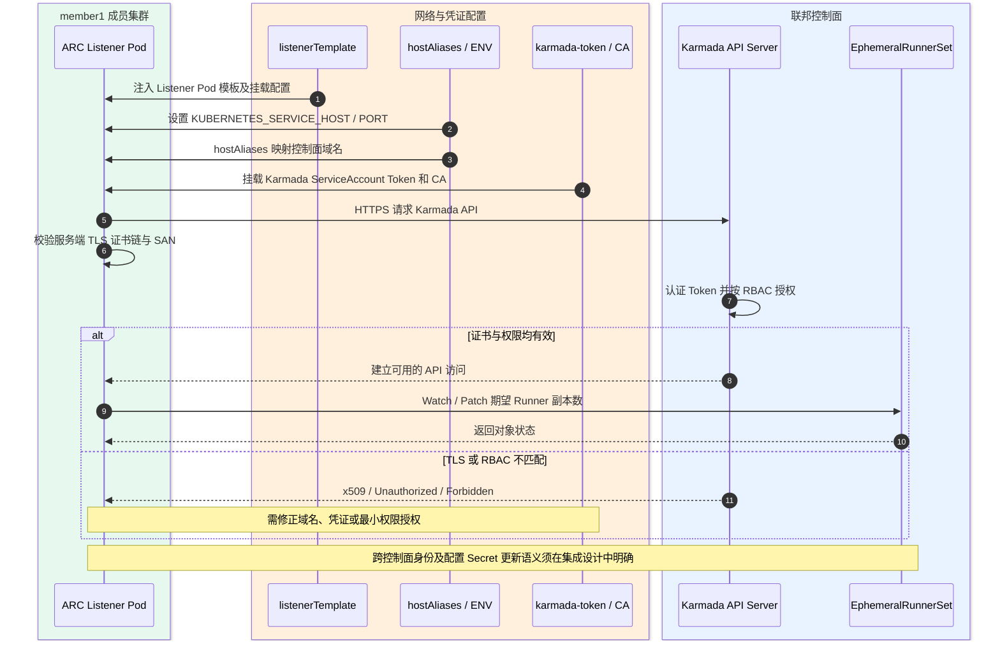

#### 5.4.4.2 UC-11 令牌轮换、权限拒绝和撤销——异常时序

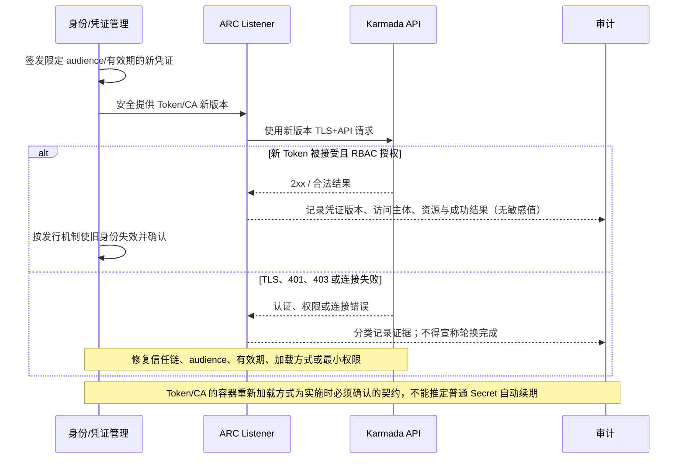

| 情况 | 错误归属 | 设计恢复动作 | 禁止行为 |
|---|---|---|---|
| DNS/TCP/路由失败 | 网络连通性 | 恢复控制面可达，保留目标地址和错误分类 | 不转向未经验证 API |
| TLS CA/SAN 不匹配 | 服务端身份与信任链 | 修正证书链、访问域名、信任锚 | 不关闭 TLS 校验 |
| HTTP 401 | Token 到期、issuer/audience、对象绑定或载入失败 | 重新核对 Token 有效性、消费者加载和 Karmada 认证配置 | 不升级为管理员凭证 |
| HTTP 403 | RBAC 不足或请求作用域不匹配 | 对照实际 API verb、resource、namespace 与 `resourceNames` | 不直接授予 cluster-admin |
| Secret 副本留存/成员失联 | 传播与回收状态未知 | 记录目标成员及副本 UID；恢复后核对，并独立检查远端凭证撤销 | 不宣称删除控制面 Secret 即完成全域撤销 |
| 更新 Secret 但 Listener 仍用旧 Token | 凭证加载机制 | 定义可检查的新凭证加载/Listener 重启流程 | 不把 Secret resourceVersion 变化当成轮换成功 |

**接口检查**：应记录 Caller 身份、目标资源及操作、请求结果、失败类别、凭证非敏感版本和观测时间。原则上仅记录不含敏感信息的可追踪标识。对当前 `03-rbac.yaml` 的 `ephemeralrunners` 授权范围及 Controller admin kubeconfig，必须标为生产目标权限整改点；不能通过本次文档更新宣布配置已整改。

### 5.4.5 用户接口设计

身份和轮换由安全管理员维护；运维查看 Listener 状态、错误类型及证书/Token 版本。复用现有工具，无独立 UI。

### 5.4.6 实现接口设计

#### 5.4.6.1 接口设计

| 交互双方 | 原生接口或资源 | 输入、操作与输出 | 权限与前置条件 | 异常处理与限制 | 依据及规格 |
|---|---|---|---|---|---|
| ARC Listener 与 Karmada API | HTTPS Kubernetes API、`EphemeralRunnerSet` | Listener 必须使用指定 API 地址、可信 CA 和访问令牌更新所负责的 Runner 对象。 | Token 必须来自受控身份；RBAC 只授予所需对象和操作。 | 网络、证书、HTTP 401、HTTP 403 和超时必须分别记录，不允许绕过认证。 | K8S-1、K8S-2；SP-05 |
| 部署与密钥管理系统和 Listener Pod | Listener 模板、Secret 或受控凭证投射卷 | 部署方必须提供 CA、Token、有效期及 API 连接信息，并明确更新后的加载方式。 | 凭证应以只读方式提供给需要的容器，禁止出现在日志中。 | Token 到期或未加载时，必须报告身份状态；不得假定修改 Secret 后立即生效。 | SP-04、SP-05 |
| 安全管理员与 Kubernetes RBAC | `Role`、`RoleBinding` | 对指定 `EphemeralRunnerSet` 授予所需 `patch` 权限，对必要的 `EphemeralRunner` 资源授予对应读写和状态权限。 | 必须确认 ServiceAccount 命名空间、绑定对象以及操作范围。 | RBAC 配置与契约不一致时，应修正 Role/Binding；不得赋予 `cluster-admin`。 | K8S-2；SP-05 |

**开发交付边界**：开发人员维护 ServiceAccount、Role/RoleBinding、Listener 模板和证书/令牌加载配置。Token 的到期处理和重新加载方式必须在部署方案中确定。

### 5.4.9 DFX分析

**功能安全与性能约束**：Listener 必须验证 HTTPS 服务器证书。凭证只授予必要操作权限，日志不得包含 Token 或私钥。高可用与不中断轮换属于部署参数，不能宣称已自动具备。

**可靠性故障分析（FMEA）**

| 编号 | 失效原因 | 业务或系统影响 | 检测方法 | 处理与恢复要求 | 负责方 |
|---|---|---|---|---|---|
| F04-01 | API 地址不可达或 TLS 证书校验失败。 | Listener 不能访问 Karmada API。 | 分别检查 DNS/TCP 连通性、CA 与证书 SAN。 | 部署维护者应修正服务地址或证书配置，不能关闭 TLS 校验。 | 部署与证书管理员 |
| F04-02 | Token 已到期或 Listener 未加载新 Token。 | Listener 的 Runner 数量更新操作失败。 | 检查 HTTP 401、Token 有效期和凭证加载记录。 | 身份管理员更新 Token；部署维护者按规定重载 Listener。 | 身份与部署维护者 |
| F04-03 | Role 或 RoleBinding 的授权范围错误。 | Listener 无法操作所需资源，或存在越权风险。 | 检查 HTTP 403 与 Role/Binding 中的资源名称及操作。 | 安全管理员按最小权限规则修正配置，保留变更审计。 | 安全管理员 |

**风险—措施—验证追踪**（关联：SR-04-01、SR-NF-01/02；延续上方 FMEA 编号，不替代已有故障表）

| FMEA | 失效模式 | 影响 | 风险 | 设计措施及对应约束 | 设计验证准则 | 剩余风险 |
|---|---|---|---|---|---|---|
| F04-01 | TLS 身份校验错误或连接不可达 | Listener 无法安全访问控制面 | 高 | SP-05 强制 CA/SAN 校验，网络/TLS 分别诊断 | 错误路径不允许 insecure-skip-verify、换用未知地址或管理员凭证 | 证书与网络基础设施失效仍影响供给 |
| F04-02 | Token 到期、新凭证未被加载 | ERS 更新失败、Runner 供给停止 | 高 | SEC-04 轮换双确认；按加载机制更新或安全重启 | Secret 更新但旧 Token 仍在使用不得判为轮换成功；401 可追踪 | 需要目标运行方式的加载/轮换能力 |
| F04-03 | RBAC 过大或过小 | 越权修改/合法操作被拒绝 | 严重 | SEC-03 逐 API verb/resource/namespace 收敛；Controller 禁止生产 admin kubeconfig | 授权身份只可改所属资源；403 单独报告；当前 admin kubeconfig 标记为差距 | 上游版本变更可能改变所需权限 |
| F04-04 | GitHub 主凭证被传播至无消费者成员 | 成员被攻陷后获取长期管理凭证 | 严重 | SEC-01/02 分离管理凭证、JIT 和 Listener 身份；只允许实际消费者读取与传播 | 核对 PropagationPolicy：非消费者成员无长期主 Secret；当前双成员分发标记未满足 | 凭证本身受外部授权与撤销机制限制 |

**运行诊断与敏感信息处理**：平台必须分开记录网络连接错误、证书校验错误、HTTP 401 与 HTTP 403。出现权限失败时，不能通过关闭 TLS 或授予 `cluster-admin` 来绕过。

## 5.5 F-05 Runner Pod 状态反馈与一致性

### 5.5.1 功能概述

**关联需求**：SR-05-01；**用例**：UC-09 Runner Ready 状态反馈、UC-12 状态缺失、冲突或滞后；**功能域规格**：SP-06、SP-07。

F-05 将成员 Pod 状态回传 Karmada，供 ARC 读取容器名、运行状态与 Ready；仅支持单执行成员。

**职责**：状态解释及来源约束；Job 结果归 GitHub。

### 5.5.3 实现思路

用 Karmada `ResourceInterpreterCustomization` 保留 Pod 状态，不改 ARC/Karmada 控制器。多来源状态须另定冲突规则，不能直接取第一个非空值。

### 5.5.4 设计思路

成员 kubelet 更新 Pod，Karmada 汇总状态，ARC 读取 Ready 和容器信息。无成员状态时不得伪造 Ready 或判定 Job 成功。

#### 5.5.4.1 UC-09 Runner Ready 状态反馈——运行时序（US-06）

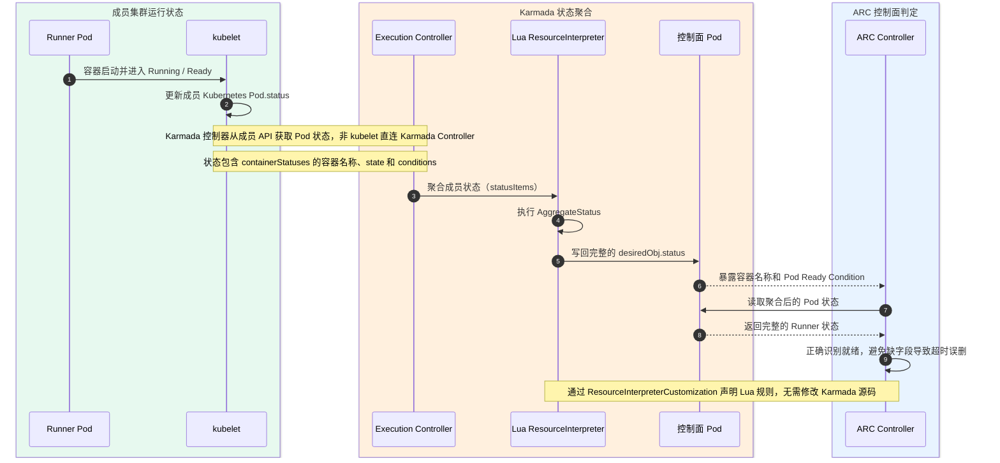

##### 5.5.4.2 多来源状态聚合及过期状态处理

**当前配置差距**：`manifests/01-karmada-interpreter.yaml` 中的 `AggregateStatus` 使用第一个非空 `statusItems[i].status`，只在确实存在唯一可信来源时才适用，**没有实现**按目标成员选择、冲突隔离或过期识别。

| 输入/条件 | 设计要求 | 不满足时 |
|---|---|---|
| ResourceBinding/Work 的当前活动目标 Cluster | 聚合源只能来自目标成员 | 无法唯一确认时不产生新的 Ready 结论 |
| 成员 Pod 身份（Cluster、namespace、name、UID） | 来源与当前传播实例匹配，不使用旧 Pod/旧 Work 的状态 | 记为 Unknown 并保留冲突证据 |
| Pod phase、conditions、containerStatuses | 保留 ARC 目标版本实际需要的全部状态字段 | 不合成缺失字段或假造 Ready |
| 最新性 | 在同一对象/集群内使用 UID 和实际可比较的版本/观测时间；跨集群不比较 resourceVersion | 信息不全则保留未确认状态 |

**扩展点边界**：目标版本 `ResourceInterpreterCustomization` 是否暴露目标 Cluster 和 Pod UID，以及 Lua 是否能查询当前 Binding/Work，必须由该版本接口确认。若缺少这些输入，则不能声称上述规则由现有 Lua 单独实现；只能保留严格的单来源前提，或在后续设计确定合适的外部状态选择机制。状态算法不得通过猜测字段伪实现。

**正确性出口**：成员状态、控制面聚合状态和 GitHub Job 状态独立追踪。控制面旧 Ready 不得覆盖成员失联事实；Pod Ready 不等于 GitHub Job 成功。

### 5.5.5 用户接口设计

开发者在 GitHub 查看 Job；运维按 Pod UID、成员、容器名、Ready 排障。无新增 UI。

### 5.5.6 实现接口设计

#### 5.5.6.1 接口设计

| 交互双方 | 原生接口或资源 | 输入、操作与输出 | 权限与前置条件 | 异常处理与限制 | 依据及规格 |
|---|---|---|---|---|---|
| 成员 kubelet 与 Karmada | Kubernetes `Pod.status` | 成员 Kubernetes 提供 `phase`、`conditions`、`containerStatuses` 和容器运行信息。 | Karmada 必须能读取目标成员 Pod 的状态。 | 状态未返回时应保留未确认状态，不得生成不存在的容器状态。 | KAR-3；SP-06 |
| Karmada 状态解释器与控制面 Pod | `ResourceInterpreterCustomization` 的 `AggregateStatus` | Lua 规则必须将单目标成员的必要 Pod 状态字段写入控制面对象。 | 目标对象为 `apiVersion: v1`、`kind: Pod`；来源必须与选定执行成员一致。 | 没有状态时不能伪造 Ready；出现多个状态来源时必须有明确的选择规则。 | KAR-3；SP-06 |
| ARC Controller 与 Pod 状态 | Kubernetes Pod 读取或监听操作 | ARC 读取 Runner 容器名称、容器状态与 Pod Ready 条件。 | Controller 必须具有读取对应 Pod 的权限。 | 字段缺失时不能假定 Runner 已就绪；必须提供状态与事件诊断。 | ARC-1；SP-06 |

**开发交付边界**：开发人员维护 `ResourceInterpreterCustomization` 中的 Lua 解释规则，并保证目标版本的 ARC 所需字段完整保留。

### 5.5.9 DFX分析

**功能安全与性能约束**：必须保留 ARC 需要的 Pod 状态字段，同时避免在状态聚合或日志中记录凭证数据。状态同步延迟和告警时限由业务 SLO 确定，不得把测试采样参数当作生产指标。

**可靠性故障分析（FMEA）**

| 编号 | 失效原因 | 业务或系统影响 | 检测方法 | 处理与恢复要求 | 负责方 |
|---|---|---|---|---|---|
| F05-01 | 状态解释器遗漏容器名称或 Ready 条件。 | ARC 可能把 Runner 判定为未就绪。 | 逐项比较成员和控制面 Pod 的状态字段。 | 状态适配维护者必须保留 ARC 所需字段并检查映射规则。 | 状态适配维护者 |
| F05-02 | 同一个 Pod 出现多个互相冲突的状态来源。 | 控制面可能显示错误成员的状态。 | 核对 Binding 的目标成员与各来源 Pod 的标识。 | 设计必须先定义状态来源规则；不得静默采用第一个非空状态。 | 状态适配与 Karmada 管理者 |
| F05-03 | 成员状态同步延迟。 | Runner 就绪信息不能及时反映到控制面。 | 比较 Pod 条件时间和控制面状态更新时间。 | 平台应根据批准的时效性目标设计告警，不能填写未经定义的 SLA。 | Karmada、ARC 运维 |

**风险—措施—验证追踪**（关联：SR-05-01、SR-NF-03/04；延续上方 FMEA 编号，不替代已有故障表）

| FMEA | 失效模式 | 影响 | 风险 | 设计措施及对应约束 | 设计验证准则 | 剩余风险 |
|---|---|---|---|---|---|---|
| F05-01 | 状态聚合遗漏容器名/Ready 条件 | ARC 误判未就绪、误清理 Runner | 高 | SP-06 保留 ARC 实际读取的 Pod 状态字段 | 对比成员 Pod 与控制面字段集合，缺失不得伪造就绪 | Karmada 传输延迟仍存在 |
| F05-02 | 多来源冲突或旧状态覆盖新目标 | 错误 Ready、异常生命周期推进 | 严重 | LC-02/LC-06 先按 Binding 目标成员和对象 UID 过滤，无法唯一确认则 Unknown | 多来源时不能静默取首个非空；现有 Lua 标为未满足目标设计 | 目标版本 statusItems 可见身份字段及扩展点仍需确认 |
| F05-03 | 成员与控制面状态同步延迟 | Runner 就绪延迟/误判 | 中 | LC-04 区分成员真实状态和异步聚合；附来源及观测时间 | 控制面旧 Ready 不得证明当前成员可执行；有状态滞后诊断路径 | 同步性能目标待业务批准 |

**运行诊断与敏感信息处理**：排障时比较目标成员与控制面 Pod 的 UID、容器状态和 Ready 条件。状态来源发生冲突时必须先确认目标成员，不能静默取第一个来源。

## 5.6 F-06 异构 NPU 任务执行资源适配

### 5.6.1 功能概述

**扩展设计，当前无正式核心 SR**：原候选 SR-06-01 未纳入第 2.4 节；关联 UC-07 NPU 工作流节点调度、UC-13 NPU 资源不足，以及 SP-02、SP-08。当前 Manifest 未配置 NPU 扩展资源或 Dispatcher；本节仅规定联邦与成员的**调度职责**，不设计运行时隔离、设备固件或沙箱。

F-06 将 NPU 资源需求对应到**成员集群内实际申请 NPU 的 Pod**，保证联邦层选成员、成员层选 Node、kubelet 与设备插件分配设备。

### 5.6.3 实现思路

**两种工作负载形态必须区分**：在 runner-container-hooks 的 container mode 下，Runner Pod 可以仅使用 CPU，Runner 接收 Job 后 hooks 创建携带 NPU resources 的 workflow Pod；在不使用该模式、Job 直接在 Runner 中执行时，Runner Pod 本身可能需要申请 NPU。Dispatcher 使用声明的需求估算成员容量，但**不以 Runner Pod Ready 证明真实 NPU 已占用**。实际节点放置归成员 kube-scheduler/Volcano，设备分配归 kubelet/Device Plugin。

### 5.6.4 设计思路

Dispatcher 依据 NPU 需求和成员容量选择 Cluster，放行 Runner Binding；Karmada 负责 Runner Pod/JIT 依赖传播。成员完成 Runner Pod 调度、Job Pod 创建及 NPU Node 绑定；若节点资源不足，保持实际 NPU Pod Pending，向 Dispatcher 提供后续容量与等待诊断，不自动重派 GitHub Job。必须核实 hooks 是否强制 workflow 与 Runner 同节点；存在同节点约束时不得假设 workflow 可独立选 Node。

#### 5.6.4.1 UC-07 请求 NPU Runner 并在兼容节点执行——运行时序（US-08）

§§§mermaid
sequenceDiagram
    autonumber
    participant GH as GitHub / ARC
    participant D as Dispatcher
    participant K as Karmada Binding/Work
    participant MS as 成员 kube-scheduler / Volcano
    participant R as Runner Pod (通常 CPU)
    participant W as NPU workflow Pod
    participant KL as kubelet + Device Plugin
    GH->>K: 创建 Runner Pod 并形成待放行 Binding
    D->>D: 排队并按成员资源容量选 Cluster
    D->>K: 放行 Binding，记录唯一成员
    K->>MS: 传播 Runner Pod 和 JIT 依赖
    MS->>R: 选择 Runner Pod 节点并启动
    GH->>R: Job 分配给已注册 Runner
    R->>MS: hooks 创建携带 NPU resources 的 workflow Pod
    MS->>MS: 依据 Node 资源和拓扑 Filter / Score / Bind
    MS->>W: 绑定实际 NPU Node
    KL->>KL: kubelet 在 Node 上调用 Device Plugin Allocate
    KL-->>W: 通过容器运行时暴露设备
    W-->>GH: 执行 Job 并上报结果
    Note over D,MS: Dispatcher 选成员/管理预留；成员调度器决定 Node
§§§

**非 container mode 分支**：若 Job 直接运行在申请 NPU 的 Runner Pod 中，成员调度器直接对该 Runner Pod 完成 NPU Node 绑定；该分支不能假装存在独立 workflow Pod。

#### 5.6.4.2 UC-13 NPU 资源不足——异常运行时序

§§§mermaid
sequenceDiagram
    autonumber
    participant D as Dispatcher
    participant K as Karmada
    participant M as 成员 kube-scheduler / Volcano
    participant W as 实际 NPU Pod
    participant Ops as 运维诊断
    D->>D: 查询成员资源可放置性与预留状态
    alt 无合格成员
        Note over D,K: 保留待放行 Binding，分类 NoFeasibleCluster / CapacityUnknown
    else 已选择成员
        D->>K: 放行 Runner Binding 至选中 Cluster
        K-->>M: Runner 到成员，随后实际 NPU Pod 由成员创建
        M->>M: 检查节点资源与拓扑
        alt 无可用 NPU Node
            M-->>W: Pod Pending / FailedScheduling
            M-->>Ops: 保留 Pod、Node 及设备失败证据
            Note over D,Ops: Dispatcher 更新后续容量决策；不改变已运行 Job
        else 节点可放置
            M-->>W: Bind Node，kubelet/Device Plugin 分配设备
        end
    end
§§§

### 5.6.5 用户接口设计

开发者通过原有 `runs-on` 选择 NPU 服务，无需指定成员或 Node。运维按 GitHub 排队、Dispatcher Binding hold、成员 NPU Pod Pending 分阶段定位等待。无新增 UI。

### 5.6.6 实现接口设计

#### 5.6.6.1 接口设计

| 交互双方 | 原生接口或资源 | 输入、操作与输出 | 权限与前置条件 | 异常处理与限制 | 依据及规格 |
|---|---|---|---|---|---|
| 工作流与 Runner 服务 | GitHub Actions `runs-on`、ARC RunnerSet | 服务类型与实际 NPU 工作负载需求匹配；保持用户标签不变。 | 仓库获得服务授权。 | 无服务时由 GitHub 排队，不自动降级 CPU。 | ARC-1；SP-01、SP-08 |
| Dispatcher 与 Karmada | Runner `ResourceBinding`、成员资源状态 | Dispatcher 选 Cluster 并放行 Binding；Karmada 分发 Runner Pod 和依赖。 | 单一 Binding 写入者；服务与成员授权一致。 | 无可接纳成员保留等待，不设 NodeName，不重复创建 Job。 | KAR-1；PL-D02 |
| 成员调度器与实际 NPU Pod | `Pod.spec.containers[].resources`、`Pod.spec.schedulerName`、节点约束 | workflow Pod（或直接执行的 Runner Pod）声明 NPU 扩展资源；成员调度器选 Node。 | 资源名由设备插件发布；hooks 同节点限制已查明。 | FailedScheduling 由成员报告，不以 Karmada 成员放置成功替代 Node 绑定。 | K8S-3；SP-08 |
| kubelet 与 NPU Device Plugin | Device Plugin API | 在已绑定 Node 上完成设备 Allocate 并向容器暴露设备。 | 设备已注册且健康。 | 设备异常不得移除资源请求或改用 CPU 运行。 | K8S-3；SP-08 |

**开发交付边界**：本节仅定义架构接口；NPU 扩展资源名、workflow/Runner Pod 模板、hooks 同节点条件、成员 Scheduler 类型及设备拓扑为 P 类输入，待后续设计确认，不宣称目标方案已部署。

### 5.6.9 DFX分析

**性能与可靠性**：分开观测 Dispatcher 等待、Runner 供给/注册、实际 NPU Pod 从创建到 PodScheduled 的等待，以及设备准备。保护队首的节点预留只影响成员可用容量与调度约束，**不等于 Node Bind**。

**可靠性故障分析（FMEA）**

| 编号 | 失效原因 | 业务或系统影响 | 检测方法 | 处理与恢复要求 | 负责方 |
|---|---|---|---|---|---|
| F06-01 | 实际 NPU Pod 的资源名称或单位与 Device Plugin 不一致。 | NPU Pod 无法调度。 | 比对 workflow/Runner Pod requests 与 Node allocatable。 | 修正实际 NPU Pod 模板；不改动资源请求以绕过失败。 | 设备与服务维护者 |
| F06-02 | hooks 强制 workflow 与 Runner 同节点，所选 Runner Node 没有 NPU。 | workflow Pod 长期 Pending 或放置失败。 | 检查 `nodeName`、required NodeAffinity、hooks 版本及 Pod 事件。 | 明确解除节点耦合或采取受约束放置路径；不把普通成员放置判断当 Node 保证。 | Hooks 与调度维护者 |
| F06-03 | Dispatcher 估计可行，成员实际资源发生竞争或设备变为不可用。 | 已放行 Runner 但 NPU Pod Pending，Job 等待增加。 | 比较 Binding/容量账本、成员 FailedScheduling、Node 设备状态。 | 成员继续原生调度，Dispatcher 更新容量与后续放行；不额外重派 Job。 | Dispatcher 与成员调度维护者 |

**风险—措施—验证追踪**

| FMEA | 失效模式 | 影响 | 风险 | 设计措施及对应约束 | 设计验证准则 | 剩余风险 |
|---|---|---|---|---|---|---|
| F06-01 | NPU resources 不一致 | Pending / FailedScheduling | 高 | SP-08 绑定真正 NPU Pod 的资源声明与设备插件名称 | 请求与 Node allocatable 的资源单位一致；失败不得降级 | 设备型号配置漂移 |
| F06-02 | Runner/workflow 强制同节点 | 消除成员 NPU 可放置性 | 高 | PL-D02：按 hooks 版本确定耦合分支 | 有/无同节点约束时分别能指出成员内 Node 选择路径 | 当前 hooks 部署模式待确认 |
| F06-03 | 容量快照与成员实时状态不同步 | NPU 任务等待 | 高 | PL-D02 容量账本/预留与成员调度事实对账 | 不把预留 Node 当已绑定；Pod Pending 有独立诊断 | 资源竞争、成员状态延迟 |

**运行诊断**：必须区分 CPU Runner Pod 与真正申请 NPU 的 workflow Pod（或直接 NPU Runner Pod），记录 NPU Pod UID、节点资源申请、PodScheduled、Device Plugin 事件及关联 Runner/Binding。不得把 CPU Runner 已就绪当作 NPU 容量已分配。

## 5.7 跨功能时序与接口契约

本节统一明确 F-01～F-06 的**输入、输出、前置条件、异常与幂等边界**。本节是现有功能设计的补充约束，不新增控制器、REST API 或 Swagger Endpoint。上游 ARC/Karmada/Kubernetes 的 API 定义优先于设计示意图。既有 US-01～US-08 的箭头表示业务协作关系；涉及实际对象创建顺序时，以目标版本控制器实现为准，不能把“ARC 创建 Pod/Secret”理解为 Listener 直接调用 Pod API。

| 功能 / 场景 | 前置条件与输入 | 实现机制与输出 | 异常、并发与幂等边界 |
|---|---|---|---|
| F-01 统一 Runner 服务；UC-01/02 | GitHub 仓库/组织授权；workflow `runs-on` 与 `AutoscalingRunnerSet.spec.runnerScaleSetName` 匹配；Scale Set、凭证与 Listener 可用 | GitHub 匹配 Job，Listener 接收需求，ARC 调谐期望 Runner；输出服务匹配及需求状态 | 未匹配/未授权时按 GitHub 原生队列与报错处理；不得自动改写标签或跨授权服务降级；重试提交工作流不属于集成层能力 |
| F-02 按需供给与回收；UC-03/04 | Listener 收到 GitHub 的 Job Available 信息；ERS、ER、JIT 和 Controller 权限满足 ARC 版本要求 | Listener 经 K8s API 更新 ERS；ARC 的 ER/Pod/JIT 依版本原生机制调谐；Job 结束后的删除由 ARC/Karmada 分别完成 | 创建失败、Pod Failed、注册失败和删除滞后分开记录；重复 Watch 不能自行生成额外 Job；删除 API 成功不等于成员清理完成 |
| F-03 联邦放置及依赖；UC-05/06/10 | Runner Pod 匹配 PropagationPolicy、成员授权明确；Dispatcher 获得任务 NPU 规格与容量证据 | Dispatcher 决定 Cluster、持有或放行 Runner Binding；Karmada Work 分发 Runner 及 JIT；成员调度器为实际 NPU Pod 选择 Node | 无容量时 hold；不得扩张授权成员、复制 Runner 或重派 GitHub Job；成员失败由成员调度事实诊断 |
| F-04 Listener 跨控制面认证；UC-08/11 | CA/SAN、有效 Token、受限 RBAC、正确 Karmada API endpoint | Listener 通过认证和授权后对目标 ERS/ER 执行所需 API 操作；输出 API 返回值与非敏感审计记录 | DNS/TCP、TLS、401、403、资源版本冲突分别处理；仅对授权资源重新读取并重试；轮换必须核实新凭证加载与旧身份失效 |
| F-05 状态反馈；UC-09/12 | 控制面 Pod 与当前 Binding/Work 可关联；成员 Pod 身份及状态可信 | Karmada 汇总成员 `Pod.status`；ARC 读取必要 `conditions`、`containerStatuses`；输出控制面可见状态 | 当前 Lua 只支持唯一可信状态来源；多来源/过期状态不能取首个非空；重复和乱序事件按 UID/目标 Cluster 核对，不伪造 Ready |
| F-06 NPU 扩展；UC-07/13 | **非本期正式 SR**；确认实际申请 NPU 的 Pod（workflow 或 Runner）、扩展资源名和成员/节点约束 | Karmada + Dispatcher 选择成员；成员 kube-scheduler/Volcano 选择 Node；kubelet/Device Plugin 实际分配设备 | NPU Pod 资源不足则 Pending；不得跨成员拼接、移除资源请求或自动降级 CPU |

**接口调用语义与真实上游分工**：

1. `GitHub Job Available → Listener → EphemeralRunnerSet` 是 ARC 的需求扩缩链路；`EphemeralRunnerSet → EphemeralRunner Controller → JIT configuration/Runner Pod` 才是细化后的动态对象管理链路。F-01/02 现有图的 `C→K: 创建 EphemeralRunner 与 Runner Pod` 仅为跨子系统简写，**不是一次原子 API 调用**，并不保证两个对象同时存在。
2. `Karmada Policy` 为声明式配置，`Detector/Scheduler/Binding/Work` 是控制器协调的资源与状态；F-03 图中 `API→Policy`、`Binding→Member` 为说明性箭头，不代表 Policy/Binding 对象主动发起网络调用。成员实际资源分发与状态回传由 Karmada 相关控制器协调。
3. `Pod.status` 由成员 Kubernetes/kubelet 更新，Karmada 对应控制器获取并聚合。F-05 图的 `kubelet→Execution Controller` 是数据来源关系，不代表 kubelet 直接调用 Karmada Execution Controller。状态聚合输入以目标版本 `ResourceInterpreterCustomization` API 为准。
4. NPU 设备插件通过 kubelet 的 Device Plugin API 注册并参与设备分配，**不是 kube-scheduler 直接调用 Device Plugin**。F-06 原 UC-07/UC-13 图中的 `kube-scheduler→Device Plugin` 只表示最终依赖，应按 kube-scheduler 选择节点、kubelet 经插件完成设备分配的原生交互理解。
5. `Runner/Job → GitHub` 的执行状态/结果与 `Pod.status → Karmada → ARC` 的生命周期状态是两条独立链路。Secret 挂载成功、Pod Ready 或 Work 分发完成都不能替代 GitHub 的 Job 结果。
6. `ResourceVersion` 冲突只在同一 Kubernetes API 对象上下文中按读后重试处理；不能以跨集群 resourceVersion、同名 Pod 或观察时间判定全局唯一执行。不存在跨 GitHub、ARC、Karmada 的原子提交或 exactly-once Job 保证。

**接口设计出口**：现有 5.1.6～5.6.6 的原生 API/资源表分别承载各功能契约；第 4 章 SP-01～SP-09 规定跨功能约束；T2 的身份关联与 T3 状态机规定跨域前后条件。对尚未锁定的上游版本字段（尤其状态解释器多来源字段和 NPU 插件兼容性）保留显式待核对项，不编造 Swagger 字段、响应码或自动恢复行为。

**依据**：[GitHub ARC 官方工作原理](https://docs.github.com/en/actions/concepts/runners/actions-runner-controller)、[Karmada 依赖传播](https://karmada.io/docs/userguide/scheduling/propagate-dependencies/)、[Kubernetes Device Plugins](https://kubernetes.io/docs/concepts/extend-kubernetes/compute-storage-net/device-plugins/)。

## 5.8 功能追踪与开发接口清单

| SR | 功能 | 关联规格 | 运行视图 | 开发实现入口 |
|---|---|---|---|---|
| FT-01：SR-01-01 | F-01 | SP-01 | 5.1.4.1（UC-02 为异常场景） | `04-autoscalingrunnerset.yaml`、GitHub Workflow |
| FT-01/FT-04：SR-02-01、SR-02-02 | F-02 | SP-01、SP-07 | 5.2.4.1 / 5.2.4.2 | 官方 ARC、RunnerSet、对象生命周期契约 |
| FT-02/FT-03：SR-03-01、SR-03-02 | F-03 | SP-02、SP-03、SP-04 | 5.3.4.1 / 5.3.4.2 / 5.3.4.3 | `02-propagation-policies.yaml`、Dispatcher Binding Hold/Release 与队列/预留接口（PL-D02/D03）、成员 NPU Pod 调度 |
| FT-03：SR-04-01 | F-04 | SP-04、SP-05 | 5.4.4.1 | `03-rbac.yaml`、`04-autoscalingrunnerset.yaml` Listener Template |
| FT-03：SR-05-01 | F-05 | SP-06 | 5.5.4.1 | `01-karmada-interpreter.yaml` |
| **扩展候选：原 SR-06-01，当前非正式 SR** | F-06 | SP-02、SP-08 | 5.6.4.1 / 5.6.4.2 | 尚需设备选型；仓库未配置 NPU 扩展资源 |

### 5.8.1 需求—用例—规格—接口—DFX 完整追踪

**追踪口径**：IR 是功能能力要求，SR 为场景需求，UC 为用例，F 为实现设计单元，SP 为跨功能规格。FMEA 的编号 `F01-01` 等为失效模式，不是 F 功能编号；US 为时序图编号，不是系统需求。AR 尚未进入迭代分解，不得虚构。下表明确**正式需求**与**扩展候选**的差异。

| IR / 特性 | 正式 SR | 对应用例（含异常） | F 与接口 | 跨功能规格/约束 | DFX 与故障追踪 |
|---|---|---|---|---|---|
| IR-01 / FT-01 | SR-01-01 | UC-01、UC-02 | F-01；5.1.6 | SP-01、SP-05；SEC-02 | 5.1.9：F01-01～02 |
| IR-01 / FT-01 | SR-02-01 | UC-03 | F-02；5.2.6 | SP-01、SP-07；LC-03/04 | 5.2.9：F02-01～02 |
| IR-04 / FT-04 | SR-02-02 | UC-04、UC-12（清理异常） | F-02、F-05；5.2.6、5.5.6 | SP-07、SP-06；LC-05/06 | 5.2.9：F02-02～03；5.5.9 |
| IR-02 / FT-02 | SR-03-01 | UC-05、UC-10 | F-03；5.3.6 | SP-02、SP-03；PL-01～13、PL-D01/D02/D03 | 5.3.9：F03-01～09；QA-07～09 |
| IR-03 / FT-03 | SR-03-02 | UC-06 | F-03；5.3.6 | SP-03、SP-04；LC-04 | 5.3.9：F03-02 |
| IR-03 / FT-03 | SR-04-01 | UC-08、UC-11 | F-04；5.4.6 | SP-04、SP-05；SEC-01～06 | 5.4.9：F04-01～04 |
| IR-03 / FT-03 | SR-05-01 | UC-09、UC-12（状态异常） | F-05；5.5.6 | SP-06、SP-07；LC-01/02/06 | 5.5.9：F05-01～03 |
| 扩展候选（不属于正式 IR/FT） | 原 SR-06-01（未纳入） | UC-07、UC-13 | F-06；5.6.6 | SP-02、SP-08；PL-04/05 | 5.6.9：F06-01～03 |

**非功能要求的横向追踪**：SR-NF-01/02 对应第 4.4、5.4 及 F03-01/F04-03/F04-04；SR-NF-03 对应 4.5、4.7.2、F02-03/F03-03/F05-02/F03-07/09；SR-NF-04 对应 3.5.1、4.7.3、QA-04/08 及各功能诊断；SR-NF-05/06 对应 4.3.6、4.7.1/4.7.4、F02-01/F03-03/06/08、QA-07～09；SR-NF-08 对应 4.3、5.3、PL-01/02/09。完整的非功能条目见 5.8.2。

**UC/US 对应关系**：UC-01→US-01；UC-03→US-02；UC-05→US-03；UC-06→US-04；UC-08→US-05；UC-09→US-06；UC-04→US-07；UC-07→US-08。UC-02、UC-10、UC-11、UC-12、UC-13 为异常分支，其中 UC-10/11/13 已给出异常时序，UC-02/12 由异常契约及状态规则覆盖；**没有对应独立 US 编号不表示该 UC 已被实现**。

**现状与目标**：SP-02（当前无 Dispatcher Hold/Reserve/Backfill）、SP-03（Pod 选择器过宽）、SP-04（长期 GitHub 主凭证传播）、SP-05（Controller 高权限与 Token 轮换）、SP-06（状态解释器首个非空）均是目标设计与当前配置差异。PL-D03 规定公平与队首保护的设计条件，但并不代表这些机制已在本仓库部署，也不代表多来源状态一致性已经实现。

### 5.8.2 非功能需求与详细设计追踪

| 非功能需求 | 功能域规格 | 主要实现设计章节 |
|---|---|---|
| SR-NF-01 身份与权限 | SP-01、SP-05 | 5.1.9、5.4.6、5.4.9 |
| SR-NF-02 凭证保护 | SP-04、SP-09 | 5.2.9、5.3.9、5.4.9 |
| SR-NF-03 成员故障隔离 | SP-02、SP-07 | 5.2.9、5.3.4.3、5.3.9 |
| SR-NF-04 可服务性 | SP-09 | 5.1～5.6 各功能的 DFX |
| SR-NF-05 性能与容量 | SP-01/02、SP-09、PL-D03 | 4.3.6、4.7.1/4.7.4、5.3.4/5.3.9；量化参数 P-SR-01、P-SR-02 |
| SR-NF-06 成本与资源利用 | SP-01、SP-07 | 5.2.3、5.2.9；量化参数 P-SR-04 |
| SR-NF-08 策略可维护性 | SP-01、SP-02 | 4.2、4.3、5.3.6 |

本表只将与 FT-01～FT-04 相关的正式 SR 关联至详细设计。第 4、5 章仍可保存 ARC/Karmada 的必要技术契约和 NPU 扩展参考，但不把所有实现机制或通用 DFX 项目升级为正式系统需求。量化参数未获得业务批准时，对应指标保持待定。

### 5.8.3 最终设计评审的判定边界

本设计的“完成”是指功能与质量属性的**设计契约可审查**，而不是跨组件组合已经经过验证。尤其需要区分：（1）现有 Manifest 已体现的配置；（2）官方版本直接支持的 API 和机制；（3）本项目要求但尚未实现或尚未证明可由现有扩展点实现的集成行为。

| 待确认项 | 文档已有的设计结论 | 验收限制 |
|---|---|---|
| Karmada `ResourceInterpreterCustomization` 多来源识别 | 必须根据当前目标成员/对象身份过滤状态，冲突时不得宣称 Ready | 未确认目标版本的 `statusItems` 可见字段与筛选扩展点，不得标记“可直接由当前 Lua 实现” |
| ARC Controller/Listener RBAC 最小化 | 必须根据目标版本的真实 API verbs/resources 收敛 | 当前 Controller admin kubeconfig 不符合生产目标；文档不能替代权限实施 |
| JIT Secret 异步传播与删除 | 依赖 Pod 引用及 Karmada `propagateDeps`，清理需确认成员副本 | 不能推断所有引用形态均自动识别，或跨成员销毁是原子事务 |
| NPU 资源容量与节点可放置性 | PL-D02：Dispatcher 选择成员并协调容量预留，成员 kube-scheduler/Volcano 选择 NPU Node，kubelet/Device Plugin 分配设备 | Dispatcher Binding 独占权、hooks 同节点行为、成员容量估计及预留恢复需版本级确认；当前 Manifest 未实现 |
| FIFO/Reserve Node/Backfill 与公平 | PL-D03：Dispatcher 持有与放行 Binding、队首容量保护、非预留容量 Backfill、优先级与租户公平仲裁 | 可信 PR/nightly 类别、租户来源、批准时间窗口/权重、Node 精确 Toleration、同组 Hold、租约清理和应急调度互斥尚需接口与参数确认 |
| 关键路径与可用性目标 | 已定义阶段、来源、故障域和诊断契约 | 没有业务批准的时延/恢复阈值，不构成量化性能与可用性验收 |

**DFX 设计决策追踪**：PL-D01 → F-03/QA-01～02；PL-D02 → F-03/QA-01、QA-04、PL-07/08、F03-03～05；PL-D03 → F-03/QA-07～09、PL-09～13、F03-06～09；ST-D01 → F-05/QA-03；QA-05～06 → SP-07/SP-09。剩余风险见 4.7.4。

**最终评审口径**：第 2～5 章设计结构、要求追踪、异常处理与 FMEA 可以通过静态设计检查；涉及上表未确定的技术可实现性、正式指标或实际运行效果，只能标为**待专项选型/接口确认**。不要求开展 PoC，也不以抽象时序图替代上游 API 证据。

**统一资料来源及版本边界**：本文件 3.7 给出 ARC/GitHub Actions、Karmada、Kubernetes 官方文档索引；本仓库现有 Manifest 用于定位配置差异；任何仅有内部运行记录支持、而无上游接口规范支持的声明都应标明为集成设计假设。缺少 PoC 不构成功能设计缺口，但 **SR/接口/异常/DFX 未定义**属于设计缺口。

**实施前需选择的参数（P）**：GitHub 组织/仓库与权限、目标版本和镜像 digest、联邦控制面 API/DNS/CA、凭证发行及轮换、成员与资源标签、NPU 型号与扩展资源名、跨租户权重、PR/nightly 可信类别及时间窗口、Reserve/Backfill 租约与保护预算、性能/可用性 SLO。若有正式输入来源，则填写批准值；如果尚无，不得硬编码临时 Kind IP 或杜撰业务 SLA。
