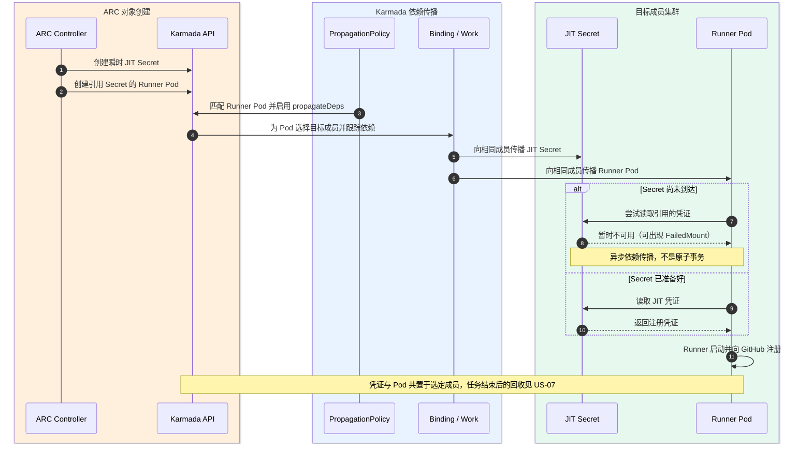
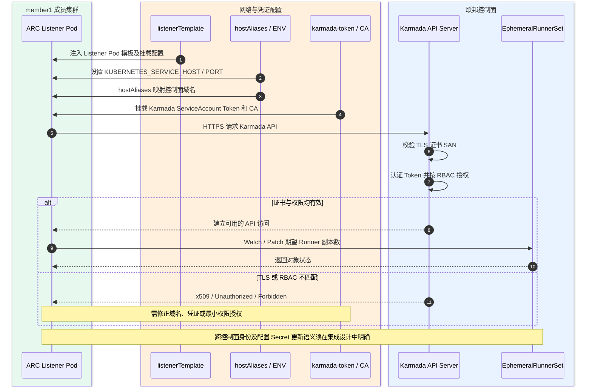
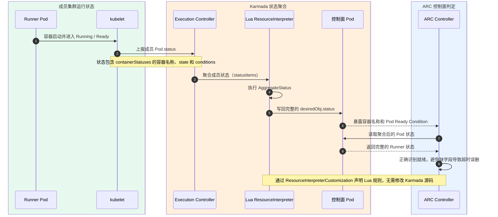
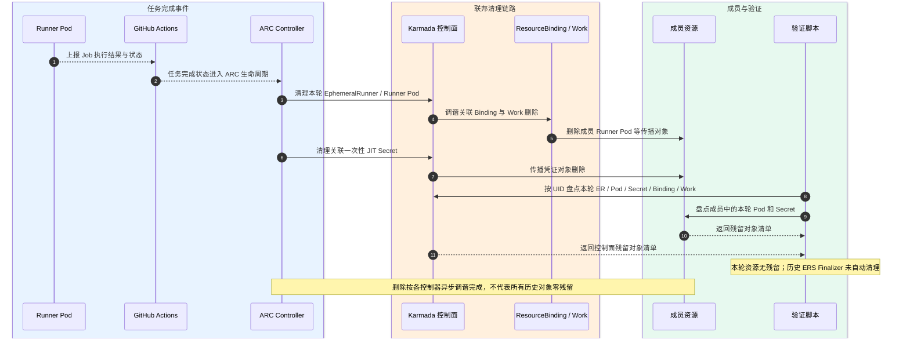

# ARC + Karmada 联邦调度执行子系统设计说明书

> 版本：1.3（基于上游组件文档的架构设计）
> 设计参考：GitHub Actions / ARC、Karmada、Kubernetes 官方文档；本仓库当前 Manifest 为实现示例
> 文档性质：**方案设计与设计评审**；不以 PoC、CI、Kind 重建或实际 Job 运行作为文档完成前提

## 本文档的定位

本文回答“如何结合官方 ARC Runner Scale Set、Karmada 资源联邦和成员 Kubernetes，设计统一标签、跨成员执行的 GitHub Actions Runner 平台”。核心内容是业务问题、组件职责、部署关系、接口契约、状态/凭证/生命周期及 US-01～US-08 的运行场景。**ARC、Karmada、Kubernetes 均作为上游复用组件，不展开它们内部架构。**

**设计依据**：ARC 的 Scale Set、Listener、JIT 注册及 Runner 生命周期采用 [GitHub 官方 ARC 文档](https://docs.github.com/en/actions/concepts/runners/actions-runner-controller)；成员选取、依赖传播和状态解释能力采用 [Karmada 官方 PropagationPolicy](https://karmada.io/docs/next/userguide/scheduling/propagation-policy/)、[Propagate Dependencies](https://karmada.io/docs/userguide/scheduling/propagate-dependencies/) 及 [Resource Interpreter](https://karmada.io/docs/userguide/globalview/customizing-resource-interpreter/)；成员 RBAC 和设备资源采用 Kubernetes 官方文档。逐 Story 依据和适用边界见 **[上游文档依据矩阵](UPSTREAM-SOURCE-MATRIX.md)**。

这些上游文档分别定义了各组件的接口和行为，但**不直接担保 ARC 与 Karmada 组合的端到端兼容性**。跨控制面 Listener 鉴权、JIT 依赖同成员传播、Pod.status 归并和清理协作属于本项目提出的集成设计决策，必须在[实现契约](IMPLEMENTATION-CONTRACT.md)中写清前提与限制。文档评审只要求“依据可追溯、约束自洽、接口清晰”；运行验证属于后续工程活动，不是设计审批门槛。

[设计评审规则](ACCEPTANCE-CONTRACT.md)定义如何判断设计是否完整；[README](../README.md)和[历史 PoC 验证记录](arc-0.15.0-validation.md)仅是可选实施参考，不作为本设计的主要证据。

# 1. 模块介绍

## 1.1 目标与职责

将原先项目独占的多个执行集群纳入 Karmada，统一管理 GitHub Actions Runner 的创建、分发与回收。

| 职责 | 实现主体 | 边界 |
|---|---|---|
| 任务匹配与 Runner 生命周期 | ARC Listener、Controller、Scale Set | GitHub Actions 提供队列；ARC 调整 Runner 数量 |
| 资源对象传播与成员选择 | Karmada Policy、Scheduler、Binding / Execution Controller | 选择成员集群；不承担每个 Pod 的节点级调度 |
| 资源实际执行 | 成员 Kubernetes、kube-scheduler、kubelet | 创建 Runner Pod；可在 NPU 节点执行有设备请求的工作负载 |
| 状态与凭证适配 | ResourceInterpreterCustomization、Listener Token / RBAC、propagateDeps | 保留 ARC 所需的 Pod 状态和 JIT Secret |
| 设计契约与治理 | 本子系统接口适配、策略、身份与状态约束 | 由本项目负责架构决策；不代替上游内部实现 |

## 1.2 系统边界

**边界内：** ARC Controller、Listener、Runner Scale Set；Karmada 控制面；纳管的 Kubernetes 成员集群、Runner Pod 和目标 NPU 节点资源。

**边界外：** GitHub Actions 服务、业务项目、镜像仓库及现有企业级监控系统。

系统边界表示统一联邦执行的运行范围，组件可依据部署条件运行在不同 Kubernetes / 宿主环境。图示选择了“Controller 在独立管理环境、Listener 定向成员、Runner 由联邦分发”的**参考部署拓扑**，并非上游唯一合法部署形态。跨控制面访问需要独立的凭据与网络设计。

## 1.3 子系统目标

**现状：** 集群按项目固定分配。不同集群不能共享空闲资源。部分集群资源空闲，部分集群任务排队。热点项目等待时间较长。

**目标：** ARC 统一管理 Runner 需求。Karmada 将 Runner 分发至满足条件的成员集群。系统支持项目间共享合格成员的执行容量，以减少资源错配和可避免的排队等待。

**设计边界：** 该图为问题/目标示意，利用率及排队收益没有定量证明；本设计不承诺指定改善百分比。联邦策略负责成员选择，成员实际容量、资源兼容性和 NPU 驱动属于部署输入。

## 1.4 整体架构

本子系统包含 ARC、Karmada、成员 Kubernetes 集群及 Runner 执行环境。图中灰色外框表示子系统边界。边界外的系统通过以下接口交互。

| 外部子系统 | 方向 | 交互内容 |
|---|---|---|
| GitHub Actions | 输入 | 工作流任务、`runs-on` 标签、Runner 需求 |
| GitHub Actions | 输出 | Runner 注册、Job 执行状态和结果 |
| 配置与部署系统 | 输入 | Scale Set、PropagationPolicy、RBAC、组件版本 |
| 镜像仓库 | 输入 | Runner 镜像、Action 镜像 |
| 监控与审计系统 | 输出 | 运行日志、Kubernetes 事件、验证记录 |

**设计范围：** 图中以一个集中 ARC、一个 Karmada 控制面和两个成员作为可扩展的逻辑示例，不限定 Kind 或具体地区。NPU 设备插件是目标环境依赖，按选型纳入成员集群；不依赖 `karmada-search`。

## 1.5 关键约束

- Runner 工作流使用 `runs-on: karmada-runner`。标签对应一个已注册 Scale Set。
- Scale Set 版本标签与 ARC Controller 0.15.0 保持一致。
- Listener 运行在成员集群，通过独立 Token、CA 和 DNS 配置访问 Karmada API。
- Runner Pod 的 JIT Secret 必须传播至同一执行成员；传播过程允许短暂异步等待。
- Karmada Pod 状态解释器保留 `containerStatuses[].name` 和 `conditions`。
- `Divided / Weighted` 针对单个资源对象执行。多个独立 Pod 不保证逐轮均匀分布。
- 成员 Kubernetes 负责节点调度。NPU 任务需额外核实节点标签、设备插件、资源请求和工作负载运行环境。

# 2. 关键需求分析

## 2.1 用户故事

| ID | 用户故事（作为…我希望…以便…） | 主要验收条件 |
|---|---|---|
| US-01 | 作为 CI 开发者，我希望通过稳定的 Runner 标签提交任务，以便不指定执行 Region | 工作流不写成员集群名；Runner 标签匹配成功 |
| US-02 | 作为平台工程师，我希望集中管理 Runner 生命周期，以便减少每个集群的独立 ARC 部署 | Listener 接收任务，Controller 创建 Runner，执行后清理 |
| US-03 | 作为资源池管理员，我希望 Runner 在多个成员集群间分发，以便打通项目独占资源池 | 实际任务可分别在 member1 与 member2 成功运行 |
| US-04 | 作为平台工程师，我希望 JIT Secret 跟随 Runner Pod，以便 Runner 能完成注册 | Runner 与其 JIT Secret 在同一成员可用 |
| US-05 | 作为平台工程师，我希望 Listener 安全访问 Karmada 控制面，以便跨控制面更新 Runner 需求 | TLS、Token、RBAC 检查通过；Listener 稳定工作 |
| US-06 | 作为 ARC 维护者，我希望获取完整 Pod 状态，以便正确识别 Runner Ready 与容器状态 | Runner 容器名称、Ready Condition 在控制面可见 |
| US-07 | 作为 CI 运维人员，我希望执行结束后清理本轮资源，以便避免 Runner 和临时凭证残留 | 核对 Runner Pod、EphemeralRunner、JIT Secret、关联 RB/Work |
| US-08 | 作为 NPU 资源池管理员，我希望纳管 NPU 成员资源，以便运行硬件匹配的 CI 任务 | 明确设备插件/扩展资源、节点选择和兼容性约束；型号与资源名称待选型 |

## 2.2 场景与设计成立条件

### US-01：统一 Runner 标签
- **正常：** 工作流使用 `runs-on: karmada-runner`；GitHub Actions 与 Listener 完成匹配。
- **异常：** 标签无匹配 Scale Set 时，任务等待可用 Runner。
- **设计审查：** 匹配 ARC 官方 Scale Set 的 runs-on 标签及 Runner 注册接口；错误标签行为有文档依据。

### US-02：Runner 生命周期管理
- **正常：** Listener 更新 EphemeralRunnerSet；Controller 创建 EphemeralRunner、Pod 与 JIT Secret；Runner 完成任务。
- **异常：** Scale Set 版本不兼容、Controller 调谐异常或 Pod 启动失败。
- **设计审查：** ARC 官方 Listener、ERS、JIT 与临时 Runner 生命周期的职责边界明确。

### US-03：跨成员分发
- **正常：** Karmada 根据 PropagationPolicy 选择成员，生成 ResourceBinding 与 Work，成员执行 Runner Pod。
- **异常：** 同批独立 Pod 全部落在一个成员；任务仍可能全部成功。
- **设计审查：** Karmada 策略允许候选成员，成员执行职责清晰；不将多个独立 Pod 的均衡作为确定性保证。

### US-04：JIT Secret 依赖传播
- **正常：** Runner Pod 引用 JIT Secret；`propagateDeps: true` 将依赖传播至目标成员。
- **异常：** Secret 尚未到达时 Pod 可出现短暂 FailedMount。
- **设计审查：** ARC JIT 引用与 Karmada propagateDeps 能力有文档依据；明确非原子传播和失败责任。

### US-05：Listener 控制面访问
- **正常：** member1 Listener 通过控制面 CA、Token、Endpoint 访问 Karmada API，并 Patch EphemeralRunnerSet。
- **异常：** DNS/SAN 不匹配引发 TLS 错误；错误 ServiceAccount Token 引发 401。
- **设计审查：** Kubernetes SA/Token/RBAC/TLS 的信任边界、最小授权和轮换责任明确。

### US-06：Pod 状态聚合
- **正常：** ResourceInterpreterCustomization 将成员 Pod 的完整 `status` 回传控制面。
- **异常：** 缺少 `containerStatuses[].name` 或 Ready Condition 时，ARC 可能误判 Runner 未就绪。
- **设计审查：** Karmada AggregateStatus 能力与 ARC Pod 状态消费契约清晰；明确单目标解释规则。

### US-07：任务结束与资源清理
- **正常：** GitHub Actions Job 完成后，ARC 回收本轮临时 Runner；Karmada 逐步清理传播对象。
- **异常：** 异步删除、历史 Finalizer 或控制器失败可能保留残余对象。
- **设计审查：** ARC 回收与 Karmada 下发/删除的所有权和最终一致性边界明确。

### US-08：NPU 成员执行（待验证）
- **目标：** NPU 节点通过 Kubernetes Device Plugin 公开资源；工作负载声明对应扩展资源后，由成员调度器放置。
- **前置条件：** 确认真实 NPU 类型、分配粒度、驱动、Runtime、设备插件与 Pod 模板。
- **设计审查：** 依据 Kubernetes Device Plugin 说明资源请求和设备分配；厂商驱动与资源名作为选型输入。
- **设计状态：** US-08 可提出标准 Kubernetes 设备插件方案；实际 NPU 产品/资源名仍待选型，与是否写出设计无关。

**设计完成标准：** US-01～US-08 应各自具备用户目标、上游来源、系统决策、正常/异常交互和架构约束。T1/T2 等实际运行测试属于后续实施验证，不是本设计文档的完成前置条件。参见[设计评审准则](ACCEPTANCE-CONTRACT.md)与[上游依据矩阵](UPSTREAM-SOURCE-MATRIX.md)。

# 3. 模块设计

## 3.1 逻辑组件架构

本子系统要解决的核心问题是：**项目与执行集群绑定，导致集群间资源难以互用、负载不均衡及任务排队**。架构采用 **ARC 集中管理 Runner + Karmada 联邦分发 + 成员 Kubernetes 原生执行** 的协作模式；以下重点说明各构件对整体问题的贡献，而非展开上游组件的内部实现。

| 架构构件 | 主要解决的问题 / 架构职责 | 与其他构件的协作关系 |
|---|---|---|
| ARC Listener | **统一任务入口**：让开发者使用同一个 Runner 标签提交任务，不必为不同成员集群选择专用标签。 | 对接 GitHub Actions 的任务需求，与 ARC Controller 协同完成按需 Runner 供给。 |
| ARC Controller | **集中管理执行实例的生命周期**：使 Runner 的创建、扩缩与回收不再由每个执行集群各自管理。 | 承接 Listener 的需求变化，将 Runner 交给 Karmada 跨集群分发，并根据执行状态管理生命周期。 |
| Karmada（复用的联邦子系统） | **打通相互隔离的执行资源池**：将多个成员集群纳入同一分发范围，使一个项目的任务可以使用其他合格成员的执行资源。 | 接收 ARC 产生的 Runner 对象，将其分发至成员 Kubernetes，并把执行状态返回给 ARC；不取代成员的节点级调度。 |
| 成员 Kubernetes 与 Runner Pod | **提供实际、相互隔离的任务执行能力**：让集中管理的 Runner 在选中的成员集群使用当地计算资源执行 GitHub Job。 | 接收 Karmada 下发的 Runner 工作负载，使用成员原生调度与网络执行任务，并向控制面反馈状态。 |
| ARC–Karmada 集成适配（本原型配置与扩展） | **消除两套上游系统之间的语义与环境差异**：保障跨控制面访问、临时注册凭证可用、Runner 就绪状态可被正确识别。 | 在 ARC、Karmada 与成员 Kubernetes 之间补齐通信鉴权、依赖传播和状态聚合约束，使上述管理、分发、执行链路闭环。 |

**范围与边界：** GitHub Actions 是外部任务来源；ARC、Karmada 与 Kubernetes 是复用组件。`karmada-search` 不在本方案逻辑图中；NPU 设备插件属于成员环境依赖，不应误画为自研核心模块。跨成员执行是设计能力，不据此承诺均匀分配或固定排队收益。

部署位置见 **3.2 部署架构**；具体资源对象、联邦契约及配置适配分别见 **3.3 资源对象与生命周期**、**3.4 模块间接口**和[仓库配置](../manifests/)。

## 3.2 部署架构

以下 SVG 以仓库现有配置为**部署方案示例**，表达 ARC 管理面、Karmada 联邦控制面、成员 Kubernetes 与 GitHub Actions / 镜像仓库 / 运维监控的连接关系。图中的宿主机 Docker、Kind、member1/member2 和版本号只是参考拓扑，**不构成设计必须使用 Kind 的约束，更不要求通过 PoC 才能完成文档**。

### 3.2.1 部署构件及对外依赖

| 部署域 | 主要构件 | 架构作用与外部关系 | 设计约束 / 依据 |
|---|---|---|---|
| ARC 管理域（图例：宿主侧 Docker） | 官方 ARC Controller / Scale Set 资源 | 访问 GitHub API 并管理 Runner 生命周期；通过目标 Kubernetes API 调谐 ARC CR/Pod | 控制器凭据最小化、与 API 的网络连通性；[ARC 官方架构](https://docs.github.com/en/actions/concepts/runners/actions-runner-controller) |
| Karmada 控制面域（图例：karmada-host） | Karmada API、PropagationPolicy、资源绑定与状态解释配置 | 接收 ARC 的 Runner 对象，依策略选择成员并汇聚状态；与所有成员 API 通信 | 联邦策略、访问授权及状态语义；[PropagationPolicy](https://karmada.io/docs/next/userguide/scheduling/propagation-policy/) |
| Listener 域（图例：member1） | ARC Listener、控制面 Token/CA | 接入 GitHub Scale Set 消息，并访问 **Karmada API** 调整 EphemeralRunnerSet；不要求在所有成员各部署 Listener | 异地控制面 TLS、RBAC、Token 有效期和轮换；[Kubernetes SA](https://kubernetes.io/docs/concepts/security/service-accounts/) |
| 执行域（图例：member1/member2） | Kubernetes、临时 Runner Pod、JIT Secret；可选 NPU 设备插件 | 接收 Karmada 下发对象；由成员 kube-scheduler 完成节点级放置，Runner 直接连接 GitHub 取得任务 | 依赖传播非原子；设备资源请求由厂商插件暴露；[Karmada 依赖传播](https://karmada.io/docs/userguide/scheduling/propagate-dependencies/) |
| 平台边界外 | GitHub Actions、镜像仓库、部署管理、日志审计 | 提供 Job、Runner/Action 镜像、配置和可观测信息 | 显式声明凭据、镜像可信源与指标/审计流向 |

### 3.2.2 部署依赖与边界

- **管理面分离**：ARC Controller 不部署在每一个执行成员；它面向统一 Kubernetes API 操作受管理对象。部署为 Docker 或 Kubernetes Deployment 属于运维选型，文档不假设唯一形式。
- **Listener 控制面访问**：Listener 与 API 之间配置可验证的 HTTPS endpoint、CA、Token 与最小 RBAC；Token 的签发/轮换必须有负责方，不把手工生成的 Secret 解释为自动轮换机制。
- **执行面分发**：Karmada 通过 PropagationPolicy 选择候选成员；Runner Pod 引用的 JIT Secret 通过 `propagateDeps` 传播。Secret/Pod 下发属于异步最终一致性，需定义短暂缺失场景。
- **资源隔离**：成员 Kubernetes 负责节点调度及设备分配；Runner 无需访问其他成员的 Pod 网络。GPU/NPU 资源需要对应 Device Plugin、驱动与有效的 extended-resource 名称。
- **部署示例与正式设计**：图中 IP、Kind Cluster 名、namespace 或版本标签由[集成契约](IMPLEMENTATION-CONTRACT.md)定义为参数或基线示例；不得根据图中 PoC 布局推导生产级 HA、容灾、性能结论。

部署组件之间的接口约束见 **3.4**；每项跨组件行为的官方依据与本项目承担的决定见[依据矩阵](UPSTREAM-SOURCE-MATRIX.md)。

## 3.3 资源对象与生命周期

| 对象 | 生产者 | 消费者 / 作用 |
|---|---|---|
| AutoscalingRunnerSet | 平台配置 | ARC 管理对应 Scale Set |
| EphemeralRunnerSet / EphemeralRunner | ARC | Runner 数量和单实例生命周期 |
| Runner Pod | ARC | 作为 Karmada 的待传播 Pod |
| JIT Secret | ARC | Runner 启动注册所需的临时凭证 |
| PropagationPolicy | 平台配置 | Karmada 识别需要传播的 Pod、Secret、ServiceAccount |
| ResourceBinding | Karmada 控制面 | 保存目标成员及传播约束 |
| Work | Karmada Binding Controller | 向成员集群下发 Kubernetes 对象 |
| Pod status | 成员 Kubernetes | 经自定义 Resource Interpreter 回传给 ARC |

**关键生命周期约束：** ARC 负责 Runner 期望数量和临时实例生命周期，Karmada 负责传播和状态反馈；二者通过异步调谐完成闭环，而不是同一事务。动态对象的 owner/finalizer 不由本模块重新实现。资源删除属于控制器异步调谐契约；历史/异常 Finalizer 的治理须区分资源所有者与操作权限。资源的生产者、namespace、selector、目标成员和删除条件见[实现契约第 3～4 节](IMPLEMENTATION-CONTRACT.md)。

## 3.4 模块间接口

| 源 | 目的 | 接口 / 数据 | 关键条件 |
|---|---|---|---|
| GitHub Actions | ARC Listener | Runner scale-set Job 匹配 | Label 对应已注册 Scale Set |
| Listener | Karmada API | EphemeralRunnerSet Patch | 控制面 Token、CA、最小权限 |
| ARC | Karmada | Pod / Secret / ServiceAccount | 对象生命周期与命名空间正确 |
| 本原型传播策略配置 | Karmada（复用） | `PropagationPolicy`：Pod 选择器、clusterAffinity、Divided / Weighted、propagateDeps | 候选成员可用；不承诺独立 Pod 均匀分布 |
| Karmada（复用） | 成员 Kubernetes API | Work 中的 Pod / Secret / ServiceAccount 等对象 | 成员可访问且拥有所需权限 |
| 成员 Kubernetes | Karmada（复用） | Pod.status；由本原型声明的 ResourceInterpreterCustomization 规则聚合 | 控制面需保留容器名称、状态和 Ready conditions |
| 依赖传播 | 成员 Kubernetes | Runner 所需 JIT Secret | `propagateDeps: true`；允许异步到达 |

**集成失败边界：** Listener 跨控制面连接失败属于 TLS/Token/RBAC/网络契约问题；JIT Secret 晚到是异步依赖传播问题；成员 Pod Ready 与控制面状态不一致属于状态聚合问题。各故障的观测、重试责任和当前未验证能力详见[实现契约第 5～7 节](IMPLEMENTATION-CONTRACT.md)，不能要求业务方理解上游各 Controller 的内部实现。

## 3.5 质量属性（设计约束）

| 属性 | 设计要求 | 对外依据 / 待定项 |
|---|---|---|
| 安全 | 控制面与成员访问按身份隔离；Listener 使用最小 RBAC；Runner 默认不需要 K8s 管控 API 权限；尽量不扩散 GitHub 主凭证 | [Kubernetes RBAC Good Practices](https://kubernetes.io/docs/concepts/security/rbac-good-practices/)；生产 Token 生命周期为实现决策 |
| 可靠性 | ARC/联邦传播均采用各自上游生命周期；明确 JIT Secret 晚到、成员不可达、Pod Pending、Status 滞后与回收异常的状态和恢复责任 | [ARC](https://docs.github.com/en/actions/concepts/runners/actions-runner-controller)、[Karmada 依赖传播](https://karmada.io/docs/userguide/scheduling/propagate-dependencies/)；不承诺运行中 Job 无损迁移 |
| 性能 | 单 Scale Set 按需弹性供给；成员资源池可共享候选执行容量；不把独立 Pod 加权策略视为均衡 SLA | [ARC 量测接口](https://docs.github.com/en/actions/how-tos/manage-runners/use-actions-runner-controller/deploy-runner-scale-sets)；SLO 数值待业务给定 |
| 兼容性 | 采用官方组件 API，不依赖自维护上游源码补丁；版本适配由部署基线约束 | ARC/Karmada 官方 API 与版本资料；组合兼容性不是上游保证 |
| 可观测性 | Controller、Listener、Runner、Karmada Binding/Work 和成员 Pod 应具备可关联的指标、日志及资源状态 | GitHub ARC metrics 文档、Kubernetes Event/Pod.status；保留隐私与脱敏边界 |
| 可维护性 | 本系统只维护集成策略、接口配置和必要状态解释逻辑，不重建 Karmada/ARC 内部模块 | [集成契约](IMPLEMENTATION-CONTRACT.md)、[官方文档矩阵](UPSTREAM-SOURCE-MATRIX.md) |

**设计风险**：仓库示例中的主 GitHub Secret 多成员传播、Runner Pod 全 namespace 匹配等不能作为最小权限的目标方案。状态解释器采用首个非空状态的写法只适合单目标成员假设。设计评审须明确上述取舍的风险和改进原则，不必等待 PoC 才可以形成设计结论。

# 4. Story 设计

运行视图采用 Mermaid 时序图，表达跨组件职责、接口消息及异常路径，不展开 ARC 或 Karmada 的内部实现。图中各交互是依据官方文档能力组织的**系统级设计**，不是 PoC 的调用日志；每个 Story 的文档依据见[来源矩阵](UPSTREAM-SOURCE-MATRIX.md)，约束详见[实现契约](IMPLEMENTATION-CONTRACT.md)。

## 4.1 US-01：按统一标签提交任务

**外部体验：** 工作流使用 `runs-on: karmada-runner` 提交 Job。业务方无需指定 member1 或 member2。

**内部流程：** GitHub Actions 排队 → ARC Listener 匹配 Scale Set → 更新 EphemeralRunnerSet → Controller 创建 Runner。

**设计审查：** 核对 ARC 官方 runs-on/Scale Set 标签匹配与 Listener 获取任务需求的机制（ARC-1）。 详见[上游依据矩阵](UPSTREAM-SOURCE-MATRIX.md)。

## 4.2 US-02：集中管理 Runner 生命周期

**外部体验：** 平台按任务需求创建临时 Runner。任务结束后按 ARC 生命周期回收。

**内部流程：** Listener 调整需求 → Controller 创建 EphemeralRunner、Runner Pod 和 JIT Secret → Karmada 传播 Pod 与凭证 → Runner 执行 → ARC 清理。

**设计审查：** 核对 ARC 官方 EphemeralRunnerSet、JIT Runner 生命周期与集中管理职责（ARC-1、GH-1）。 详见[上游依据矩阵](UPSTREAM-SOURCE-MATRIX.md)。

## 4.3 US-03：原生跨成员调度

**外部体验：** 同一 Scale Set 的 Job 可在 member1 或 member2 运行。

**内部流程：** PropagationPolicy 选择 Runner Pod → Detector 创建 ResourceBinding → Karmada Scheduler 选择成员 → Binding Controller 生成 Work → Execution Controller 下发成员。

**设计审查：** 核对 Karmada Policy 的成员选择/传播与成员 Kubernetes 节点调度边界（KAR-1）。 详见[上游依据矩阵](UPSTREAM-SOURCE-MATRIX.md)。

## 4.4 US-04：JIT Secret 跟随 Runner

**外部体验：** Runner 启动后正常注册并领取 Job，无需开发者管理一次性凭证。

**内部流程：** ARC 创建 JIT Secret → Runner Pod 引用 Secret → Karmada 识别依赖 → JIT Secret 与 Runner Pod 下发同一成员 → Runner 启动。

**设计审查：** 核对 ARC JIT 配置与 Karmada propagateDeps 的组合前提；明确依赖传播不保证原子次序（ARC-1、KAR-2）。 详见[上游依据矩阵](UPSTREAM-SOURCE-MATRIX.md)。

## 4.5 US-05：Listener 跨控制面认证

**外部体验：** Listener 持续响应任务需求；用户不感知控制面与成员集群的网络差异。

**内部流程：** Listener Pod 下发 member1 → hostAliases 解析控制面名称 → 挂载 karmada-token 和 CA → InClusterConfig 指向 Karmada API → Role 允许 Patch EphemeralRunnerSet。

**设计审查：** 核对 Kubernetes TokenRequest、ServiceAccount/RBAC、TLS 与外部控制面身份边界（K8S-1、K8S-2）。 详见[上游依据矩阵](UPSTREAM-SOURCE-MATRIX.md)。

## 4.6 US-06：Pod 状态正确回传

**外部体验：** Runner Ready 状态正常，ARC 不会因状态字段缺失而误删 Runner。

**内部流程：** 成员 Pod 上报 status → Karmada 调用自定义 AggregateStatus → 控制面保留 containerStatuses、state 和 conditions → ARC 根据完整状态调谐。

**设计审查：** 核对 Karmada AggregateStatus 扩展及 ARC 就绪判断所需状态字段，限制为单目标 Runner Pod（KAR-3、ARC-1）。 详见[上游依据矩阵](UPSTREAM-SOURCE-MATRIX.md)。

## 4.7 US-07：本轮资源自动清理

**外部体验：** Job 完成后不遗留本轮创建的临时 Runner 和 JIT Secret。

**内部流程：** Job 结束 → ARC 更新 EphemeralRunner 状态并删除临时资源 → Karmada 处理绑定对象和成员资源回收 → 验证脚本按 UID 盘点。

**设计审查：** 核对 ARC Runner 回收和 Karmada 工作负载传播对象的所有权及最终一致性（ARC-1、KAR-1）。 详见[上游依据矩阵](UPSTREAM-SOURCE-MATRIX.md)。

## 4.8 US-08：NPU 资源执行（设备选型场景）

**外部行为（待验证）：** 工作流选择 NPU Runner 规格后，由兼容 NPU 节点执行计算任务。

**组件协作（尚未验证）：** Runner 模板声明 NPU 请求 → Karmada 选择目标成员 → 成员 kube-scheduler 选择节点 → Device Plugin 分配设备 → Pod 执行 → 资源释放。

**前置工作：** 核对 Runner 模板、NPU 设备插件、资源名称、节点标签、资源分配粒度和网络路径。需要真实 NPU 作业测试。

**设计状态：** 按 Kubernetes 扩展资源机制给出架构方案；具体 NPU 产品、资源名称、驱动和兼容性留待部署选型，不阻塞架构文档完成。

**设计审查：** 核对 Kubernetes Device Plugin 的扩展资源发布、Pod Request/Limit 与节点调度规则（K8S-3）。 详见[上游依据矩阵](UPSTREAM-SOURCE-MATRIX.md)。
# 5. Story → 上游能力 → 集成决策 → 设计审查

本章是**设计依据追踪**，不是 Job Run 成绩单或测试计划。原生能力依据均来自 [GitHub Actions / ARC](https://docs.github.com/en/actions/concepts/runners/actions-runner-controller)、[Karmada](https://karmada.io/docs/next/userguide/scheduling/propagation-policy/) 与 [Kubernetes](https://kubernetes.io/docs/concepts/security/service-accounts/) 官方资料；详细编号、源链接、适用范围和推导边界见[依据矩阵](UPSTREAM-SOURCE-MATRIX.md)。

| Story | 上游官方依据 | 本系统的关键集成决策 | 设计评审结论 |
|---|---|---|---|
| US-01 统一标签 | ARC-1 / ARC-2 | Scale Set 与 runs-on 一致，屏蔽成员名称 | 可依据官方 API 完成设计 |
| US-02 Runner 生命周期 | ARC-1 / GH-1 | 集中管理 Runner，成员只承担执行 | 可依据官方生命周期完成设计 |
| US-03 多成员分发 | KAR-1 | Policy 选择候选成员；不保证独立 Pod 逐轮均衡 | 可依据 Policy API 完成设计 |
| US-04 JIT 依赖传播 | ARC-1 / KAR-2 | 使用 JIT Secret 引用 + propagateDeps，并处理异步到达 | 有官方机制；集成时序是本项目决策 |
| US-05 Listener 认证 | ARC-1 / K8S-1 / K8S-2 | Token/CA/TLS/RBAC 最小权限访问 Karmada API | 有 Kubernetes 鉴权机制；跨控制面为本项目设计 |
| US-06 Pod 状态回传 | ARC-1 / KAR-3 | 单目标 Runner Pod 的 AggregateStatus 与 Ready 语义 | 有解释器扩展；规则需自行定义 |
| US-07 生命周期回收 | ARC-1 / KAR-1 | ARC 管 Runner、Karmada 管传播对象，明确异步清理 | 职责边界可设计；不承诺原子删除 |
| US-08 NPU 执行 | KAR-1 / K8S-3 | Device Plugin 扩展资源 + 成员节点资源约束 | 标准机制有据；厂商资源名待选型 |

**闭环准则：** 每个需求都可以从上游机制追溯到本项目接口/职责/异常的完整设计，未确认的产品参数必须明确标注；不需要提供 GitHub Job 链接、Kind 初始化日志、PoC 清理记录、T1/T2 验收或 NPU 硬件运行证据。相关运行工作属于后续实现测试，不能用于替代上游设计依据。

# 6. 设计约束、风险与后续实现问题

1. **ARC–Karmada 是集成方案**：官方分别支持 Runner Scale Set 和资源联邦，但没有把二者组合的全部行为定义为一项上游保证；本系统应明确 Token、状态、Secret 与所有权转换。
2. **调度语义**：Karmada Policy 允许多成员候选选择，不保证各独立 Pod 必须均匀分配；负载公平、容量感知、排队 SLA 属于未来需求。
3. **安全**：遵循 Kubernetes 最小 RBAC、TokenRequest 与 Secret 传播最小化原则；本仓库已有配置例子不自动等同生产安全基线。
4. **异步行为**：Runner/JIT Secret 与成员 Pod、绑定对象删除均存在独立控制器的调谐边界；设计必须容纳晚到、失联和恢复，不承诺跨集群原子事务。
5. **Pod 状态**：自定义 Resource Interpreter 可处理状态汇总；“第一个有 status 的成员”仅为单目标示例，不能推定自动支持多副本或运行中无损迁移。
6. **NPU**：基于 Kubernetes Device Plugin 定义标准集成，实际厂商资源名、Runtime、驱动和兼容矩阵留作实施前的具体选型。
7. **生产 DFX**：HA、升级、隔离和观测 SLO 应单列业务目标及设计，不应从示意图或官方组件能力推导性能结论。

**文档设计闭环**可由[设计评审准则](ACCEPTANCE-CONTRACT.md)与[官方文档依据矩阵](UPSTREAM-SOURCE-MATRIX.md)判定。实现/PoC 是独立工程任务，不阻塞本设计文档完成。

## 参考资料

- [官方文档依据矩阵（各 Story 的能力、设计推论、边界）](UPSTREAM-SOURCE-MATRIX.md)
- [GitHub 官方：Actions Runner Controller](https://docs.github.com/en/actions/concepts/runners/actions-runner-controller)
- [GitHub 官方：Self-hosted runners reference](https://docs.github.com/en/actions/reference/runners/self-hosted-runners)
- [Karmada 官方：Propagation Policy](https://karmada.io/docs/next/userguide/scheduling/propagation-policy/)
- [Karmada 官方：Propagate dependencies](https://karmada.io/docs/userguide/scheduling/propagate-dependencies/)
- [Karmada 官方：Customizing Resource Interpreter](https://karmada.io/docs/userguide/globalview/customizing-resource-interpreter/)
- [Kubernetes 官方：Service Accounts](https://kubernetes.io/docs/concepts/security/service-accounts/)
- [Kubernetes 官方：Device Plugins](https://kubernetes.io/docs/concepts/extend-kubernetes/compute-storage-net/device-plugins/)
- [本仓库集成契约](IMPLEMENTATION-CONTRACT.md)、[设计评审规则](ACCEPTANCE-CONTRACT.md)
- [历史 PoC 运行验证（独立工程资料，非设计完成依据）](arc-0.15.0-validation.md)
