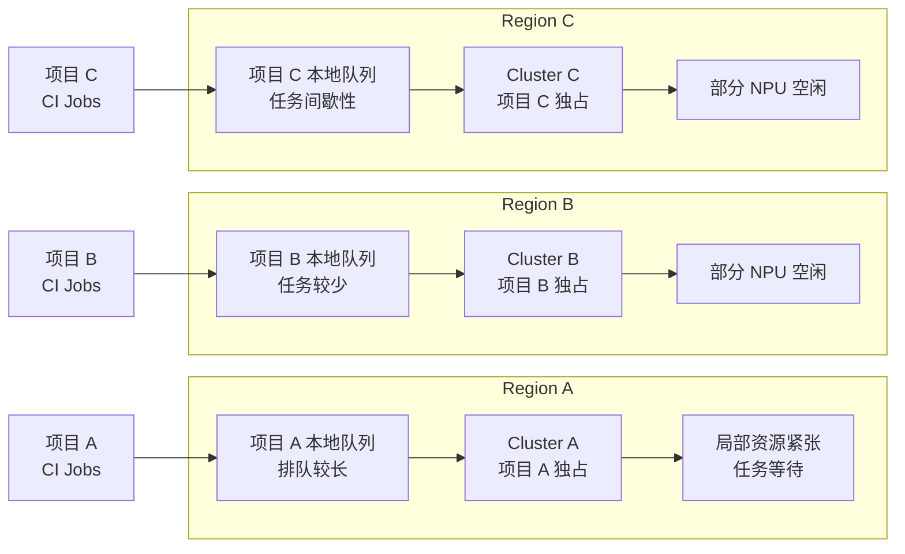
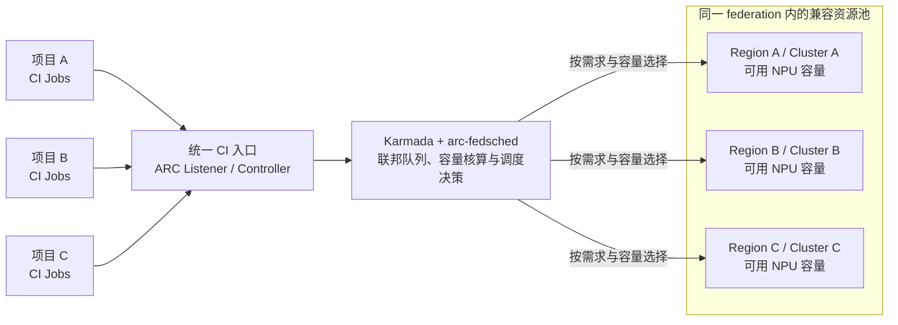

# Karmada + ARC 联邦调度子系统设计说明

> 版本：1.0  
> 日期：2026-10-24  
> 文档状态：架构说明与实现映射；**不是生产部署验收报告**。  
> 主要实现仓库：opensourceways/arc-fedsched；基础接入 PoC：pkking/arc-karmada-test。

## 本文档的定位

本文档是一份面向 `arc-fedsched` 的**联邦调度原型验证与设计说明**。它的首要目的不是宣称系统已经达到生产就绪，而是基于可复现的运行证据，说明一个关键技术判断：**ARC 与 Karmada 可以组合工作，将 GitHub Actions Runner 从单一 Kubernetes 集群的部署模式扩展为跨多个成员集群的联邦执行模式；本文进一步解释这一组合如何实现，以及 `arc-fedsched` 在此基础上补足了哪些调度能力。**

### 本文要回答的核心问题

1. **ARC 与 Karmada 能否结合？** ARC 的 Controller / Listener 能否面向 Karmada 控制面工作，并让 Runner 在不同成员集群中运行？
2. **这种组合如何实现？** 需要怎样配置控制面身份、Karmada 传播策略、Runner 及其依赖 Secret、Pod 状态聚合和成员集群执行环境，才能让任务从统一入口进入并在成员集群中完成？
3. **原生联邦分发解决了什么，还缺少什么？** Karmada 能够将 Runner 工作负载分发到成员集群，但原生 `Divided / Weighted` 不等于具备全局容量感知、公平排队、NPU 资源核算和确定性的负载均衡。
4. **`arc-fedsched` 为什么存在？** 它在 ARC + Karmada 的基础联邦执行能力上增加面向 CI/NPU 资源池的调度层，处理统一队列、需求识别、容量账本、目标成员选择、in-flight grant、可选节点预留和故障恢复等问题。

### 已有事实与结论边界

本文采用分层证据，避免把“集成可行”误写成“调度能力全部通过验收”。

- **基础集成的实测证据：** [arc-karmada-test 原型验证记录](https://github.com/pkking/arc-karmada-test/blob/main/docs/arc-0.15.0-validation.md)记录了官方 ARC Controller / Listener 0.15.0 与 Karmada v1.19.0、Kubernetes v1.37.0 在两个 KinD 成员集群上的真实 GitHub Actions 任务验证。证据覆盖 Runner 在两个成员集群执行、JIT Secret 依赖可用、容器状态回传、Listener 跨控制面认证及本轮资源清理。该结果支持“ARC 与 Karmada 可以结合实现跨成员集群的 Runner 执行”这一可行性结论。
- **原生调度的限制同样是验证结果的一部分：** 测试中出现过三项任务都落在同一个成员集群的情况，因此不能据此声称原生 `Divided / Weighted` 保证每轮均匀分布、全局公平或故障自动切换。失败与覆盖不足的运行记录保留在原验证文档中。
- **`arc-fedsched` 的职责：** arc-fedsched 仓库研究并实现比基础联邦分发更进一步的资源感知调度能力。本文描述其目标架构、组件协作、用户故事与质量属性；代码存在、单元测试通过或离线回放成功，均不单独构成生产环境的端到端验收证据。
- **原型环境的范围：** 基础集成验证运行于两个 KinD 成员集群。它证明的是指定版本和测试环境下的技术可行性，不等于已证明生产规模的容量均衡、持续高负载性能、跨 Region 故障切换、无中断升级或生产级安全基线。
- **容量模型的边界：** `arc-fedsched/config/example-federation.yaml` 用于说明配置结构；`arc-fedsched/clusters/smoke.yaml` 等合成 / 推断模型用于验证机制，不是生产容量基线。生产等待时间、吞吐量和利用率收益必须由真实节点、Pod 资源请求、工作流 trace 与监控数据校准。

### 本文在相关仓库中的位置

- [`pkking/arc-karmada-test` 验证文档与配置](https://github.com/pkking/arc-karmada-test/tree/main/docs)：提供 ARC + Karmada 基础集成的运行步骤、环境版本、结果和限制，是“能否结合、如何结合”的直接实验依据。
- [`opensourceways/arc-fedsched` 架构设计记录](https://github.com/opensourceways/arc-fedsched/blob/main/docs/DESIGN.md)：解释自定义联邦调度器的机制与设计取舍。
- [工程实施计划](https://github.com/opensourceways/arc-fedsched/blob/main/docs/BUILD-PLAN.md)：记录实现拆分与实施顺序。
- [模拟器与回放计划](https://github.com/opensourceways/arc-fedsched/blob/main/docs/SIMULATOR-PLAN.md)：说明离线模型、回放和差分验证的范围。
- [配置示例](https://github.com/opensourceways/arc-fedsched/blob/main/config/example-federation.yaml)与 [仓库 README](https://github.com/opensourceways/arc-fedsched/blob/main/README.md)：用于核对当前配置模型、实现状态和验证命令。

因此，本文的逻辑顺序是：先说明联邦调度要解决的资源割裂问题，再以基础原型的实测事实建立 ARC + Karmada 的集成可行性，随后解释 `arc-fedsched` 如何在这一基础上补足资源感知调度，并明确哪些结论已有证据、哪些仍需真实环境验证。

# 1. 模块介绍

## 1.1 模块目标

本模块为 GitHub Actions Runner Controller（ARC）提供一个基于 Karmada 的多集群执行资源调度子系统。它将“任务如何排队、应该使用哪类 NPU、哪个成员集群有可用容量、何时释放 Runner、如何防止头部任务长期饥饿、调度器失效后如何恢复”等问题从单个集群的局部视角提升到联邦视角。

目标体验是：仓库维护者通过已有的 runs-on 标签选择所需 Runner 规格，不必在工作流中硬编码具体成员集群；平台在满足硬件类型、任务规格、容量、配额与策略约束的前提下选择执行集群，并提供可追踪、可回放、可恢复的调度过程。

## 1.2 模块边界

| 边界 | 包含内容 | 不负责的内容 |
|---|---|---|
| 上游任务入口 | GitHub Actions 任务匹配；ARC Listener 更新 AutoscalingRunnerSet / EphemeralRunnerSet 的副本需求 | GitHub 工作流依赖关系、Job/Step 编排、业务测试逻辑 |
| ARC 接入适配 | ARC Controller / Listener 在 Karmada 控制面和成员集群间的身份、Secret、状态与资源对象适配 | 修改 GitHub Actions 服务端调度语义；替代 ARC 的 Runner 生命周期控制 |
| 联邦调度核心 | 观察 ResourceBinding、成员节点与 Pod；需求解析；容量核算；策略决策；RB 释放；可选节点预留、超时与恢复 | 创建或扩容物理节点；实现 NPU 驱动和设备插件；替代成员集群的最终 Pod scheduler |
| Karmada 联邦控制面 | 通过 ResourceBinding、PropagationPolicy、Work 等原生机制完成跨集群分发 | 维护各 CI 系统内部的任务 DAG、重试策略和 CRD 语义 |
| 成员集群执行面 | 承载 Runner Pod 和工作负载 Pod；由 Volcano / kube-scheduler 与设备插件完成最终节点放置 | 跨集群迁移正在执行的容器；提供跨集群工作目录或网络隧道 |
| 运营与验证 | Prometheus 指标、决策轨迹、容量快照、Python 参考模拟器、Go 回放与差分测试 | 在缺乏真实校准数据时给出未经验证的生产 SLA |

**关键边界原则：** ARC 决定何时需要 Runner；本模块决定已进入联邦调度队列的 Runner 何时、向哪个成员集群释放；Karmada Binding Controller 负责把已选的 ResourceBinding 转换为成员集群中的 Work；成员集群调度器负责最终 Pod 节点放置。该模块不接管 CI 平台自身的任务编排。

## 1.3 系统建设前后对比（Before / After）

本系统的核心价值不是简单地把 Runner Pod 分发到多个 Kubernetes 集群，而是把原本按项目和 Region 静态切分的执行资源，转变为**在兼容性、权限和配额约束内可由多个项目共享的联邦资源池**。下面以多个 Region 的 NPU CI 资源为例说明建设前后的差异。

### 1.3.1 Before：项目与集群静态绑定

没有联邦调度时，各 Region 的 Cluster 往往按项目独立分配。项目只能使用绑定给自己的集群，队列和容量都在本地管理；一个项目排队，并不意味着其他 Region 没有空闲资源。

**主要问题：**

- **资源割裂：** 每个 Region 独立形成小资源池，缺少跨 Region 的统一容量视图。
- **项目绑定：** 资源归属由静态项目划分决定，而不是由任务的硬件需求和实时容量决定。
- **局部排队、全局闲置：** 一个项目的队列可能很长，同时其他项目绑定的集群仍有可用 NPU；空闲容量无法及时服务排队任务。
- **利用率受限：** 资源需求存在时间差，独立资源池难以相互补位，整体利用率因此受到影响。
- **用户体验割裂：** 开发者和运维人员需要了解项目、Region 与 Cluster 的对应关系，容量规划和故障排查也按集群分别进行。

### 1.3.2 After：联邦调度与共享资源池

引入 Karmada + ARC + arc-fedsched 后，多个项目的 Runner 请求进入统一的调度入口。在同一 federation 内，调度器综合任务声明的硬件规格、成员集群状态和可用容量，选择满足条件的执行集群。资源不再因为项目静态归属而天然隔离。

**改进后的效果：**

- **从项目独占到资源共享：** 符合任务硬件规格和策略约束的多个项目，可以共享 federation 内的执行容量。
- **从局部队列到联邦调度：** 调度器能同时观察候选成员的容量，减少“一个 Region 排队、另一个 Region 闲置”的资源错配。
- **从静态分配到按需放置：** 根据任务需求、节点容量、背景负载和调度策略动态选择目标成员；必要时通过 backfill 和节点预留兼顾资源利用率与队列头部公平性。
- **开发者屏蔽集群位置：** 工作流按既定的 `runs-on` / Runner 规格提交任务，不需要在工作流中指定具体 Region 或 Cluster。
- **形成可度量、可演进的资源池：** 通过统一账本、调度决策轨迹和指标分析排队、容量承诺及实际资源使用情况，为后续优化提供依据。

### 1.3.3 建设前后的关键差异

| 维度 | Before：无联邦调度 | After：Karmada + ARC + arc-fedsched |
|---|---|---|
| 资源组织 | 按项目静态绑定到 Region / Cluster | 同一 federation 内按硬件兼容性和策略共享 |
| 队列视角 | 各项目 / 集群局部排队 | Dispatcher 在 federation 范围内统一决策 |
| 资源选择 | 由静态归属决定 | 按声明需求、可用容量和策略动态选择 |
| 资源错配 | 局部排队与其他集群空闲可能并存 | 可以使用其他合格成员的可用容量 |
| 用户感知 | 需要了解集群归属和差异 | 主要通过 Runner 规格提交任务 |
| 运营能力 | 分散核算，难以比较全局供需 | 统一观测容量、grants、等待原因和调度结果 |

> **边界说明：** “共享资源池”不是指所有 Region 的资源无条件互换。只有纳入同一 federation、硬件规格兼容、访问路径可用、权限与配额允许且容量观测可信的成员，才参与相应任务的调度。该设计提升跨项目、跨 Region 复用资源的能力，但实际利用率提升幅度和排队改善程度仍需通过真实工作流数据与集群容量校准后评估。

## 1.4 整体架构

整体调用链如下：

    GitHub Actions
        |
        v
    ARC Listener -- 更新 Runner 副本需求
        |
        v
    ARC Controller（Karmada 控制面）
        |
        v
    Karmada Detector --> ResourceBinding
        |
        v
    arc-fedsched Dispatcher（每个 federation 一个进程）
        |              |
        |              +--> State Provider：RB / 节点 / Pod / Runner 观测
        |              +--> Ledger：物理占用 + 背景负载 + in-flight grants
        |              +--> Policy：FIFO / backfill / node reservation
        |              +--> Estimator Cross-check（可选）
        |              +--> Actuator：成员节点 taint / reservation
        +--> Holder：带并发前置条件地释放 RB
                         |
                         v
    Karmada Binding Controller --> Work --> 成员集群 Runner Pod
                                               |
                                               v
                                     runner-container-hooks
                                               |
                                               v
                               Volcano / kube-scheduler + NPU 设备插件

Watchdog 监控 Dispatcher Lease 与放置进展；Janitor 清理过期节点 reservation；Reaper 清理孤儿工作负载 Pod。成员节点、Pod 和 Runner 状态经 State Provider 回流，供下一轮账本和策略决策使用。

### 两种运行模式必须区分

1. **基础 ARC + Karmada 模式**：PropagationPolicy 通过原生 placement / replicaScheduling 将 Runner Pod 分发到候选成员集群。它适合验证跨集群接入、凭证、状态聚合和依赖传播，但原生 Divided / Weighted 不等于全局公平队列，也不承诺每轮均匀分摊。
2. **arc-fedsched 调度模式**：Runner ResourceBinding 通过 spec.schedulerName: arc-dispatcher 交由本模块持有。默认 Karmada scheduler 不处理这些 RB；Dispatcher 在观察、核算和决策后，显式写入选定的 spec.clusters。这一结构性 hold 是全局排队和自定义释放策略的基础。

这两种模式不能在设计说明中被当成同一个已经验收的部署形态。切换到 Dispatcher 模式前，必须确认 PropagationPolicy、RB 的 schedulerName、NPU 需求解释、成员读写路径、Runner 标签和故障接管行为一致。

## 1.5 关键架构约束

- **按硬件规格拆分 Runner Scale Set。** 一个 AutoscalingRunnerSet 只有一个 Runner 模板、需求声明和 hook 配置。不同 NPU 类型或数量应使用不同 Scale Set；不能把多个不同规格合并到同一个模板中，再期待 Dispatcher 仅靠队列推断实际需求。
- **保持工作流标签兼容。** 调度层不要求开发者感知目标集群；已有 runs-on 标签是否可原样保留，取决于 Scale Set 创建时注册的完整标签集合。不能把“集群无感”误解成所有硬件规格都必须使用同一个标签。
- **每个 Dispatcher 进程服务一个 federation。** federation 是共享硬件类型、容量单位、策略与成员集合的调度边界。可在同一个 Karmada 控制面运行多个 federation，但每个 federation 的容量账本、Lease、队列与策略状态相互隔离。
- **NPU 需求必须在控制面可见。** Runner Pod 本身可能不请求 NPU，真正的工作负载 Pod 由 hooks 创建。因此 Dispatcher 不能只读取 Runner Pod 的真实资源请求，必须使用声明需求并在实际 Pod 出现后修正账本。
- **最终节点放置仍由成员集群调度器完成。** Dispatcher 的节点预留通过 taint、toleration 和成员侧调度规则建立约束；启用前必须确认实际部署的 runner-container-hooks 是否将工作负载 Pod 硬绑定到 Runner 节点。如果 hooks 的实际行为与设计假设不符，预留目标和容量核算必须重新设计，不能直接启用 reservation。

# 2. 关键需求分析

## 2.1 角色与用户故事总览

| ID | 用户故事 | 主要价值 | 核心验收结果 |
|---|---|---|---|
| US-01 | 工作流按 Runner 规格提交，不感知成员集群 | 统一开发者入口，降低迁移成本 | 目标集群由平台选择；已有标签兼容性有清单和测试 |
| US-02 | 平台识别任务的 NPU 类型与数量 | 避免规格错配和虚假容量 | 声明需求进入 RB，按 allocation granularity 取整 |
| US-03 | 多集群共享队列并保护队列头部 | 减少长期饥饿，同时允许安全 backfill | 稳定队列顺序、可解释的 hold 原因、预留节点不被冲突任务抢占 |
| US-04 | 调度器准确核算可用容量 | 防止超分与重复计数 | 账本区分物理占用、背景负载和 in-flight grant |
| US-05 | 平台选择合适成员并可靠释放 Runner | 提高资源匹配度，避免重复分发 | RB 写入具备并发前置条件、可幂等重试 |
| US-06 | 长任务不会因资源碎片永久阻塞 | 保护队列头部并利用其余容量 | 预留有上限、有租约、能识别外部占用并可释放 |
| US-07 | 取消、超时和异常任务能归还资源 | 避免 Runner、grant、taint 和工作负载泄漏 | 清理动作有明确触发条件、保护窗口和可观测原因 |
| US-08 | Dispatcher 故障后能恢复调度 | 限制单点故障与状态丢失影响 | Lease 失效触发接管；新 Leader 完成状态重建后才恢复释放 |
| US-09 | 运维能解释调度决策并验证策略变更 | 缩短排障时间，避免仅凭主观调参 | 指标、轨迹、回放与 Go/Python 策略差分可用 |
| US-10 | 新成员集群可安全加入或退出 federation | 控制接入风险，支持异构集群 | 读写权限、可达性、容量和策略前置检查通过后才承载任务 |

## 2.2 用户故事、场景与验收条件

### US-01：工作流按 Runner 规格提交，不感知成员集群

**用户故事：** 作为 CI 工作流维护者，我希望继续通过稳定的 runs-on 标签选择 Runner 规格，而不必指定底层 Karmada 成员集群，以便在多个集群之间共享资源且不反复修改工作流。

**场景：**
- 正常场景：工作流声明已注册的 Runner 标签；Listener 发现任务并请求 ARC 创建 Runner；平台在满足该规格的成员集群中选择执行位置。
- 资源不足场景：所有合格成员均无法承载任务时，任务留在受控队列中并有可解释的等待原因，而不是悄悄降级到不兼容硬件。
- 兼容场景：集群从 federation 中移除时，已有工作流不因标签重命名而要求业务仓库立即修改；Scale Set 注册标签清单必须经过审查。

**验收条件：**
1. 工作流不需要写入目标成员集群名。
2. 每个硬件规格对应明确的 Scale Set、需求声明和 hook 模板。
3. 原有标签是否保留有显式清单；不把原生 Karmada 的分摊行为描述为严格均匀。
4. 没有兼容规格的任务不得被派发到不兼容资源。

### US-02：平台识别任务的 NPU 类型与数量

**用户故事：** 作为平台工程师，我希望每个 Runner Scale Set 声明其工作负载需要的 NPU 类型与数量，并让该需求在 Karmada 控制面可见，以便调度决策使用一致的资源模型。

**场景：**
- 正常场景：Scale Set 的需求注解随 ARC 对象链路传递；Karmada 的资源解释器将声明需求写入 ResourceBinding 的 replicaRequirements，Dispatcher 读取同一份声明。
- 非整数粒度场景：请求单位不能被硬件分配粒度整除时，按 federation 的 allocationGranularity 向上取整，防止账本低估。
- 配置错误场景：缺失、非法或与 Scale Set 规格不一致的需求配置应在启动验证或调度前被拒绝，而不是按零需求处理。

**验收条件：**
1. 声明需求在 RB 上可检查，且与实际 Scale Set / hook 模板保持一致。
2. A3 等硬件的取整粒度由配置显式指定，不散落在多个策略实现中。
3. Runner Pod 未产生实际工作负载 Pod 时，账本仍通过 grant 暂时占住已承诺的容量。
4. 基础 PoC 的 Pod 状态聚合与 Dispatcher 所需的需求解释是两项不同能力：前者保留容器状态和 Ready Condition；后者暴露 NPU 需求。部署必须按所启用模式配置对应解释器。

### US-03：多集群共享队列并保护队列头部

**用户故事：** 作为 CI 资源池运营者，我希望同一 federation 内的 Runner 请求进入稳定的全局队列；当队列头部任务因资源碎片暂时无法运行时，系统既能保护它，也能继续执行不冲突的后续任务。

**场景：**
- 正常场景：队列按照 queued-since 与稳定的对象标识排序，避免事件到达顺序或进程重启改变任务先后。
- 头部阻塞场景：头部任务等待超过配置的 reservation delay 且没有可立即放置的节点时，策略选择可排空的候选节点并建立 reservation。
- Backfill 场景：后续任务能使用未被预留的容量，且不属于被预留组的冲突请求，可以继续释放。
- 无法满足场景：任何成员都无法满足请求时，策略保留任务并记录等待原因；不能通过不断重建 Runner 来伪造调度成功。

**验收条件：**
1. 队列顺序在同一输入下确定且可回放。
2. 预留决策考虑节点容量、背景负载、已运行任务预计释放时间和 offloading quota（适用时）。
3. Backfill 不得破坏头部任务的预留约束。
4. reservationDelaySeconds、minHeadFraction 等策略参数可配置并经过回放验证。

### US-04：准确核算容量，防止超分与重复计数

**用户故事：** 作为调度器维护者，我希望每个节点的可用 NPU 容量同时考虑已实际占用资源、尚未落地的已释放 Runner、其他租户负载和硬件分配粒度，以便调度器不会把同一份容量承诺给多个任务。

**场景：**
- Runner 已释放但工作负载 Pod 尚未创建：打开 in-flight grant，先为声明需求记账。
- 工作负载 Pod 出现：通过可观测状态将 grant 与真实资源请求对齐，避免同时计算声明需求和真实需求。
- Pod 正在删除但尚未终止：继续计入占用，直到终态或明确的回收证据出现。
- 同一节点运行其他租户任务：其 NPU 请求作为背景负载计入，不能因为 namespace 或标签不同而被当成空闲资源。
- 观测不完整：不以缺失数据当作零占用；标记成员降级并阻止向无法可靠核算的成员继续释放。

**验收条件：**

账本使用的核心概念如下：

> free(node) = max(0, allocatable(node) - non_terminal_physical_demand(node) - open_grants(node) - background_load(node))

- 以上各项统一使用按 federation 分配粒度取整后的单位。
- grant 在释放成功后打开，而不是在 PATCH 前打开；正常物化、终止、取消、删除或超时信号到来时关闭，TTL / hook window 作为兜底而不是唯一的容量回收手段。
- 账本重建必须基于完整快照；新 Leader 在重建 grant 前不得恢复放量。
- maxPerCluster 等限制用于控制尚未落地的承诺量；达到上限时应延迟后续释放。

### US-05：选择合适成员并可靠释放 Runner

**用户故事：** 作为 CI 资源池运营者，我希望系统结合节点级容量、硬件规格和可选的 Karmada estimator 结果选择目标成员，并以幂等、可校验的方式释放 ResourceBinding，避免重复分发或依据过期状态做决定。

**场景：**
- 正常场景：策略在可用节点中选择目标成员；若启用 estimator，则使用准确资源需求进行交叉核验；通过后才释放 RB。
- 并发场景：Dispatcher 两个副本、重试或其他控制器同时修改 RB；系统通过重新读取对象、resourceVersion 前置条件和 UID / placement 检查拒绝覆盖不兼容的并发修改。
- 重复场景：RB 已被释放时，重复调用应识别为已放置并恢复已有 grant 账目，而不是再执行一次放置。
- 目标失效场景：成员读失败、NotReady 或状态过期时，本轮不应继续向该成员放量。

**验收条件：**
1. RB 的释放 PATCH 同时携带所选 spec.clusters、applied-placement 与 grant 元数据，并使用最新 resourceVersion 作并发前置条件。
2. 释放成功后才打开 grant；失败或冲突后在下一轮基于新快照重新决策。
3. estimator 默认可关闭；宽松模式记录分歧，严格模式才把分歧作为阻断条件。
4. resourceVersion 前置条件可保护本模块自己的并发写入，但不能单独证明与所有外部调度器写入之间不存在竞态。break-glass 接管必须经过专门的并发和交接测试。

### US-06：保护队列头部，同时避免预留资源永久闲置

**用户故事：** 作为资源池运营者，我希望当头部任务需要等待特定节点释放容量时，系统能暂时保护候选节点；同时，预留必须有范围、租约和清理机制，不能让故障 Dispatcher 永久占用节点。

**场景：**
- 建立预留：策略选择候选节点后，Actuator 写入 reservation taint 与 head、group、期限等元数据。
- 同组任务调度：成员侧调度规则只允许匹配预留组的工作负载使用被保护节点；其他任务继续使用未预留容量。
- 外部占用：如果不属于本 federation 的工作负载落到预留节点，系统记录 foreign engagement，便于发现保护契约失效。
- Dispatcher 暂停或退出：reservation 到期后，成员侧 Janitor 通过重复确认过期状态清理 taint。
- 保护开关关闭：关闭 reservation 必须停止新增预留并清扫已有预留，不能只停止后续写入。

**验收条件：**
1. Reservation 的 taint key、value、toleration 与 reservation group 契约一致；使用 NoSchedule，不依赖软偏好实现强保护。
2. 同时受每 federation / 每成员节点数限制和成员总节点预算约束。
3. reserved-until 作为短租约按 reconcile 周期续期；不能用一个长固定 TTL 代替活性检测。
4. Janitor 只有在跨两次检查确认期限已过后才清除，避免单纯时钟偏差导致活跃 reservation 被清理。
5. 启用前验证实际 hooks 的节点绑定行为、工作负载 toleration 和成员调度器规则。

### US-07：取消、超时和异常任务能归还资源

**用户故事：** 作为平台运维人员，我希望取消任务、Runner 注册失效、成员集群故障或工作负载异常结束时，系统能够清理相应的 Runner、grant、reservation 和孤儿工作负载，并记录清理原因。

**场景：**
- 用户取消排队任务：不再保留该 RB 的队列位置与 grant；如果它是 reservation head，应同时释放关联 reservation。
- Runner 已释放但目标成员一直没有 Pod：达到 placement timeout 后回收 Runner，并让容量账本在同一轮处理 grant 关闭。
- Runner 曾经运行、之后观测暂时丢失：不能把一次成功但不完整的 Pod LIST 当成“从未启动”，从而误删正在运行的 Runner。
- 工作流结束后遗留 workflow 或 step Pod：成员侧 Reaper 根据标签、命名形态、持续缺失窗口和 grace period 清理，避免把仍在运行的 Pod 当成孤儿。
- 资源长期无法满足：超过 max-hold 的处理必须保留队列位置语义，并有指标告警，不能无限重建同一个头部任务。

**验收条件：**
1. 每一种删除或回收动作都有明确的触发条件、原因标签、保护窗口与指标。
2. 删除 Runner 时同步处理关联 grant / reservation，避免只清理一半。
3. Reaper 不能仅凭 Runner 一次不可见就删除工作负载 Pod；进程重启时，缺失观察的计时应从安全方向重新开始。
4. Janitor 与 Reaper 的职责分开：前者清理过期节点 reservation，后者清理孤儿工作负载 Pod。

### US-08：Dispatcher 故障后可恢复调度

**用户故事：** 作为平台可靠性工程师，我希望 Dispatcher 崩溃、失去 Karmada API 连接或无法持续完成调度时，系统能够停止基于不完整状态继续放量，并在明确的交接条件下恢复调度。

**场景：**
- Leader 正常工作：持有 Kubernetes Lease，并按预算周期续约。
- Leader 在读取或写入期间卡住：tick / cold-start 有明确预算；超出预算后放弃 Lease，避免过期 Leader 继续发送写请求。
- 新 Leader 接管：重新列举 RB、节点、Pod、Runner 和已有 grant / reservation；只有完整重建后才将 ready-to-place 置为 true。
- Dispatcher Lease 不新鲜或持续续约却没有实际放置进展：Watchdog 按 Lease 与 last-placing 状态决定是否扩起 break-glass stock scheduler。
- 成员读路径失效：成员被标记 degraded，不把失败读取当作空集；其他可用成员仍可继续工作，但受配置和完整性门控约束。

**验收条件：**
1. 每次领导权获得都会重新建立状态，不沿用旧 epoch 的 readiness。
2. 所有写操作都检查当前 epoch / leadership；超过 Lease horizon 后不再发送写请求。
3. cold-start 按页面或步骤报告进度，受单步预算和总预算约束。
4. Watchdog 观察“Lease 是否新鲜”和“是否有放置进展”两个信号；部署清单中的阈值必须与 Dispatcher 的 Lease 参数联合校验。
5. break-glass 交接必须在实际 Karmada 版本和部署拓扑上验证；不能仅凭单元测试宣称无重复放置或零 Work 变更。

### US-09：运维能够解释调度决策并验证策略变更

**用户故事：** 作为 CI 平台运维人员，我希望知道任务为什么在等待、某个成员为什么没有被选择、节点为什么被预留，以及策略调整对等待时间和利用率的影响，以便通过证据调优而不是猜测。

**场景：**
- 单任务排障：按 runner / RB 关联队列进入、释放、Runner 绑定、工作负载启动、资源释放等时间线。
- 队列排障：按 hold reason、成员 staleness、open grants、background load、节点 free units 和 reservation 状态定位瓶颈。
- 策略变更：先用同一批输入 trace 和容量模型执行 Python 模拟、Go replay 与差分测试，再决定是否进入实际流量验证。
- 影子运行：比较策略会如何决策，同时继续以安全的 FIFO / first-fit 驱动释放；不启用节点预留。
- 结果复核：查看等待分布、头部阻塞、backfill、grant timeout、estimator disagreement 和节点利用率指标。

**验收条件：**
1. 每次决策可关联到队列项、策略、容量快照和结果。
2. Prometheus 指标包含队列等待、held reason、grant、成员 staleness、预留、释放结果、调度 tick 和 cold-start 等关键维度。
3. Python 参考模拟器与 Go replay 对同一标准化输入执行策略差分；成功退出时也必须检查 skip 数量与比较覆盖范围。
4. 轨迹可能包含仓库名、节点名和工作负载身份；访问控制、保留周期与导出范围应按内部运行数据处理。
5. shadow 模式不得被称为“无副作用试运行”；要验证纯只读状态时使用 dispatcher --dry-run。

### US-10：新成员集群可安全加入或退出 federation

**用户故事：** 作为平台工程师，我希望把新的异构成员加入 federation 时先验证其可达性、权限、容量与执行契约，并能将不满足预留要求的成员限制为仅放置或完全排除，以降低接入故障对整个资源池的影响。

**场景：**
- 正常接入：成员集群通过 preflight，节点和 Pod 观测完整，Karmada cluster proxy 可读写，NPU label / resource 名称与 federation 配置一致。
- 仅可读或仅可放置：readPath: proxy 用于无法建立 search informer 的成员；readPath: none 将成员排除；writable: false 允许 placement 但不启用节点 reservation。
- 成员故障：读路径失败或成员 NotReady 时，Dispatcher 将其从本轮可用目标中隔离，并通过指标暴露原因。
- 退出 federation：先阻止新任务流入，再处理已放置 Runner、open grants 和 reservations，最后移除配置及相关 RBAC /传播策略。

**验收条件：**
1. 新成员必须通过只读 preflight 和实际 proxy 访问验证；不能仅凭 Karmada 中存在 Cluster 对象认定可用。
2. readPath、writable 与 podNamespaces 的降级语义必须显式配置和评审。
3. 若只读取 federation 自己的 namespace，则其他租户负载不可见，必须作为容量估计偏差和安全风险登记。
4. 成员接入、降级和退出都有可追溯变更记录及回滚步骤。

## 2.3 非功能需求与质量目标

| 质量属性 | 设计要求 | 机制与限制 |
|---|---|---|
| 安全性 | 最小权限；Runner 运行身份不应拥有 Kubernetes 管理权限；JIT / Karmada Token 不进入日志 | Listener 使用独立控制面凭据与资源名受限的 Role；Dispatcher 对控制面 Cluster Proxy 和成员 Node 写权限分别授权；Estimator 若启用客户端 CA 校验，必须配置匹配证书。PoC 中的管理凭据不能直接作为生产权限基线 |
| 性能 | 调度循环可预测；容量核算不依赖高延迟全量 API 轮询 | 优先使用 karmada-search informer；不支持的成员可用 proxy polling；默认 reconcile / decision interval 为 15 秒且硬上限 30 秒。该间隔是设计配置，不等于已测得的端到端调度 SLA |
| 可靠性 | 不以不完整或过期观测继续放量；领导权切换后恢复一致账本 | Lease、epoch、冷启动重建、readiness gate、grant 重建、RB resourceVersion 前置条件；Watchdog、Janitor、Reaper 提供不同层次的恢复 |
| 可恢复性 | 故障后可回收遗留 reservation 和工作负载 | reservation 有短租约；Janitor 跨两次观测确认过期；Reaper 有 grace period；超时动作与回收原因有指标 |
| 可解释性 | 每个 hold、release、reservation 和删除都有可观测原因 | Prometheus、JSONL decision trace、hold-reason stream、runner timeline、debug endpoints；敏感字段需要按内部运行数据保护 |
| 可验证性 | 调度策略不因线上 / 回放两套实现而漂移 | Kubernetes-free 的 pkg/policy 与 Python 模拟器保持语义一致；Go replay、golden、invariant、livediff 和 kind lab 分层验证 |
| 兼容性 | 不要求业务仓库感知成员集群；保留既有标签契约 | 每种 runner shape 独立 Scale Set；完整标签集在创建时核验；硬件规格、NPU 数量和 hook 模板保持一致 |
| 可扩展性 | 支持不同硬件类型、容量单位和成员访问方式 | federation 隔离；配置化 NPU resource、allocation granularity、策略、成员 read path 与 reservation 上限 |

# 3. 模块设计

> **实现路径约定：** 本章中的 Go 包、策略文件、模拟器和部署目录（如 `pkg/...`、`policies/...`、`sim/...`、`argocd/...`）均属于 [`opensourceways/arc-fedsched`](https://github.com/opensourceways/arc-fedsched) 仓库；本仓库的 `manifests/`、`docs/` 与 `evidence/` 则用于 ARC + Karmada 基础原型的部署和验证。

## 3.1 组件拆分

| 组件 | 代码 / 配置位置 | 职责与解决的问题 | 主要方法 | 质量属性关注点 |
|---|---|---|---|---|
| ARC / Karmada 接入配置 | [PoC manifests](https://github.com/pkking/arc-karmada-test/tree/main/manifests)；arc-fedsched 仓库 config/ 与 argocd/ | 连接 GitHub 任务入口、ARC 对象生命周期与 Karmada 多集群分发 | Listener 使用控制面凭据；PropagationPolicy 控制资源传播；解释器聚合 Pod 状态 / 暴露声明需求 | 安全：凭据最小化；可靠性：状态和 Secret 依赖完整；兼容性：Scale Set 标签与模板一致 |
| 配置与启动校验 | pkg/config | 统一定义 federation、成员、Scale Set、策略、Lease、grant、reservation 和超时参数；防止拼写错误静默使用默认值 | 严格 YAML 解析、默认值填充、配置合法性校验、稳定的 resolved-config 输出 | 安全：拒绝未知字段；可靠性：启动前发现不一致；性能：参数约束 reconcile 上限 |
| Karmada State Provider | pkg/state、pkg/state/karmada、pkg/kmeta | 将 ResourceBinding、EphemeralRunner、节点和 Pod 转换为每轮一致的 Snapshot | search informer 或 cluster-proxy 读取；成员状态、源数据时间与 staleness 记录；分页 cold-start resync | 可靠性：不把读失败当空列表；性能：优先 watch/cache；安全：按 namespace、Policy 和成员范围过滤 |
| 容量账本 Ledger | pkg/ledger | 防止把尚未落地的 Runner 承诺量重复分配，纳入其他租户的 NPU 背景负载 | 对每节点维护 physical demand、background load、open grants、draining 与 free units；完整快照重建 grant | 正确性：避免双计 / 漏计；可靠性：新 Leader 重建后再放量；性能：增量观察并按节点核算 |
| 策略库 Policy | pkg/policy、policies/ | 把排队顺序、资源适配、backfill、预留目标与估算规则从 Kubernetes API 操作中解耦 | fifo-strict、first-fit、fifo-reserve-node、easy、conservative 等注册策略；纯 Go 状态输入输出 | 可验证性：不依赖 k8s.io；性能：决策路径可单测；可维护性：同一策略供线上和回放复用 |
| Live Adapter / Engine | pkg/live | 将真实 Snapshot 和 Ledger 转成策略输入，执行决策、分类等待原因、驱动释放和预留动作 | Builder 维护稳定 job ID / queue arrival；Engine 执行 policy、计算本轮 release 与 reservation diff；shadow/live 使用不同 applier | 正确性：统一单轮快照；可靠性：写失败不静默成功；可解释性：输出 outcome 与 hold reason |
| ResourceBinding Holder | pkg/holder、pkg/arcapi | 唯一负责释放 RB 与删除 EphemeralRunner 的写路径，防止多个代码路径各自写 RB | 重读对象；检查 UID、placement、replicas；用 resourceVersion 进行条件 PATCH；写入 selected clusters、applied-placement、grant；识别 AlreadyPlaced / Gone / Conflict | 安全：限定写入对象；并发正确性：条件写与幂等重试；限制：无法单靠 CAS 证明与所有外部 scheduler 无竞态 |
| Node Reservation Actuator | pkg/actuator | 唯一负责成员 Node reservation taint 的写路径；把策略预留转换为成员调度器可执行的约束 | 写入 / 续租 / 移除 taint 与元数据；对预留节点数、总节点预算、外部 taint、节点状态和本轮写入执行 guardrails | 安全：限制 Node 写权限；可靠性：有界 reservation；性能：避免无意义 PATCH；正确性：拒绝不满足不变量的操作 |
| Estimator Cross-check | pkg/estimator | 在账本允许释放前，可选调用成员的 Karmada scheduler estimator 对资源需求进行交叉核验 | gRPC 查询最大可容纳副本数；记录 estimator 与 ledger 分歧；strict 模式可阻断 | 正确性：提供独立交叉检查；性能：超时受限；安全：按部署选择 TLS / mTLS，避免误以为 estimator 自带授权 |
| Dispatcher Loop / Lease | pkg/dispatcher | 协调单 federation 的 Leader、观察、重建、决策、写入、超时和 readiness | Lease leader election；epoch fencing；事件标脏 + 固定 decision grid；tick / cold-start deadline；失败后主动交出 Lease | 可靠性：失去领导权后停止写入；性能：周期有界；可观测性：tick outcome、冷启动耗时、ready-to-place |
| Timeout Evaluator | pkg/timeouts | 处理 max-hold、placement timeout、过期注册、grant 关闭和 head 消失后的 reservation 释放 | 纯函数式评估当前 Snapshot、grant、reservation 与时钟，输出待执行动作 | 可测试性：可控时钟；可靠性：避免不完整观测误删已运行任务；可解释性：按 reason 统计 |
| Watchdog / Break-glass | pkg/watchdog、arc-fedsched/config/example-federation.yaml | Dispatcher 没有新鲜 Lease 或持续没有放置进展时，按配置启用 stock Karmada scheduler 作为恢复路径 | 读取各 federation Lease 和 placing 时间戳；计算 desired replicas；独立监控进程执行 Deployment 扩缩容 | 可靠性：避免 Dispatcher 单点永久停摆；安全性：独立最小权限；限制：接管和交还必须做真实集群竞态测试 |
| Reservation Janitor | pkg/janitor | 清理 Dispatcher 已失效后遗留的 reservation taint | 成员侧周期扫描；对同一 reservation-until 连续两轮确认后清理 | 可靠性：时钟偏差保护；安全：只处理符合本模块 taint 契约的节点；性能：周期扫描开销可控 |
| Orphan Reaper | pkg/reaper | 清理跨集群后 ARC 控制面无法直接看见或回收的 workflow / step Pod 孤儿 | 在成员集群按 namespace 扫描；结合 runner 标签、Pod 命名形态、缺失窗口和 grace period 判断 | 可靠性：防止误删活跃任务；安全：缩小可删除对象范围；性能：按 namespace / 周期扫描 |
| Metrics / Timeline / Trace | pkg/metrics、pkg/dispatcher、pkg/config | 解释排队、容量、放置、grant、reservation、成员 staleness 和故障恢复过程 | Prometheus 指标；JSONL job record / decision trace / hold reasons；stdout timeline 与受限 debug view | 可解释性：按任务追踪；安全：避免公开仓库或普通日志泄露工作负载身份；性能：文件轮转、debug ring 有界 |
| 模拟与差分验证 | sim/、pkg/engine、pkg/replay、test/ | 使策略改动可以在真实流量窗口重放并比较，而不必每次直接在生产集群试错 | Python reference simulator、Go replay、golden fixtures、invariant tests、livediff、可选真实 trace 校准 | 正确性：防止策略漂移；可维护性：固定输入复现；限制：合成容量模型不能证明真实集群绝对等待时间 |

## 3.2 核心数据模型

| 数据对象 | 作用 | 关键约束 |
|---|---|---|
| FederationConfig | 定义单个 Dispatcher 的硬件类型、容量单位、成员、Scale Set、策略和时间参数 | 一个进程服务一个 federation；未知配置键应在启动时失败 |
| ResourceBinding | 联邦队列中的 Runner 放置请求 | schedulerName: arc-dispatcher 表示本模块持有；spec.clusters 非空表示已经被放置 |
| QueuedSince | 记录请求首次进入队列的稳定时间 | 排序键为 (queued-since, UID)；Runner 被强制重建时应尽可能继承原队列位置 |
| Grant | 已释放但实际资源占用尚未完整反映到节点 / Pod 观测中的承诺量 | 释放成功后打开；通过观测信号关闭；TTL 仅是兜底；受每成员上限约束 |
| Reservation | 为头部任务暂时保护的成员节点 | 包含 federation / group / head / expiry 等信息；必须有上限、续租、释放和 janitor 清理路径 |
| Snapshot | 一轮决策使用的不可变状态视图 | 账本、超时判断与策略必须读取同一快照；不完整成员不能被当作零占用 |
| Decision / Outcome | 策略选择、被 hold 的原因、释放结果和预留变更 | 同时用于运行时指标、调试轨迹与离线回放 |

## 3.3 关键设计机制

### 3.3.1 用 schedulerName 建立结构性 hold

在 Dispatcher 模式下，匹配 federation 的 PropagationPolicy 为 RB 设置 spec.schedulerName: arc-dispatcher。Karmada stock scheduler 不处理这批 RB；Dispatcher 在完成决策后才写入选定的 spec.clusters。这样任务的排队权不依赖“先让默认 scheduler 尝试、失败后再重试”的偶然行为。

### 3.3.2 用声明需求弥补 Runner Pod 与工作负载 Pod 的资源差异

NPU 工作负载可能由 runner-container-hooks 在成员集群创建，而不是直接运行在 Runner Pod 中。因此，资源解释器需要将 Scale Set 上的声明需求转换为 Karmada RB 可见的 replicaRequirements。真实工作负载 Pod 出现后，账本再以实际请求修正 grant。若仅统计已存在的工作负载 Pod，会在 Pod 创建前低估承诺量。

### 3.3.3 用 Ledger + Grant 解决异步物化

调度器不能假定 RB 被释放后，真实工作负载 Pod 会立刻出现。Ledger 将容量拆成真实非终态请求、其他租户背景负载和 in-flight grant；每个 grant 通过 RB / Runner / Pod 的观测信号逐步关闭。这样既能避免双重预订，也能处理不创建 hook 工作负载 Pod 的任务路径。

### 3.3.4 用条件 PATCH 保证释放操作可重试

Holder 重新读取 RB 并检查 UID、placement、replicas 与当前状态，再以最新 resourceVersion 为前置条件写入 placement 和 grant 元数据。遇到已放置对象时采取 adopt 而非二次释放；遇到冲突则延后到下一轮重新决策。此机制提高本模块写路径的幂等性，但与外部 scheduler 的交接仍需真实集群验证。

### 3.3.5 用 reservation + backfill 缓解头部阻塞

默认策略 fifo-reserve-node 会在满足延迟门槛且头部任务没有可立即使用的候选节点时，选择可能在可接受时间内释放容量的节点作为预留目标。未被预留的容量仍可执行合适的后续任务。预留不是无限期锁定：它受容量阈值、同组规则、每成员节点预算、租约、外部占用监控和清理机制约束。

### 3.3.6 用 Lease 与恢复组件处理控制面故障

Dispatcher 通过 Lease 管理领导权；每轮写入绑定当前 epoch，tick 和 cold-start 都有时间预算。新 Leader 在完成状态重建前不应放量。Watchdog 根据 Lease 新鲜度和放置进展判断是否启用 break-glass；Janitor 与 Reaper 分别处理过期 reservation 和孤儿工作负载。恢复组件各自有边界，不能替代端到端故障注入测试。

## 3.4 安全、性能与可靠性设计

### 安全性

- Listener 的控制面 Token 应只允许操作对应 Scale Set / EphemeralRunner 所需资源；Runner 执行身份不应继承 Listener 的控制面权限。
- Dispatcher 的权限应按 federation 限定控制面 Cluster Proxy 的资源范围，并按需授予成员节点读写和 Pod 读取权限；不应使用集群管理员凭据作为长期部署方案。
- JIT Secret 通过依赖传播到实际运行 Runner 的成员集群；日志、JSONL 轨迹和调试接口不得输出 Secret Data、Token 或认证材料。
- Estimator 如启用客户端 CA 校验，应同时配置有效客户端证书和私钥；不应把连接超时或跳过检查误解为资源可用。
- 节点 taint 是影响成员集群调度的控制面写操作，必须通过 Actuator 的 guardrails、最小 RBAC 和显式 kill switch 执行。

### 性能

- 默认配置将 reconcile 与 decision grid 对齐，示例为 15 秒，配置校验拒绝超过 30 秒的 reconcile 周期。缩短周期可降低反应延迟，但会增加观测、写入和调度器负载。
- 对可建立 informer 的成员优先使用 karmada-search；Pull / NAT 等成员可使用 cluster-proxy polling，但需要接受更高的观测成本和延迟。
- 节点级账本与 grant 上限用于避免重复承诺；Estimator 交叉核验有单次超时并且默认关闭，必须根据实际可用性与测量结果决定是否启用。
- 等待时间、吞吐量和利用率必须基于真实工作流 trace 与真实容量校准；合成 clusters 文件只用于机制测试，不代表生产容量。

### 可靠性

- 任何一次快照读取失败都必须保留失败状态和 staleness，而不是返回“空集”并误判资源充足。
- Leader 切换后必须重新构建 grant 与 reservation 视图；readiness gate 未打开前不释放任务。
- RB 释放和 grant 打开遵循“先成功写入 RB，再打开 grant”的顺序；重复释放应恢复已有 grant，而不是重复预订。
- reservation 通过短租约和 Janitor 清理；Runner / placement / registration 超时由 Timeout Evaluator 与 Holder 处理；Reaper 以安全的缺失观察窗口删除孤儿工作负载。
- break-glass 的目标是恢复可用性，但它与 Dispatcher 的并发写入边界必须用实际 Karmada 版本、RB 状态和故障注入测试证明；当前代码实现不应被解读为已经完成所有生产故障场景验收。

# 4. Story 设计：模块如何协同完成每个用例

本章与第 2 章的 US-01 至 US-10 一一对应。每节先说明用户可见体验，再描述系统内部协作与验收重点。

## 4.1 US-01：工作流按 Runner 规格提交，不感知成员集群

**外部体验**

开发者只需声明所需 Runner 规格。工作流无需知道任务最终落在成员集群 A 还是 B；当资源不足时，任务表现为等待，而不是被错误地发送到不匹配的硬件。

**内部协作**

1. 仓库工作流通过 runs-on 匹配已注册的 Scale Set。
2. ARC Listener 观察 GitHub 任务队列，并调整相应 EphemeralRunnerSet / AutoscalingRunnerSet 需求。
3. ARC Controller 创建 EphemeralRunner、JIT Secret 和 Runner Pod 对象。
4. Karmada Detector 根据 PropagationPolicy 创建 ResourceBinding。
5. 基础模式由 Karmada placement 选择成员；Dispatcher 模式则由 schedulerName: arc-dispatcher 将 RB 保留在全局队列中，后续由 Dispatcher 释放。

**验收重点**

- 标签注册表与 Scale Set 清单保持一致。
- 不把原生 Divided / Weighted 当作严格均匀分布。
- Listener 使用正确的 Karmada 控制面 endpoint、CA 与身份。基础 PoC 已记录这些适配问题，但生产部署仍需使用最小权限凭据。

## 4.2 US-02：平台识别任务的 NPU 类型与数量

**外部体验**

工作流选择了某个 NPU 规格后，平台不会因 Runner Pod 本身没有 NPU request 而把它当作 CPU-only 任务；不同硬件家族和数量的任务不会被合并成一个含糊的资源需求。

**内部协作**

1. Scale Set 的 Pod 模板携带硬件类型与声明数量。
2. ARC 将相关注解沿对象链路传递到 Runner Pod。
3. Karmada 资源解释器把声明需求放入 RB 的 replicaRequirements；Pod 状态解释器保留成员集群的容器状态与 Ready Condition。
4. Dispatcher 解析 RB 声明并按 allocationGranularity 向上取整。
5. Ledger 在实际工作负载 Pod 出现之前先为释放后的 Runner 建立 grant，之后再根据真实 Pod 状态核算。

**验收重点**

- 对比 Scale Set、RB 声明需求和 hook 模板中的资源请求。
- 对奇数或非整粒度请求验证取整一致性。
- 单独测试“没有创建 workflow Pod 的任务”与“真实 Pod 尚未被观测到”两种情况，避免 grant 永久泄漏或容量被重复计数。

## 4.3 US-03：多集群共享队列并保护队列头部

**外部体验**

当一个大规格任务暂时无法启动时，后续可运行任务仍可能继续执行；但系统不会无限期跳过头部任务，也不会把为头部保留的节点随意分配给冲突任务。

**内部协作**

1. State Provider 观察新 RB；Builder 为队列项设置并持久化 queued-since。
2. Dispatcher 在固定 decision grid 上读取同一 Snapshot，Ledger 生成可用容量视图。
3. Policy 按稳定队列顺序选择 head，并评估候选节点、已运行任务预计释放时间和配额约束。
4. 当满足预留门槛时，策略返回 reservation；Engine 通过 Actuator 写入节点约束。
5. 同一轮决策仍允许使用非预留容量做 backfill；冲突 reservation group 的任务不得破坏 head 的保护条件。
6. 如果无合适目标，held reason 与队列年龄通过指标和轨迹输出。

**验收重点**

- 同一输入在 Go replay 与 Python 模拟器中得到相同的队列与决策结果。
- 对“永远无法满足的头部任务”有明确的超时 / 失败策略，不允许无限重建。
- 对 reservation 的延迟门槛、头部可满足比例、目标节点选择和 backfill 规则做边界测试。

## 4.4 US-04：准确核算容量，防止超分与重复计数

**外部体验**

平台只释放当前有证据可承载的任务。其他租户已占用的 NPU、已经承诺但尚未出现工作负载 Pod 的 Runner，以及仍处于删除过程的 Pod 都会影响可用容量。

**内部协作**

1. State Provider 采集成员节点 allocatable、非终态 Pod 资源请求、Runner 状态和 RB。
2. Ledger 区分本 federation 的 CI 工作负载与其他租户 Pod。
3. RB 释放成功后，Live Applier 打开 grant；后续 Snapshot 观察到物化 / 终止 / 删除等证据时关闭或调整 grant。
4. 策略只读取 Ledger 构造的节点 free units，不自行重复实现容量公式。
5. 任一成员观测失败时，Snapshot 标记该成员 degraded，Dispatcher 本轮不向无法可靠核算的目标释放。

**验收重点**

- 单测覆盖 allocatable、physical demand、background load、open grant、terminal / deleting Pod 和 quota 的组合。
- Leader 冷启动时重建 grant 与 reservation 的结果和故障前一致。
- 在容量差异或 estimator disagreement 时，能定位账本和成员观测的具体差异，而不只是输出“无资源”。

## 4.5 US-05：选择合适成员并可靠释放 Runner

**外部体验**

任务被送往满足其 NPU 规格和容量约束的成员集群；重复事件或短暂 API 错误不会让同一个 Runner 被重复放置。

**内部协作**

1. Policy 在 Ledger 提供的 federation 状态中选择目标成员与候选节点。
2. 若启用 Estimator，Dispatcher 使用 RB 的真实 replicaRequirements 对目标成员做交叉核验。
3. Holder 重新读取 RB，验证 UID、placement、replicas 和当前 clusters 状态。
4. Holder 以 resourceVersion 为前置条件，PATCH spec.clusters、applied-placement 与 grant 元数据。
5. Karmada Binding Controller 根据已释放 RB 创建 Work，并将 Runner Pod 分发至目标成员。
6. 如果对象已经被其他写入路径放置，Holder 返回 AlreadyPlaced，Live Applier 尝试采纳已有 grant；如果冲突则在下一轮重新决策。

**验收重点**

- 对 Gone、AlreadyPlaced、Conflict、409、重复调用和同名新 UID 分别测试。
- 检查 release 失败不会提前打开 grant。
- 在 break-glass 开关打开时做并发测试，验证外部 scheduler 与 Dispatcher 之间的交接语义。

## 4.6 US-06：保护队列头部，同时避免预留资源永久闲置

**外部体验**

资源池在保护大规格任务时仍能使用其他可用节点；当 Dispatcher 停止工作时，已预留节点能在受控时间内重新变为可调度状态。

**内部协作**

1. Policy 返回需要建立、续租、移动或释放的 reservation 集合。
2. Engine 对比期望 reservation 与已存在 reservation，生成 diff。
3. Actuator 对每个变更执行独立 guardrails，再经 Karmada Cluster Proxy 写成员 Node taint 与元数据。
4. 成员侧调度规则通过 group toleration 识别允许进入预留节点的工作负载。
5. Dispatcher 正常运行时持续续租；Reservation 关闭或策略开关关闭时清除相应 taint。
6. Dispatcher 不再续约时，Janitor 在成员侧重复确认 reservation 已过期后清理。

**验收重点**

- reservation key / value、head、group、until 与实际 toleration 一致。
- 预留节点上出现其他租户 Pod 时能产生 foreign engagement 指标。
- 覆盖 Actuator 拒绝、Node NotFound、API 失败、Dispatcher 被 kill、时钟偏差和 Janitor 重启。
- 在真实成员调度器和真实 hooks 上验证 taint 的强约束确实生效。

## 4.7 US-07：取消、超时和异常任务能归还资源

**外部体验**

取消任务后，系统不再把容量视为被该任务占用；失败成员上的 Runner 不会无限期挂起；工作流结束后残留的工作负载 Pod 和节点 reservation 能被清理。

**内部协作**

1. Timeout Evaluator 结合 Snapshot、grant、reservation、已观察到的 Runner 绑定情况和时钟，生成超时动作。
2. Holder 删除对应 EphemeralRunner；对已删除 Runner 的 grant 在同一轮关闭，避免等待缓存传播。
3. 若 reservation 的 head 已消失，Engine 释放其 reservation。
4. 成员 Reaper 周期检查带 runner 标签的 workflow / step Pod，并用命名形态和 grace period 过滤候选对象。
5. Janitor 只清理过期 reservation，不承担工作负载 Pod 回收职责。
6. 删除原因和被抑制的删除动作都通过指标记录，便于识别过度回收或清理失效。

**验收重点**

- 取消大量排队任务时，Runner 删除数与应删除对象数一致且不会被多个 actor 重复删除。
- Pod 观测短暂失败不能被解释为“任务从未启动”。
- 终态、删除中、成员 NotReady、注册过期、placement timeout 和 max-hold 分别有测试。
- Reaper 不会因 step Pod 与 workflow Pod 共用标签而误删仍在运行的 workflow Pod。

## 4.8 US-08：Dispatcher 故障后可恢复调度

**外部体验**

Dispatcher 失去控制面连接或停止推进任务时，系统不会无限期继续基于陈旧状态调度；恢复后由新的 Leader 重建状态并继续工作，必要时启动备用 scheduler。

**内部协作**

1. Dispatcher 获取 Lease 后开启新的 epoch，并把 ready-to-place 置为 false。
2. State Provider 对 RB、节点、Pod、Runner 做冷启动重建；长分页读取会报告进度并受总预算约束。
3. Ledger 以完整 Snapshot 重建 open grants；Engine 重新采纳仍然存在且能确认归属的 reservation。
4. 完成重建后才打开 ready-to-place，并在固定 decision grid 上继续调度。
5. tick 超时、Lease horizon 失效或连续写失败时，Dispatcher 主动停止写入并交出 Lease。
6. Watchdog 根据 Lease 新鲜度和 last-placing 时间判断是否扩起 break-glass scheduler；恢复正常后再按经过验证的交接流程退回。

**验收重点**

- Kill Leader、阻断 search、阻断 proxy、冷启动期间成员读失败和 Lease 过期场景。
- 新 Leader 重建前不得释放任务；grant 账本不应因 Leader 切换重复累加。
- 验证 Watchdog 对“Lease 不新鲜”和“Lease 仍续约但没有放置进展”的不同判定。
- 在目标 Karmada 版本上验证 break-glass 与 Dispatcher 的并发写入、交接与回切；不能只验证 Deployment replicas 已变化。

## 4.9 US-09：运维能够解释调度决策并验证策略变更

**外部体验**

运维人员可以从单个 Runner 的时间线定位任务卡在队列、释放、成员调度还是工作负载启动阶段；也可以在变更策略前离线比较等待、利用率和头部阻塞的变化。

**内部协作**

1. Metrics 为 queue length、held reason、wait、grant、capacity、reservation、member staleness、release result、tick 和 cold-start 等发布指标。
2. Timeline 与 JSONL trace 记录 Runner 状态迁移和决策上下文。
3. sim/ 从标准化 trace 与 cluster model 重放任务；pkg/replay / pkg/engine 使用 Go 侧策略进行差分和 golden 校验。
4. 先在离线 trace 上比较，再通过 dispatcher --dry-run 检查实际读取路径；进入 shadow 后继续观察真实流量下的决策偏差。
5. 对真实集群启用 reservation 前，先完成成员侧 taint / toleration、恢复和观测验收。

**验收重点**

- 关键指标存在且标签维度受控，不因每个 Job ID 产生高基数时间序列。
- 轨迹与指标能关联到同一 Runner / RB，且不包含 Secret Data。
- 回放报告明确输入覆盖率、跳过数量、容量模型来源和校准状态。
- shadow 模式仍会释放 RB，因此不能将它作为无写入的演练环境。

## 4.10 US-10：新成员集群可安全加入或退出 federation

**外部体验**

平台工程师可以通过配置和 preflight 将新成员以“可调度且可预留”“仅可放置”或“排除”三种方式纳入资源池；一个成员的 API 访问问题不会被误判为全局空闲容量。

**内部协作**

1. Operator 对目标成员运行只读 preflight，检查 Karmada Cluster 状态、API endpoint、cluster-proxy、RBAC、NPU 节点标签与资源名。
2. FederationConfig 设置 readPath、writable、podNamespaces、reservation cap 与 Scale Set 对应关系。
3. 配置校验确认策略参数、硬件单位和成员资源定义一致；Dispatcher 启动时打印解析后的稳定配置。
4. State Provider 通过 search 或 proxy 建立观测；失败成员进入 degraded 状态；readPath: none 成员不参与账本与 placement。
5. 退出时先停止新流量，再清理未完成 Runner、grant 和 reservation，最后移除成员配置及相关权限。

**验收重点**

- preflight 结果与配置变更记录归档。
- writable: false 不允许启用需要节点写权限的 reservation。
- 对 podNamespaces: configured 的使用，明确接受其他租户负载不可见所带来的容量低估风险。
- 每次成员接入或升级后重新运行 preflight；不得把历史 readiness 表格直接视为当前验收结果。

# 5. 用例与实现追踪矩阵

本章中的组件实现路径指向 [`opensourceways/arc-fedsched`](https://github.com/opensourceways/arc-fedsched)；原型运行记录与部署配置位于本仓库的 `docs/`、`manifests/` 和 `evidence/`。

| 用户故事 | 主要组件 | 关键配置 / 证据 | 主要失败风险 |
|---|---|---|---|
| US-01 标签与成员集群解耦 | ARC、Karmada PropagationPolicy、Holder / Dispatcher | [PoC 验证](https://github.com/pkking/arc-karmada-test/blob/main/docs/arc-0.15.0-validation.md)、arc-fedsched/config/example-federation.yaml 的 Scale Sets | 标签不全、不同规格被错误合并、把原生分摊误当成均匀分配 |
| US-02 NPU 需求可见 | ARC 模板、ResourceInterpreterCustomization、pkg/state/karmada、Ledger | [PoC interpreter](https://github.com/pkking/arc-karmada-test/blob/main/manifests/01-karmada-interpreter.yaml)、[DESIGN §3](https://github.com/opensourceways/arc-fedsched/blob/main/docs/DESIGN.md) | 声明与真实 hook 资源请求不一致、取整差异 |
| US-03 全局队列与公平性 | pkg/live、pkg/policy、pkg/dispatcher | [policies/fifo-reserve-node.yaml](https://github.com/opensourceways/arc-fedsched/blob/main/policies/fifo-reserve-node.yaml)、[DESIGN §5-7](https://github.com/opensourceways/arc-fedsched/blob/main/docs/DESIGN.md) | 头部饥饿、错误 backfill、容量预测偏差 |
| US-04 容量核算 | pkg/ledger、pkg/state、pkg/estimates | [BUILD-PLAN §1.5](https://github.com/opensourceways/arc-fedsched/blob/main/docs/BUILD-PLAN.md)、clusters 模型文件 | grant 泄漏、背景负载不可见、重复记账 |
| US-05 RB 可靠释放 | pkg/holder、pkg/live、pkg/estimator | [Holder 实现](https://github.com/opensourceways/arc-fedsched/blob/main/pkg/holder/holder.go)、[DESIGN §5-6](https://github.com/opensourceways/arc-fedsched/blob/main/docs/DESIGN.md) | 过期 placement、并发 PATCH、外部 scheduler 竞态 |
| US-06 节点预留 | pkg/actuator、pkg/policy、pkg/janitor | [Actuator 实现](https://github.com/opensourceways/arc-fedsched/blob/main/pkg/actuator/actuator.go)、配置中的 reservation 部分 | taint 契约失效、活跃节点被清理、资源永久被占用 |
| US-07 超时与孤儿清理 | pkg/timeouts、pkg/holder、pkg/reaper、pkg/janitor | [Timeout 实现](https://github.com/opensourceways/arc-fedsched/blob/main/pkg/timeouts/timeouts.go)、[Reaper 实现](https://github.com/opensourceways/arc-fedsched/blob/main/pkg/reaper/reaper.go) | 误删活跃任务、grant / reservation 未同步回收 |
| US-08 故障接管 | pkg/dispatcher、pkg/watchdog、pkg/state/karmada | [Dispatcher](https://github.com/opensourceways/arc-fedsched/blob/main/pkg/dispatcher/dispatcher.go)、[Watchdog](https://github.com/opensourceways/arc-fedsched/blob/main/pkg/watchdog/watchdog.go) | 新 Leader 未重建就放量、break-glass 交接竞态 |
| US-09 可观测与回放 | pkg/metrics、pkg/engine、pkg/replay、sim/ | [README 测试命令](https://github.com/opensourceways/arc-fedsched/blob/main/README.md)、[SIMULATOR-PLAN](https://github.com/opensourceways/arc-fedsched/blob/main/docs/SIMULATOR-PLAN.md) | 指标缺失、回放输入未校准、shadow 被误认为只读 |
| US-10 成员生命周期 | pkg/config、pkg/state/karmada、pkg/dispatcher、argocd/ | arc-fedsched/config/example-federation.yaml、[PLAYBOOK](https://github.com/opensourceways/arc-fedsched/blob/main/docs/PLAYBOOK.md) | API endpoint 不可达、RBAC 不足、其他租户容量不可见 |

# 6. 当前限制与上线前必须关闭的风险

1. **基础 PoC 与增强调度层的证据不能互相替代。** ARC 0.15.0 的基础接入验证不代表 schedulerName: arc-dispatcher、Ledger、reservation、Watchdog 和 Reaper 的组合已在生产流量中验收。
2. **版本与镜像必须固定。** PoC 验证使用官方 ARC 0.15.0；[DESIGN.md](https://github.com/opensourceways/arc-fedsched/blob/main/docs/DESIGN.md) 的部分历史分析引用更早的 ARC / hooks 版本和内部 fork。上线前必须核实实际部署的 ARC Controller、Listener、runner-container-hooks、Karmada 与成员调度器版本。
3. **hooks 的节点放置语义是 reservation 的前置条件。** 必须检查真实 workflow Pod 的 spec.nodeName、affinity、schedulerName、NPU request 和 tolerations。若 hooks 把工作负载 Pod 固定到 Runner 节点，当前“Dispatcher 选成员、成员调度器选工作负载节点”的假设就不成立。
4. **break-glass 不是自动等价于零竞态。** Lease 与 Watchdog 可以触发接管，但必须验证 stock scheduler 与 Dispatcher 同时观察或写入同一个 RB 的交错时序，以及交接期间 Work / RB 是否发生非预期变化。
5. **容量模型必须校准。** arc-fedsched/clusters/smoke.yaml 明确未校准；带 synthetic / inferred 标记的模型不能用于生产绝对等待时间承诺。需要从真实节点清单、Pod 资源请求、GitHub workflow trace 和 LTS / Prometheus 事件建立校准证据。
6. **Shadow 仍然会写 RB。** 启用 shadow 前要确认其释放行为符合预期；若目标是验证只读访问、权限和容量视图，使用 dispatcher --dry-run，并在隔离测试环境验证实际写路径。
7. **生产权限需独立评审。** 基础 PoC 中便于复现的高权限 kubeconfig 和固定网络配置不是生产安全基线；生产需使用最小权限、Secret 管理、证书轮换和审计策略。
8. **生产验收应按测试阶梯推进。** 先通过配置校验、Go 单测 / race / invariants、Python 单测与差分回放，再通过 kind / 故障注入，最后进入真实 federation 的 shadow、有限启用和回滚演练。每一阶段都必须记录未覆盖场景，不能把“命令退出码为 0”当作所有场景均通过。

## 参考资料

- [ARC + Karmada PoC 文档目录](https://github.com/pkking/arc-karmada-test/tree/main/docs)
- [ARC 0.15.0 + Karmada 运行验证](https://github.com/pkking/arc-karmada-test/blob/main/docs/arc-0.15.0-validation.md)
- [PoC PropagationPolicy 配置](https://github.com/pkking/arc-karmada-test/blob/main/manifests/02-propagation-policies.yaml)
- [PoC AutoscalingRunnerSet 配置](https://github.com/pkking/arc-karmada-test/blob/main/manifests/04-autoscalingrunnerset.yaml)
- [arc-fedsched 仓库架构设计记录](https://github.com/opensourceways/arc-fedsched/blob/main/docs/DESIGN.md)
- [arc-fedsched 仓库工程实施计划](https://github.com/opensourceways/arc-fedsched/blob/main/docs/BUILD-PLAN.md)
- [arc-fedsched 仓库模拟器范围与验证计划](https://github.com/opensourceways/arc-fedsched/blob/main/docs/SIMULATOR-PLAN.md)
- [arc-fedsched 仓库配置示例](https://github.com/opensourceways/arc-fedsched/blob/main/config/example-federation.yaml)
- [arc-fedsched 仓库 README / 当前状态与测试命令](https://github.com/opensourceways/arc-fedsched/blob/main/README.md)
- [Actions Runner Controller](https://github.com/actions/actions-runner-controller)
- [Karmada](https://github.com/karmada-io/karmada)
