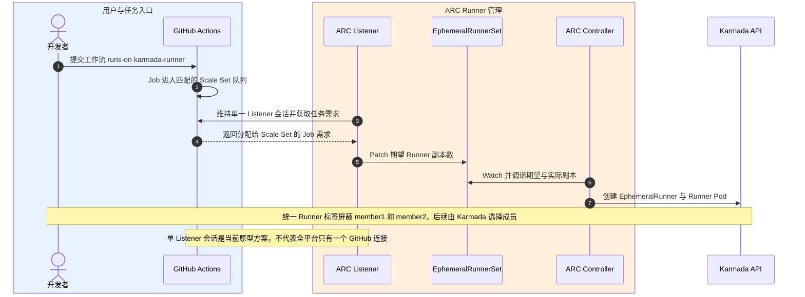
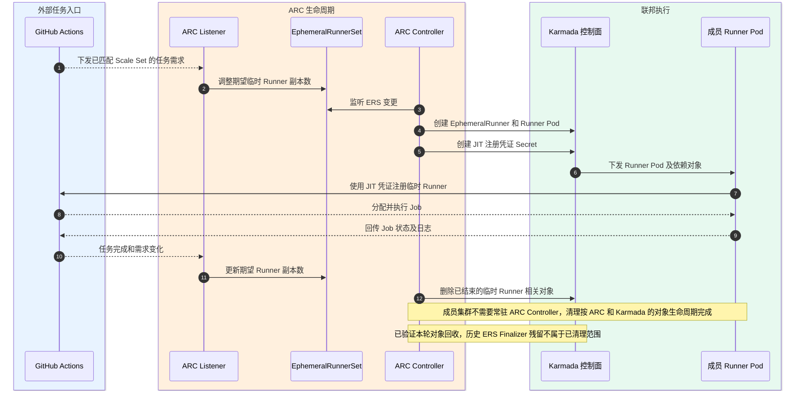
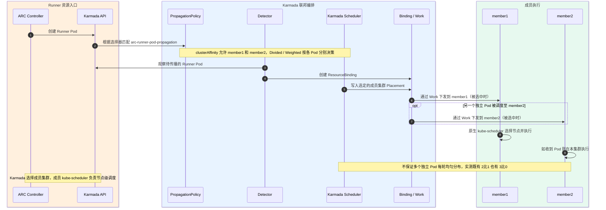
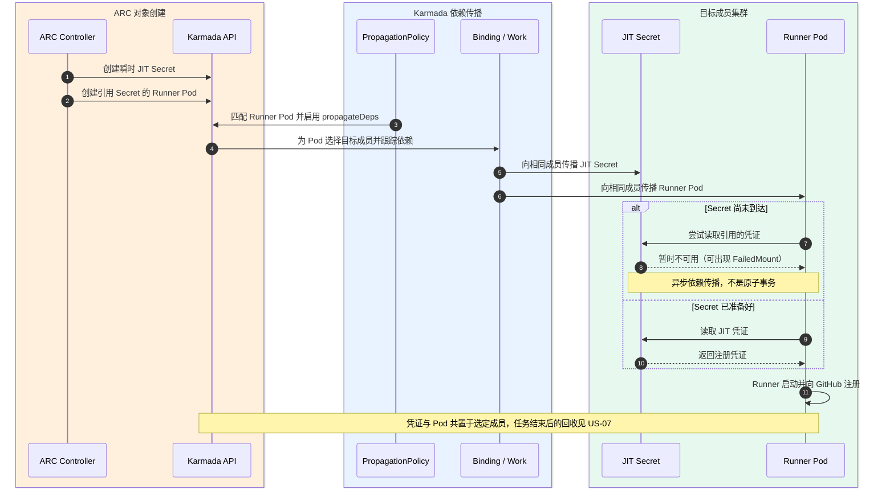
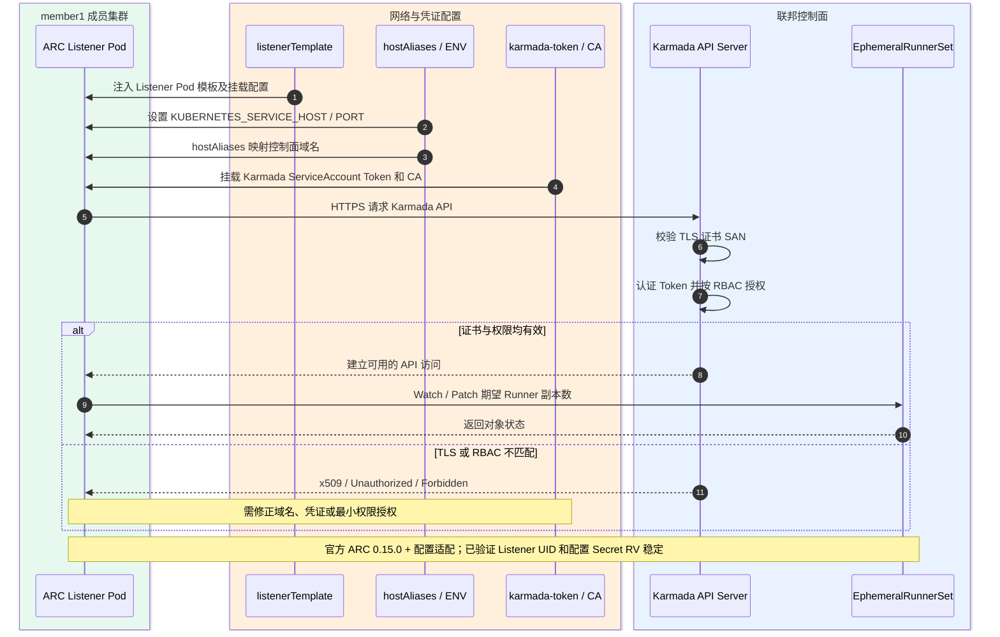
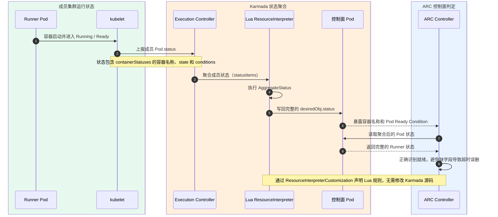
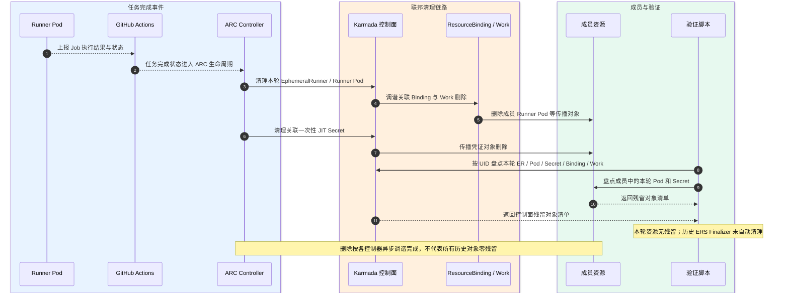
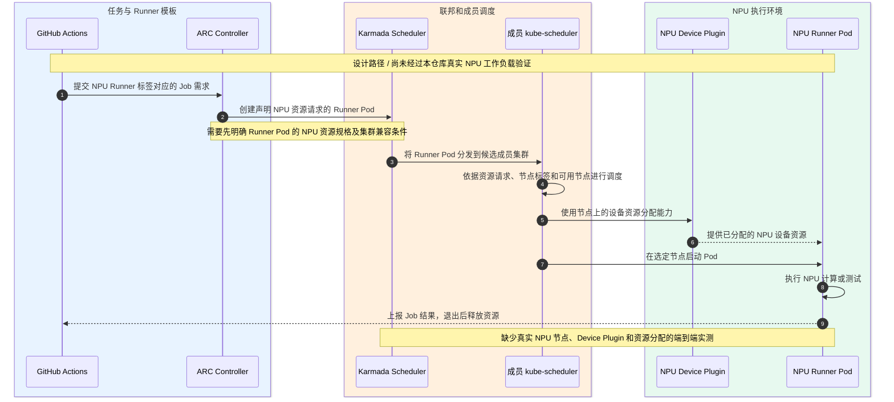

# ARC + Karmada 联邦调度执行子系统设计与验证说明

> 版本：1.2（架构 + 独立实现/验收契约）
> 验证基线：2026-10-15，ARC 0.15.0 / Karmada v1.19.0 / Kubernetes v1.37.0
> 文档性质：原型设计与可复现验证；不作为生产部署验收报告

## 本文档的定位

本文验证 ARC 与 Karmada 的集成可行性，说明 GitHub Actions Runner 如何通过一个控制面分发至多个 Kubernetes 成员集群。设计范围覆盖 ARC、Karmada、成员 Kubernetes 集群，以及拟纳管的 NPU 执行资源。

本原型使用官方 ARC 0.15.0、Karmada v1.19.0 和两个 Kind 成员集群执行真实 GitHub Actions 任务。已验证 Runner 跨成员执行、JIT Secret 依赖传播、Pod 状态聚合、Listener 跨控制面认证和本轮资源清理。**本轮没有验证 NPU 工作负载、跨 Region 真实网络或生产级容量均衡。**

本文采用逻辑、部署和场景等架构视角组织设计，组件均对应当前原型或明确标注的官方可选能力。**本文件只描述架构决策与 Story 行为**；准确资源选择器、权限、环境参数和异常责任统一写入[实现契约](IMPLEMENTATION-CONTRACT.md)；Story 的前置条件、测试等级和证据规则统一写入[验收契约](ACCEPTANCE-CONTRACT.md)。部署操作见 [README](../README.md)，历史运行事实见[验证记录](arc-0.15.0-validation.md)。当前文档与契约的完善不等于已完成全新 Kind 环境重建。

# 1. 模块介绍

## 1.1 目标与职责

将原先项目独占的多个执行集群纳入 Karmada，统一管理 GitHub Actions Runner 的创建、分发与回收。

| 职责 | 实现主体 | 边界 |
|---|---|---|
| 任务匹配与 Runner 生命周期 | ARC Listener、Controller、Scale Set | GitHub Actions 提供队列；ARC 调整 Runner 数量 |
| 资源对象传播与成员选择 | Karmada Policy、Scheduler、Binding / Execution Controller | 选择成员集群；不承担每个 Pod 的节点级调度 |
| 资源实际执行 | 成员 Kubernetes、kube-scheduler、kubelet | 创建 Runner Pod；可在 NPU 节点执行有设备请求的工作负载 |
| 状态与凭证适配 | ResourceInterpreterCustomization、Listener Token / RBAC、propagateDeps | 保留 ARC 所需的 Pod 状态和 JIT Secret |
| 原型验证 | scripts/verify-arc.py、tests/、docs/evidence/ | 验证真实 GitHub Actions 运行结果和清理；不作生产 SLA 承诺 |

## 1.2 系统边界

**边界内：** ARC Controller、Listener、Runner Scale Set；Karmada 控制面；纳管的 Kubernetes 成员集群、Runner Pod 和目标 NPU 节点资源。

**边界外：** GitHub Actions 服务、业务项目、镜像仓库及现有企业级监控系统。

系统边界表示统一联邦执行的运行范围。各组件可部署在不同 Kubernetes 运行环境。当前 PoC 的 Controller 运行在宿主侧；Listener 下发至 member1，使用独立 Karmada 控制面凭据访问 API。

## 1.3 子系统目标

**现状：** 集群按项目固定分配。不同集群不能共享空闲资源。部分集群资源空闲，部分集群任务排队。热点项目等待时间较长。

**目标：** ARC 统一管理 Runner 需求。Karmada 将 Runner 分发至满足条件的成员集群。系统支持项目间共享合格成员的执行容量，以减少资源错配和可避免的排队等待。

**验证边界：** 原型已验证 Runner 可在两个成员集群执行。图中的利用率为示意数据。NPU 利用率提升、排队时长改善和生产环境的跨 Region 能力仍需实测。

## 1.4 整体架构

本子系统包含 ARC、Karmada、成员 Kubernetes 集群及 Runner 执行环境。图中灰色外框表示子系统边界。边界外的系统通过以下接口交互。

| 外部子系统 | 方向 | 交互内容 |
|---|---|---|
| GitHub Actions | 输入 | 工作流任务、`runs-on` 标签、Runner 需求 |
| GitHub Actions | 输出 | Runner 注册、Job 执行状态和结果 |
| 配置与部署系统 | 输入 | Scale Set、PropagationPolicy、RBAC、组件版本 |
| 镜像仓库 | 输入 | Runner 镜像、Action 镜像 |
| 监控与审计系统 | 输出 | 运行日志、Kubernetes 事件、验证记录 |

**原型范围：** 当前验证使用 ARC 0.15.0、Karmada v1.19.0 和两个 KinD 成员集群。图中只展示该集成链路中的组件。NPU 设备插件、真实 NPU 作业和 `karmada-search` 未纳入本次验证。

## 1.5 关键约束

- Runner 工作流使用 `runs-on: karmada-runner`。标签对应一个已注册 Scale Set。
- Scale Set 版本标签与 ARC Controller 0.15.0 保持一致。
- Listener 运行在成员集群，通过独立 Token、CA 和 DNS 配置访问 Karmada API。
- Runner Pod 的 JIT Secret 必须传播至同一执行成员；传播过程允许短暂异步等待。
- Karmada Pod 状态解释器保留 `containerStatuses[].name` 和 `conditions`。
- `Divided / Weighted` 针对单个资源对象执行。多个独立 Pod 不保证逐轮均匀分布。
- 成员 Kubernetes 负责节点调度。NPU 任务需额外核实节点标签、设备插件、资源请求和工作负载运行环境。

# 2. 关键需求分析

## 2.1 用户故事

| ID | 用户故事（作为…我希望…以便…） | 主要验收条件 |
|---|---|---|
| US-01 | 作为 CI 开发者，我希望通过稳定的 Runner 标签提交任务，以便不指定执行 Region | 工作流不写成员集群名；Runner 标签匹配成功 |
| US-02 | 作为平台工程师，我希望集中管理 Runner 生命周期，以便减少每个集群的独立 ARC 部署 | Listener 接收任务，Controller 创建 Runner，执行后清理 |
| US-03 | 作为资源池管理员，我希望 Runner 在多个成员集群间分发，以便打通项目独占资源池 | 实际任务可分别在 member1 与 member2 成功运行 |
| US-04 | 作为平台工程师，我希望 JIT Secret 跟随 Runner Pod，以便 Runner 能完成注册 | Runner 与其 JIT Secret 在同一成员可用 |
| US-05 | 作为平台工程师，我希望 Listener 安全访问 Karmada 控制面，以便跨控制面更新 Runner 需求 | TLS、Token、RBAC 检查通过；Listener 稳定工作 |
| US-06 | 作为 ARC 维护者，我希望获取完整 Pod 状态，以便正确识别 Runner Ready 与容器状态 | Runner 容器名称、Ready Condition 在控制面可见 |
| US-07 | 作为 CI 运维人员，我希望执行结束后清理本轮资源，以便避免 Runner 和临时凭证残留 | 核对 Runner Pod、EphemeralRunner、JIT Secret、关联 RB/Work |
| US-08 | 作为 NPU 资源池管理员，我希望纳管 NPU 成员资源，以便下一阶段运行硬件匹配的 CI 任务 | **目标场景，尚未验证**：设备插件、资源请求、节点选择和工作负载实测 |

## 2.2 场景与验收边界

### US-01：统一 Runner 标签
- **正常：** 工作流使用 `runs-on: karmada-runner`；GitHub Actions 与 Listener 完成匹配。
- **异常：** 标签无匹配 Scale Set 时，任务等待可用 Runner。
- **验收：** 检查真实 Workflow Run 与 Runner 注册信息。

### US-02：Runner 生命周期管理
- **正常：** Listener 更新 EphemeralRunnerSet；Controller 创建 EphemeralRunner、Pod 与 JIT Secret；Runner 完成任务。
- **异常：** Scale Set 版本不兼容、Controller 调谐异常或 Pod 启动失败。
- **验收：** 对比 ARC CRD、Controller 日志、Runner Pod 和任务状态。

### US-03：跨成员分发
- **正常：** Karmada 根据 PropagationPolicy 选择成员，生成 ResourceBinding 与 Work，成员执行 Runner Pod。
- **异常：** 同批独立 Pod 全部落在一个成员；任务仍可能全部成功。
- **验收：** 证明每个成员都能运行 Runner；单轮均匀覆盖单独记录。

### US-04：JIT Secret 依赖传播
- **正常：** Runner Pod 引用 JIT Secret；`propagateDeps: true` 将依赖传播至目标成员。
- **异常：** Secret 尚未到达时 Pod 可出现短暂 FailedMount。
- **验收：** Secret 与 Runner Pod 同成员可用；执行结束后检查清理。

### US-05：Listener 控制面访问
- **正常：** member1 Listener 通过控制面 CA、Token、Endpoint 访问 Karmada API，并 Patch EphemeralRunnerSet。
- **异常：** DNS/SAN 不匹配引发 TLS 错误；错误 ServiceAccount Token 引发 401。
- **验收：** Listener Pod 持续正常，控制面 RBAC 满足最小所需权限。

### US-06：Pod 状态聚合
- **正常：** ResourceInterpreterCustomization 将成员 Pod 的完整 `status` 回传控制面。
- **异常：** 缺少 `containerStatuses[].name` 或 Ready Condition 时，ARC 可能误判 Runner 未就绪。
- **验收：** 在控制面检查 Runner 容器名称、State、Ready 与 Conditions。

### US-07：任务结束与资源清理
- **正常：** GitHub Actions Job 完成后，ARC 回收本轮临时 Runner；Karmada 逐步清理传播对象。
- **异常：** 异步删除、历史 Finalizer 或控制器失败可能保留残余对象。
- **验收：** 按当前 Run 关联 UID 盘点 Pod、EphemeralRunner、JIT Secret、ResourceBinding 和 Work。

### US-08：NPU 成员执行（待验证）
- **目标：** NPU 节点通过 Kubernetes Device Plugin 公开资源；工作负载声明对应扩展资源后，由成员调度器放置。
- **前置条件：** 确认真实 NPU 类型、分配粒度、驱动、Runtime、设备插件与 Pod 模板。
- **验收：** 用真实 NPU Workflow 检查节点选择、设备分配、任务成功率和释放。
- **状态：** 本轮 PoC 运行验证未覆盖该用户故事。

**验收分层原则：** T1 验证 Job 成功、Runner/JIT/状态与本轮清理；T2 分别验证 member1 和 member2 可独立执行；T3 的统计负载均衡与排队收益须独立定义工作负载、窗口和 SLO。**同一轮三个 Job 均成功但仅落在一个成员，不等于 T1 失败**。可执行定义见[验收契约](ACCEPTANCE-CONTRACT.md)。

# 3. 模块设计

## 3.1 逻辑组件架构

本子系统要解决的核心问题是：**项目与执行集群绑定，导致集群间资源难以互用、负载不均衡及任务排队**。架构采用 **ARC 集中管理 Runner + Karmada 联邦分发 + 成员 Kubernetes 原生执行** 的协作模式；以下重点说明各构件对整体问题的贡献，而非展开上游组件的内部实现。

| 架构构件 | 主要解决的问题 / 架构职责 | 与其他构件的协作关系 |
|---|---|---|
| ARC Listener | **统一任务入口**：让开发者使用同一个 Runner 标签提交任务，不必为不同成员集群选择专用标签。 | 对接 GitHub Actions 的任务需求，与 ARC Controller 协同完成按需 Runner 供给。 |
| ARC Controller | **集中管理执行实例的生命周期**：使 Runner 的创建、扩缩与回收不再由每个执行集群各自管理。 | 承接 Listener 的需求变化，将 Runner 交给 Karmada 跨集群分发，并根据执行状态管理生命周期。 |
| Karmada（复用的联邦子系统） | **打通相互隔离的执行资源池**：将多个成员集群纳入同一分发范围，使一个项目的任务可以使用其他合格成员的执行资源。 | 接收 ARC 产生的 Runner 对象，将其分发至成员 Kubernetes，并把执行状态返回给 ARC；不取代成员的节点级调度。 |
| 成员 Kubernetes 与 Runner Pod | **提供实际、相互隔离的任务执行能力**：让集中管理的 Runner 在选中的成员集群使用当地计算资源执行 GitHub Job。 | 接收 Karmada 下发的 Runner 工作负载，使用成员原生调度与网络执行任务，并向控制面反馈状态。 |
| ARC–Karmada 集成适配（本原型配置与扩展） | **消除两套上游系统之间的语义与环境差异**：保障跨控制面访问、临时注册凭证可用、Runner 就绪状态可被正确识别。 | 在 ARC、Karmada 与成员 Kubernetes 之间补齐通信鉴权、依赖传播和状态聚合约束，使上述管理、分发、执行链路闭环。 |

**范围与边界：** GitHub Actions 是边界外的任务来源；验证脚本属于 PoC 验证工具，不是线上调度模块。可选的 `karmada-search` 和尚未实测的 NPU 执行组件不列为本轮逻辑架构构件。跨成员执行已验证，但不据此承诺均匀负载分摊或任务排队时长改善。

部署位置见 **3.2 部署架构**；具体资源对象、联邦契约及配置适配分别见 **3.3 资源对象与生命周期**、**3.4 模块间接口**和[仓库配置](../manifests/)。

## 3.2 部署架构

本节展示 **2026-10-15 已验证的 PoC 部署形态**，侧重组件实际运行位置、控制面连接和成员执行位置；ARC、Karmada 与 Kubernetes 均复用上游实现，不在此展开其内部模块逻辑。

### 3.2.1 当前部署单元

| 部署位置 | 组件 / 资源 | 部署与职责 | 验证范围 |
|---|---|---|---|
| 宿主侧 Docker | ARC Controller `0.15.0` | 官方镜像以 Docker `host` 网络模式运行，使用只读挂载的控制面 kubeconfig 调谐 ARC 资源 | 已运行验证；**不是**部署于成员 Kubernetes 的 Controller Pod |
| `karmada-host`（Kind） | Karmada 控制面 `v1.19.0` | 承载联邦 API、ARC CRD/CR、传播策略和自定义 Pod 状态解释器；接收 Controller 与 Listener 的 Kubernetes API 请求 | 控制面及两成员联邦已验证 |
| `member1`（Kind） | ARC Listener Pod（`arc-systems`）、Runner Pod 和 JIT Secret（`arc-runners`） | Listener 由策略定向放置，挂载 Karmada Token/CA 并直连 Karmada API；Runner Pod 根据联邦放置结果执行 Job | Listener 认证、Runner 执行及 JIT 依赖已验证 |
| `member2`（Kind） | Runner Pod 与 JIT Secret（`arc-runners`） | 作为可选执行成员，由 Karmada 下发 Runner Pod 和依赖凭证；无需单独部署 ARC Controller | 已验证 Runner 定向运行及凭证可用性 |
| 外部 GitHub Actions | 工作流队列、Runner 注册和 Job 结果 | Listener 获取 Runner 需求；成员 Runner 使用成员自身网络访问 GitHub | 真实 GitHub Actions Job 已验证 |

### 3.2.2 部署约束与验证边界

- **控制面访问**：Controller 使用控制面 kubeconfig；Listener 依靠 `listenerTemplate` 中的 `hostAliases`、`KUBERNETES_SERVICE_HOST/PORT` 和 `karmada-token`（Token/CA）访问 Karmada API。Listener Token 尚未实现自动轮换。
- **部署与分发边界**：`arc-listener-propagation` 将 Listener 固定放置在 `member1`；`arc-runner-pod-propagation` 允许 Runner Pod 选择 `member1` 或 `member2`，并通过 `propagateDeps: true` 传播 JIT Secret。**同一轮任务不保证两成员均匀分摊**。
- **资源执行**：成员 Kubernetes 使用本地 kube-scheduler、kubelet 和容器运行时执行 Runner Pod。Runner 不依赖额外跨集群 Pod 网络隧道。本轮没有执行真实 NPU 工作负载。
- **PoC 限制**：三个 Kind 集群和宿主侧 Docker 构成验证环境；未验证生产级控制面 HA、Controller 最小权限、故障切换、Token 自动轮换及全新环境一键初始化。该部署图不代表已经具备生产就绪能力。

详细配置与实际运行证据分别参见 [复现指南](../README.md)、[RunnerSet 模板](../manifests/04-autoscalingrunnerset.yaml)、[传播策略](../manifests/02-propagation-policies.yaml)及[ARC 0.15.0 验证记录](arc-0.15.0-validation.md)。

## 3.3 资源对象与生命周期

| 对象 | 生产者 | 消费者 / 作用 |
|---|---|---|
| AutoscalingRunnerSet | 平台配置 | ARC 管理对应 Scale Set |
| EphemeralRunnerSet / EphemeralRunner | ARC | Runner 数量和单实例生命周期 |
| Runner Pod | ARC | 作为 Karmada 的待传播 Pod |
| JIT Secret | ARC | Runner 启动注册所需的临时凭证 |
| PropagationPolicy | 平台配置 | Karmada 识别需要传播的 Pod、Secret、ServiceAccount |
| ResourceBinding | Karmada 控制面 | 保存目标成员及传播约束 |
| Work | Karmada Binding Controller | 向成员集群下发 Kubernetes 对象 |
| Pod status | 成员 Kubernetes | 经自定义 Resource Interpreter 回传给 ARC |

**关键生命周期约束：** ARC 负责 Runner 期望数量和临时实例生命周期，Karmada 负责传播和状态反馈；二者通过异步调谐完成闭环，而不是同一事务。动态对象的 owner/finalizer 不由本模块重新实现。当前仅验证本轮临时资源回收，历史 ERS Finalizer 另列。资源的生产者、namespace、selector、目标成员和删除条件见[实现契约第 3～4 节](IMPLEMENTATION-CONTRACT.md)。

## 3.4 模块间接口

| 源 | 目的 | 接口 / 数据 | 关键条件 |
|---|---|---|---|
| GitHub Actions | ARC Listener | Runner scale-set Job 匹配 | Label 对应已注册 Scale Set |
| Listener | Karmada API | EphemeralRunnerSet Patch | 控制面 Token、CA、最小权限 |
| ARC | Karmada | Pod / Secret / ServiceAccount | 对象生命周期与命名空间正确 |
| 本原型传播策略配置 | Karmada（复用） | `PropagationPolicy`：Pod 选择器、clusterAffinity、Divided / Weighted、propagateDeps | 候选成员可用；不承诺独立 Pod 均匀分布 |
| Karmada（复用） | 成员 Kubernetes API | Work 中的 Pod / Secret / ServiceAccount 等对象 | 成员可访问且拥有所需权限 |
| 成员 Kubernetes | Karmada（复用） | Pod.status；由本原型声明的 ResourceInterpreterCustomization 规则聚合 | 控制面需保留容器名称、状态和 Ready conditions |
| 依赖传播 | 成员 Kubernetes | Runner 所需 JIT Secret | `propagateDeps: true`；允许异步到达 |

**集成失败边界：** Listener 跨控制面连接失败属于 TLS/Token/RBAC/网络契约问题；JIT Secret 晚到是异步依赖传播问题；成员 Pod Ready 与控制面状态不一致属于状态聚合问题。各故障的观测、重试责任和当前未验证能力详见[实现契约第 5～7 节](IMPLEMENTATION-CONTRACT.md)，不能要求业务方理解上游各 Controller 的内部实现。

## 3.5 质量属性

| 属性 | 设计措施 | 验证状态 / 风险 |
|---|---|---|
| 安全 | Listener 使用固定控制面 SA、受限 Role；Runner SA 禁用 Token 自动挂载 | Listener 最小权限已有配置；Controller 仍使用高权限 kubeconfig；Token 轮换需完善 |
| 可靠性 | 状态无损聚合；JIT Secret 依赖传播；ARC / Karmada 原生控制器调谐 | 已进行真实 Job 与本轮清理测试；故障切换和持续负载未验收 |
| 性能 | 单 Scale Set Listener，避免按每个成员部署独立 Listener；原生对象传播 | 未测定生产规模 API 负载、Runner 等待分布或容量收益 |
| 兼容性 | 官方 ARC 0.15.0、同版本 CRD 与 Scale Set 版本标签 | 已做 CRD 一致性和 Controller 版本检查 |
| 可观测性 | verify-arc.py 采集运行、Pod/Secret、UID/RV 和清理证据 | JSON 已脱敏；尚未构建统一 NPU 使用率监控 |
| 可维护性 | 复用 ARC / Karmada 上游能力，最小化自定义代码 | 自定义内容限于 Lua 聚合器、配置和测试脚本 |

**当前风险进一步明确：** 基础策略将主 GitHub Secret 传播至两成员、Runner Pod 策略选择整个 `arc-runners` 命名空间的 Pod，属于需要依赖与安全性核查的配置；Pod Lua 状态聚合当前采用首个有 status 的成员记录，仅适用于本 PoC 单目标 Runner Pod。不能将上述当前行为默认为最小权限、通用多副本能力。

# 4. Story 设计

运行视图仍采用 Mermaid 时序图，描述模块协作与外部体验，不复刻上游控制器的内部设计。正常分支、必要异常分支和对应实现/验收条款分别参见[实现契约](IMPLEMENTATION-CONTRACT.md)及[验收契约](ACCEPTANCE-CONTRACT.md)。

## 4.1 US-01：按统一标签提交任务

**外部体验：** 工作流使用 `runs-on: karmada-runner` 提交 Job。业务方无需指定 member1 或 member2。

**内部流程：** GitHub Actions 排队 → ARC Listener 匹配 Scale Set → 更新 EphemeralRunnerSet → Controller 创建 Runner。

**检查：** 工作流 Label 匹配、Runner 已注册、Job 状态成功。参考 [真实 Run 38667994949](https://github.com/pkking/arc-karmada-test/actions/runs/38667994949)。

## 4.2 US-02：集中管理 Runner 生命周期

**外部体验：** 平台按任务需求创建临时 Runner。任务结束后按 ARC 生命周期回收。

**内部流程：** Listener 调整需求 → Controller 创建 EphemeralRunner、Runner Pod 和 JIT Secret → Karmada 传播 Pod 与凭证 → Runner 执行 → ARC 清理。

**检查：** ER/Pod/JIT Secret 与 Run 关联一致；历史遗留 Finalizer 单独记录。

## 4.3 US-03：原生跨成员调度

**外部体验：** 同一 Scale Set 的 Job 可在 member1 或 member2 运行。

**内部流程：** PropagationPolicy 选择 Runner Pod → Detector 创建 ResourceBinding → Karmada Scheduler 选择成员 → Binding Controller 生成 Work → Execution Controller 下发成员。

**检查：** [Run 38667994949](https://github.com/pkking/arc-karmada-test/actions/runs/38667994949) 三个 Job 成功，分布为 member1=2、member2=1。另一轮 [Run 38668853059](https://github.com/pkking/arc-karmada-test/actions/runs/38668853059) 三个 Job 全在 member1，证明逐轮覆盖不可保证。member2 的单独执行能力见 [Run 38669630663](https://github.com/pkking/arc-karmada-test/actions/runs/38669630663)。

## 4.4 US-04：JIT Secret 跟随 Runner

**外部体验：** Runner 启动后正常注册并领取 Job，无需开发者管理一次性凭证。

**内部流程：** ARC 创建 JIT Secret → Runner Pod 引用 Secret → Karmada 识别依赖 → JIT Secret 与 Runner Pod 下发同一成员 → Runner 启动。

**检查：** Secret 同成员可用；接受短暂异步 FailedMount；确认任务成功和最终清理。

## 4.5 US-05：Listener 跨控制面认证

**外部体验：** Listener 持续响应任务需求；用户不感知控制面与成员集群的网络差异。

**内部流程：** Listener Pod 下发 member1 → hostAliases 解析控制面名称 → 挂载 karmada-token 和 CA → InClusterConfig 指向 Karmada API → Role 允许 Patch EphemeralRunnerSet。

**检查：** TLS SAN 校验成功；Karmada 鉴权成功；Role 事件反复触发调谐后 Listener UID 与配置 Secret RV 稳定。

## 4.6 US-06：Pod 状态正确回传

**外部体验：** Runner Ready 状态正常，ARC 不会因状态字段缺失而误删 Runner。

**内部流程：** 成员 Pod 上报 status → Karmada 调用自定义 AggregateStatus → 控制面保留 containerStatuses、state 和 conditions → ARC 根据完整状态调谐。

**检查：** [验证记录](arc-0.15.0-validation.md)包含控制面 Runner 容器名称及 Ready 状态证据。

## 4.7 US-07：本轮资源自动清理

**外部体验：** Job 完成后不遗留本轮创建的临时 Runner 和 JIT Secret。

**内部流程：** Job 结束 → ARC 更新 EphemeralRunner 状态并删除临时资源 → Karmada 处理绑定对象和成员资源回收 → 验证脚本按 UID 盘点。

**检查：** [最终状态证据](evidence/arc-0.15.0-final-state.json)确认本轮 Runner Pod、EphemeralRunner、JIT Secret、关联 Binding / Work 无残留；历史 ERS Finalizer 未自动清理。

## 4.8 US-08：NPU 资源执行（待验证）

**外部行为（待验证）：** 工作流选择 NPU Runner 规格后，由兼容 NPU 节点执行计算任务。

**组件协作（尚未验证）：** Runner 模板声明 NPU 请求 → Karmada 选择目标成员 → 成员 kube-scheduler 选择节点 → Device Plugin 分配设备 → Pod 执行 → 资源释放。

**前置工作：** 核对 Runner 模板、NPU 设备插件、资源名称、节点标签、资源分配粒度和网络路径。需要真实 NPU 作业测试。

**验证状态：** 尚无本仓库 PoC 的 NPU 工作负载实测证据；不纳入本轮 P0 功能验收。

# 5. Story → 契约 → 实现 → 验收 → 证据

本表是**架构级追踪矩阵**；精确参数、测试步骤、超时与失败归因由[实现契约](IMPLEMENTATION-CONTRACT.md)和[验收契约](ACCEPTANCE-CONTRACT.md)统一规定。以下状态均是 **2026-10-15 既有实测结论**，不是本次修改后重新执行了完整 E2E。

| Story / 架构能力 | 实现与契约锚点 | 验收依据 | 状态 |
|---|---|---|---|
| US-01 统一标签入口 | [RunnerSet](../manifests/04-autoscalingrunnerset.yaml)、[Workflow](../.github/workflows/test-arc.yml)；[契约 §2](IMPLEMENTATION-CONTRACT.md) | [真实 Run 38667994949](https://github.com/pkking/arc-karmada-test/actions/runs/38667994949)、T1 | 已验证 |
| US-02 集中 Runner 生命周期 | 官方 ARC Controller、[启动脚本](../scripts/run-arc-controller.sh)；[资源契约](IMPLEMENTATION-CONTRACT.md) | [验证记录](arc-0.15.0-validation.md)、本轮清理 T1 | 已验证本轮 |
| US-03 跨成员执行 | [传播策略](../manifests/02-propagation-policies.yaml)；[传播契约](IMPLEMENTATION-CONTRACT.md) | [2:1](evidence/arc-0.15.0-multicluster.json)、[3:0](evidence/arc-0.15.0-single-cluster-coverage-failed.json)、[member2 定向](evidence/arc-0.15.0-directed-member2.json)；T1/T2 | 成员能力已验证；均衡 T3 未验证 |
| US-04 JIT Secret 随 Pod | [传播策略](../manifests/02-propagation-policies.yaml)；[依赖契约](IMPLEMENTATION-CONTRACT.md) | [验证记录](arc-0.15.0-validation.md)、T1 | 已验证异步同成员可用 |
| US-05 Listener 控制面鉴权 | [RBAC](../manifests/03-rbac.yaml)、[Token 脚本](../scripts/setup-karmada-token.sh)；[身份契约](IMPLEMENTATION-CONTRACT.md) | [稳定窗口证据](evidence/arc-0.15.0-directed-member2.json)、T1 | 当前身份已验证；自动轮换未验证 |
| US-06 Pod 状态聚合 | [Lua 解释器](../manifests/01-karmada-interpreter.yaml)；[状态契约](IMPLEMENTATION-CONTRACT.md) | [验证记录](arc-0.15.0-validation.md)、T1 | 已验证单目标；多副本未验证 |
| US-07 本轮临时对象清理 | ARC/Karmada 生命周期、[验证脚本](../scripts/verify-arc.py)；[生命周期契约](IMPLEMENTATION-CONTRACT.md) | [最终状态证据](evidence/arc-0.15.0-final-state.json)、T1 | 本轮通过，历史 ERS 遗留 |
| US-08 NPU 任务执行 | 仅目标架构；[待决策 D-07](IMPLEMENTATION-CONTRACT.md) | 无真实 NPU E2E；需要专用 E2E | **待验证** |

**验证分级：** T0 静态符合性；T1 确定性功能；T2 成员分别定向可执行；T3 统计负载均衡及排队收益。现有 `verify-arc.py` 默认强制单轮两成员覆盖；新增 `--coverage-mode report-only` 仅记录覆盖，不因此判定功能失败。两者必须显式选择并保留观测结果；不能通过削弱旧断言伪造通过。

# 6. 已知限制与下一步验证

1. **资源均衡：** 原生 `Divided / Weighted` 不保证多个独立 Pod 均匀分布。须单独测量等待分布和成员利用率。
2. **NPU 执行：** 本轮没有真实 NPU 工作负载。启用前须验证设备插件和节点调度。
3. **容灾：** 未验证成员宕机自动迁移、运行中 Job 恢复或生产级跨 Region 网络故障。
4. **安全：** Controller 的高权限 kubeconfig 与 Listener Token 轮换尚需生产设计。
5. **升级：** 验证采用排空后的 PoC 部署；没有完成无中断滚动升级演练。
6. **清理：** 本轮临时对象已核对；环境仍存在历史 ERS Finalizer，不能宣称全环境零残留。
7. **容量与指标：** 当前没有 NPU 利用率和队列时延的生产级校准数据。

## 参考资料

- [本仓库 README](../README.md)
- [ARC 0.15.0 实测验证与限制](arc-0.15.0-validation.md)
- [ARC 0.15.0 静态评估](arc-0.15.0-assessment.md)
- [Karmada 官方架构说明](https://karmada.io/zh/docs/v1.16/core-concepts/architecture/)
- [Karmada Scheduler](https://karmada.io/docs/reference/components/karmada-scheduler/)
- [Karmada-search](https://karmada.io/docs/userguide/globalview/global-search-for-resources/)
- [Actions Runner Controller](https://github.com/actions/actions-runner-controller)
