# Karmada + ARC 联邦调度子系统设计说明

> 版本：1.0  
> 日期：2026-10-24  
> 文档状态：架构说明与实现映射；不作为生产部署验收依据。  
> 主要实现仓库：opensourceways/arc-fedsched；基础接入 PoC：pkking/arc-karmada-test。

## 本文档的定位

本文档说明 ARC 与 Karmada 如何组成跨集群 Runner 执行系统，并定义 `arc-fedsched` 的资源感知调度设计。文档以原型实测记录为基础，区分已验证能力、设计能力和待验收事项。

### 证据范围

| 项目 | 现有证据 | 结论边界 |
|---|---|---|
| ARC + Karmada 基础集成 | [ARC 0.15.0 验证记录](https://github.com/pkking/arc-karmada-test/blob/main/docs/arc-0.15.0-validation.md)：Karmada v1.19.0、Kubernetes v1.37.0、两个 KinD 成员集群；已运行真实 GitHub Actions 任务 | 已验证 Runner 跨成员集群执行、JIT Secret 依赖、容器状态回传、Listener 跨控制面认证和资源清理 |
| 原生联邦分发 | 测试中出现三项任务落在同一成员集群的情况 | `Divided / Weighted` 不保证每轮均匀分布，也不提供全局公平队列或故障自动切换 |
| `arc-fedsched` 调度层 | 架构、组件、策略、账本、回放和恢复设计见下文及实现仓库 | 代码存在、单元测试通过或离线回放成功，均不能单独证明生产环境端到端验收通过 |
| 容量与性能 | [配置示例](https://github.com/opensourceways/arc-fedsched/blob/main/config/example-federation.yaml)；合成模型 `clusters/smoke.yaml` | 合成数据用于机制验证。生产等待时间、吞吐量和利用率须用真实节点、Pod 请求、工作流轨迹和监控数据校准 |

### 相关仓库

- [基础集成原型与验证记录](https://github.com/pkking/arc-karmada-test/tree/main/docs)：部署步骤、配置、实测结果和限制。
- [`arc-fedsched` 架构设计](https://github.com/opensourceways/arc-fedsched/blob/main/docs/DESIGN.md)：调度机制和设计取舍。
- [`arc-fedsched` 工程实施计划](https://github.com/opensourceways/arc-fedsched/blob/main/docs/BUILD-PLAN.md)：实现拆分和实施顺序。
- [`arc-fedsched` 模拟器与回放计划](https://github.com/opensourceways/arc-fedsched/blob/main/docs/SIMULATOR-PLAN.md)：离线模型和差分验证。
- [`arc-fedsched` 配置与实现](https://github.com/opensourceways/arc-fedsched/blob/main/README.md)：配置模型、当前状态和测试命令。

本文先定义资源割裂问题，再说明基础集成的实测结果，最后描述资源感知调度设计及其验收边界。

# 1. 模块介绍

## 1.1 模块目标

本调度模块为 GitHub Actions Runner Controller（ARC）提供基于 Karmada 的跨集群调度能力。它负责全局排队、NPU 需求识别、容量核算、成员选择、Runner 释放、头部任务保护和故障恢复。

目标体验是：仓库维护者通过已有的 runs-on 标签选择所需 Runner 规格，不必在工作流中硬编码具体成员集群；平台在满足硬件类型、任务规格、容量、配额与策略约束的前提下选择执行集群，并提供可追踪、可回放、可恢复的调度过程。

## 1.2 模块边界

| 边界 | 包含内容 | 不负责的内容 |
|---|---|---|
| 上游任务入口 | GitHub Actions 任务匹配；ARC Listener 更新 AutoscalingRunnerSet / EphemeralRunnerSet 的副本需求 | GitHub 工作流依赖关系、Job/Step 编排、业务测试逻辑 |
| ARC 接入适配 | ARC Controller / Listener 在 Karmada 控制面和成员集群间的身份、Secret、状态与资源对象适配 | 修改 GitHub Actions 服务端调度语义；替代 ARC 的 Runner 生命周期控制 |
| 联邦调度核心 | 观察 ResourceBinding、成员节点与 Pod；需求解析；容量核算；策略决策；RB 释放；可选节点预留、超时与恢复 | 创建或扩容物理节点；实现 NPU 驱动和设备插件；替代成员集群的最终 Pod scheduler |
| Karmada 联邦控制面 | 通过 ResourceBinding、PropagationPolicy、Work 等原生机制完成跨集群分发 | 维护各 CI 系统内部的任务 DAG、重试策略和 CRD 语义 |
| 成员集群执行面 | 承载 Runner Pod 和工作负载 Pod；由 Volcano / kube-scheduler 与设备插件完成最终节点放置 | 跨集群迁移正在执行的容器；提供跨集群工作目录或网络隧道 |
| 运营与验证 | Prometheus 指标、决策轨迹、容量快照、Python 参考模拟器、Go 回放与差分测试 | 在缺乏真实校准数据时给出未经验证的生产 SLA |

**职责链：** ARC 创建 Runner 需求；Dispatcher 决定释放时间和目标成员；Karmada Binding Controller 创建 Work；成员集群调度器选择 Pod 节点。CI 平台继续负责任务编排。

## 1.3 系统建设前后对比（Before / After）

本系统将按项目和 Region 静态划分的执行资源整合为**受硬件兼容性、权限和配额约束的共享资源池**。下图对比建设前后的资源组织方式。

### 1.3.1 Before：项目与集群静态绑定

无联邦调度时，项目与 Cluster 静态绑定。每个 Cluster 独立排队和核算容量。一个项目排队时，其他 Cluster 仍可能有空闲 NPU。

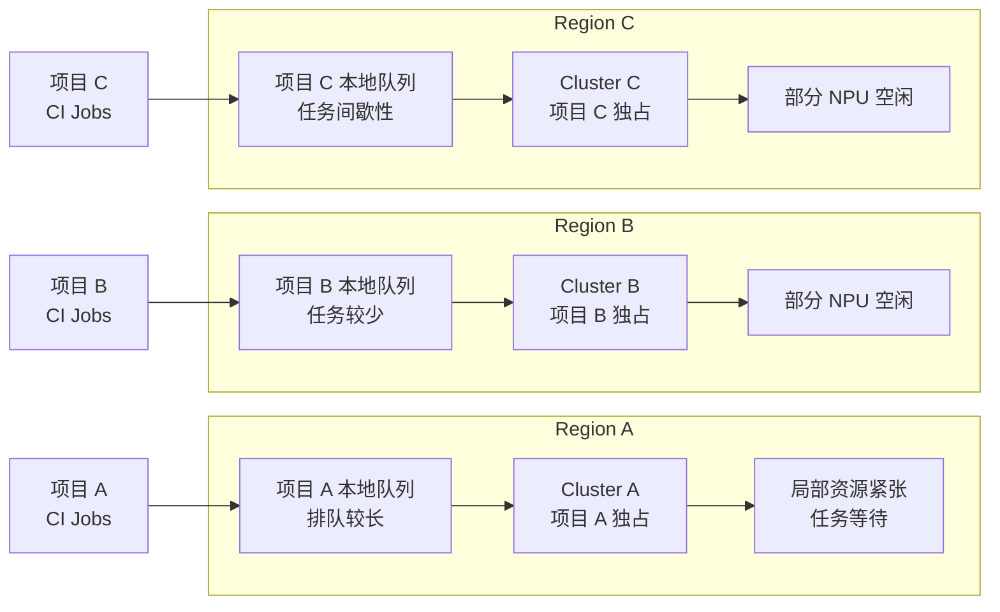

**主要问题：**

- 资源按项目切分，缺少全局容量视图。
- 各集群独立排队，空闲容量无法及时服务其他项目。
- 开发者须了解项目、Region 与 Cluster 的映射关系。

### 1.3.2 After：联邦调度与共享资源池

引入 Karmada + ARC + arc-fedsched 后，多个项目共享统一调度入口。Dispatcher 根据硬件规格、成员状态、可用容量和策略选择目标集群。

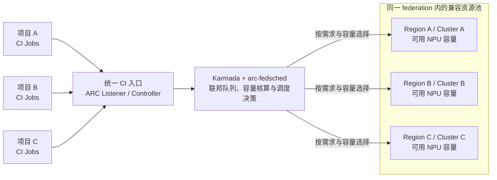

**主要效果：**

- 多项目按兼容规格共享联邦容量。
- Dispatcher 统一评估队列、容量和任务需求。
- 工作流只声明 `runs-on` / Runner 规格；平台负责选择成员。
- 账本、指标和决策轨迹支持容量分析与策略优化。

### 1.3.3 建设前后的关键差异

| 维度 | Before：无联邦调度 | After：Karmada + ARC + arc-fedsched |
|---|---|---|
| 资源组织 | 按项目静态绑定到 Region / Cluster | 同一 federation 内按硬件兼容性和策略共享 |
| 队列视角 | 各项目 / 集群局部排队 | Dispatcher 在 federation 范围内统一决策 |
| 资源选择 | 由静态归属决定 | 按声明需求、可用容量和策略动态选择 |
| 资源错配 | 局部排队与其他集群空闲可能并存 | 可使用其他合格成员的可用容量 |
| 用户感知 | 须了解集群归属和差异 | 主要通过 Runner 规格提交任务 |
| 运营能力 | 分散核算，难以比较全局供需 | 统一观测容量、grants、等待原因和调度结果 |

> **调度边界：** 只有属于同一 federation、硬件兼容、网络可达、权限和配额满足要求且容量数据可信的成员，才可接收任务。利用率和排队改善幅度须用真实工作流与容量数据评估。

## 1.4 整体架构

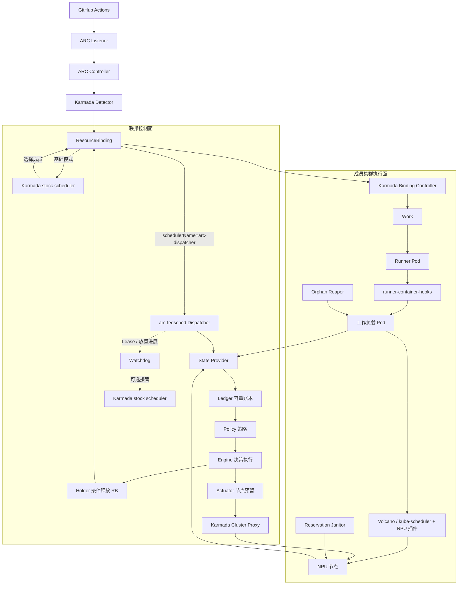

Watchdog 检查 Lease 和放置进展。Janitor 清理过期节点 reservation；Reaper 清理孤儿工作负载 Pod。State Provider 将成员状态提供给下一轮容量核算。

### 两种运行模式必须区分

1. **基础 ARC + Karmada：** PropagationPolicy 使用原生 placement / replicaScheduling 分发 Runner Pod。该模式验证跨集群接入、凭证、状态聚合和依赖传播。`Divided / Weighted` 不保证每轮均匀分布或全局公平。
2. **arc-fedsched：** `spec.schedulerName: arc-dispatcher` 将 ResourceBinding 保留在全局队列。Dispatcher 完成状态观测、容量核算和策略决策后，写入目标 `spec.clusters`。

两种模式的配置和验收范围不同。启用 Dispatcher 前，须验证 PropagationPolicy、RB `schedulerName`、NPU 需求解释、成员读写路径、Runner 标签和故障接管流程。

## 1.5 关键架构约束

- **按硬件规格拆分 Scale Set。** 每个 AutoscalingRunnerSet 使用一套 Runner 模板、需求声明和 hook 配置。不同 NPU 类型或数量使用独立 Scale Set。
- **保持标签契约。** 工作流只选择 Runner 规格。Scale Set 创建时须注册完整标签集；不同硬件规格可使用不同标签。
- **每个 Dispatcher 进程服务一个 federation。** federation 是共享硬件类型、容量单位、策略与成员集合的调度边界。可在同一个 Karmada 控制面运行多个 federation，但每个 federation 的容量账本、Lease、队列与策略状态相互隔离。
- **在控制面公开 NPU 需求。** Runner Pod 可能没有 NPU request，hooks 创建的工作负载 Pod 才请求 NPU。Dispatcher 先按声明需求记账，再根据实际 Pod 修正账本。
- **成员调度器负责最终节点放置。** Dispatcher 通过 taint、toleration 和成员侧规则预留节点。启用 reservation 前，须检查实际 hooks 是否将工作负载 Pod 固定到 Runner 节点；若行为不符，先调整设计再启用。

# 2. 关键需求分析

## 2.1 角色与用户故事总览

| ID | 用户故事 | 主要价值 | 核心验收结果 |
|---|---|---|---|
| US-01 | 工作流按 Runner 规格提交，不感知成员集群 | 统一开发者入口，降低迁移成本 | 目标集群由平台选择；已有标签兼容性有清单和测试 |
| US-02 | 平台识别任务的 NPU 类型与数量 | 避免规格错配和虚假容量 | 声明需求进入 RB，按 allocation granularity 取整 |
| US-03 | 多集群共享队列并保护队列头部 | 减少长期饥饿，同时允许安全 backfill | 稳定队列顺序、可解释的 hold 原因、预留节点不被冲突任务抢占 |
| US-04 | 调度器准确核算可用容量 | 防止超分与重复计数 | 账本区分物理占用、背景负载和 in-flight grant |
| US-05 | 平台选择合适成员并可靠释放 Runner | 提高资源匹配度，避免重复分发 | RB 写入具备并发前置条件、可幂等重试 |
| US-06 | 长任务不会因资源碎片永久阻塞 | 保护队列头部并利用其余容量 | 预留有上限、有租约、能识别外部占用并可释放 |
| US-07 | 取消、超时和异常任务能归还资源 | 避免 Runner、grant、taint 和工作负载泄漏 | 清理动作有明确触发条件、保护窗口和可观测原因 |
| US-08 | Dispatcher 故障后能恢复调度 | 限制单点故障与状态丢失影响 | Lease 失效触发接管；新 Leader 完成状态重建后才恢复释放 |
| US-09 | 运维能解释调度决策并验证策略变更 | 缩短排障时间，避免仅凭主观调参 | 指标、轨迹、回放与 Go/Python 策略差分可用 |
| US-10 | 新成员集群可安全加入或退出 federation | 控制接入风险，支持异构集群 | 读写权限、可达性、容量和策略前置检查通过后才承载任务 |

## 2.2 用户故事、场景与验收条件

### US-01：工作流按 Runner 规格提交，不感知成员集群

**用户故事：** 作为 CI 工作流维护者，我希望继续通过稳定的 runs-on 标签选择 Runner 规格，而不必指定底层 Karmada 成员集群，用于在多个集群之间共享资源且不反复修改工作流。

**场景：**
- 正常场景：工作流声明已注册的 Runner 标签；Listener 发现任务并请求 ARC 创建 Runner；平台在满足该规格的成员集群中选择执行位置。
- 资源不足场景：所有合格成员均无法承载任务时，任务保留在队列中并记录等待原因。不得降级到不兼容硬件。
- 兼容场景：集群从 federation 中移除时，已有工作流不因标签重命名而要求业务仓库立即修改；Scale Set 注册标签清单必须经过审查。

**验收条件：**
1. 工作流不需要写入目标成员集群名。
2. 每个硬件规格对应明确的 Scale Set、需求声明和 hook 模板。
3. 原有标签是否保留有显式清单；不把原生 Karmada 的分摊行为描述为严格均匀。
4. 没有兼容规格的任务不得被派发到不兼容资源。

### US-02：平台识别任务的 NPU 类型与数量

**用户故事：** 作为平台工程师，我希望每个 Runner Scale Set 声明工作负载所需的 NPU 类型与数量，并在 Karmada 控制面公开该需求，确保调度使用统一的资源模型。

**场景：**
- 正常场景：Scale Set 的需求注解随 ARC 对象链路传递；Karmada 的资源解释器将声明需求写入 ResourceBinding 的 replicaRequirements，Dispatcher 读取同一份声明。
- 非整数粒度场景：请求单位不能被硬件分配粒度整除时，按 federation 的 allocationGranularity 向上取整，防止账本低估。
- 配置错误场景：启动校验或调度前拒绝缺失、非法或与 Scale Set 不一致的需求配置。

**验收条件：**
1. 声明需求在 RB 上可检查，且与实际 Scale Set / hook 模板保持一致。
2. A3 等硬件的取整粒度由配置显式指定，不散落在多个策略实现中。
3. Runner Pod 未产生实际工作负载 Pod 时，账本仍通过 grant 暂时占住已承诺的容量。
4. 基础 PoC 的 Pod 状态聚合与 Dispatcher 所需的需求解释是两项不同能力：前者保留容器状态和 Ready Condition；后者暴露 NPU 需求。部署必须按所启用模式配置对应解释器。

### US-03：多集群共享队列并保护队列头部

**用户故事：** 作为 CI 资源池运营者，我希望同一 federation 内的 Runner 请求进入稳定的全局队列；当队列头部任务因资源碎片暂时无法运行时，系统既能保护它，也能继续执行不冲突的后续任务。

**场景：**
- 正常场景：队列按照 queued-since 与稳定的对象标识排序，避免事件到达顺序或进程重启改变任务先后。
- 头部阻塞场景：头部任务等待超过配置的 reservation delay 且没有可立即放置的节点时，策略选择可排空的候选节点并建立 reservation。
- Backfill 场景：后续任务能使用未被预留的容量，且不属于被预留组的冲突请求，继续释放。
- 无法满足场景：没有成员满足请求时，保留任务并记录原因。不得反复重建 Runner。

**验收条件：**
1. 队列顺序在同一输入下确定且可回放。
2. 预留决策考虑节点容量、背景负载、已运行任务预计释放时间和 offloading quota（适用时）。
3. Backfill 不得破坏头部任务的预留约束。
4. reservationDelaySeconds、minHeadFraction 等策略参数可配置并经过回放验证。

### US-04：准确核算容量，防止超分与重复计数

**用户故事：** 作为调度器维护者，我希望每个节点的可用 NPU 容量纳入实际占用、已释放但尚未落地的 Runner、其他租户负载和硬件分配粒度，防止同一份容量被重复承诺。

**场景：**
- Runner 已释放但工作负载 Pod 尚未创建：打开 in-flight grant，先为声明需求记账。
- 工作负载 Pod 出现：通过可观测状态将 grant 与真实资源请求对齐，避免同时计算声明需求和真实需求。
- Pod 正在删除但尚未终止：继续计入占用，直到终态或明确的回收证据出现。
- 同一节点运行其他租户任务：其 NPU 请求作为背景负载计入，无论 namespace 或标签是否相同，都将其计入背景负载。
- 观测不完整：不以缺失数据当作零占用；标记成员降级并阻止向无法可靠核算的成员继续释放。

**验收条件：**

账本使用的核心概念如下：

> free(node) = max(0, allocatable(node) - non_terminal_physical_demand(node) - open_grants(node) - background_load(node))

- 以上各项统一使用按 federation 分配粒度取整后的单位。
- RB 释放成功后打开 grant。正常物化、终止、取消、删除或超时信号到来时关闭 grant；TTL / hook window 仅作兜底。
- 账本重建必须基于完整快照；新 Leader 在重建 grant 前不得恢复放量。
- maxPerCluster 等限制用于控制尚未落地的承诺量；达到上限时应延迟后续释放。

### US-05：选择合适成员并可靠释放 Runner

**用户故事：** 作为 CI 资源池运营者，我希望系统结合节点级容量、硬件规格和可选的 Karmada estimator 结果选择目标成员，并以幂等、可校验的方式释放 ResourceBinding，避免重复分发或依据过期状态做决定。

**场景：**
- 正常场景：策略在可用节点中选择目标成员；若启用 estimator，则使用准确资源需求交叉核验；通过后才释放 RB。
- 并发场景：Dispatcher 两个副本、重试或其他控制器同时修改 RB；系统通过重新读取对象、resourceVersion 前置条件和 UID / placement 检查拒绝覆盖不兼容的并发修改。
- 重复场景：RB 已释放时，重复调用返回已放置状态，并恢复已有 grant 账目。
- 目标失效场景：成员读失败、NotReady 或状态过期时，本轮不应继续向该成员放量。

**验收条件：**
1. RB 的释放 PATCH 同时携带所选 spec.clusters、applied-placement 与 grant 元数据，并使用最新 resourceVersion 作并发前置条件。
2. 释放成功后才打开 grant；失败或冲突后在下一轮基于新快照重新决策。
3. estimator 默认可关闭；宽松模式记录分歧，严格模式才把分歧作为阻断条件。
4. resourceVersion 可保护本调度模块内的并发写入。它不能消除外部调度器的写入竞态。break-glass 必须通过并发和交接测试。

### US-06：保护队列头部，同时避免预留资源永久闲置

**用户故事：** 作为资源池运营者，我希望当头部任务需要等待特定节点释放容量时，系统能暂时保护候选节点；同时，预留必须有范围、租约和清理机制，不能让故障 Dispatcher 永久占用节点。

**场景：**
- 建立预留：策略选择候选节点后，Actuator 写入 reservation taint 与 head、group、期限等元数据。
- 同组任务调度：成员侧调度规则只允许匹配预留组的工作负载使用被保护节点；其他任务继续使用未预留容量。
- 外部占用：如果不属于本 federation 的工作负载落到预留节点，系统记录 foreign engagement，便于发现保护契约失效。
- Dispatcher 暂停或退出：reservation 到期后，成员侧 Janitor 通过重复确认过期状态清理 taint。
- 保护开关关闭：关闭 reservation 时，停止新增预留并清理已有预留。

**验收条件：**
1. Reservation 的 taint key、value、toleration 与 reservation group 契约一致；使用 NoSchedule，不依赖软偏好实现强保护。
2. 同时受每 federation / 每成员节点数限制和成员总节点预算约束。
3. reserved-until 作为短租约按 reconcile 周期续期；使用短租约并持续检测活性。
4. Janitor 只有在跨两次检查确认期限已过后才清除，避免单纯时钟偏差导致活跃 reservation 被清理。
5. 启用前验证实际 hooks 的节点绑定行为、工作负载 toleration 和成员调度器规则。

### US-07：取消、超时和异常任务能归还资源

**用户故事：** 作为平台运维人员，我希望取消任务、Runner 注册失效、成员集群故障或工作负载异常结束时，系统可清理相应的 Runner、grant、reservation 和孤儿工作负载，并记录清理原因。

**场景：**
- 用户取消排队任务：不再保留该 RB 的队列位置与 grant；如果它是 reservation head，应同时释放关联 reservation。
- Runner 已释放但目标成员一直没有 Pod：达到 placement timeout 后回收 Runner，并让容量账本在同一轮处理 grant 关闭。
- Runner 曾经运行、之后观测暂时丢失：Pod LIST 不完整时，不得据此判定 Runner 从未启动。
- 工作流结束后遗留 workflow 或 step Pod：成员侧 Reaper 根据标签、命名形态、持续缺失窗口和 grace period 清理，避免把仍在运行的 Pod 当成孤儿。
- 资源长期无法满足：超过 max-hold 的处理必须保留队列位置语义，并有指标告警，达到 max-hold 后按配置处理任务并触发告警。不得无限重建。

**验收条件：**
1. 每一种删除或回收动作都有明确的触发条件、原因标签、保护窗口与指标。
2. 删除 Runner 时同步处理关联 grant / reservation，避免只清理一半。
3. Reaper 不能仅凭 Runner 一次不可见就删除工作负载 Pod；进程重启时，缺失观察的计时应从安全方向重新开始。
4. Janitor 与 Reaper 的职责分开：前者清理过期节点 reservation，后者清理孤儿工作负载 Pod。

### US-08：Dispatcher 故障后可恢复调度

**用户故事：** 作为平台可靠性工程师，我希望 Dispatcher 崩溃、失去 Karmada API 连接或无法持续完成调度时，系统可停止基于不完整状态继续放量，并在明确的交接条件下恢复调度。

**场景：**
- Leader 正常工作：持有 Kubernetes Lease，并按预算周期续约。
- Leader 在读取或写入期间卡住：tick / cold-start 有明确预算；超出预算后放弃 Lease，避免过期 Leader 继续发送写请求。
- 新 Leader 接管：重新列举 RB、节点、Pod、Runner 和已有 grant / reservation；只有完整重建后才将 ready-to-place 置为 true。
- Dispatcher Lease 不新鲜或持续续租却没有实际放置进展：Watchdog 按 Lease 与 last-placing 状态决定是否扩起 break-glass stock scheduler。
- 成员读路径失效：成员被标记 degraded，不把失败读取当作空集；其他可用成员仍可继续工作，但受配置和完整性门控约束。

**验收条件：**
1. 每次领导权获得都会重新建立状态，不沿用旧 epoch 的 readiness。
2. 所有写操作都检查当前 epoch / leadership；超过 Lease horizon 后不再发送写请求。
3. cold-start 按页面或步骤报告进度，受单步预算和总预算约束。
4. Watchdog 观察“Lease 是否新鲜”和“是否有放置进展”两个信号；部署清单中的阈值必须与 Dispatcher 的 Lease 参数联合校验。
5. break-glass 交接必须在实际 Karmada 版本和部署拓扑上验证；须在目标 Karmada 版本和部署拓扑中验证重复放置、Work 变更和交接行为。

### US-09：运维可解释调度决策并验证策略变更

**用户故事：** 作为 CI 平台运维人员，我希望知道任务为什么在等待、某个成员为什么没有被选择、节点为什么被预留，以及策略调整对等待时间和利用率的影响，据此调整策略并验证效果。

**场景：**
- 单任务排障：按 runner / RB 关联队列进入、释放、Runner 绑定、工作负载启动、资源释放等时间线。
- 队列排障：按 hold reason、成员 staleness、open grants、background load、节点 free units 和 reservation 状态定位瓶颈。
- 策略变更：先用同一批输入 trace 和容量模型执行 Python 模拟、Go replay 与差分测试，再决定是否进入实际流量验证。
- 影子运行对比策略输出。实际释放仍由 FIFO / first-fit 执行，不启用节点预留。
- 结果复核：查看等待分布、头部阻塞、backfill、grant timeout、estimator disagreement 和节点利用率指标。

**验收条件：**
1. 每次决策可关联到队列项、策略、容量快照和结果。
2. Prometheus 指标包含队列等待、held reason、grant、成员 staleness、预留、释放结果、调度 tick 和 cold-start 等关键维度。
3. Python 参考模拟器与 Go replay 对同一标准化输入执行策略差分；成功退出时也必须检查 skip 数量与比较覆盖范围。
4. 轨迹可能包含仓库名、节点名和工作负载身份；访问控制、保留周期与导出范围应按内部运行数据处理。
5. shadow 模式不得被称为“无副作用试运行”；要验证纯只读状态时使用 dispatcher --dry-run。

### US-10：新成员集群可安全加入或退出 federation

**用户故事：** 作为平台工程师，我希望把新的异构成员加入 federation 时先验证其可达性、权限、容量与执行契约，并能将不满足预留要求的成员限制为仅放置或完全排除，以降低接入故障对整个资源池的影响。

**场景：**
- 正常接入：成员集群通过 preflight，节点和 Pod 观测完整，Karmada cluster proxy 可读写，NPU label / resource 名称与 federation 配置一致。
- 仅可读或仅可放置：readPath: proxy 用于无法建立 search informer 的成员；readPath: none 将成员排除；writable: false 允许 placement 但不启用节点 reservation。
- 成员故障：读路径失败或成员 NotReady 时，Dispatcher 将其从本轮可用目标中隔离，并通过指标暴露原因。
- 退出 federation：先阻止新任务流入，再处理已放置 Runner、open grants 和 reservations，最后移除配置及相关 RBAC /传播策略。

**验收条件：**
1. 新成员必须通过只读 preflight 和实际 proxy 访问验证；Karmada 中存在 Cluster 对象不足以证明成员可用。
2. readPath、writable 与 podNamespaces 的降级语义必须显式配置和评审。
3. 只读取 federation namespace 时，其他租户负载不可见。须记录由此产生的容量估计偏差和安全风险。
4. 成员接入、降级和退出都有可追溯变更记录及回滚步骤。

## 2.3 非功能需求与质量目标

| 质量属性 | 设计要求 | 机制与限制 |
|---|---|---|
| 安全性 | 最小权限；Runner 运行身份不应拥有 Kubernetes 管理权限；JIT / Karmada Token 不进入日志 | Listener 使用独立控制面凭据与资源名受限的 Role；Dispatcher 对控制面 Cluster Proxy 和成员 Node 写权限分别授权；Estimator 若启用客户端 CA 校验，必须配置匹配证书。PoC 中的管理凭据不能直接作为生产权限基线 |
| 性能 | 调度循环可预测；容量核算避免高延迟全量 API 轮询 | 优先使用 karmada-search informer；其他成员可用 proxy polling。默认 reconcile / decision interval 为 15 秒，硬上限为 30 秒。该值是设计配置，尚非端到端 SLA 测量结果 |
| 可靠性 | 不以不完整或过期观测继续放量；领导权切换后恢复一致账本 | Lease、epoch、冷启动重建、readiness gate、grant 重建、RB resourceVersion 前置条件；Watchdog、Janitor、Reaper 提供不同层次的恢复 |
| 可恢复性 | 故障后可回收遗留 reservation 和工作负载 | reservation 有短租约；Janitor 跨两次观测确认过期；Reaper 有 grace period；超时动作与回收原因有指标 |
| 可解释性 | 每个 hold、release、reservation 和删除都有可观测原因 | Prometheus、JSONL decision trace、hold-reason stream、runner timeline、debug endpoints；敏感字段需要按内部运行数据保护 |
| 可验证性 | 调度策略不因线上 / 回放两套实现而漂移 | Kubernetes-free 的 pkg/policy 与 Python 模拟器保持语义一致；Go replay、golden、invariant、livediff 和 kind lab 分层验证 |
| 兼容性 | 不要求业务仓库感知成员集群；保留既有标签契约 | 每种 runner shape 独立 Scale Set；完整标签集在创建时核验；硬件规格、NPU 数量和 hook 模板保持一致 |
| 可扩展性 | 支持不同硬件类型、容量单位和成员访问方式 | federation 隔离；配置化 NPU resource、allocation granularity、策略、成员 read path 与 reservation 上限 |

# 3. 模块设计

> **实现路径约定：** 本章的 Go 包、策略文件、模拟器和部署目录（如 `pkg/...`、`policies/...`、`sim/...`、`argocd/...`）均属于 [`opensourceways/arc-fedsched`](https://github.com/opensourceways/arc-fedsched) 仓库；本仓库的 `manifests/`、`docs/` 与 `evidence/` 则用于 ARC + Karmada 基础原型的部署和验证。

## 3.1 组件拆分

| 组件 | 代码 / 配置位置 | 职责与解决的问题 | 主要方法 | 质量属性关注点 |
|---|---|---|---|---|
| ARC / Karmada 接入配置 | [PoC manifests](https://github.com/pkking/arc-karmada-test/tree/main/manifests)；arc-fedsched 仓库 config/ 与 argocd/ | 连接 GitHub 任务入口、ARC 对象生命周期与 Karmada 多集群分发 | Listener 使用控制面凭据；PropagationPolicy 控制资源传播；解释器聚合 Pod 状态 / 暴露声明需求 | 安全：凭据最小化；可靠性：状态和 Secret 依赖完整；兼容性：Scale Set 标签与模板一致 |
| 配置与启动校验 | pkg/config | 统一定义 federation、成员、Scale Set、策略、Lease、grant、reservation 和超时参数；防止拼写错误静默使用默认值 | 严格 YAML 解析、默认值填充、配置合法性校验、稳定的 resolved-config 输出 | 安全：拒绝未知字段；可靠性：启动前发现不一致；性能：参数约束 reconcile 上限 |
| Karmada State Provider | pkg/state、pkg/state/karmada、pkg/kmeta | 将 ResourceBinding、EphemeralRunner、节点和 Pod 转换为每轮一致的 Snapshot | search informer 或 cluster-proxy 读取；成员状态、源数据时间与 staleness 记录；分页 cold-start resync | 可靠性：不把读失败当空列表；性能：优先 watch/cache；安全：按 namespace、Policy 和成员范围过滤 |
| 容量账本 Ledger | pkg/ledger | 防止把尚未落地的 Runner 承诺量重复分配，纳入其他租户的 NPU 背景负载 | 对每节点维护 physical demand、background load、open grants、draining 与 free units；完整快照重建 grant | 正确性：避免双计 / 漏计；可靠性：新 Leader 重建后再放量；性能：增量观察并按节点核算 |
| 策略库 Policy | pkg/policy、policies/ | 把排队顺序、资源适配、backfill、预留目标与估算规则从 Kubernetes API 操作中解耦 | fifo-strict、first-fit、fifo-reserve-node、easy、conservative 等注册策略；纯 Go 状态输入输出 | 可验证性：不依赖 k8s.io；性能：决策路径可单测；可维护性：同一策略供线上和回放复用 |
| Live Adapter / Engine | pkg/live | 将真实 Snapshot 和 Ledger 转成策略输入，执行决策、分类等待原因、驱动释放和预留动作 | Builder 维护稳定 job ID / queue arrival；Engine 执行 policy、计算本轮 release 与 reservation diff；shadow/live 使用不同 applier | 正确性：统一单轮快照；可靠性：写失败不静默成功；可解释性：输出 outcome 与 hold reason |
| ResourceBinding Holder | pkg/holder、pkg/arcapi | 唯一负责释放 RB 与删除 EphemeralRunner 的写路径，防止多个代码路径各自写 RB | 重读对象；检查 UID、placement、replicas；用 resourceVersion 进行条件 PATCH；写入 selected clusters、applied-placement、grant；识别 AlreadyPlaced / Gone / Conflict | 安全：限定写入对象；并发正确性：条件写与幂等重试；限制：无法单靠 CAS 证明与所有外部 scheduler 无竞态 |
| Node Reservation Actuator | pkg/actuator | 唯一负责成员 Node reservation taint 的写路径；把策略预留转换为成员调度器可执行的约束 | 写入 / 续租 / 移除 taint 与元数据；对预留节点数、总节点预算、外部 taint、节点状态和本轮写入执行 guardrails | 安全：限制 Node 写权限；可靠性：有界 reservation；性能：避免无意义 PATCH；正确性：拒绝不满足不变量的操作 |
| Estimator Cross-check | pkg/estimator | 在账本允许释放前，可选调用成员的 Karmada scheduler estimator 对资源需求交叉核验 | gRPC 查询最大可容纳副本数；记录 estimator 与 ledger 分歧；strict 模式可阻断 | 正确性：提供独立交叉检查；性能：超时受限；安全：按部署选择 TLS / mTLS，避免误以为 estimator 自带授权 |
| Dispatcher Loop / Lease | pkg/dispatcher | 协调单 federation 的 Leader、观察、重建、决策、写入、超时和 readiness | Lease leader election；epoch fencing；事件标脏 + 固定 decision grid；tick / cold-start deadline；失败后主动交出 Lease | 可靠性：失去领导权后停止写入；性能：周期有界；可观测性：tick outcome、冷启动耗时、ready-to-place |
| Timeout Evaluator | pkg/timeouts | 处理 max-hold、placement timeout、过期注册、grant 关闭和 head 消失后的 reservation 释放 | 纯函数式评估当前 Snapshot、grant、reservation 与时钟，输出待执行动作 | 可测试性：可控时钟；可靠性：避免不完整观测误删已运行任务；可解释性：按 reason 统计 |
| Watchdog / Break-glass | pkg/watchdog、arc-fedsched/config/example-federation.yaml | Dispatcher 没有新鲜 Lease 或持续没有放置进展时，按配置启用 stock Karmada scheduler 作为恢复路径 | 读取各 federation Lease 和 placing 时间戳；计算 desired replicas；独立监控进程执行 Deployment 扩缩容 | 可靠性：避免 Dispatcher 单点永久停摆；安全性：独立最小权限；限制：接管和交还必须做真实集群竞态测试 |
| Reservation Janitor | pkg/janitor | 清理 Dispatcher 已失效后遗留的 reservation taint | 成员侧周期扫描；对同一 reservation-until 连续两轮确认后清理 | 可靠性：时钟偏差保护；安全：只处理符合本调度模块 taint 契约的节点；性能：周期扫描开销可控 |
| Orphan Reaper | pkg/reaper | 清理跨集群后 ARC 控制面无法直接看见或回收的 workflow / step Pod 孤儿 | 在成员集群按 namespace 扫描；结合 runner 标签、Pod 命名形态、缺失窗口和 grace period 判断 | 可靠性：防止误删活跃任务；安全：缩小可删除对象范围；性能：按 namespace / 周期扫描 |
| Metrics / Timeline / Trace | pkg/metrics、pkg/dispatcher、pkg/config | 解释排队、容量、放置、grant、reservation、成员 staleness 和故障恢复过程 | Prometheus 指标；JSONL job record / decision trace / hold reasons；stdout timeline 与受限 debug view | 可解释性：按任务追踪；安全：避免公开仓库或普通日志泄露工作负载身份；性能：文件轮转、debug ring 有界 |
| 模拟与差分验证 | sim/、pkg/engine、pkg/replay、test/ | 支持在真实流量窗口重放和比较策略，减少直接在生产集群试错 | Python reference simulator、Go replay、golden fixtures、invariant tests、livediff、可选真实 trace 校准 | 正确性：防止策略漂移；可维护性：固定输入复现；限制：合成容量模型不能证明真实集群绝对等待时间 |

## 3.2 核心数据模型

| 数据对象 | 作用 | 关键约束 |
|---|---|---|
| FederationConfig | 定义单个 Dispatcher 的硬件类型、容量单位、成员、Scale Set、策略和时间参数 | 一个进程服务一个 federation；未知配置键应在启动时失败 |
| ResourceBinding | 联邦队列中的 Runner 放置请求 | schedulerName: arc-dispatcher 表示本调度模块持有；spec.clusters 非空表示已经被放置 |
| QueuedSince | 记录请求首次进入队列的稳定时间 | 排序键为 (queued-since, UID)；Runner 被强制重建时应尽可能继承原队列位置 |
| Grant | 已释放但实际资源占用尚未完整反映到节点 / Pod 观测中的承诺量 | 释放成功后打开；通过观测信号关闭；TTL 仅是兜底；受每成员上限约束 |
| Reservation | 为头部任务暂时保护的成员节点 | 包含 federation / group / head / expiry 等信息；必须有上限、续租、释放和 janitor 清理路径 |
| Snapshot | 一轮决策使用的不可变状态视图 | 账本、超时判断与策略必须读取同一快照；不完整成员不能被当作零占用 |
| Decision / Outcome | 策略选择、hold 原因、释放结果和预留变更 | 用于运行时指标、调试轨迹和离线回放 |

## 3.3 关键设计机制

### 3.3.1 用 schedulerName 建立结构性 hold

在 Dispatcher 模式下，匹配 federation 的 PropagationPolicy 为 RB 设置 spec.schedulerName: arc-dispatcher。Karmada stock scheduler 不处理这批 RB；Dispatcher 在完成决策后才写入选定的 spec.clusters。该机制使 Dispatcher 直接管理队列中的放置请求。

### 3.3.2 用声明需求弥补 Runner Pod 与工作负载 Pod 的资源差异

runner-container-hooks 可能在成员集群创建 NPU 工作负载 Pod。资源解释器将 Scale Set 声明需求写入 Karmada RB 的 `replicaRequirements`。工作负载 Pod 出现后，账本按实际请求修正 grant。只统计已存在的工作负载 Pod，会低估创建前的资源承诺。

### 3.3.3 用 Ledger + Grant 解决异步物化

调度器不能假定 RB 被释放后，真实工作负载 Pod 会立刻出现。Ledger 将容量拆成真实非终态请求、其他租户背景负载和 in-flight grant；每个 grant 通过 RB / Runner / Pod 的观测信号逐步关闭。该机制避免双重预订，并覆盖未创建 hook 工作负载 Pod 的任务路径。

### 3.3.4 用条件 PATCH 保证释放操作可重试

Holder 重新读取 RB 并检查 UID、placement、replicas 与当前状态，再以最新 resourceVersion 为前置条件写入 placement 和 grant 元数据。遇到已放置对象时采取 adopt 而非二次释放；遇到冲突则延后到下一轮重新决策。此机制提高本调度模块写路径的幂等性。外部 scheduler 的交接仍需真实集群验证。

### 3.3.5 用 reservation + backfill 缓解头部阻塞

默认策略 `fifo-reserve-node` 在达到延迟门槛且头部任务没有可用节点时，选择预计能及时释放容量的节点。后续任务仍可使用未预留容量。预留有明确期限，并受容量阈值、同组规则、每成员节点预算、外部占用监控和清理机制约束。

### 3.3.6 用 Lease 与恢复组件处理控制面故障

Dispatcher 通过 Lease 管理领导权；每轮写入绑定当前 epoch，tick 和 cold-start 都有时间预算。新 Leader 在完成状态重建前不应放量。Watchdog 根据 Lease 新鲜度和放置进展判断是否启用 break-glass；Janitor 与 Reaper 分别处理过期 reservation 和孤儿工作负载。恢复组件各有职责。仍须执行端到端故障注入测试。

## 3.4 安全、性能与可靠性设计

### 安全性

- Listener 的控制面 Token 应只允许操作对应 Scale Set / EphemeralRunner 所需资源；Runner 执行身份不应继承 Listener 的控制面权限。
- Dispatcher 的权限应按 federation 限定控制面 Cluster Proxy 的资源范围，并按需授予成员节点读写和 Pod 读取权限；不应使用集群管理员凭据作为长期部署方案。
- JIT Secret 通过依赖传播到实际运行 Runner 的成员集群；日志、JSONL 轨迹和调试接口不得输出 Secret Data、Token 或认证材料。
- Estimator 启用客户端 CA 校验时，配置有效客户端证书和私钥。连接超时或跳过检查时，不得将资源判定为可用。
- 节点 taint 是影响成员集群调度的控制面写操作，必须通过 Actuator 的 guardrails、最小 RBAC 和显式 kill switch 执行。

### 性能

- 默认配置将 reconcile 与 decision grid 对齐，示例为 15 秒，配置校验拒绝超过 30 秒的 reconcile 周期。缩短周期可降低反应延迟，但会增加观测、写入和调度器负载。
- 优先对支持的成员使用 karmada-search informer。Pull / NAT 等成员使用 cluster-proxy polling；这类成员的观测成本和延迟更高。
- 节点级账本与 grant 上限用于避免重复承诺；Estimator 交叉核验有单次超时并且默认关闭，必须根据实际可用性与测量结果决定是否启用。
- 等待时间、吞吐量和利用率必须基于真实工作流 trace 与真实容量校准；合成 clusters 文件只用于机制测试，不代表生产容量。

### 可靠性

- 快照读取失败时保留失败状态和 staleness。不得将失败结果转换为空列表。
- Leader 切换后必须重新构建 grant 与 reservation 视图；readiness gate 未打开前不释放任务。
- RB 释放成功后再打开 grant。重复释放时恢复已有 grant，避免重复预订。
- reservation 通过短租约和 Janitor 清理；Runner / placement / registration 超时由 Timeout Evaluator 与 Holder 处理；Reaper 以安全的缺失观察窗口删除孤儿工作负载。
- break-glass 的目标是恢复可用性，但它与 Dispatcher 的并发写入边界必须用实际 Karmada 版本、RB 状态和故障注入测试证明；当前代码实现不应被解读为已经完成所有生产故障场景验收。

# 4. Story 设计：模块如何协同完成每个用例

本章按 US-01 至 US-10 展示运行视图。每节包含用户体验、模块交互和关键接口约束。

## 4.1 US-01：工作流按 Runner 规格提交，不感知成员集群

**外部体验**

开发者按 `runs-on` 选择 Runner 规格。平台选择符合条件的成员集群。资源不足时，任务保留在队列中并显示等待原因。

**运行视图**

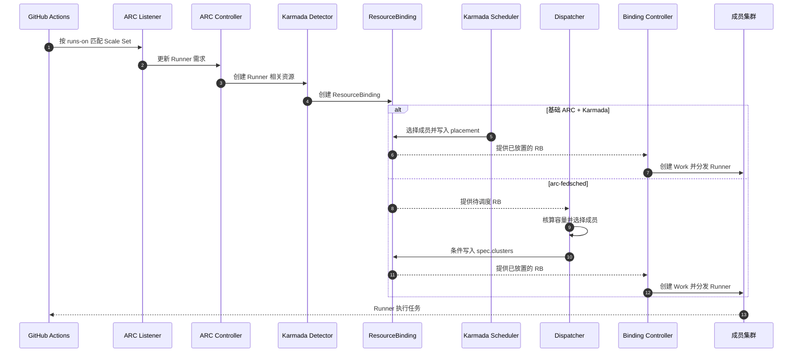

**接口与边界**

- 工作流标签必须与 Scale Set 注册标签一致。
- 基础模式和 Dispatcher 模式分别验证；原生分发不保证均匀分布。

## 4.2 US-02：平台识别任务的 NPU 类型与数量

**外部体验**

工作流选择 Runner 规格后，调度器读取对应的 NPU 类型和数量。真实工作负载 Pod 出现后，账本对齐实际请求。

**运行视图**

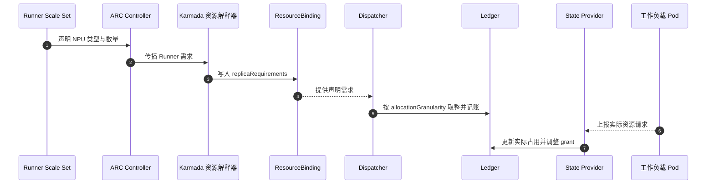

**接口与边界**

- 声明需求、RB `replicaRequirements` 和 hook 模板必须一致。
- 按 `allocationGranularity` 取整；真实 Pod 出现后校正 grant。

## 4.3 US-03：多集群共享队列并保护队列头部

**外部体验**

所有 Runner 请求进入 federation 级队列。系统保护队列头部，并在不冲突时执行后续任务。

**运行视图**

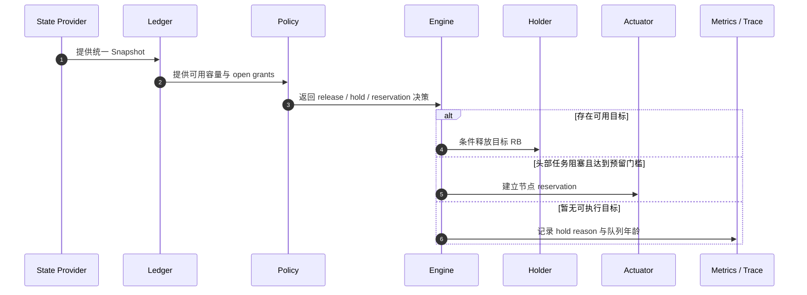

**接口与边界**

- 同一轮决策读取同一 Snapshot 和 Ledger。
- 预留与 backfill 规则通过 Go / Python 差分和边界测试。

## 4.4 US-04：准确核算容量，防止超分与重复计数

**外部体验**

调度器根据节点容量、其他租户负载和未完成的资源承诺计算可用量，避免重复承诺同一份容量。

**运行视图**

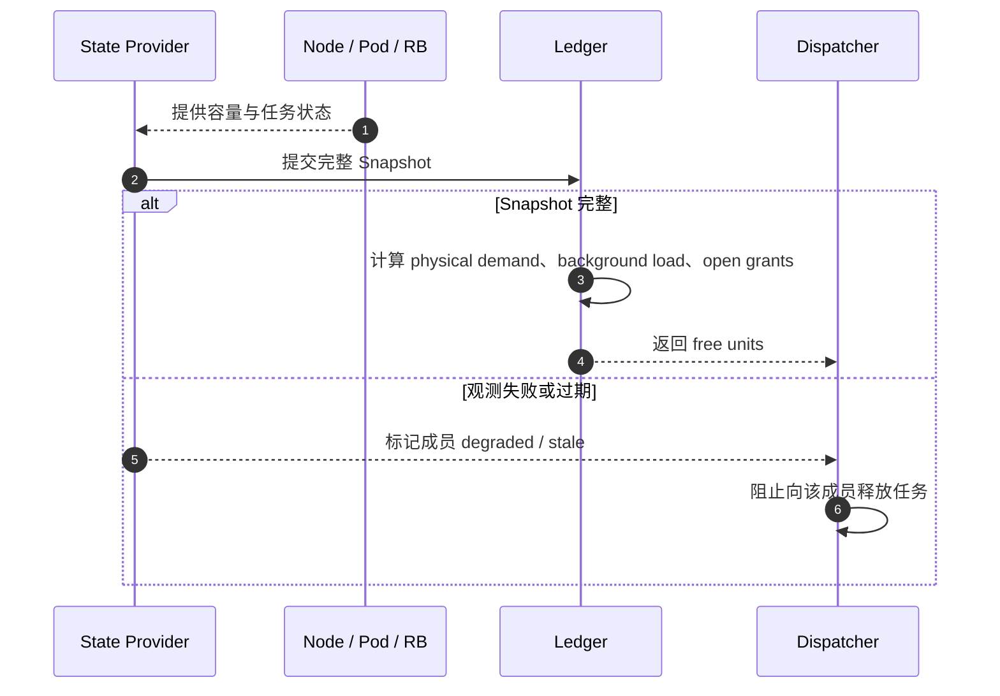

**接口与边界**

- 容量公式统一使用 federation 分配单位。
- Snapshot 不完整或过期时，成员进入 degraded 状态并停止放量。

## 4.5 US-05：选择合适成员并可靠释放 Runner

**外部体验**

系统选择满足硬件和容量约束的成员，并以条件写入释放 ResourceBinding。重复事件不会直接触发第二次放置。

**运行视图**

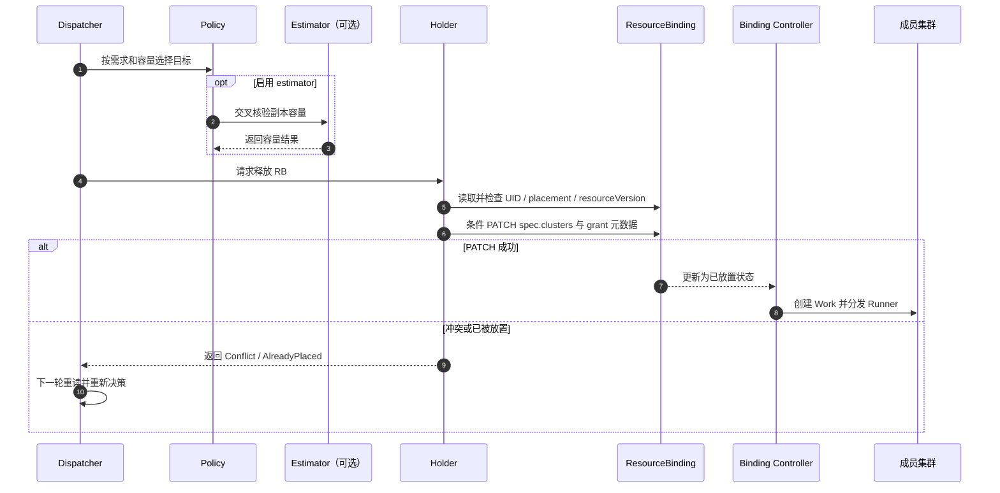

**接口与边界**

- Holder 检查 UID、placement 和 `resourceVersion` 后执行条件 PATCH。
- 覆盖 Gone、AlreadyPlaced、Conflict、409 和 break-glass 交接场景。

## 4.6 US-06：保护队列头部，同时避免预留资源永久闲置

**外部体验**

系统为队列头部任务临时预留节点。预留受配额、租约和清理机制约束。

**运行视图**

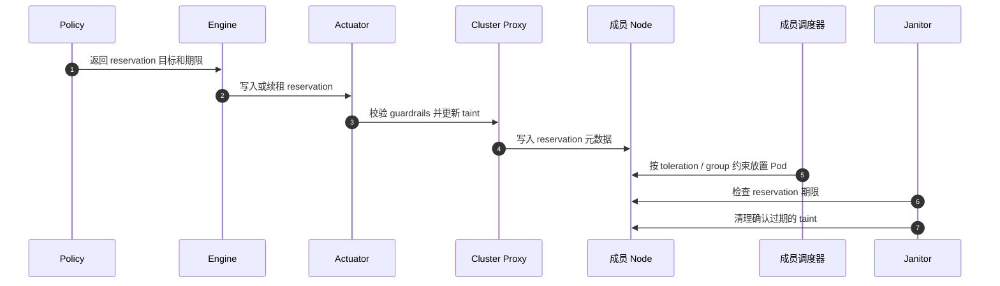

**接口与边界**

- taint、toleration、reservation group 和期限必须匹配。
- 验证真实 hooks 与成员调度器后再启用节点预留。

## 4.7 US-07：取消、超时和异常任务能归还资源

**外部体验**

取消、超时或异常结束后，系统回收 Runner、grant、reservation 和孤儿工作负载，并记录原因。

**运行视图**

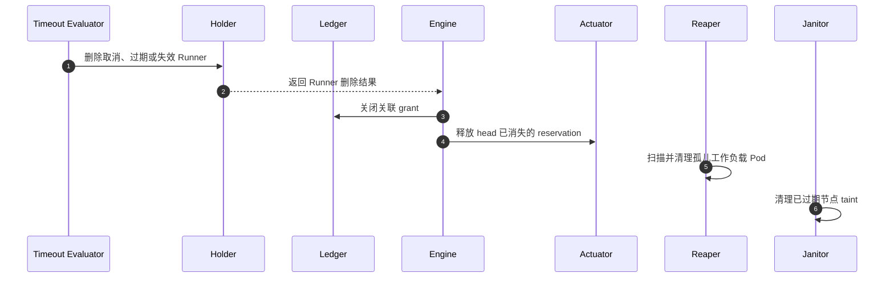

**接口与边界**

- Runner 删除与 grant / reservation 回收保持一致。
- Reaper 和 Janitor 分别清理工作负载 Pod 与过期节点 taint。

## 4.8 US-08：Dispatcher 故障后可恢复调度

**外部体验**

Dispatcher 故障后，新 Leader 重建状态再恢复放置。Watchdog 可按配置启动备用调度器。

**运行视图**

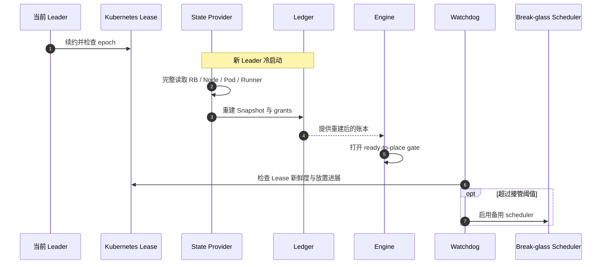

**接口与边界**

- 新 Leader 完成状态重建前不得释放任务。
- 在目标 Karmada 版本验证 Lease、Watchdog 和备用调度器交接。

## 4.9 US-09：运维可解释调度决策并验证策略变更

**外部体验**

运维人员可查看单个 Runner 的时间线，并用同一份 trace 比较策略变化。报告记录输入覆盖率和模型校准状态。

**运行视图**

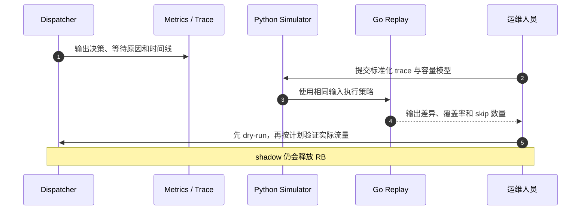

**接口与边界**

- 指标、轨迹不得包含 Secret Data；控制标签基数。
- 回放报告记录输入来源、校准状态、覆盖率和 skip 数量。

## 4.10 US-10：新成员集群可安全加入或退出 federation

**外部体验**

新成员先通过 preflight，再按配置加入资源池。退出时先停止新任务并清理未完成资源。

**运行视图**

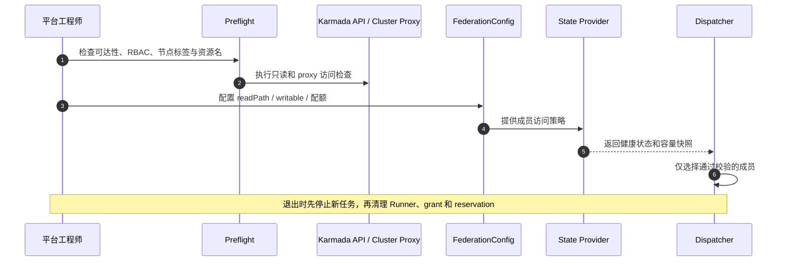

**接口与边界**

- 成员接入前验证 API、proxy、RBAC、节点标签和资源名。
- 退出前停止新流量，并回收 Runner、grant、reservation 和相关权限。

# 5. 用例与实现追踪矩阵

组件实现位于 [`opensourceways/arc-fedsched`](https://github.com/opensourceways/arc-fedsched)。基础原型的运行记录和部署配置位于本仓库的 `docs/`、`manifests/` 和 `evidence/`。

| 用户故事 | 主要组件 | 关键配置 / 证据 | 主要失败风险 |
|---|---|---|---|
| US-01 标签与成员集群解耦 | ARC、Karmada PropagationPolicy、Holder / Dispatcher | [PoC 验证](https://github.com/pkking/arc-karmada-test/blob/main/docs/arc-0.15.0-validation.md)、arc-fedsched/config/example-federation.yaml 的 Scale Sets | 标签不全、不同规格被错误合并、把原生分摊误当成均匀分配 |
| US-02 NPU 需求可见 | ARC 模板、ResourceInterpreterCustomization、pkg/state/karmada、Ledger | [PoC interpreter](https://github.com/pkking/arc-karmada-test/blob/main/manifests/01-karmada-interpreter.yaml)、[DESIGN §3](https://github.com/opensourceways/arc-fedsched/blob/main/docs/DESIGN.md) | 声明与真实 hook 资源请求不一致、取整差异 |
| US-03 全局队列与公平性 | pkg/live、pkg/policy、pkg/dispatcher | [policies/fifo-reserve-node.yaml](https://github.com/opensourceways/arc-fedsched/blob/main/policies/fifo-reserve-node.yaml)、[DESIGN §5-7](https://github.com/opensourceways/arc-fedsched/blob/main/docs/DESIGN.md) | 头部饥饿、错误 backfill、容量预测偏差 |
| US-04 容量核算 | pkg/ledger、pkg/state、pkg/estimates | [BUILD-PLAN §1.5](https://github.com/opensourceways/arc-fedsched/blob/main/docs/BUILD-PLAN.md)、clusters 模型文件 | grant 泄漏、背景负载不可见、重复记账 |
| US-05 RB 可靠释放 | pkg/holder、pkg/live、pkg/estimator | [Holder 实现](https://github.com/opensourceways/arc-fedsched/blob/main/pkg/holder/holder.go)、[DESIGN §5-6](https://github.com/opensourceways/arc-fedsched/blob/main/docs/DESIGN.md) | 过期 placement、并发 PATCH、外部 scheduler 竞态 |
| US-06 节点预留 | pkg/actuator、pkg/policy、pkg/janitor | [Actuator 实现](https://github.com/opensourceways/arc-fedsched/blob/main/pkg/actuator/actuator.go)、配置中的 reservation 部分 | taint 契约失效、活跃节点被清理、资源永久被占用 |
| US-07 超时与孤儿清理 | pkg/timeouts、pkg/holder、pkg/reaper、pkg/janitor | [Timeout 实现](https://github.com/opensourceways/arc-fedsched/blob/main/pkg/timeouts/timeouts.go)、[Reaper 实现](https://github.com/opensourceways/arc-fedsched/blob/main/pkg/reaper/reaper.go) | 误删活跃任务、grant / reservation 未同步回收 |
| US-08 故障接管 | pkg/dispatcher、pkg/watchdog、pkg/state/karmada | [Dispatcher](https://github.com/opensourceways/arc-fedsched/blob/main/pkg/dispatcher/dispatcher.go)、[Watchdog](https://github.com/opensourceways/arc-fedsched/blob/main/pkg/watchdog/watchdog.go) | 新 Leader 未重建就放量、break-glass 交接竞态 |
| US-09 可观测与回放 | pkg/metrics、pkg/engine、pkg/replay、sim/ | [README 测试命令](https://github.com/opensourceways/arc-fedsched/blob/main/README.md)、[SIMULATOR-PLAN](https://github.com/opensourceways/arc-fedsched/blob/main/docs/SIMULATOR-PLAN.md) | 指标缺失、回放输入未校准、shadow 被误认为只读 |
| US-10 成员生命周期 | pkg/config、pkg/state/karmada、pkg/dispatcher、argocd/ | arc-fedsched/config/example-federation.yaml、[PLAYBOOK](https://github.com/opensourceways/arc-fedsched/blob/main/docs/PLAYBOOK.md) | API endpoint 不可达、RBAC 不足、其他租户容量不可见 |

# 6. 当前限制与上线前必须关闭的风险

1. **分开验收基础集成和增强调度。** ARC 0.15.0 的 PoC 不覆盖 `arc-dispatcher`、Ledger、reservation、Watchdog 和 Reaper 的生产端到端行为。
2. **固定并核对版本。** 上线前核实 ARC Controller、Listener、runner-container-hooks、Karmada 和成员调度器的实际版本。历史设计文档中的旧版本结论需重新确认。
3. **验证 hooks 的节点放置行为。** 检查 workflow Pod 的 `spec.nodeName`、affinity、`schedulerName`、NPU request 和 tolerations。该结果决定 reservation 是否有效。
4. **验证 break-glass 交接。** 在目标 Karmada 版本中测试 stock scheduler 与 Dispatcher 对同一 RB 的并发读写、Work 变化和回切。
5. **校准容量模型。** `arc-fedsched/clusters/smoke.yaml` 尚未校准。使用真实节点、Pod 请求、工作流 trace 和 LTS / Prometheus 事件校准等待时间、吞吐量和利用率。
6. **区分 shadow 与 dry-run。** shadow 仍会释放 RB。只读检查使用 `dispatcher --dry-run`，并在隔离环境验证写路径。
7. **评审生产权限。** PoC 的管理凭据和固定网络配置不构成生产安全基线。使用最小权限、Secret 管理、证书轮换和审计策略。
8. **按测试阶梯发布。** 依次完成配置校验、Go 单测 / race / invariants、Python 测试与差分回放、Kind / 故障注入、真实 federation 的 shadow、有限启用和回滚演练。逐阶段记录未覆盖场景。命令退出码为 0 不代表所有场景通过。

## 参考资料

- [ARC + Karmada PoC 文档目录](https://github.com/pkking/arc-karmada-test/tree/main/docs)
- [ARC 0.15.0 + Karmada 运行验证](https://github.com/pkking/arc-karmada-test/blob/main/docs/arc-0.15.0-validation.md)
- [PoC PropagationPolicy 配置](https://github.com/pkking/arc-karmada-test/blob/main/manifests/02-propagation-policies.yaml)
- [PoC AutoscalingRunnerSet 配置](https://github.com/pkking/arc-karmada-test/blob/main/manifests/04-autoscalingrunnerset.yaml)
- [arc-fedsched 仓库架构设计记录](https://github.com/opensourceways/arc-fedsched/blob/main/docs/DESIGN.md)
- [arc-fedsched 仓库工程实施计划](https://github.com/opensourceways/arc-fedsched/blob/main/docs/BUILD-PLAN.md)
- [arc-fedsched 仓库模拟器范围与验证计划](https://github.com/opensourceways/arc-fedsched/blob/main/docs/SIMULATOR-PLAN.md)
- [arc-fedsched 仓库配置示例](https://github.com/opensourceways/arc-fedsched/blob/main/config/example-federation.yaml)
- [arc-fedsched 仓库 README / 当前状态与测试命令](https://github.com/opensourceways/arc-fedsched/blob/main/README.md)
- [Actions Runner Controller](https://github.com/actions/actions-runner-controller)
- [Karmada](https://github.com/karmada-io/karmada)
